<p align="center">
  
</p>

<h1 align="center">RelayProxy</h1>

<p align="center">
  <strong>把分散在各处的设备，安全地连成一张私有网络。</strong>
</p>

<p align="center">
  自建中继代理系统 · 出口和客户端无需公网 IP · 一套控制台管理所有设备
</p>

<p align="center">
  <code>SOCKS5</code> · <code>HTTP</code> · <code>TCP</code> · <code>QUIC</code> · <code>规则分流</code> · <code>多出口</code> · <code>RDP</code>
</p>

<p align="center">
  <a href="#快速开始"><strong>快速开始</strong></a> ·
  <a href="#功能一览">功能</a> ·
  <a href="#使用教程">使用教程</a> ·
  <a href="#常见问题">常见问题</a> ·
  <a href="docs/reference.md">完整参考</a>
</p>

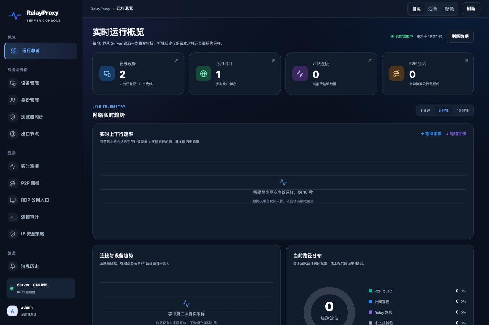

<p align="center"><sub>Server 管理控制台 · 设备、出口、连接和流量一屏掌握</sub></p>

> **一句话**：一台有公网 IP 的服务器 + 每台设备一个 Agent，就能把家里、办公室和云上的设备连成一张可控的私有网络。

---

## 这是什么

RelayProxy 由一个中心 **Relay Server** 和多个 **Relay Agent** 组成：

- **Agent 作为客户端**：在本机提供 SOCKS5 / HTTP 代理，或接管系统流量。
- **Agent 作为出口**：替其他设备访问互联网、公司内网、VPN 或 NAS。
- **Server 负责控制面**：身份、设备审批、能力授权、跨身份授权、会话协调；需要时中继流量。
- **直连优先**：Client 和 Exit 之间优先尝试 P2P / 公网直连，失败自动回退 Relay，不需要你手动切换。

它不要求每台设备都有公网 IP，也不需要在路由器上逐个端口映射。设备主动连接 Server，再由 Server 协调出一条可用的路径。

### 适合谁

| 场景 | 你能做什么 |
| --- | --- |
| 🏠 远程办公 | 通过办公室的 Exit Agent 访问公司 LAN、VPN 和内部系统 |
| 🌐 家庭网络 | 通过家里的 Exit Agent 访问 NAS、路由器、打印机和家庭设备 |
| ☁️ 多云 / 多 VPC | 把云主机作为 Exit，统一从固定入口访问不同云上网络 |
| 🧑‍💻 多设备 / 小团队 | 用身份隔离设备，按能力审批，按规则分流，并保留连接审计 |

### 核心概念

| 概念 | 说明 |
| --- | --- |
| **Server** | 中心服务。保存身份、设备、授权和审计；负责认证、会话协调与必要时中继 |
| **Agent** | 装在设备上的客户端。可以是 Client、Exit，或两者兼具 |
| **Identity** | 16 位公开身份 ID，用来隔离设备空间；登录用户名和密码与它相互独立 |
| **Client** | 发起代理请求的一端，本机监听 SOCKS5 / HTTP |
| **Exit** | 提供网络出口的一端，替 Client 访问最终目标 |
| **Capability** | 设备能力，例如 `proxy.client`、`proxy.exit`、`rdp.host`；审批时逐项勾选 |
| **Route** | 每条连接的去向：`DIRECT`、`PROXY` 或 `REJECT` |

### 它怎么工作

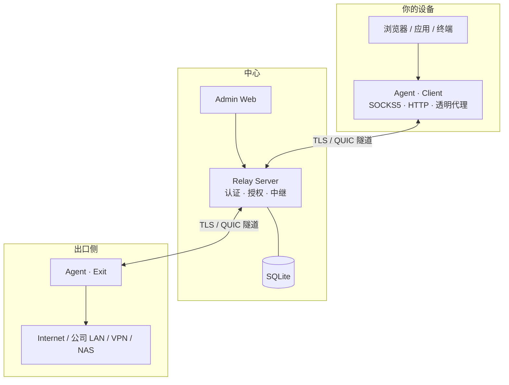

### 首次接入

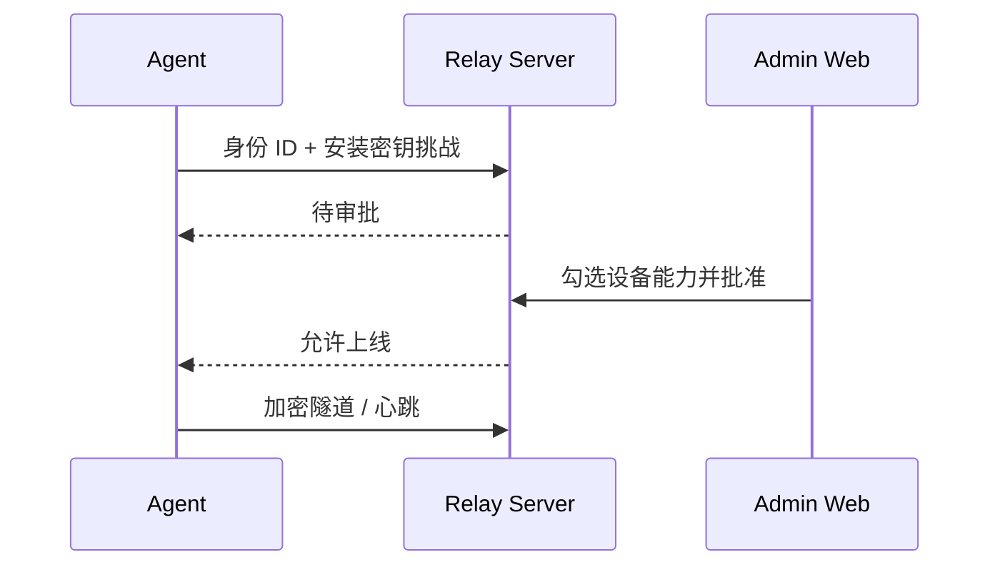

身份只负责隔离，不直接代表权限。设备能力在首次审批或后续编辑时单独勾选；同一身份的已审批设备可以互相使用出口，跨身份访问则需要在目标设备上显式授权。

---

## 功能一览

| 能力 | 一句话 |
| --- | --- |
| 🚀 **多出口** | Home / Office / Cloud 多个 Exit，按默认出口或规则选择 |
| 🔀 **规则分流** | 按进程、域名/IP、端口、TCP/UDP 选择 DIRECT / PROXY / REJECT |
| 🛡️ **身份与审批** | 身份隔离、设备审批、能力授权、跨身份授权、连接审计 |
| 🧭 **透明代理** | Windows 系统级接管，应用无需逐个配置代理 |
| 🖥️ **远程桌面** | 授权后一键连接 RDP 主机，P2P 优先、Relay 兜底 |
| 📁 **文件共享** | 在授权设备之间浏览和传输文件（开发预览） |
| 📨 **消息与验证码** | Server 推送消息到指定设备，自动提取验证码 |
| 📊 **可视化管理** | Admin Web、Agent GUI/Web、实时连接、流量和日志 |

### 连接与路径

- **TCP / QUIC 双通道**：`auto` 模式优先 QUIC，失败自动回退 TCP。
- **P2P / 公网直连**：Client 和 Exit 能直连时不绕 Server；直连不可用自动回退 Relay。
- **多出口切换**：同一 Client 可以把不同连接送到不同 Exit。
- **拥塞控制**：默认 BBR Aggressive；在明确知道真实带宽时可选择 Hysteria Brutal。

### 代理与分流

- 本机 SOCKS5：`127.0.0.1:1080`；HTTP Proxy：`127.0.0.1:8080`。
- 规则字段之间是 **AND**，同一字段多个值是 **OR**；按顺序匹配，第一条命中生效。
- 支持进程名/路径、域名、IPv4/IPv6、CIDR、端口范围、TCP/UDP。
- 支持 GFWList / 域名 / IP 订阅，按规则优先、订阅兜底。
- 透明代理可以把系统流量交给同一套规则。

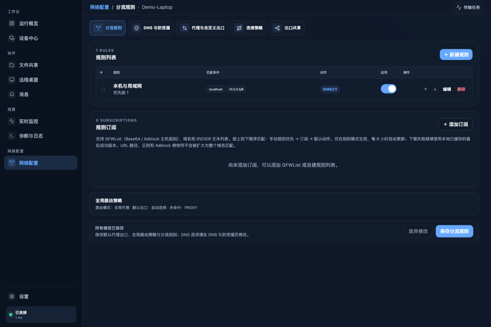

<p align="center"><sub>Agent · 分流规则：默认规则、订阅和全局策略都在一个页面</sub></p>

### 身份与权限

- 首次连接进入待审批列表；管理员逐项勾选设备能力。
- 同一身份的设备可以直接使用彼此的出口和 RDP。
- 跨身份访问必须在目标设备上授权，可设置能力与过期时间。
- Server ACL 与 Exit ACL **取交集**：两边都允许才真正放行。
- 连接、RDP、撤销和授权变更都有审计记录。

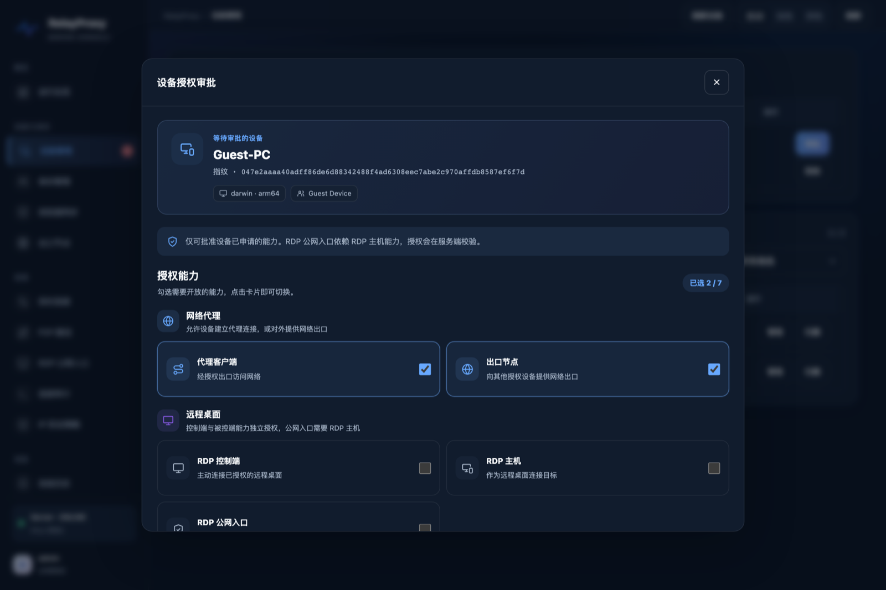

<p align="center"><sub>Server · 设备审批：只批准设备实际申请的能力</sub></p>

### 远程访问

- **RDP**：授权 Controller / Host 能力后，Agent GUI 直接显示可连接目标；Windows 自动打开 `mstsc`。
- **RDP 公网入口**：把指定 RDP Host 暴露到固定端口，支持来源 CIDR、限速和过期时间（默认关闭）。
- **文件共享**：按设备授权文件夹，支持远程浏览、下载、上传和续传（开发预览）。
- **浏览器同步**：Chrome 扩展 / Browser Sync，属于预览能力，默认关闭。

### 管理与可观测

- **Admin Web**：设备、身份、出口、会话、RDP、消息、审计、服务配置。
- **Agent GUI / 本地 Web**：连接状态、出口切换、规则、实时监控、日志。
- **实时连接**：查看进程、目标、命中规则、路径、速率和流量。
- **消息与验证码**：Server 统一分发，Agent 弹窗复制验证码。

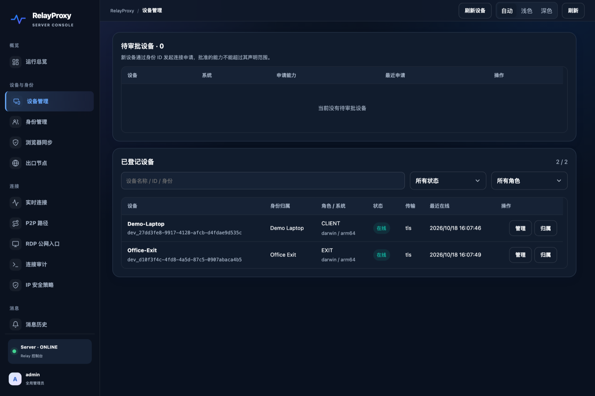

<p align="center"><sub>Server · 设备管理：在线状态、身份归属、角色和传输方式</sub></p>

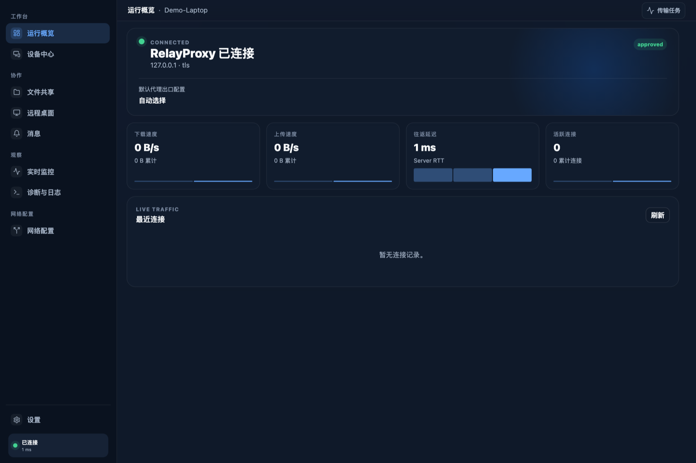

<p align="center"><sub>Agent · 运行概览：连接状态、速率、延迟和活跃连接</sub></p>

### 平台

| 平台 | Server | Agent | 图形界面 | SOCKS5 / HTTP | 系统透明代理 |
| --- | --- | --- | --- | --- | --- |
| Windows x64 | ✅ | ✅ | Wails GUI | ✅ | ✅ |
| Windows ARM64 | ✅ | ✅ | Wails GUI | ✅ | — |
| Linux x64 | ✅ | ✅ | 本地 Web | ✅ | ✅ |
| Linux ARM64 | ✅ | ✅ | 本地 Web | ✅ | ✅ |
| macOS Intel / Apple Silicon | 实验产物 | ✅ | App / Web | ✅ | 需系统扩展环境 |

> Windows ARM64 建议使用 SOCKS5 / HTTP；macOS 透明代理依赖 Network Extension，需要额外签名和授权。

---

## 快速开始

下面用**两台设备 + 一个 Server**跑通最小闭环：

- 一台机器做 **Exit**（提供网络出口）；
- 一台机器做 **Client**（本机代理）；
- 两台设备使用**同一个身份 ID**；
- 公网/正式环境请直接看[正式上线](#tls)。

只有一台机器时，可以再准备一台虚拟机或另一台电脑；不要让同一个 Agent 既当 Client 又当 Exit，自动选择会跳过自身。


### 准备

- Server：一台有公网 IP 或域名的机器；本机/内网测试也可以。
- 端口：示例使用 `20000/TCP`（隧道）和 `20001/TCP`（Admin）。
- 客户端：Windows / macOS / Linux 均可。
- 二进制：从 Release 下载，或本地构建：

```bash
# Linux / macOS
./scripts/build.sh

# Windows PowerShell
.\scripts\build.ps1
```

产物在 `dist/<平台>/`。首次体验可以直接用 `relay-server` 和 `relay-agent` 两个二进制。

### 1. 启动 Server

先创建一个**仅用于本机/内网测试**的配置（关闭 TLS，便于快速验证）：

```yaml
# relay-server.yaml
server:
  tls_enabled: false

  tls:
    listen: ":20000"      # TCP 隧道
  admin:
    listen: ":20001"      # Admin Web
    tls_enabled: false

database:
  driver: sqlite
  dsn: "relayproxy.db"

relay_acl:
  allow_internet: true
```

启动：

```bash
export RELAY_ADMIN_PASSWORD='请替换为强密码'
./relay-server -config relay-server.yaml
```

Windows PowerShell：

```powershell
$env:RELAY_ADMIN_PASSWORD = "请替换为强密码"
.\relay-server.exe -config .\relay-server.yaml
```

打开：

```text
http://<Server-IP>:20001
```

默认管理员用户名是 `admin`。如果没有设置 `RELAY_ADMIN_PASSWORD`，Server 首次初始化数据库时会生成随机密码并在控制台打印一次。

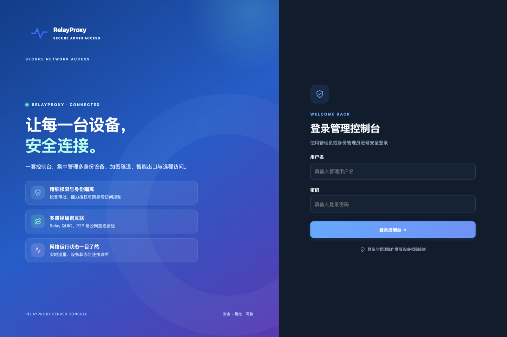

<p align="center"><sub>Server 控制台登录页</sub></p>

> ⚠️ 上面的 `tls_enabled: false` 只适合首次体验或完全受信的局域网。公网部署请启用 TLS，见[正式上线](#tls)。

### 2. 创建身份

登录后进入 **身份管理 → 创建身份**，填写：

- 身份名称：例如 `Home`；
- 登录用户名：例如 `home-demo`；
- 初始密码：至少 8 位。

创建成功后会得到 16 位身份 ID（例如 `a1b2c3d4e5f6g7h8`）。这个 ID 用于 Agent 连接；登录用户名/密码用于管理控制台，两者相互独立。

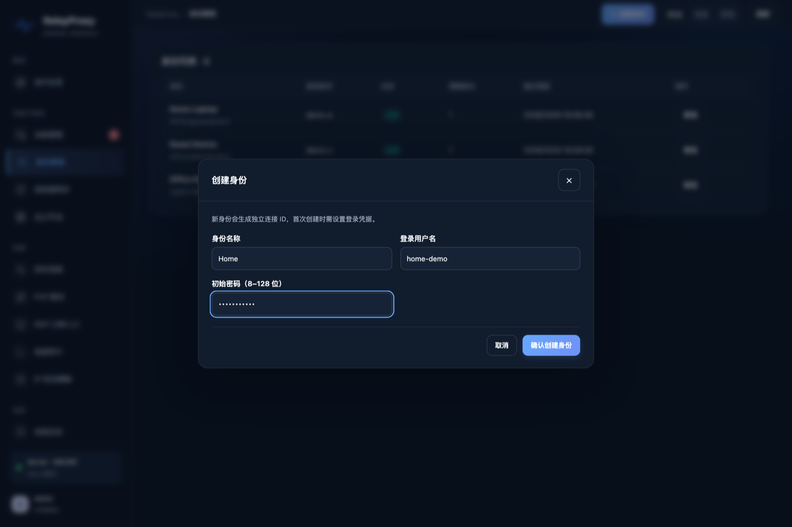

<p align="center"><sub>创建身份：身份 ID 自动生成，登录账号单独设置</sub></p>

### 3. 启动 Exit Agent

在**提供出口**的机器上创建配置：

```yaml
# relay-agent.yaml（Exit）
server:
  address: "<Server-IP>"
  tcp_port: 20000
  quic_port: 20000
  tls_enabled: false

device:
  identity_id: "a1b2c3d4e5f6g7h8"   # 上一步的 16 位身份 ID
  name: "Office-PC"

transport:
  mode: tcp_only

exit:
  enabled: true
  allow_internet: true
  allow_private_network: false

proxy:
  socks5:
    enabled: false
  http:
    enabled: false
```

启动：

```bash
./relay-agent --no-gui --config ./relay-agent.yaml
```

Agent 默认会在 `127.0.0.1:9090` 提供本地 Web 管理页。Windows 用户也可以直接打开 `relay-agent-gui.exe`，在「连接与身份」中填写 Server 地址和身份 ID。

### 4. 审批出口设备

打开 Server 的 **设备管理 → 待审批设备**，找到刚上线的设备，点击 **审批**，勾选 **出口节点**，然后批准。


<p align="center"><sub>只批准设备实际需要的能力；这里选「出口节点」</sub></p>

批准后 Exit Agent 会自动上线。Server 的「出口节点」页面应该能看到它。

### 5. 启动 Client Agent

在**需要代理的机器**上创建配置，使用**同一个身份 ID**：

```yaml
# relay-agent.yaml（Client）
server:
  address: "<Server-IP>"
  tcp_port: 20000
  quic_port: 20000
  tls_enabled: false

device:
  identity_id: "a1b2c3d4e5f6g7h8"
  name: "My-Laptop"

transport:
  mode: tcp_only

proxy:
  socks5:
    enabled: true
    listen: 127.0.0.1
    port: 1080
  http:
    enabled: true
    listen: 127.0.0.1
    port: 8080
```

启动：

```bash
./relay-agent --no-gui --config ./relay-agent.yaml
```

然后回到 Server 的 **设备管理 → 待审批设备**，批准这台设备，勾选 **代理客户端**。

### 6. 开始代理

批准后，Client 默认会自动选择唯一可用的出口。测试：

```bash
# SOCKS5（推荐：让远端解析域名）
curl -x socks5h://127.0.0.1:1080 https://ipinfo.io

# HTTP
curl -x http://127.0.0.1:8080 https://ipinfo.io
```

浏览器中手动配置代理：

```text
SOCKS5  127.0.0.1:1080
HTTP    127.0.0.1:8080
```

如果返回的 IP 是 Exit 机器的出口 IP，说明链路已经打通。Agent 的「运行概览」会显示连接状态和流量。

<a id="tls"></a>
### 正式上线：启用 TLS

公网部署至少要做三件事：**启用 TLS、配置证书、限制管理入口**。

Server：

```yaml
server:
  tls_enabled: true

  tls:
    listen: ":443"        # TCP 隧道
  quic:
    listen: ":443"        # UDP / QUIC
  admin:
    listen: ":8443"
    tls_enabled: true

  cert_file: "/etc/relayproxy/fullchain.pem"
  key_file: "/etc/relayproxy/privkey.pem"
```

Agent：

```yaml
server:
  address: "relay.example.com"
  tcp_port: 443
  quic_port: 443
  tls_enabled: true

transport:
  mode: auto
```

防火墙至少放行：

```text
443/TCP   隧道（TLS）
443/UDP   QUIC（可选，但建议）
8443/TCP  Admin Web
```

说明：

- 证书域名必须与 Agent 的 `server.address` 匹配；使用自建 CA 时，需要把 CA 安装到 Agent 的系统信任库。
- 管理端建议只对管理网络开放，或放在反向代理 / VPN 后面。
- `insecure_tls`（Agent）只用于测试自签名环境，不要用于生产。
- 如果暂时不用 QUIC，Agent 设置 `transport.mode: tcp_only` 即可，不影响功能。

---

## 使用教程

### 选择和切换出口

Client 的出口有三种确定方式：

1. **默认出口**：在 Agent 配置里指定设备 ID：

```yaml
proxy:
  default_exit_id: "dev_xxxxxxxxx"
```

2. **自动选择**：没有默认出口时，如果只有一个已授权且在线的出口，自动使用它。
3. **规则指定**：在分流规则里给某条规则设置 `exit_id`。

GUI 的 **设备中心** 会列出当前身份可用的出口；跨身份访问需要在目标设备上单独授权。

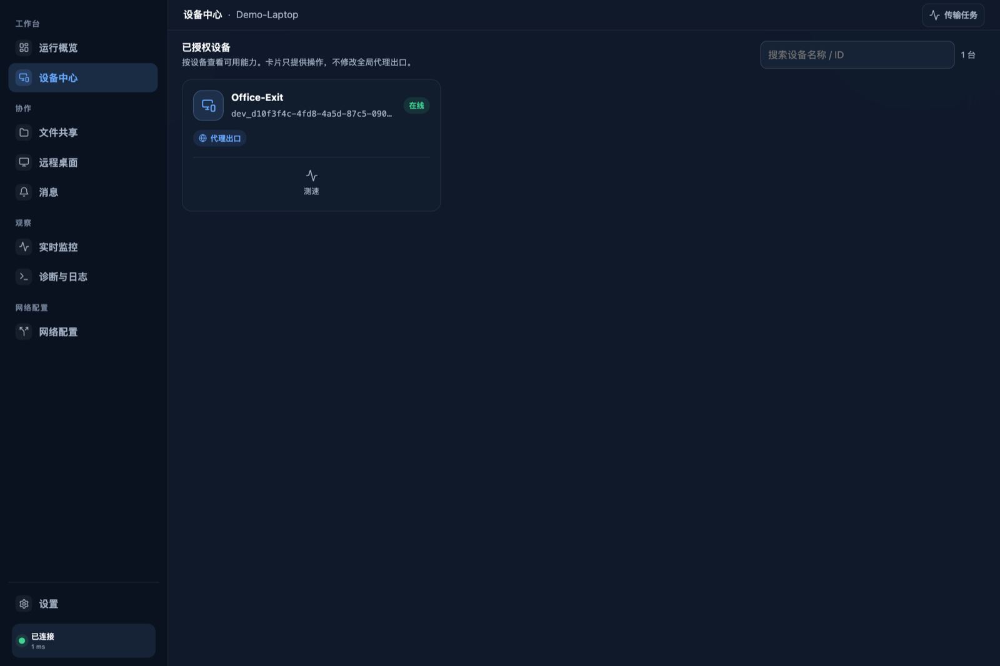

<p align="center"><sub>Agent · 设备中心：只展示已授权的出口设备</sub></p>

跨身份授权步骤：

```text
Server → 设备管理 → 目标设备「管理」
→ 跨身份授权 → 选择被授权身份
→ 勾选「代理出口」→ 设置过期时间 → 保存
```

被授权身份的设备重新拉取清单后即可看到该出口。

### 按规则分流

在 Agent 的 **网络配置 → 分流规则** 新建规则。字段之间是 **AND**，同一字段多个值是 **OR**：

```yaml
routing:
  mode: rule
  default_action: DIRECT

  rules:
    - name: "工作域名走办公室"
      enabled: true
      processes:
        - "chrome*"
      targets:
        - "*.corp.example"
        - "10.0.0.0/8"
      ports:
        - "443"
        - "8000-9000"
      protocols:
        - tcp
      action: PROXY
      exit_id: "dev_office"
```

规则按顺序执行，第一条命中生效。支持的动作：

| 动作 | 含义 |
| --- | --- |
| `DIRECT` | 本机直接连接 |
| `PROXY` | 通过指定 / 默认出口访问 |
| `REJECT` | 阻断 |


<p align="center"><sub>分流规则：支持手动规则、订阅和全局默认策略</sub></p>

更多字段、订阅格式和 DNS 模式见 [完整参考](docs/reference.md) 与 [DNS 独立模式](docs/dns-independent-modes.md)。

### 访问公司内网 / VPN

访问私网需要 **Server ACL** 和 **Exit ACL** 同时允许，最终权限取交集：

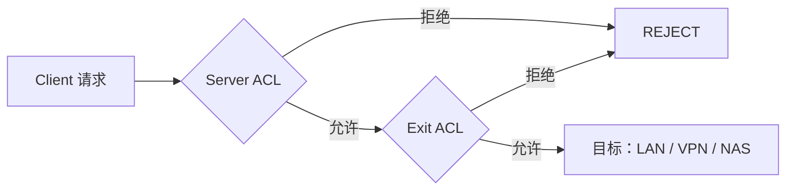

Server：

```yaml
relay_acl:
  allow_internet: true
  allow_private_network: true
  allow_loopback: false
```

Exit Agent：

```yaml
exit:
  enabled: true
  allow_internet: true
  allow_private_network: true
  allow_loopback: false
```

只想开放指定网段时，在两边同时配置 `access.cidrs` / `access.domains`。不要为了方便直接打开 `allow_loopback` 或把整个私网暴露给所有身份。

### Windows 系统透明代理

Windows x64 可以把系统流量交给 RelayProxy，无需在浏览器或应用里逐个设置代理。

```yaml
network:
  mode: divert

  exclude_processes:
    - updater.exe
    - backup.exe
```

GUI 对应：

```text
网络配置 → 代理与自定义出口
→ Windows 系统透明代理
```

要求：

- Windows x64；
- 管理员权限；
- Windows Network Service / WinDivert 已安装并运行。

透明代理的流量同样走统一分流规则：

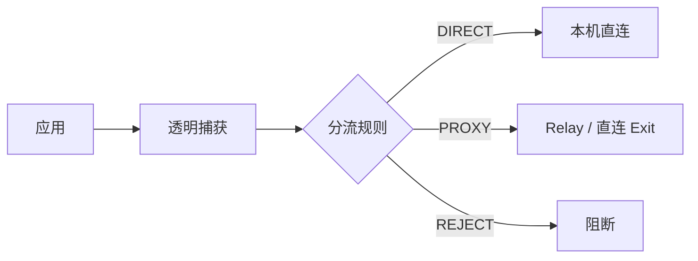

DNS、FakeIP、IPv6 和进程识别的边界见 [Windows 透明代理说明](docs/windows-transparent-proxy.md) 与 [Linux 透明代理说明](docs/linux-transparent-proxy.md)。

### 一键远程桌面

RDP 不需要在公网暴露 3389。授权后，Agent GUI 会显示可连接的主机：

1. **目标设备**：批准 `RDP 主机` 能力，并确保本机 RDP 已开启。
2. **控制设备**：批准 `RDP 控制端` 能力。
3. 同身份直接可见；跨身份在目标设备上授权 `RDP 连接`。
4. 打开 Agent 的 **远程桌面**，点击 **一键连接**；Windows 会自动打开 `mstsc`。

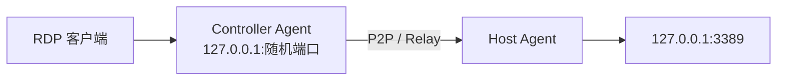

默认目标固定为 `127.0.0.1:3389`，不会下发给 Controller，因此不能把 RDP 授权变成任意端口转发。跨 NAT 想走 P2P 时，在 Server 配置 RDP rendezvous：

```yaml
rdp:
  rendezvous_listen: ":3478"
  rendezvous_advertise: "relay.example.com:3478"
```

如果需要公网固定端口入口，再启用：

```yaml
rdp:
  ingress:
    enabled: true
    listen: "0.0.0.0:0"
    port_start: 20100
    port_end: 20200
    source_cidrs:
      - "203.0.113.0/24"
    rate_limit_per_minute: 120
```

然后在 Server 的 **RDP 公网入口** 页面为指定设备创建入口。公网环境务必设置来源 CIDR，不要无条件暴露 RDP。

### 文件共享、消息与浏览器同步

这些能力按需开启，默认不启用：

- **文件共享（开发预览）**：批准 `文件访问端` / `文件共享端`，在 Agent 的「文件共享」里添加目录并按设备授权。文件夹权限由共享拥有者在本机执行，跨身份共享暂未开放。
- **消息 / 验证码**：Server 的「推送渠道」可以配置目标设备、验证码规则和内容分流；外部系统通过渠道 URL 推送。详见[完整参考](docs/reference.md)。
- **浏览器同步（预览）**：Chrome 扩展与 Browser Sync 默认关闭，需要 TLS 和扩展 ID 配置；详见 [Browser Sync 文档](docs/browser-session-sync-design-development.md)。

---

## 常见问题

### Agent 提示“身份接入未完成” / 一直在待审批

检查三件事：

1. Agent 填写的是 **16 位身份 ID**，不是登录用户名；
2. 该身份在 Server 中处于启用状态；
3. Server 的 **设备管理 → 待审批设备** 中已经勾选能力并批准。

### Agent 无法连接 Server

按顺序检查：

- Server 是否运行；
- Agent 的 `server.address` / `tcp_port` 是否正确；
- 防火墙是否放行隧道端口；
- 两端 `tls_enabled` 是否一致；
- 域名是否解析到正确地址。

### QUIC 不通，但 TCP 可以

QUIC 使用 UDP。UDP 被防火墙或运营商阻断时，把 Agent 改成：

```yaml
transport:
  mode: tcp_only
```

功能不受影响，只是少一条更快的路径。

### 能连上，但应用无法访问网络

常见原因：

- 没有在线的 Exit，或 Client 没有被授权使用该 Exit；
- Exit 没有批准 `出口节点`，或 Client 没有批准 `代理客户端`；
- 访问私网时，Server ACL 或 Exit ACL 只开了一边；
- 默认出口为空且有多个可用出口，需要显式选择。

### 删除设备后为什么又出现在待审批

删除设备会删除登记记录，但设备本机的安装身份仍在。它下次连接时会重新发起申请，等待审批。要彻底阻止，请撤销授权并清理对应安装身份，或删除该身份。

### Windows 透明代理无法启动

确认：

- 使用 Windows x64；
- 以管理员权限安装 / 修复 Network Service；
- WinDivert 驱动已正确安装；
- 不是 Windows ARM64（建议使用 SOCKS5 / HTTP）。

更多问题见 [完整参考的常见问题](docs/reference.md#20-常见问题)。

---

## 进阶与参考

### 完整配置

- [Server 配置示例](configs/relay-server.yaml)
- [Agent 配置示例](configs/relay-agent.yaml)
- [完整参考手册](docs/reference.md)：完整配置、CLI、推送 API、RDP 入口、FAQ

### 常用命令

```bash
# 交互式安装并后台启动
relay-agent install

# 指定配置目录
relay-agent --config-dir ./my-config

# 无 GUI 运行
relay-agent --no-gui --config ./relay-agent.yaml

# 后台运行
relay-agent --background --config ./relay-agent.yaml

# 临时覆盖
relay-agent --server relay.example.com --exit dev_xxxxx
relay-agent --socks5 127.0.0.1:1081 --http 127.0.0.1:8081
```

### 构建与测试

```bash
go build ./...
go test ./... -count=1
go vet ./...

# 发布构建
./scripts/build.sh          # Linux / macOS
.\scripts\build.ps1         # Windows
```

要求 Go 1.27+。

### 文档

| 文档 | 内容 |
| --- | --- |
| [完整参考](docs/reference.md) | 原完整 README：配置、CLI、推送 API、FAQ |
| [DNS 独立模式](docs/dns-independent-modes.md) | 本地 / 远端 / FakeIP DNS 行为 |
| [Windows 透明代理](docs/windows-transparent-proxy.md) | WinDivert、Network Service、DNS |
| [Linux 透明代理](docs/linux-transparent-proxy.md) | iptables / nftables 接管 |
| [RDP 网络性能](docs/rdp-network-performance-design.md) | P2P、Relay、UDP 路径 |
| [文件共享设计](docs/agent-file-sharing-design.md) | 目录授权、传输与续传 |
| [Browser Sync](docs/browser-session-sync-design-development.md) | 浏览器同步开发说明 |
| [连接吞吐修复](docs/connection-throughput-fixes.md) | BBR / Brutal / 续传优化 |

### 上线前安全检查

- [ ] 隧道启用 TLS，并使用受信任证书；
- [ ] 设置强 `RELAY_ADMIN_PASSWORD`，管理端不直接暴露公网；
- [ ] 只放行必要端口（隧道、Admin、RDP 入口）；
- [ ] 不需要私网访问时保持 `allow_private_network: false`；
- [ ] 保持 `allow_loopback: false`；
- [ ] RDP 公网入口默认关闭，开启时限制 `source_cidrs`；
- [ ] 定期备份 SQLite 数据库，检查设备与授权列表；
- [ ] 不在公网使用 `insecure_tls`。

---

<p align="center"><sub>RelayProxy · 自建、可控、够简单的私有网络入口</sub></p>

使用与分发请遵循仓库中的许可证及第三方组件许可。
