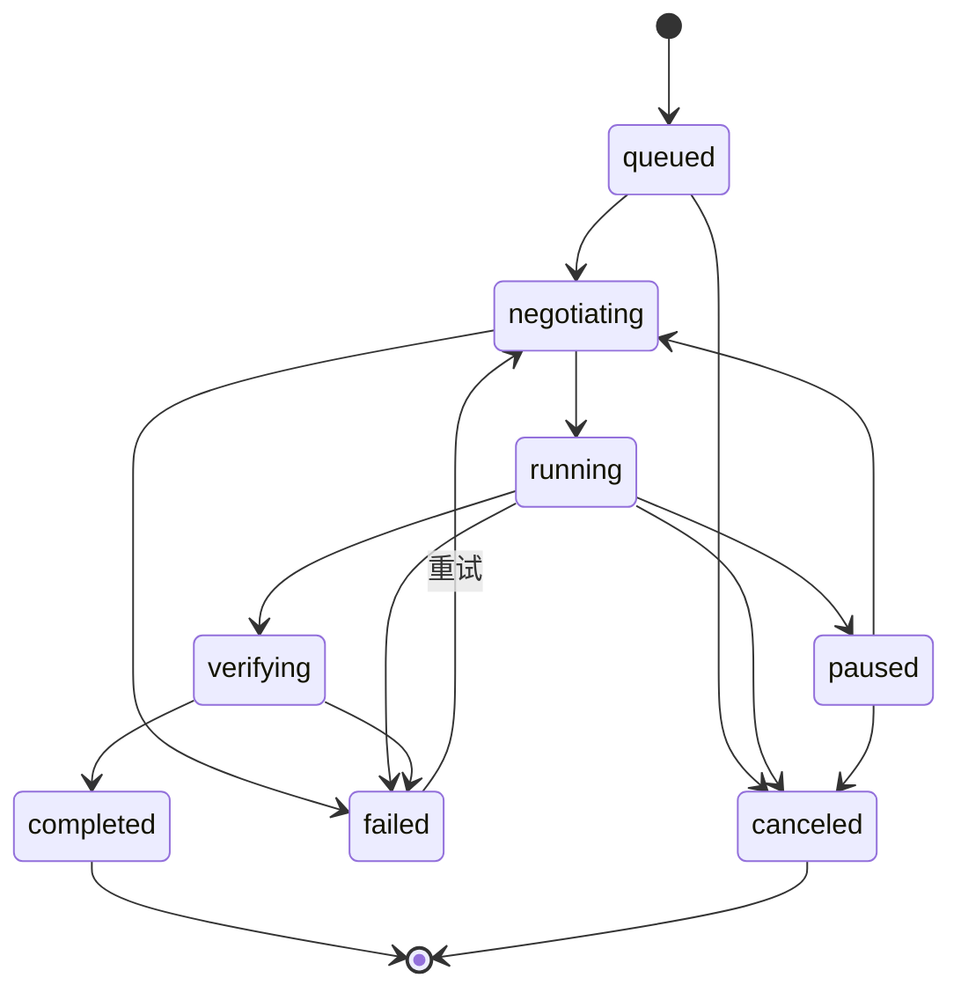
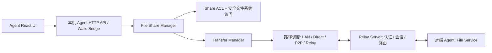

# RelayProxy Agent 文件共享：原型与可开发设计

> 状态：**P0 开发中**。本机共享、Server 能力审批、同身份设备发现、Relay 文件浏览与下载和进度任务代码已提交，仍需完成 CI 与真实双端验收；上传、公网直连/P2P 文件通道仍未完成。
>
> 参考当前 `main`：`agent/gui/frontend/src/App.jsx`、`agent/gui/frontend/src/styles.css`、`agent/gui/frontend/src/bridge.js`（后者仅按 App.jsx 的调用方式推断）；以及 README 中的设备身份、Server 审批、P2P / 公网直连 / Relay 路径。设计中的接口和配置名称均为**新增建议**，不是已存在的 API。

## 1. 目标与范围

在已有 Agent（Windows GUI、macOS 窗口、Linux 本地 Web）里加入「文件共享」，让授权的 Agent 之间浏览共享文件夹并传输文件，无需搭建 SMB、FTP 或暴露文件服务器端口。

- 可以添加任意多个本机共享文件夹，独立命名、启停、修改路径、删除**共享配置**（不触碰真实文件）。
- 每个共享文件夹以**目标设备 ID**分配 `none` / `read` / `read_write` 权限；默认 `none`，`read_write` 也包含读取。
- 其他设备只能看见自己有访问权限的共享及目录内容。只读允许浏览/下载；读写在首版即可上传文件（原子落盘，覆盖需确认）；新建目录、重命名、删除（需确认）作为第二阶段扩展。
- 传输任务显示已传/总大小、百分比、平滑后的实时速率、剩余时间、连接路径（局域网 / P2P / 公网直连 / Relay）、失败原因；支持暂停、续传、取消。
- 本机 Agent 执行最终访问控制和路径边界校验，Server 负责设备身份、能力审批、访问路由与流量回退。

**默认策略**：文件共享功能默认关闭；新文件夹默认不授权任何设备；同身份的已批准设备也必须由共享所有者显式授权文件夹。跨身份共享暂不开放，后续须在 Server 增加独立跨身份审批，再与文件夹 ACL 取交集。

## 2. 已有界面适配

现有 UI：React 18 / Vite、Wails 与本地 Web 共用 `agent/gui/frontend`；导航由 App.jsx 的 `NAV` 数组生成，页面组件、`PageHead`、`Card`、`Badge`、`Button`、`Switch`、`Modal` 和 `styles.css` 已有通用风格。

**导航**：在「本机」组的「远程桌面」下新增 `['files','folder','文件共享']`；观察组仍保留「实时监控」，新功能的传输任务独立在文件共享内，不混入网络连接监控。

**单页三视图**：

| 视图 | 模块 | 核心操作 |
| --- | --- | --- |
| 我的共享 | 文件夹列表及状态 | 添加 / 编辑 / 删除共享、启用 / 停用、打开设备权限弹窗 |
| 其他设备 | 授权设备卡片 + 左侧共享目录 + 右侧文件浏览器 | 搜索、面包屑导航、下载；读写时上传 / 新建文件夹 / 删除 |
| 传输任务 | 状态筛选 + 单任务进度 | 查看速率 / 剩余时间 / 路径、暂停 / 继续 / 取消、查看完成记录 |

界面沿用当前 CSS 变量（例如 `--brand: #1677ff`、`--bg: #f4f7fb`，深色模式下覆盖变量）、242px 左侧导航、52px 顶栏、卡片圆角和按钮外观。不能使用只在 Windows Wails 下存在的 API 作为唯一入口：**本地 Web 必须能够完成同等核心操作**。

### 交互规则

1. **添加共享**：选择本机目录、填写名称，验证绝对路径与重叠风险；成功后默认不授权其他设备。路径不发送到 Server 或其他设备，远端只见共享名与不透明 `share_id`。
2. **授权**：权限弹窗列出当前身份下 Server 已批准的设备（显示离线设备），按设备选择“不允许 / 只读 / 读写”；保存后立即通过同一个实时策略更新机制刷新远端列表。
3. **删除共享**：只删除共享关系，不删除磁盘内容；停止对应未完成传输。
4. **远端浏览**：只列出已被授权的文件夹。离线时可显示已知设备状态，但不得用旧缓存继续授权或发起传输；服务端、目录拥有者双重校验。
5. **下载**：点击文件加入任务列表，展示速率、已传字节数、百分比与 ETA；已存在同名本地目标时提示跳过 / 重命名 / 覆盖，默认重命名。Chrome/Wails GUI 可选择本机目录；浏览器本地 Web 受浏览器文件 API 限制，采用流式浏览器下载。
6. **上传**：只有读写可见。Wails 使用本机文件选择器，本地 Web 使用浏览器文件选择器；前端只传所选文件句柄 / Blob，不直接向远端泄露绝对本机路径。
7. **多选下载**：P1 可支持多文件排队（多个文件独立任务），无需首版 ZIP 打包。文件夹递归下载放到 P1，并加文件总数 / 总大小限制。
8. **传输失败/断线**：显示失败原因，短暂断线尝试重新协商传输路径；恢复时验证源文件版本和已完成分块。

## 3. 授权与安全边界

### 3.1 两级授权

建议新增设备级能力：

- `files.client`：设备可请求浏览 / 下载 / 上传已授权文件共享。
- `files.host`：设备可在本机启用文件共享并作为传输目标。

与现有 `rdp.controller` / `rdp.host` 的控制思路相同，但**文件夹具体权限只由共享拥有者 Agent 定义和执行**。

最终授权条件为：

```text
允许操作 = 发起设备已认证且 Server 批准 files.client
        AND 目标设备已认证且 Server 批准 files.host
        AND 两设备归属同一身份（P0）
        AND 目标共享已启用
        AND 目标 Agent 的 share_id × 源设备 ID 权限允许该操作
        AND 规范化路径仍位于共享根目录内
```

Server 的会话身份源于已验证的设备连接，不接受客户端传入的 `actor_device_id` 作为权限依据。跨身份在 P0 明确拒绝，而不是“只要知道设备 ID 即可访问”。

权限撤销、停用文件夹、移除目标设备或身份失效时，目标 Agent 应**立即停止**相关列目录、下载和上传任务，不等待下次重启；建立共享操作级 session/lease，检查授权版本（`policy_revision`）和中途失效事件。

### 3.2 文件系统隔离

- 完全不暴露任意绝对路径读取接口；客户端只使用 `share_id` + 相对路径 / 不透明文件项 ID。
- 路径输入校验：禁止绝对路径、`..`、NUL、不规范分隔符及 Windows 特殊保留名；做 Unicode 与大小写平台兼容处理。
- 默认**拒绝符号链接、目录联接点、reparse point** 穿越共享根目录；不能只调用 `filepath.Clean` 或先校验再 `os.Open`（TOCTOU）。Linux 参考 `openat2` / `RESOLVE_BENEATH`，Windows 用 handle-based file ID 与 reparse 检查，macOS 使用逐层安全打开方式。
- 拒绝访问存储的 `.part` / 元数据等临时文件，隐藏敏感 dotfiles 可作为共享配置但不能视为安全边界。
- 上传先写根目录下隔离临时文件、校验哈希、`fsync` 和原子替换；默认遇到同名提示，不静默覆盖。预留磁盘空间、限制并发与磁盘写入负载。
- 默认不开放公开下载链接，不新增 TCP/UDP 公网监听端口，不复用本机 Agent Web 的不安全 LAN 管理端口承载跨设备文件服务。
- 初版避免默认暴露复杂目录操作如 chmod、符号链接创建或任意命令执行。

### 3.3 数据隐私与加密

既有 Relay 会话具有链路安全能力，但不能仅凭 QUIC / TLS 推断 Server 无法读取明文。**建议文件数据流单独设计端到端加密**：基于 Server 已校验的设备公钥绑定临时密钥协商，对元数据请求与文件块均进行会话认证与加密；Server 只负责寻址、限流与回退转发，不记录文件内容。若首期沿用现有会话链路，必须明确其信任模型，不能宣传为 E2E。

## 4. 配置和数据模型（建议）

```yaml
file_sharing:
  enabled: false                    # 默认关闭
  download_dir: "/Users/me/Downloads/RelayProxy"
  max_concurrent_transfers: 3
  max_concurrent_per_device: 2
  bandwidth_limit_bytes_per_sec: 0  # 0=不单独限速
  shares:
    - id: "share_01j..."            # 稳定的随机 ID
      name: "工作资料"
      root_path: "/Users/me/Documents/Projects"  # 仅存本机
      enabled: true
      permissions:
        "device_abc": "read"
        "device_def": "read_write"
```

同一目录多次共享需提示或禁止重复；包含 / 被包含的共享根目录默认拦截，避免 ACL 意外覆盖。文件夹 ID 在重命名和修改描述时保持不变，**修改根路径**视为高风险操作，建议终止传输并重新审阅权限。

| 模型 | 关键字段 | 保存位置 |
| --- | --- | --- |
| `FileShare` | `id`, `name`, `root_path`, `enabled`, `permissions`, `revision` | 仅所属 Agent 本地配置 |
| `FileShareDescriptor` | `share_id`, `display_name`, `owner_device_id`, `permission`, `online`, `revision` | 远端临时内存 / 可受控缓存；不含本机根路径 |
| `FileEntry` | `relative_path` 或 `entry_id`, `kind`, `size`, `modified_at`, `version` | 从共享端按需返回 |
| `Transfer` | `id`, `direction`, `peer_id`, `share_id`, `source`, `destination`, `bytes_done`, `total_bytes`, `rate_bps`, `state`, `path`, `error` | 发起端本地持久化 |
| `TransferChunk` | `offset`, `size`, `hash`, `verified` | 发起端临时断点元数据 |

### 传输状态机



状态事件要求有单调 `event_seq`、传输 `id` 和精确 `bytes_done`。UI 使用 500ms~1s 采样更新速率，用近 3~5s 的 EWMA 估算速率与 ETA；限速 / 任务暂停显示速率为 0，不出现负数或虚假的预计剩余时间。任务完成应在校验成功且原子落盘之后发生。

## 5. 服务拆分与协议



建议在 Go Agent 新增相对独立的 `fileshare` 包，负责：目录注册、ACL 检查、安全文件句柄、浏览/读写、文件清单与分块校验、任务生命周期。`TransferManager` 共用现有 P2P / Direct / Relay 连接协调，不再造一套 NAT 穿透协议；但大文件流使用独立 QUIC stream / mux channel，并控制并发和窗口，**避免持续下载挤压代理与远程桌面的互动流量**。

### 建议本机 HTTP API（需与现有 Agent 路由规范统一）

| 动作 | 建议接口 | 作用 |
| --- | --- | --- |
| GET | `/api/v1/file-shares/local` | 本机共享列表（本机管理凭据） |
| POST | `/api/v1/file-shares/local` | 新增共享配置 |
| PATCH / DELETE | `/api/v1/file-shares/local/{shareId}` | 更新或移除共享 |
| PUT | `/api/v1/file-shares/local/{shareId}/permissions` | 原子替换设备 ACL（带 revision） |
| GET | `/api/v1/file-shares/devices` | Server 已审批的可授权设备列表 |
| GET | `/api/v1/file-shares/remote` | 授权可访问设备 / 共享摘要 |
| GET | `/api/v1/file-shares/remote/{deviceId}/{shareId}/entries?path=...` | 远程分页浏览 |
| POST | `/api/v1/file-transfers/download` | 启动下载 |
| POST | `/api/v1/file-transfers/upload` | 启动上传（Wails 本地路径句柄 / Web 浏览器流式上传适配） |
| GET | `/api/v1/file-transfers` | 分页列出任务与状态 |
| POST | `/api/v1/file-transfers/{id}/pause`、`/resume`、`/cancel` | 任务控制 |
| GET | `/api/v1/file-transfers/events` | SSE 订阅任务状态与权限变化；连接断开用快照续接 |

> 这些是**待实现的新接口建议**。正式接入应根据现有 `callJSON(...)`、`call(...)`、`saveConfig(...)` 的桥接习惯设计 `goGetFileShares` 等适配函数；不要在 GUI 中绕过本地 Agent 直接连接 Relay Server。

### Agent ↔ Server ↔ Agent 数据消息（新增协议）

控制帧建议包含 `op`, `request_id`, `actor_device_id`（Server 认证后填充）, `target_device_id`, `share_id`, `relative_path`, `policy_revision`, `trace_id`；操作如 `FILE_SHARES_LIST`, `FILE_DIR_LIST`, `FILE_STAT`, `FILE_TRANSFER_START`, `FILE_TRANSFER_CHUNK`, `FILE_TRANSFER_ACK`, `FILE_TRANSFER_CANCEL`。目录列表按游标分页，避免扫描大目录时一次性返回数十万条记录。上传下载先交换 `size/mtime/version/hash` 文件指纹，断点重连后验证指纹及块哈希，指纹变化要重新协商，不能拼接旧文件。

**路径调度**：在同一 LAN 优先走已验证内网直连；否则 P2P QUIC / 已验证公网直连；不通时自动回退 Relay QUIC/TCP。必须在权限检查通过后建立数据流，且每次路径切换不跳过身份确认。Server 默认只转发授权会话，不持久化文件。

### Web 与原生选择器差异

- Wails / macOS GUI：本机目录选择器 + 本地临时文件可操作，Agent 直接读写磁盘；Go API 应绑定 OS 控件选择结果，而不是信任浏览器随意传来的路径。
- Agent 本地 Web：只有浏览器选择的 File Blob 可上传；下载用流式响应交给浏览器下载管理器。文件保存位置可能由浏览器决定，不能保证与原生 GUI 相同的“本地目标路径”和可靠断点续写能力；进度需区分“Agent 收取/转发完成”和“浏览器真正落盘完成”。
- Android：首期支持“浏览和下载”可复用 Android 的 SAF / MediaStore，作为文件共享宿主需要另做 SAF 权限持久化和后台任务兼容性验证。

## 6. 配套 Server 改动

- 审批页能力清单加入 `files.client`、`files.host`，下发已批准能力；新增跨身份 file grant 留到后续版本。
- 授权设备发现接口只返回当前身份已审批设备、在线状态与能力；共享名称可由目标 Agent 动态按设备权限筛选，不需要 Server 保存真实共享路径。
- 服务端只负责认证会话和中转文件数据流；统一审计最小化记录：时间、发起设备、目标设备、共享 ID、动作、结果、字节数、路径类型。是否记录文件名应该有隐私开关，默认避免记录全路径。
- ACL / 设备审批变更通过项目现有实时更新机制通知关联 Agent；**不要求通过断线/重启才能刷新权限**。消息丢失时按 `policy_revision` 再拉快照校验。

## 7. 推荐实现顺序

### P0：可用版（建议第一阶段）

1. 共享根目录注册、多个文件夹、状态启停、设备权限弹窗和 Server 授权能力。
2. 已授权设备 / 文件夹列表、远程目录浏览、**单文件下载及按写权限上传**，与首版读写授权形成闭环。
3. 分块传输、进度 / 速率、取消、失败处理、路径回退；上传临时文件及原子落盘。
4. 安全路径校验、防穿越、覆盖确认、文件变更校验、权限撤销即时生效。
5. Windows / macOS / Linux Agent Web 端到端验收；本地 Web 的浏览器下载 / 上传流分别验收。

### P1：完整读写版

1. 远程新建目录、重命名和删除，高风险写入的确认交互。
2. 可靠暂停 / 继续 / 断点续传、队列、限速、并发数配置。
3. 多选下载 / 文件夹递归、完成历史、全链路实时事件。
4. 基础流量公平性和弱网切换压测；Android 浏览与下载。

### P2：后续增强

跨身份文件共享审批、加密文件夹目录索引缓存、文件预览、拖放上传、批量操作、只写投递箱、Android 本机共享提供端、细粒度写入策略、文件版本回滚。

## 8. 可验收测试清单

| 场景 | 通过条件 |
| --- | --- |
| 多目录隔离 | 3 个根目录可各自启停与授权，目录 A 权限不能用于 B |
| 默认最小权限 | 新增共享后其他设备不可见，不因同身份自动开放 |
| 读权限 | 只读设备可浏览与下载，不能上传、覆盖、重命名、删除 |
| 写权限 | 读写设备可安全上传，完成时文件已校验且原子落盘 |
| 授权即时撤销 | 下载 / 上传中撤销设备或停用共享，数据流立即被终止 |
| 设备身份伪造 | 以其他 device_id、过期身份、未审批设备发起操作均被拒绝 |
| 路径安全 | URL 编码穿越、symlink / junction、并发替换目录均不能逃逸根目录 |
| 大文件 / 断点 | 10GiB 文件网络中断后可恢复，源文件变化不得错误续传 |
| LAN / P2P / Relay | 各路径可下载，LAN 优先，P2P 失败可回退；切换不绕过 ACL |
| 公平性 | 大文件持续传输不应让代理/RDP 延迟无约束飙升；提供可量化 QoS 基准 |
| 多任务 | 3 个下载并发、暂停与取消状态一致、进度单调且无超 100% |
| 磁盘错误 | 低空间、写入权限失败、已存在目标文件均给出清晰提示 |
| GUI/Web 一致 | Windows / macOS GUI 与本地 Web 能完成各自可支持的核心操作 |
| 状态实时性 | 撤销权限、设备离线、重连、传输速度变化不依赖手动刷新 |

## 9. 与原型的差异声明

随附 `relayproxy-file-sharing-prototype.html` 是单文件、无外部依赖、无真实网络和磁盘读写的**功能交互原型**。共享文件夹、设备、目录和进度都是演示数据；新增共享和权限配置只在当前浏览器页面内生效，刷新即重置。原型中的“浏览器目录选择器”按钮不会直接获得 Agent 机器的文件系统访问权限，该能力需在 Go/Wails 本地服务实现后才能工作。
## 10. 当前开发进度（2026-10-14）

| 功能 | 状态 | 代码 |
| --- | --- | --- |
| 原型、技术设计 | 已提交 | `docs/agent-file-sharing-prototype.html` |
| 本机多目录注册 / 启停 / 删除共享配置 | 首轮完成，待 CI 实测 | `agent/fileshare/store.go` |
| 按设备 read / read_write ACL、默认拒绝、版本冲突保护 | 首轮完成，待集成实测 | `agent/fileshare/store.go` |
| 本机侧车 JSON 持久化 | 首轮完成，待 Windows / macOS 验证 | `<agent配置文件>.file-shares.json` |
| Agent React 配置页面与权限编辑 | 首轮完成，待 GUI 验证 | `agent/gui/frontend/src/FileSharingPage.jsx` |
| 本地 Web API / Windows Wails 桥接 | 首轮完成，待编译与回归 | `agent/gui/fileshare_web.go` |
| Server files.client / files.host 能力和认证设备发现 | 未开始 | P0 下一阶段 |
| Agent ↔ Agent 远程目录浏览 / 下载 / 上传 | 未开始 | P0 下一阶段 |
| 传输速率 / 进度 / 取消 / 路径回退 | 未开始 | P0 下一阶段 |

### 首轮实现和设计的暂时差异

- 当前共享配置先使用**独立 sidecar JSON**，而不是修改 Agent 主 YAML。原因是复用现有 Web + Wails 管理入口时不应破坏配置热更新；正式上线前需评审配置迁移、并发写与备份策略。
- 在获得 Server 已审批设备目录接口之前，首轮权限编辑先接受设备 ID。**不能把手工输入设备 ID 当作设备身份认证**；仅在后续远端连接由 Server 验证身份后，主机 Agent 以认证设备 ID 检查 ACL。当前没有对外文件浏览或下载的数据接口。
- 共享文件真实读写、浏览器上传下载和传输进度尚未接通，React 对应视图明确说明未实现，不以模拟数据伪装为完成。
- 文件共享功能默认关闭，新增目录没有任何设备权限；相关全链路安全测试未完成，不能视为已可正式上线。

## 11. 第二批实现（2026-10-14）

- **Server**：独立增加 `files.client` / `files.host` 审批能力、同身份在线文件共享设备发现和专门的 `FrameTypeFileShare` 数据流。每次连接通过数据库实时核验双方的身份状态、审批状态及能力；不能借用 `proxy.client`/`proxy.exit` 绕过文件授权。活跃流每 2 秒复核 Server 授权，撤销时断流。
- **Agent 主机**：只有 `files.host` 获批、共享总开关开启且目录 ACL 授权后，才处理来源设备的文件请求。Server 基于已认证会话重写请求头中的设备 ID。利用 `os.OpenRoot` 把目录浏览、读取限定在共享根目录下，限制单目录最多返回 5000 条文件。下载过程中复核目录权限与共享根路径，撤销时中止。
- **Agent 访问端**：使用现有 Relay 隧道发现在线共享设备、浏览目录、逐文件下载；下载任务异步保存到本机 `Downloads/RelayProxy`，支持进度、平滑速率、取消和失败提示；React/Wails/Web 接口复用。
- **Server Web**：设备审批页面新设「文件共享」能力分组，文件访问端和共享端独立勾选。新能力不会因设备更新而自动获得审批。
- **测试新增**：数据库授权与身份边界/撤销、实际目录枚举、有效文件下载、未授权设备、相对路径穿越、越界符号链接等回归测试。
- **当前实现限制**：文件内容经 Relay 转发，尚未接入文件传输专用 P2P / 公网直连；目录 ACL 的 `read_write` 权限已持久化，但上传执行协议与上传 UI 尚未交付，当前实际可用操作为浏览、下载；同身份已审批且**在线**的主机可被发现，离线清单和跨身份共享仍待开发。
- **验证**：上一批 PR 的 Go CI / UI CI 已通过；本批新增的跨 Agent 代码正在等待新一轮 Actions 检查。不得把新功能视为已完成实网验收。

## 12. 第三批实现（上传协议及统一传输任务）

- 已增加独立的 `FileShareUpload` 请求，访问端声明相对路径和大小（单文件最多 20 GiB），Server 仍对每个打开的流验证 `files.client/files.host`，目标 Agent 必须验证当前设备获得 `read_write` 目录 ACL。
- 文件以 `os.Root` 限制路径，写入同目录私有随机临时文件，`fsync` 后使用不覆盖目标文件的 `Root.Link` 发布。传输失败、截断、取消、越权或已存在同名文件均不能覆盖现有用户文件，临时文件自动删除。
- 主机对传输期和提交前进行 ACL 复查；下载/目录浏览不可查看或读取上传暂存文件。
- 访问端以半关闭传输方向结束字节流，并要求目标 Agent 的**最终提交回执**，只有确认发布后才将任务标记为成功。
- Agent Web 与 Wails 页面采用定长 base64 分块暂存所选择的浏览器文件，采用随机不透明的短期会话 ID；本地暂存完成后交给 Agent 后台执行 Relay 上传。统一传输任务页面显示方向、进度、速率、取消与失败结果。默认最多 3 个活跃传输、5 个等待提交的上传。
- 新增真实双向流测试：写权限/只读拒绝、目录穿越、已存在目标文件不覆盖、截断回滚、权限撤销前不能发布。
- **暂未实测通过：** Go CI/UI CI 和 Windows/macOS 端到端仍需验证。网页文件先本地暂存、再经 Relay 发送会额外占用访问端临时磁盘空间；上传端暂不支持断点续传，文件专用 P2P/公网直连也仍未交付。
