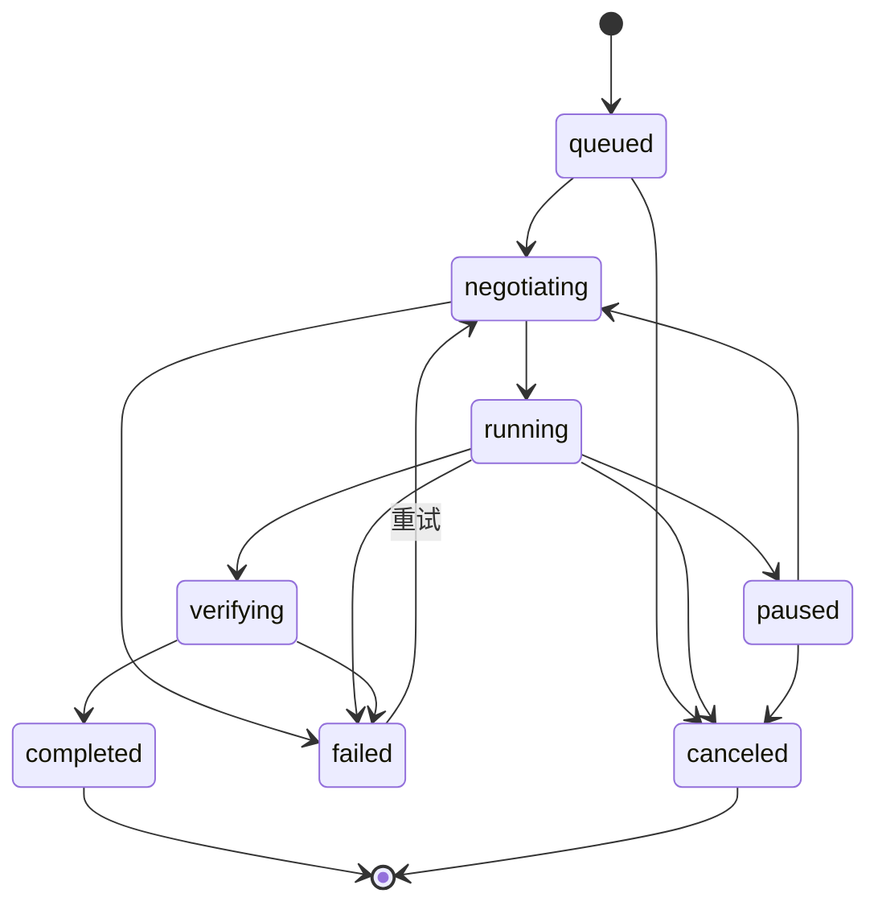
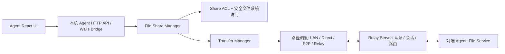

# RelayProxy Agent 文件共享：原型与可开发设计

> 状态：**P0 开发中（PR #204，Draft）**。已提交 Server 文件能力审批、多目录 ACL、远程浏览、Relay 及 TLS 文件专用可路由直连、双向 SHA-256 续传、下载任务暂停/继续及跨 Agent 重启恢复。Go CI 和 Windows/macOS UI 自动化已覆盖双 Agent 传输；**UDP NAT 打洞 P2P、两台物理设备异网实测、上传跨进程重启恢复仍未完成**。
>
> 参考当前 `main`：`agent/gui/frontend/src/App.jsx`、`agent/gui/frontend/src/styles.css`、`agent/gui/frontend/src/bridge.js`（后者仅按 App.jsx 的调用方式推断）；以及 README 中的设备身份、Server 审批、P2P / 公网直连 / Relay 路径。设计中的接口和配置名称均为**新增建议**，不是已存在的 API。

## 1. 目标与范围

在已有 Agent（Windows GUI、macOS 窗口、Linux 本地 Web）里加入「文件共享」，让授权的 Agent 之间浏览共享文件夹并传输文件，无需搭建 SMB、FTP 或暴露文件服务器端口。

- 可以添加任意多个本机共享文件夹，独立命名、启停、修改路径、删除**共享配置**（不触碰真实文件）。
- 每个共享文件夹以**目标设备 ID**分配 `none` / `read` / `read_write` 权限；默认 `none`，`read_write` 也包含读取。
- 其他设备只能看见自己有访问权限的共享及目录内容。只读允许浏览/下载；读写在首版即可上传文件（原子落盘，覆盖需确认）；新建目录、重命名、删除（需确认）作为第二阶段扩展。
- 传输任务显示已传/总大小、百分比、平滑后的实时速率、剩余时间、连接路径（局域网 / P2P / 公网直连 / Relay）、失败原因；支持暂停、续传、取消。
- 本机 Agent 执行最终访问控制和路径边界校验，Server 负责设备身份、能力审批、访问路由与流量回退。

**默认策略**：文件共享功能默认关闭；新文件夹默认不授权任何设备；同身份的已批准设备也必须由共享所有者显式授权文件夹。跨身份共享暂不开放，后续须在 Server 增加独立跨身份审批，再与文件夹 ACL 取交集。

## 2. 已有界面适配

现有 UI：React 18 / Vite、Wails 与本地 Web 共用 `agent/gui/frontend`；导航由 App.jsx 的 `NAV` 数组生成，页面组件、`PageHead`、`Card`、`Badge`、`Button`、`Switch`、`Modal` 和 `styles.css` 已有通用风格。

**导航**：在「本机」组的「远程桌面」下新增 `['files','folder','文件共享']`；观察组仍保留「实时监控」，新功能的传输任务独立在文件共享内，不混入网络连接监控。

**单页三视图**：

| 视图 | 模块 | 核心操作 |
| --- | --- | --- |
| 我的共享 | 文件夹列表及状态 | 添加 / 编辑 / 删除共享、启用 / 停用、打开设备权限弹窗 |
| 其他设备 | 授权设备卡片 + 左侧共享目录 + 右侧文件浏览器 | 搜索、面包屑导航、下载；读写时上传 / 新建文件夹 / 删除 |
| 传输任务 | 状态筛选 + 单任务进度 | 查看速率 / 剩余时间 / 路径、暂停 / 继续 / 取消、查看完成记录 |

界面沿用当前 CSS 变量（例如 `--brand: #1677ff`、`--bg: #f4f7fb`，深色模式下覆盖变量）、242px 左侧导航、52px 顶栏、卡片圆角和按钮外观。不能使用只在 Windows Wails 下存在的 API 作为唯一入口：**本地 Web 必须能够完成同等核心操作**。

### 交互规则

1. **添加共享**：选择本机目录、填写名称，验证绝对路径与重叠风险；成功后默认不授权其他设备。路径不发送到 Server 或其他设备，远端只见共享名与不透明 `share_id`。
2. **授权**：权限弹窗列出当前身份下 Server 已批准的设备（显示离线设备），按设备选择“不允许 / 只读 / 读写”；保存后立即通过同一个实时策略更新机制刷新远端列表。
3. **删除共享**：只删除共享关系，不删除磁盘内容；停止对应未完成传输。
4. **远端浏览**：只列出已被授权的文件夹。离线时可显示已知设备状态，但不得用旧缓存继续授权或发起传输；服务端、目录拥有者双重校验。
5. **下载**：点击文件加入任务列表，展示速率、已传字节数、百分比与 ETA；已存在同名本地目标时提示跳过 / 重命名 / 覆盖，默认重命名。Chrome/Wails GUI 可选择本机目录；浏览器本地 Web 受浏览器文件 API 限制，采用流式浏览器下载。
6. **上传**：只有读写可见。Wails 使用本机文件选择器，本地 Web 使用浏览器文件选择器；前端只传所选文件句柄 / Blob，不直接向远端泄露绝对本机路径。
7. **多选下载**：P1 可支持多文件排队（多个文件独立任务），无需首版 ZIP 打包。文件夹递归下载放到 P1，并加文件总数 / 总大小限制。
8. **传输失败/断线**：显示失败原因，短暂断线尝试重新协商传输路径；恢复时验证源文件版本和已完成分块。

## 3. 授权与安全边界

### 3.1 两级授权

建议新增设备级能力：

- `files.client`：设备可请求浏览 / 下载 / 上传已授权文件共享。
- `files.host`：设备可在本机启用文件共享并作为传输目标。

与现有 `rdp.controller` / `rdp.host` 的控制思路相同，但**文件夹具体权限只由共享拥有者 Agent 定义和执行**。

最终授权条件为：

```text
允许操作 = 发起设备已认证且 Server 批准 files.client
        AND 目标设备已认证且 Server 批准 files.host
        AND 两设备归属同一身份（P0）
        AND 目标共享已启用
        AND 目标 Agent 的 share_id × 源设备 ID 权限允许该操作
        AND 规范化路径仍位于共享根目录内
```

Server 的会话身份源于已验证的设备连接，不接受客户端传入的 `actor_device_id` 作为权限依据。跨身份在 P0 明确拒绝，而不是“只要知道设备 ID 即可访问”。

权限撤销、停用文件夹、移除目标设备或身份失效时，目标 Agent 应**立即停止**相关列目录、下载和上传任务，不等待下次重启；建立共享操作级 session/lease，检查授权版本（`policy_revision`）和中途失效事件。

### 3.2 文件系统隔离

- 完全不暴露任意绝对路径读取接口；客户端只使用 `share_id` + 相对路径 / 不透明文件项 ID。
- 路径输入校验：禁止绝对路径、`..`、NUL、不规范分隔符及 Windows 特殊保留名；做 Unicode 与大小写平台兼容处理。
- 默认**拒绝符号链接、目录联接点、reparse point** 穿越共享根目录；不能只调用 `filepath.Clean` 或先校验再 `os.Open`（TOCTOU）。Linux 参考 `openat2` / `RESOLVE_BENEATH`，Windows 用 handle-based file ID 与 reparse 检查，macOS 使用逐层安全打开方式。
- 拒绝访问存储的 `.part` / 元数据等临时文件，隐藏敏感 dotfiles 可作为共享配置但不能视为安全边界。
- 上传先写根目录下隔离临时文件、校验哈希、`fsync` 和原子替换；默认遇到同名提示，不静默覆盖。预留磁盘空间、限制并发与磁盘写入负载。
- 默认不开放公开下载链接，不新增 TCP/UDP 公网监听端口，不复用本机 Agent Web 的不安全 LAN 管理端口承载跨设备文件服务。
- 初版避免默认暴露复杂目录操作如 chmod、符号链接创建或任意命令执行。

### 3.3 数据隐私与加密

既有 Relay 会话具有链路安全能力，但不能仅凭 QUIC / TLS 推断 Server 无法读取明文。**建议文件数据流单独设计端到端加密**：基于 Server 已校验的设备公钥绑定临时密钥协商，对元数据请求与文件块均进行会话认证与加密；Server 只负责寻址、限流与回退转发，不记录文件内容。若首期沿用现有会话链路，必须明确其信任模型，不能宣传为 E2E。

## 4. 配置和数据模型（建议）

```yaml
file_sharing:
  enabled: false                    # 默认关闭
  download_dir: "/Users/me/Downloads/RelayProxy"
  max_concurrent_transfers: 3
  max_concurrent_per_device: 2
  bandwidth_limit_bytes_per_sec: 0  # 0=不单独限速
  shares:
    - id: "share_01j..."            # 稳定的随机 ID
      name: "工作资料"
      root_path: "/Users/me/Documents/Projects"  # 仅存本机
      enabled: true
      permissions:
        "device_abc": "read"
        "device_def": "read_write"
```

同一目录多次共享需提示或禁止重复；包含 / 被包含的共享根目录默认拦截，避免 ACL 意外覆盖。文件夹 ID 在重命名和修改描述时保持不变，**修改根路径**视为高风险操作，建议终止传输并重新审阅权限。

| 模型 | 关键字段 | 保存位置 |
| --- | --- | --- |
| `FileShare` | `id`, `name`, `root_path`, `enabled`, `permissions`, `revision` | 仅所属 Agent 本地配置 |
| `FileShareDescriptor` | `share_id`, `display_name`, `owner_device_id`, `permission`, `online`, `revision` | 远端临时内存 / 可受控缓存；不含本机根路径 |
| `FileEntry` | `relative_path` 或 `entry_id`, `kind`, `size`, `modified_at`, `version` | 从共享端按需返回 |
| `Transfer` | `id`, `direction`, `peer_id`, `share_id`, `source`, `destination`, `bytes_done`, `total_bytes`, `rate_bps`, `state`, `path`, `error` | 发起端本地持久化 |
| `TransferChunk` | `offset`, `size`, `hash`, `verified` | 发起端临时断点元数据 |

### 传输状态机



状态事件要求有单调 `event_seq`、传输 `id` 和精确 `bytes_done`。UI 使用 500ms~1s 采样更新速率，用近 3~5s 的 EWMA 估算速率与 ETA；限速 / 任务暂停显示速率为 0，不出现负数或虚假的预计剩余时间。任务完成应在校验成功且原子落盘之后发生。

## 5. 服务拆分与协议



建议在 Go Agent 新增相对独立的 `fileshare` 包，负责：目录注册、ACL 检查、安全文件句柄、浏览/读写、文件清单与分块校验、任务生命周期。`TransferManager` 共用现有 P2P / Direct / Relay 连接协调，不再造一套 NAT 穿透协议；但大文件流使用独立 QUIC stream / mux channel，并控制并发和窗口，**避免持续下载挤压代理与远程桌面的互动流量**。

### 建议本机 HTTP API（需与现有 Agent 路由规范统一）

| 动作 | 建议接口 | 作用 |
| --- | --- | --- |
| GET | `/api/v1/file-shares/local` | 本机共享列表（本机管理凭据） |
| POST | `/api/v1/file-shares/local` | 新增共享配置 |
| PATCH / DELETE | `/api/v1/file-shares/local/{shareId}` | 更新或移除共享 |
| PUT | `/api/v1/file-shares/local/{shareId}/permissions` | 原子替换设备 ACL（带 revision） |
| GET | `/api/v1/file-shares/devices` | Server 已审批的可授权设备列表 |
| GET | `/api/v1/file-shares/remote` | 授权可访问设备 / 共享摘要 |
| GET | `/api/v1/file-shares/remote/{deviceId}/{shareId}/entries?path=...` | 远程分页浏览 |
| POST | `/api/v1/file-transfers/download` | 启动下载 |
| POST | `/api/v1/file-transfers/upload` | 启动上传（Wails 本地路径句柄 / Web 浏览器流式上传适配） |
| GET | `/api/v1/file-transfers` | 分页列出任务与状态 |
| POST | `/api/v1/file-transfers/{id}/pause`、`/resume`、`/cancel` | 任务控制 |
| GET | `/api/v1/file-transfers/events` | SSE 订阅任务状态与权限变化；连接断开用快照续接 |

> 这些是**待实现的新接口建议**。正式接入应根据现有 `callJSON(...)`、`call(...)`、`saveConfig(...)` 的桥接习惯设计 `goGetFileShares` 等适配函数；不要在 GUI 中绕过本地 Agent 直接连接 Relay Server。

### Agent ↔ Server ↔ Agent 数据消息（新增协议）

控制帧建议包含 `op`, `request_id`, `actor_device_id`（Server 认证后填充）, `target_device_id`, `share_id`, `relative_path`, `policy_revision`, `trace_id`；操作如 `FILE_SHARES_LIST`, `FILE_DIR_LIST`, `FILE_STAT`, `FILE_TRANSFER_START`, `FILE_TRANSFER_CHUNK`, `FILE_TRANSFER_ACK`, `FILE_TRANSFER_CANCEL`。目录列表按游标分页，避免扫描大目录时一次性返回数十万条记录。上传下载先交换 `size/mtime/version/hash` 文件指纹，断点重连后验证指纹及块哈希，指纹变化要重新协商，不能拼接旧文件。

**路径调度**：在同一 LAN 优先走已验证内网直连；否则 P2P QUIC / 已验证公网直连；不通时自动回退 Relay QUIC/TCP。必须在权限检查通过后建立数据流，且每次路径切换不跳过身份确认。Server 默认只转发授权会话，不持久化文件。

### Web 与原生选择器差异

- Wails / macOS GUI：本机目录选择器 + 本地临时文件可操作，Agent 直接读写磁盘；Go API 应绑定 OS 控件选择结果，而不是信任浏览器随意传来的路径。
- Agent 本地 Web：只有浏览器选择的 File Blob 可上传；下载用流式响应交给浏览器下载管理器。文件保存位置可能由浏览器决定，不能保证与原生 GUI 相同的“本地目标路径”和可靠断点续写能力；进度需区分“Agent 收取/转发完成”和“浏览器真正落盘完成”。
- Android：首期支持“浏览和下载”可复用 Android 的 SAF / MediaStore，作为文件共享宿主需要另做 SAF 权限持久化和后台任务兼容性验证。

## 6. 配套 Server 改动

- 审批页能力清单加入 `files.client`、`files.host`，下发已批准能力；新增跨身份 file grant 留到后续版本。
- 授权设备发现接口只返回当前身份已审批设备、在线状态与能力；共享名称可由目标 Agent 动态按设备权限筛选，不需要 Server 保存真实共享路径。
- 服务端只负责认证会话和中转文件数据流；统一审计最小化记录：时间、发起设备、目标设备、共享 ID、动作、结果、字节数、路径类型。是否记录文件名应该有隐私开关，默认避免记录全路径。
- ACL / 设备审批变更通过项目现有实时更新机制通知关联 Agent；**不要求通过断线/重启才能刷新权限**。消息丢失时按 `policy_revision` 再拉快照校验。

## 7. 推荐实现顺序

### P0：可用版（建议第一阶段）

1. 共享根目录注册、多个文件夹、状态启停、设备权限弹窗和 Server 授权能力。
2. 已授权设备 / 文件夹列表、远程目录浏览、**单文件下载及按写权限上传**，与首版读写授权形成闭环。
3. 分块传输、进度 / 速率、取消、失败处理、路径回退；上传临时文件及原子落盘。
4. 安全路径校验、防穿越、覆盖确认、文件变更校验、权限撤销即时生效。
5. Windows / macOS / Linux Agent Web 端到端验收；本地 Web 的浏览器下载 / 上传流分别验收。

### P1：完整读写版

1. 远程新建目录、重命名和删除，高风险写入的确认交互。
2. 可靠暂停 / 继续 / 断点续传、队列、限速、并发数配置。
3. 多选下载 / 文件夹递归、完成历史、全链路实时事件。
4. 基础流量公平性和弱网切换压测；Android 浏览与下载。

### P2：后续增强

跨身份文件共享审批、加密文件夹目录索引缓存、文件预览、拖放上传、批量操作、只写投递箱、Android 本机共享提供端、细粒度写入策略、文件版本回滚。

## 8. 可验收测试清单

| 场景 | 通过条件 |
| --- | --- |
| 多目录隔离 | 3 个根目录可各自启停与授权，目录 A 权限不能用于 B |
| 默认最小权限 | 新增共享后其他设备不可见，不因同身份自动开放 |
| 读权限 | 只读设备可浏览与下载，不能上传、覆盖、重命名、删除 |
| 写权限 | 读写设备可安全上传，完成时文件已校验且原子落盘 |
| 授权即时撤销 | 下载 / 上传中撤销设备或停用共享，数据流立即被终止 |
| 设备身份伪造 | 以其他 device_id、过期身份、未审批设备发起操作均被拒绝 |
| 路径安全 | URL 编码穿越、symlink / junction、并发替换目录均不能逃逸根目录 |
| 大文件 / 断点 | 10GiB 文件网络中断后可恢复，源文件变化不得错误续传 |
| LAN / P2P / Relay | 各路径可下载，LAN 优先，P2P 失败可回退；切换不绕过 ACL |
| 公平性 | 大文件持续传输不应让代理/RDP 延迟无约束飙升；提供可量化 QoS 基准 |
| 多任务 | 3 个下载并发、暂停与取消状态一致、进度单调且无超 100% |
| 磁盘错误 | 低空间、写入权限失败、已存在目标文件均给出清晰提示 |
| GUI/Web 一致 | Windows / macOS GUI 与本地 Web 能完成各自可支持的核心操作 |
| 状态实时性 | 撤销权限、设备离线、重连、传输速度变化不依赖手动刷新 |

## 9. 与原型的差异声明

随附 `relayproxy-file-sharing-prototype.html` 是单文件、无外部依赖、无真实网络和磁盘读写的**功能交互原型**。共享文件夹、设备、目录和进度都是演示数据；新增共享和权限配置只在当前浏览器页面内生效，刷新即重置。原型中的“浏览器目录选择器”按钮不会直接获得 Agent 机器的文件系统访问权限，该能力需在 Go/Wails 本地服务实现后才能工作。
## 10. 当前开发进度（2026-10-14）

| 功能 | 状态 | 代码 |
| --- | --- | --- |
| 原型、技术设计 | 已提交 | `docs/agent-file-sharing-prototype.html` |
| 本机多目录注册 / 启停 / 删除共享配置 | 首轮完成，待 CI 实测 | `agent/fileshare/store.go` |
| 按设备 read / read_write ACL、默认拒绝、版本冲突保护 | 首轮完成，待集成实测 | `agent/fileshare/store.go` |
| 本机侧车 JSON 持久化 | 首轮完成，待 Windows / macOS 验证 | `<agent配置文件>.file-shares.json` |
| Agent React 配置页面与权限编辑 | 首轮完成，待 GUI 验证 | `agent/gui/frontend/src/FileSharingPage.jsx` |
| 本地 Web API / Windows Wails 桥接 | 首轮完成，待编译与回归 | `agent/gui/fileshare_web.go` |
| Server files.client / files.host 能力和认证设备发现 | 未开始 | P0 下一阶段 |
| Agent ↔ Agent 远程目录浏览 / 下载 / 上传 | 未开始 | P0 下一阶段 |
| 传输速率 / 进度 / 取消 / 路径回退 | 未开始 | P0 下一阶段 |

### 首轮实现和设计的暂时差异

- 当前共享配置先使用**独立 sidecar JSON**，而不是修改 Agent 主 YAML。原因是复用现有 Web + Wails 管理入口时不应破坏配置热更新；正式上线前需评审配置迁移、并发写与备份策略。
- 在获得 Server 已审批设备目录接口之前，首轮权限编辑先接受设备 ID。**不能把手工输入设备 ID 当作设备身份认证**；仅在后续远端连接由 Server 验证身份后，主机 Agent 以认证设备 ID 检查 ACL。当前没有对外文件浏览或下载的数据接口。
- 共享文件真实读写、浏览器上传下载和传输进度尚未接通，React 对应视图明确说明未实现，不以模拟数据伪装为完成。
- 文件共享功能默认关闭，新增目录没有任何设备权限；相关全链路安全测试未完成，不能视为已可正式上线。

## 11. 第二批实现（2026-10-14）

- **Server**：独立增加 `files.client` / `files.host` 审批能力、同身份在线文件共享设备发现和专门的 `FrameTypeFileShare` 数据流。每次连接通过数据库实时核验双方的身份状态、审批状态及能力；不能借用 `proxy.client`/`proxy.exit` 绕过文件授权。活跃流每 2 秒复核 Server 授权，撤销时断流。
- **Agent 主机**：只有 `files.host` 获批、共享总开关开启且目录 ACL 授权后，才处理来源设备的文件请求。Server 基于已认证会话重写请求头中的设备 ID。利用 `os.OpenRoot` 把目录浏览、读取限定在共享根目录下，限制单目录最多返回 5000 条文件。下载过程中复核目录权限与共享根路径，撤销时中止。
- **Agent 访问端**：使用现有 Relay 隧道发现在线共享设备、浏览目录、逐文件下载；下载任务异步保存到本机 `Downloads/RelayProxy`，支持进度、平滑速率、取消和失败提示；React/Wails/Web 接口复用。
- **Server Web**：设备审批页面新设「文件共享」能力分组，文件访问端和共享端独立勾选。新能力不会因设备更新而自动获得审批。
- **测试新增**：数据库授权与身份边界/撤销、实际目录枚举、有效文件下载、未授权设备、相对路径穿越、越界符号链接等回归测试。
- **当前实现限制**：文件内容经 Relay 转发，尚未接入文件传输专用 P2P / 公网直连；目录 ACL 的 `read_write` 权限已持久化，但上传执行协议与上传 UI 尚未交付，当前实际可用操作为浏览、下载；同身份已审批且**在线**的主机可被发现，离线清单和跨身份共享仍待开发。
- **验证**：上一批 PR 的 Go CI / UI CI 已通过；本批新增的跨 Agent 代码正在等待新一轮 Actions 检查。不得把新功能视为已完成实网验收。

## 12. 第三批实现（上传协议及统一传输任务）

- 已增加独立的 `FileShareUpload` 请求，访问端声明相对路径和大小（单文件最多 20 GiB），Server 仍对每个打开的流验证 `files.client/files.host`，目标 Agent 必须验证当前设备获得 `read_write` 目录 ACL。
- 文件以 `os.Root` 限制路径，写入同目录私有随机临时文件，`fsync` 后使用不覆盖目标文件的 `Root.Link` 发布。传输失败、截断、取消、越权或已存在同名文件均不能覆盖现有用户文件，临时文件自动删除。
- 主机对传输期和提交前进行 ACL 复查；下载/目录浏览不可查看或读取上传暂存文件。
- 访问端以半关闭传输方向结束字节流，并要求目标 Agent 的**最终提交回执**，只有确认发布后才将任务标记为成功。
- Agent Web 与 Wails 页面采用定长 base64 分块暂存所选择的浏览器文件，采用随机不透明的短期会话 ID；本地暂存完成后交给 Agent 后台执行 Relay 上传。统一传输任务页面显示方向、进度、速率、取消与失败结果。默认最多 3 个活跃传输、5 个等待提交的上传。
- 新增真实双向流测试：写权限/只读拒绝、目录穿越、已存在目标文件不覆盖、截断回滚、权限撤销前不能发布。
- **暂未实测通过：** Go CI/UI CI 和 Windows/macOS 端到端仍需验证。网页文件先本地暂存、再经 Relay 发送会额外占用访问端临时磁盘空间；上传端暂不支持断点续传，文件专用 P2P/公网直连也仍未交付。

## 13. 第四批：Server 授权设备选择器与下载文件保护（2026-10-14）

- Agent 的「编辑共享 / 设备权限」不再要求手动输入设备 ID。增加专用 `FrameTypeFileShareCandidates`，由共享端已认证 `files.host` 会话向 Server 查询**同身份、已审批并具备 `files.client`** 的访问设备；候选项显示设备名称、在线状态及 ID，离线设备也可以预先授权。
- Server 查询直接检查当前数据库中的身份有效性、设备审批状态和能力，不从前端采信设备 ID 列表；撤销审批、跨身份及未获得文件访问能力的设备不显示。已有历史 ACL 若不在候选列表内，仍可以在编辑器中单独移除。
- Agent 本地 Web / Windows Wails 桥接新增 `goGetFileShareCandidates`，用于共享目录权限编辑，确保每个目录仍是独立 ACL。
- 下载落盘改为同目录硬链接无覆盖发布，避免另一个下载任务与已有文件名碰撞时的覆盖风险。
- 新增 Server 数据库级候选列表测试：离线、跨身份、缺少 `files.client`、设备撤销及 `files.host` 撤销边界。
- **验收门槛未改变：** 新一轮 Go CI、UI CI、双设备上传下载、Windows/macOS 文件授权及文件专用直连仍待确认，PR 继续 Draft。

## 14. 文件传输完成回执与安全自审（2026-10-14）

- **双向完整性**：上传与下载均计算流式 SHA-256，主机在读取／写入完整大小并成功完成后发送最终回执。访问端只有在字节数与最终摘要一致时才认为成功。下载的临时文件仅在这些校验完成后发布。摘要是在现有 Relay 通道中传输的校验信息，并非主机端签名或独立端到端认证，不可将其描述为端到端加密。
- **快照正确性**：下载过程中如果共享源文件大小或修改时间变化，主机返回失败而不是成功回执，避免同名文件被写入时产生不一致的快照。
- **服务保护**：单台 Agent 作为文件共享主机时，最多允许 6 条同时执行的文件流；超限的新文件操作失败，不影响本机管理界面。
- **上传目标冲突**：开始上传前尽早探测目标是否已经存在；最终发布仍由不覆盖已有文件的原子 `os.Root.Link` 保证，不依赖前置检查消除竞争。
- **上传暂存**：修复闲置计时器与分块写入竞争的情况；及时重设到期定时器，并在长期不活跃时自动清理本机临时文件。
- **测试**：更新真实下载测试，要求最终 SHA-256 回执；上传测试检查最终摘要；增加主机并发占用上限回归测试。
- **状态**：改动已经提交 PR #204，仍须通过最新 Go/UI Actions 和 Windows/macOS 双设备真实上传下载验收。文件专用 P2P / 公网直连、断点续传尚未完成，不能合并或默认发布。

## 15. 文件专用直连、双向断点续传与双端自动化验收（2026-10-14）

### 实现范围

- 下载请求新增 `Offset` 和 `PrefixSHA256`。主机在自己受限的 `os.Root` 文件句柄上重算并确认前缀哈希，验证完成后只传输剩余字节；最终回执始终携带**整个文件**的 SHA-256。访问端本地临时文件以 `ReadWriteSeeker` 重算前缀，网络错误触发有上限的自动重试；远端文件发生变化时先清空旧片段，再尝试重新下载，不会混合版本。
- 上传新增可选 `Resume` 和绑定来源设备、共享根、共享 ID、路径、大小的 `UploadID` 随机令牌。主机在同目录保留私有临时文件，断线后复用未上传部分并对原始前缀进行 SHA-256 双向核验；所有数据就绪并 fsync、复查最新 ACL 后才无覆盖地发布。活动上传受原有 6 条流上限约束；闲置会话 30 分钟过期，当前**不承诺 Agent 重启后续传**。
- 文件专用直连帧 `FileDirectPrepare/Grant/Check` 独立于代理、RDP 和浏览器能力。只有 Server 数据库按最新 `files.client` / `files.host` 判定允许时，Server 才向已认证的共享端发 20 秒有效的一次性随机授权令牌，客户端从已认证 Relay 控制通道得到 TLS 证书 SHA-256 指纹和候选端点。主机提供独立 TLS 1.3/ALPN 文件监听端口，在 TLS 证书指纹确认及一次性凭据消费前不处理共享请求；认证后仍每 2 秒向 Server 复核权限，失去 Server 或遭到撤销即关闭直连流。共享端本地目录 ACL 在读写期间仍独立验证。
- 访问端优先尝试可路由的局域网 / 公网 TCP 端点，不能建立认证连接则使用已存在的 Relay 文件流，不能以降低 TLS 证书验证或放宽 Server ACL 的方式“直连成功”。
- 自动化测试创建两个独立的 Agent 实例与真实 Relay Server，覆盖 QUIC/TCP Relay、枚举、远程下载、文件前缀续传、上传、目录 ACL 撤销；新测试还会确认至少一次文件直连通过，然后关闭直连监听并验证 Relay 回退。另有上传断流后以同一令牌续传以及非授权设备盗用令牌失败的测试。

### 未完成与验收限制

- **NAT 打洞 P2P 未完成**：当前直连仅在目标 TCP 地址可达时生效，支持同 LAN 和具有真实公网路由的端点；使用 NAT、CGNAT 的环境仍需要端口映射或进一步开发 UDP QUIC 打洞。不得宣称已实现对称 NAT 穿透。
- 公网 IPv4 端口映射自动协商、路由器 UPnP TCP 映射、IPv6 双栈可达性测试、文件专用 QUIC 拥塞控制还没有完成；直连的当前实现是 TLS 1.3 over TCP，不是 QUIC。
- 双 Agent 自动化运行在**同一 CI 宿主机**的不同 Agent 连接，属于真实 Agent↔Server↔Agent 协议验收，而非两台物理设备 / 跨运营商 NAT / 真实互联网吞吐验收。
- 上传续传状态仅在主机进程内保持并在 30 分钟闲置后过期。断点续传不跨 Agent 进程重启；客户端任务本身也尚未持久化至磁盘以支持 GUI 重启恢复。
- 本批新文件须以最新 Go CI、UI CI、Windows/macOS 构建结果为最终判定；没有相关结果时维持 PR #204 Draft，不合并 main。

### 建议的两物理设备实测矩阵

1. 同一局域网 IPv4，分别为 Windows ↔ macOS（双向）、Windows ↔ Windows、macOS ↔ macOS：共享审批、文件直连、Relay 回退。
2. 不同局域网、仅一侧公网 IPv6 或双方公网 IPv6；公网 IPv4 + 路由器端口转发：验证 TLS 直连可达和回退。
3. 双侧 CGNAT 或对称 NAT：当前预期 Relay，不应在未实施 UDP 打洞前声称 P2P 成功。
4. 对 0 B、4 KiB、64 MiB、1 GiB 文件分别验证 SHA-256；断开网络、恢复网络、撤销 Server 能力、撤销本机 ACL、替换同名文件、源文件被修改、并发任务与同名冲突。
5. 比较直连 / Relay 的吞吐、RTT 和失败切换时间，检查任务实际走的路径；记录操作系统防火墙和公网端口可达性作为环境证据。

## 16. 下载任务索引持久化、身份隔离及回归验收（2026-10-14）

- 在 Agent 配置文件旁持久化 `<agent-config>.file-transfer-tasks.json` 任务索引。以临时文件写入、`fsync` 和重命名替换更新；Unix 文件模式为 0600。仅记录在进行中、暂停或失败的**下载任务**，不包含文件内容、设备私钥、临时 TLS 凭据或上传令牌。
- 索引内容绑定当前 Agent 的身份 ID、设备 ID 和 Relay 服务端地址及端口；重新加载前校验版本、任务 ID 格式、相对路径与目标名称，核对本机私有 `.partial` 普通文件，不跟随符号链接。身份切换时不会恢复旧身份任务。
- 重新启动 Agent/UI 后仅恢复为「已暂停」，`Done` 取本地片段的实际长度，**不自动建立连接**。用户点击「继续下载」才请求远端，共享端仍需通过 Server 文件权限及目录 ACL，并在续传前校验源文件前缀 SHA-256。
- 下载任务完成后从下一次索引中删除，不会再次进入恢复队列；遗失或不可信的本地片段不被恢复。
- 回归测试新增：有效片段重新加载、退出时运行态转暂停、任务完成不再恢复、恶意路径或符号链接过滤、身份范围变化拒绝恢复；Go CI 成功，Windows/macOS UI CI 成功（提交 `fb4f0b1`）。
- **剩余项**：上传临时状态不跨共享端 Agent 进程重启持久化；复杂 NAT 的 UDP 打洞、自动 TCP 端口映射、双物理设备跨运营商实测及网络异常长时压力测试还未完成。

正式版验收仍要求在不同物理网络的两台设备上执行 SHA-256 端到端验收、验证真实传输路径和超时回退，并记录路由器、防火墙及公网可达性证据；不能把 CI 同宿主机双 Agent 验收当作实网验收。

## 17. 文件专用 TCP UPnP 可达性增强（2026-10-14）

- 共享端本机界面新增「文件直连端口映射」开关，存于本机独立共享配置的 `directUpnpEnabled` 字段。**默认关闭，不依赖代理 P2P 的 UPnP 授权开关，也不向其他设备同步。**
- 仅在本机启用文件共享、显式打开映射选项、Server 批准 `files.host` 且有实际文件访问请求时，才异步尝试 TCP UPnP IGD 端口映射。
- 复用项目现有的路由器 SSDP 发现、固定 LAN 网关/接口校验、有限租约、续租、映射所有权校验与关闭删除机制，但为文件直连使用独立的 **TCP** 协议；既有代理 P2P 保持 UDP，避免跨协议删除或误用映射。
- 只有路由器返回可公网路由的 IPv4 WAN 地址，并且租约状态有效时才将 WAN IPv4:TCP 端口附加到文件直连候选地址中。私有 WAN、CGNAT、映射失效或续租失败均不得声明公网可达；相同 LAN 的直连候选与 Relay 回退保持可用。
- 用户关闭本机映射开关时，运行中的文件直连监听器立即撤销该公网候选并取消 UPnP 映射维护；路由器删除使用原先映射的 TCP 协议和外部端口，删除前复核内部客户端及端口所有权。Agent 退出也触发映射清理。
- 映射不属于身份授权：即使路由器允许外部访问，仍必须通过 Server 的 `files.client/files.host` 审批、20 秒一次性令牌、TLS 1.3 指纹验证和共享目录 ACL，且直连期间定期复核 Server 权限。
- 回归测试重点覆盖：TCP SOAP `AddPortMapping`、续期、`GetSpecificPortMappingEntry`、`DeletePortMapping` 的协议一致性，以及旧 UDP 协议兼容、错误端口拒绝、显式 opt-in 的持久化和关闭。
- **验收边界：** TCP UPnP 有效映射不代表外网防火墙、双层 NAT、运营商 ACL 已开放，也不是 UDP/QUIC NAT 打洞；公网连通性仍要跨两台物理设备在不同网络执行探测并记录真实传输路径。PR #204 保持 Draft，未通过最新 CI 前不能宣称本批已验收。

## 18. 文件直连映射诊断（2026-10-14）

- 文件共享页面从 Agent 本地 Web/Wails 桥接读取有效 UPnP 状态，区分默认禁用、等待 Server 审批、等待文件连接请求、网关发现中、获得公网候选地址、私有 WAN/CGNAT 和映射不可用。
- 映射状态在运行时由 TCP IGD 租约和续期结果更新，成功时显示真实的 WAN `IP:端口` 候选；失败原因来自本机 UPnP 过程。对外只开放本机管理 API，未获本机 Web 授权不能读取该诊断信息。
- 在用户关闭开关后，Agent 本地桥接立即通知文件直连运行时撤销公网候选并关闭 UPnP 映射，无须等待另一台设备再次发起连接。开关初始默认关闭，不会自动创建外部路由器端口。
- **诊断语义**：UPnP 映射成功仅说明路由器确认了其本机配置，绝不是来自另一运营商的公网 TCP 端口真实可达性证明。真实可达和传输路径必须依据另一台设备建立的独立 TLS 直连及任务实际 `direct_tls` 路径验证。
- 文件专用 UDP/QUIC NAT 打洞和跨物理设备公网验收仍待实施。

## 19. 文件专用 QUIC 数据通道：受控可路由直连（2026-10-14）

- 文件共享端新增独立的 UDP/QUIC 监听器。TLS 1.3 自签名证书与文件 TCP 监听端共享**同一 Server 证明的证书指纹**，但采用独立 ALPN `relayproxy-file-direct-quic-v1`，不承载 Proxy、RDP、Browser Sync 流。
- 每次 Server 批准 `files.client/files.host` 后，控制通道转发一个 20 秒有效、一次性文件票据，同时分别返回 TCP 与 UDP 监听端的可路由地址候选；客户端优先 QUIC，然后 TLS/TCP，最后使用既有 Relay QUIC/TLS。无论 QUIC 或 TCP，文件内容均需主机本机共享 ACL 认证及持续的 Server 权限复核。
- QUIC 服务端每连接仅接受一个双向文件流，并限定最多 16 条并行直接 QUIC 连接；通过一次性票据消费限制重放。客户端验证 Server 证明的 leaf SHA-256 和专用 ALPN，不接受无验证的 QUIC TLS；传输任务记录实际 `direct_quic` / `direct_tls` / Relay 路径。
- 双 Agent 自动化进一步断言一次成功的 QUIC 直连，在关闭 QUIC 监听器后回退到文件 TCP 直连，再关闭文件 TCP 监听器后回退 Relay。上传、下载、前缀续传与 SHA-256 完整性沿用同一文件协议。
- **当前不声称完成 NAT 打洞**：QUIC 候选仅从本地真实监听接口取得，LAN 和可路由公网地址可能直连；双方经由 NAT/CGNAT 或对称 NAT 时，仍缺少与 Server 协调的每会话 UDP 反射候选交换、双向 HMAC 打洞和稳定 socket 复用，遇不可达 UDP 将安全回退 TCP/Relay。不能把 QUIC 直连或现有 UPnP TCP 映射冒充完整 P2P 穿透。
- PR #204 的 QUIC 增强仍需最新 Go/UI/Windows/macOS CI 全部通过，异网双物理设备验收独立待办。

## 20. 文件专用 QUIC/UDP UPnP 映射（2026-10-14）

- 延续本机共享设置中默认关闭的 `directUpnpEnabled`，只有用户显式开启才尝试文件专用 UDP UPnP 映射。与既有文件 TCP 映射及代理 P2P UDP 映射互不复用租约；使用 QUIC 实际监听的内部 UDP 端口，并分别进行网关发现、短租约、续期、所有权检查、关闭删除。
- 有效公网 WAN IPv4:UDP 映射候选优先附加到 Server 已认证的文件 `FileDirectOffer.UDPEndpoints`，由客户端按 `direct_quic → direct_tls → relay_quic/relay_tls` 顺序尝试；TLS 1.3 证书指纹、ALPN、Server 一次性票据、`files.client/files.host` 和主机目录 ACL 全部保持原有检查，不因 UPnP 改变。
- 映射失败、续期故障、网关私网/CGNAT、关闭共享或关闭开关时，必须立即撤销公网 UDP 候选，不影响 LAN 候选、TCP 直连与 Relay。TCP 失败时正常的 UDP 独立租约仍可使用，避免两条传输路径互相牵连。
- 本机 Web/Wails 诊断分开显示 TCP 和 QUIC/UDP 的映射状态、有效公网地址及失败原因；仍以实际传输任务的 `transportPath` 为成功直连依据。
- 单测覆盖私网 WAN 地址不得发布、启用与停用、健康公网 UDP 候选发布和续期候选撤销。最新代码提交后需单独确认 Go/UI/跨平台 CI，且必须进行不同运营商的实体设备网络测试。
- **边界**：UPnP 是主动在用户路由器开放入站端口，不是 Server 协调的反射候选 + 双向 NAT 打洞；双侧 CGNAT、对称 NAT 的连接能力仍未实现，也没有跨网络实测证明，PR 维持 Draft。

- 快速关闭再开启映射时，等待旧 UDP/TCP UPnP 所有权校验及删除完成后才重新创建映射，避免重叠租约或界面停留在等待状态；最终配置仍为关闭时不重启映射。

## 21. 文件直连同网段优先（2026-10-14）

- 访问端根据其真实本机网卡子网，将目标共享端落在同一子网的 TCP 和 QUIC 地址优先尝试，避免路由器已开放公网映射后同一 LAN 反而先走 WAN hairpin。
- 不简单地认为任意 RFC1918 地址就是同 LAN；非同网段地址仍参与后续尝试，实际路径只有成功握手并通过主机文件票据、证书 pinning 与目录 ACL 后才确认。该排序不影响 Relay 兜底，也不修改 Server 下发候选。
- 增加排序稳定性和原始候选不可变的单元测试。复杂多宿主、VPN、异网情况仍需跨物理设备确认，不能把本地排序等同于 NAT 打洞。

## 22. 文件直连候选协商时间预算（2026-10-14）

- Server 直连票据有效期为 20 秒。文件直连候选最多各 16 个，此前 QUIC 逐个约 1.2 秒、TCP 逐个约 0.8 秒，遇无响应端点可能消耗整个票据后再进入 TCP，甚至拖延 Relay。
- 现在为 QUIC 和 TCP 分别设置最多 4 秒的阶段预算，同时保留票据过期前 2 秒安全余量；TLS/TCP 和 QUIC 的文件认证请求与服务响应也遵守各自阶段的截止时间。高延迟、失联或较多候选下应尽快进入安全 Relay 回退，不扩大文件权限。
- 对候选优先级、票据过期、父请求超时与认证阶段上限添加单测。文件传输一旦成功协商，取消短握手截止时间，继续由原始任务的生命周期与 ACL 复核管理。
- **未完成**：UDP 对称 HMAC 打洞、反射地址协商及两物理设备异网验收；此迭代只修复已有路径选择延迟，PR 保持 Draft。

## 23. 真实双设备下载验收脚本（2026-10-14）

- 新增 `scripts/fileshare-real-device-smoke.py`，**必须在真实访问端设备**运行；访问端和共享端分别连接到同一个真实 Server，且双方由 Server 按 `files.client/files.host` 审批，共享端对访问端设置只读或读写目录权限。
- 共享端在共享根目录放置一个不为 0 的测试文件（测试暂停/续传宜 64 MiB 或 1 GiB），共享端本人先计算 **SHA-256** 并提供预期摘要。脚本通过访问端本机 Agent Web API 查询已授权主机/共享/目录，创建真实下载任务并读取真实传输路径、速率、进度，最后检查本机 `Downloads/RelayProxy` 中已发布文件的大小及完整 SHA-256，任何不一致则退出非零。
- 示例（在访问端的终端执行）：
  ```bash
  export RELAYPROXY_WEB_TOKEN='<本机 Web Token，未配置时可不设置>'
  python3 scripts/fileshare-real-device-smoke.py \
    --agent-url http://127.0.0.1:21290 \
    --host-device-id '<共享端设备 ID>' \
    --share-id '<共享目录 ID>' \
    --remote-file test-1g.bin \
    --expected-sha256 '<在共享端计算的 64 位小写 SHA-256>' \
    --require-path direct_quic \
    --pause-after-bytes 8388608 \
    --report file-transfer-result.json
  ```
- 若需要验证 UDP 不可达自动降级，改用网络防火墙阻断共享端文件专用 UDP 端口，再要求 `direct_tls`；继续阻断文件 TCP 直连时应按实际 Relay 协议要求 `relay_quic` 或 `relay_tls`。脚本不自行修改防火墙或路由器。优先对 Windows ↔ macOS、跨 NAT、公网 IPv4/IPv6、弱网/断线恢复分别执行并保留报告。
- 安全界限：默认仅访问本机 loopback 的 Web API；远程 Web API 必须使用 HTTPS，避免泄漏 Bearer Token；不跟随 Web API 重定向，不将 Token 写入报告，不修改共享端文件。脚本仅测下载，不等价于已完成上传/双向验收。
- **重要：本轮只提交验收工具，尚未实际访问两台独立物理设备，更不能声称异网 P2P/NAT 打洞通过。** `direct_quic` 表示实际 QUIC 文件通道成功，不证明这是 UDP NAT 打洞（也可能是 UPnP 或公网可路由地址）。PR 保持 Draft。

## 24. 文件独立 P2P QUIC 穿透（2026-10-14）

- 新增单独的 `FileDirectPunchPrepare` 控制帧，旧 `FileDirectPrepare` 不变。Server 验证同身份与两端 `files.client/files.host` 的真实数据库审批后，为每次文件操作签发随机 64 位 P2P 会话 ID、32 字节 HMAC key，以及原有 20 秒一次性文件访问令牌，分别通过已认证 Relay 流下发。
- 双 Agent 使用独立于代理 P2P 的单次 UDP socket；同一 socket 先向既有 Server rendezvous 反射服务探测公网端点、再执行双向 HMAC/nonce UDP 打洞、最后交给文件专用 `quic.Transport` 握手与数据流，不允许从代理 P2P 授权继承文件权限。仅 `p2p_quic` 标记真正完成 HMAC 打洞后建立的 QUIC 传输。
- 若 Server 未提供 rendezvous 地址，保留既有文件 QUIC/TLS/Relay 协商。P2P 限制同时 4 个候选会话、20 秒票据有效期和 4 秒打洞窗口；失败按 `direct_quic → direct_tls → relay_quic/relay_tls` 回退。
- 不信任客户端提交的 IP 列表，Server 与共享端分别验证地址数量、协议与地址合法性；文件 QUIC 仍验证主机证书 leaf SHA-256、单次票据和实时 Server 文件审批，并由主机本地目录 ACL 判定读取或写入。
- **限制**：UDP NAT 打洞是尽力而为，不保证对称 NAT 或双侧 CGNAT 一定成功；尚须本机双 Agent 集成自动化与跨运营商双实体机实测。PR 保持 Draft。

- 小型共享列表与目录枚举不触发每次文件会话的 UDP 打洞；只有实际上传/下载才尝试 `p2p_quic`，避免 UDP 受阻时仅打开目录就引入 4 秒穿透等待。

- P2P 授权安全加固：Server 无条件剔除共享端自行回传的任何 session ID/HMAC key，再仅在经格式验证的文件 P2P 候选存在时填充 Server 新签发凭据；客户端额外限制候选总量，不能利用不可信主机伪造协商材料。

## 文件浏览器双栏改版与系统选择器（2026-10-15 / PR #205）

- Agent React「其他设备」采用设备与共享目录侧栏 + 文件浏览器主工作区，支持路径面包屑、文件排序、目录搜索、列表／网格切换、窄屏响应式；文件夹单击进入。
- Windows 原生 Wails3 GUI：`app.Dialog.OpenFile()` 目录选取，`app.Dialog.SaveFile()` 文件另存为；Windows 本机浏览器管理页使用 PowerShell Windows Forms；macOS 本机 Agent Web 使用 AppleScript。只有本机 loopback Web 请求可触发**运行 Agent 的系统**上的文件对话框，远程 Agent Web 不支持触发宿主机弹窗。
- 上传沿用浏览器／WebView 文件输入控件，系统弹窗只选择用户授权的源文件，后续分块和端到端文件 ACL 不变。
- 浏览器保存使用 File System Access API（支持的浏览器）或浏览器附件下载；只有 Agent SHA-256 校验完成的默认下载任务才能通过只读 GET 接口导出，不在 Web API 提供写入任意主机绝对路径能力。Windows/macOS 本地保存位置通过原生对话框选择后直接传递给 Agent Bridge。
- 自定义保存跨磁盘时，先复制到目标目录的私有暂存文件，再 fsync 和无覆盖链接发布；停电／取消不将不完整文件作为正常文件发布。
- 原 Agent 重启恢复的下载任务如果来自系统另存为，需要再次选择保存路径再继续，防止保存路径丢失后默默回落到默认下载目录。
- **仍待实机验收**：Windows Wails WebView2/macOS Safari 对话框权限和路径编码、浏览器较大文件保存的内存与磁盘表现、跨文件系统以及取消后清理。CI 成功不代表完成这些物理设备测试。


// 2026-10-15：设备列表 ACL 过滤与保留下载原始文件名
// - Server 文件共享设备发现不再仅凭 files.client/files.host 和数据库设备授权返回设备，
//   而是通过已认证的 Relay 会话询问共享端 Agent 当前是否存在授予访问端的有效目录权限。
//   响应只包含 bool，不暴露绝对路径或共享名称；目录关闭、总开关关闭、ACL 撤销时不可见。
//   查询受 4 秒整体预算、2 秒单主机截止时间和 8 路并发限制；旧 Agent 不支持检查则
//   fail closed（不显示），需要更新共享端 Agent。
// - 下载默认保持 source filename，遇到同名文件使用 (1)、(2) 顺序命名，不使用随机任务 ID。
//   SHA-256 验证、私有 .partial 暂存、无覆盖发布、断点续传与浏览器完成后再导出保持不变。
