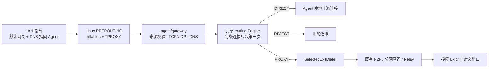

# Agent 局域网网关设计方案

Linux 首期实现已落地；实际配置、平台范围与验收方法见 [使用说明](gateway-and-groups-usage.md)。以下保留设计背景与后续规划。

日期：2026-10-26

状态：设计草案，尚未实现

修订：已对照用户提供的《RelayProxy Agent 网关模式设计方案》更新产品交互、DNS 验收和实施范围，并按用户确认采用“局域网本地启用，无需网关审批”。可行性判断基于现有代码复用条件；Linux 转发数据面尚待原型与实机验证。

## 1. 目标与范围

让局域网设备把默认网关和 DNS 指向一台运行 Relay Agent 的设备，即可使用统一分流、多出口和既有 P2P / 公网直连 / Relay 链路，下游设备无需安装 Agent。

建议首期支持 **Linux x64 / ARM64、IPv4、TCP / UDP、真实 IP DNS**。部署可使用双网卡路由设备，也可使用单网卡旁路网关。Agent 网关必须有固定局域网地址、独立可用的上游默认路由，以及到下游网段的回程路由。

首期不包含 DHCP 服务、二层桥接、远端主动访问下游、任意 IP 协议隧道、FakeIP 和 IPv6 数据面。Windows / macOS 网关适配后续单独设计；现有本机透明代理可用，不代表转发流量接管已经可用。

“默认网关”只影响经过该设备的流量。同子网设备直接通信通常不经过网关；设备使用其他 IPv6 路由时，也可能绕过 IPv4 网关。产品必须明确显示这一范围。

三类接入能力分开定义：

| 能力 | 用户配置方式 | 本次定位 |
| --- | --- | --- |
| 局域网共享 HTTP / SOCKS5 | 应用手工配置代理地址 | 可独立增强，不作为透明网关的前置里程碑 |
| 透明网关 | 终端或既有 DHCP 指定默认网关与 DNS | 本次核心交付，无需应用支持代理协议 |
| 双向子网互通 | 路由发布、回程路由 / SNAT、双向授权 | 后续独立能力，不纳入首期 |

经授权 Office Exit **单向访问**办公室私网的 TCP / UDP 服务，可以复用现有代理能力，只需目标可达且 Server / Exit 的私网访问策略允许。此时办公室目标看到 Exit 发起的连接，不要求办公室路由器知道家庭终端网段。远端主动访问家庭设备、双向三层路由和任意 IP 协议转发才需要额外子网互通设计；重叠网段及同子网目标被终端直接 ARP 的问题仍需单独处理。

## 2. 现有基础与缺口

本次使用 codebase-memory 定位结构并检查相关文件覆盖。索引生成时间早于工作区当前版本，相关文件标记为 metadata_changed，部分文件没有跟踪记录；以下结论以已读取的当前源码为依据。

| 位置 | 现有能力 | 网关需要补充 |
| --- | --- | --- |
| `agent/divert/platform_linux.go` | OUTPUT / INPUT、NFQUEUE、raw socket 注入 | 面向 LAN 入站的 PREROUTING 接入、独立规则和策略路由 |
| `agent/divert/interceptor.go` | 本机 TCP / UDP 拦截、进程查询及报文恢复 | 下游设备没有本机 PID，不能直接套用本机进程归属和反射路径 |
| `agent/routing/engine.go`、`rule.go` | DIRECT / PROXY / REJECT、目标、端口、协议、进程、多出口 | 入口、来源网段等匹配条件 |
| `agent/routing/selected_exit.go` | 执行已选出口，不重复执行分流规则 | 复用为网关 PROXY 流量出口调度器 |
| `agent/client/dialer.go` | 既有直连、P2P、Relay 与 UDP 能力 | 复用，不新增网关专用传输协议 |
| `agent/divert/dns.go` | 匹配 DNS 事务、TTL、CNAME，保守关联域名 | 当前最终关联表按目标 IP 保存，网关需按下游来源隔离 |
| `agent/divert/server.go` | ClassifiedFlow、TCP / UDP 转发、连接统计 | 普通 PROXY 在 Relay 未就绪时可能变 DIRECT，网关默认不得继承此行为 |
| `internal/traffic/registry.go` | 有界连接记录，含来源、入口、规则、出口、流量 | 网关入口标记、网卡与来源设备聚合 |
| `agent/gui/frontend/src/App.jsx` | 既有“网络配置”分类与实时监控 | 新增“网关共享”配置分类及来源设备视图 |

网关是 Agent 的一种本地接入方式，由 `gateway.enabled` 和本地网络配置控制，局域网设备无需注册或审批。使用远程 Relay 出口时沿用 Agent 既有的 `proxy.client` 授权；DIRECT 和本机自定义出口依照本地配置运行。不新增网关专属能力，也不需要为了网关功能开启 `proxy.exit`。Gateway 可作为产品能力名称，不新增互斥的 `Mode=GATEWAY` 枚举，保留现有 Client / Exit 聚合模式。

## 3. 推荐架构



新增 `agent/gateway`，负责网关入口及运行生命周期；继续共享 `routing.Engine`、出口调度、隧道与统计。逐步提取可复用的 DNS、连接转发组件，避免让新包依赖 `divert` 的本机捕获器和故障降级行为。

### 为什么采用 TPROXY

Linux TPROXY 支持在 PREROUTING 接收经过网关的连接，配合策略路由及透明 socket 保留原始目的地址，适合 TCP / UDP 网关入口。其内核和应用前提见 [Linux 内核 TPROXY 文档](https://docs.kernel.org/networking/tproxy.html)。

不把现有 OUTPUT NFQUEUE 规则简单复制到 PREROUTING：现有 hook 判断、进程查询、TCP 地址反射及回包处理都基于本机流量假设。新入口使用内核 TCP 栈承接连接，可以减少对这条路径的改造。

首期选择 nftables 一种后端，启动前探测 NFT_TPROXY / NFT_SOCKET、策略路由、透明 socket、权限及工具是否可用。OpenWrt 需按实际固件模块和 fw4 环境验证，不仅依据系统名称宣称支持。

## 4. 部署与数据面

### 4.1 单网卡旁路网关

示例：主路由 `192.168.1.1`、Agent `192.168.1.2`、终端 `192.168.1.100`。

- 终端默认网关和 DNS 均设置为 `192.168.1.2`，可手工设置，也可由现有 DHCP 服务分发。
- Agent 自身默认路由仍指向 `192.168.1.1`，不得把自身指向自己。
- DIRECT 与 PROXY 都由 Agent 建立上游 socket，回包先返回 Agent，再送回终端，避免依赖主路由到终端的额外回程配置。
- 到同子网主路由或其他设备的直接通信可能不经过 Agent；终端若继续使用同子网主路由作为 DNS，也可能无法观察这些 DNS 请求。
- 原生内核转发或显式旁路启用时，检查同接口转发、ICMP redirect 和必要的受限 SNAT。首期普通 TCP / UDP DIRECT 不依赖这一原生转发路径。

### 4.2 双网卡路由网关

示例：LAN 侧 `br-lan=192.168.50.1/24`，WAN 侧通过上游获得网络。

- 终端网关和 DNS 为 `192.168.50.1`；既有路由器或 DHCP 服务负责分发地址。
- 只捕获指定 LAN 接口和来源范围；WAN 侧不提供网关代理接入。
- 普通 TCP / UDP 经用户态分流。确需内核转发的显式旁路流量单独配置回程路由或按 LAN / WAN 限定的 NAT，不对整机加全局 masquerade。

### 4.3 每条连接的处理顺序

1. 核对入站接口、来源 CIDR 和本机服务边界，先于全局代理模式及路由规则执行。
2. 将经过网关的 UDP / TCP 53 请求交给 DNS 服务。网关自身正常服务地址在 DNS 接入之后按既有本机防火墙处理。
3. TPROXY 接收其余受管 TCP / UDP，读取真实来源和原始目的地址。
4. 构造带 `Entry=gateway`、来源地址、入口接口及可靠域名关联的 Flow；进程字段为空。
5. 共享引擎只做一次决策，并冻结该连接的动作和出口。
6. DIRECT 由本机 socket 访问原始目标 IP；PROXY 经 SelectedExitDialer 使用授权出口；REJECT 主动关闭 TCP 或丢弃 UDP。

TCP 使用透明监听 socket，校验接受连接上的原始地址。入口接口不能从 TCP RemoteAddr 推测，应采用按接口绑定的监听 / 分派机制，并在预检中验证地址与网卡对应关系；首期拒绝无法消歧的重叠来源网段。UDP 用辅助数据读取原始目的地址，关联键至少包含入口接口、协议、来源和目的 IP / 端口；透明回包 socket 保持终端看到的原始远端地址和端口。多个设备相同源端口、同一 socket 访问多个目的地必须相互隔离。

首期所有受管 DIRECT TCP / UDP 都由 Agent 持有上游连接，换取一致的来源隔离、统计和故障行为；后续再评估内核直通优化。目标和上游看到的是 Agent 或远端 Exit 的地址，不承诺保留下游源 IP。

用户方案提出的“DIRECT 优先内核转发 + NAT”作为后续性能优化保留。连接已被 TPROXY 送入监听器后，用户态规则给出 DIRECT 结果，并不能简单将这条已接管的连接交还 FORWARD；提前分流需要内核规则 / 标记、DNS 域名归属、连接决策缓存与策略更新保持一致。首版同时引入两条执行路径，会扩大 REJECT、防环、限速及统计的验证范围，因此先采用统一用户态路径。

普通 ICMP 不经现有代理协议转发。ARP、必要的本地控制消息和与已建立连接相关的 PMTU 错误按专门规则处理；其他转发协议默认拒绝。首期 `ping` 不作为代理连通性的判断依据。

## 5. 规则与 DNS

### 5.1 扩展统一规则

为 `routing.Flow` 增加 `Entry`、`SourceIP`、`SourcePort`、`InboundInterface`。为 `routing.Rule` 增加 `entries` 与 `source_cidrs`，沿用“字段之间 AND、字段内部 OR、按顺序首次命中”的语义。

- 新字段未填写时保持现有规则行为。带来源限制的规则在没有来源信息时不命中。
- `entries: [gateway]` 将规则限定到网关，避免影响本机代理。
- 下游具体进程名 / 路径无法得知，不伪造 Agent 进程。网关专用规则填写具体进程条件时校验报错；共享规则保留原条件，未知进程不能命中具体进程名，不能通过删除进程条件使规则变宽。现有 `processes: ["*"]` 的“任意进程”语义保持兼容，界面明确它不是具体进程识别。
- `global_proxy` / `direct` 模式继续沿用现有全局语义；需要按来源分流时使用 `rule` 模式。
- 不把全部 RFC1918 地址列为强制内核旁路，否则会破坏经远端 Exit 访问公司私网的规则。仅本机必要服务和明确配置的网络旁路优先处理。

首期统一使用 `source_cidrs`，单 IP 用 `/32` 表达，不另增同义的 `source_ips`。来源设备名称是本地别名；`source_groups` 后续可编译为 CIDR 集合，组变更需原子发布并关闭被撤销来源的连接。这里的来源分组与用于选择出口的 Agent 设备分组不同，不能混用。设备名称、分组和邻居表中的 MAC 均不参与 Relay 身份认证。

网关不建立独立分流规则集，页面通过“查看适用规则”进入统一分流规则。所有支持指定 Agent 出口的位置均可选择单台设备或设备分组；用户已确认分组采用按优先顺序、故障时切换，具体见 [设备分组与统一出口选择](device-exit-groups-design.md)。每条连接冻结最终选中的成员，成员切换不迁移存量连接。

### 5.2 DNS 首期采用真实 IP

新增绑定到选定 LAN 地址的 UDP / TCP 53 服务，复用现有 DNS 上游及 DNS 出口设置。默认经指定 DNS Exit 或默认代理出口解析，直连域名例外需显式配置。

- 终端应把 DNS 指向 Agent；可选接管**实际经过 Agent**的其他 UDP / TCP 53 请求。
- 将现有 DNS 逻辑提取为可复用组件，不通过启动整个本机透明代理来提供网关 DNS。
- 支持 A、AAAA、TXT、SRV、HTTPS / SVCB 等正常 IN 类查询。当前真实 IP DNS 路径已可转发并校验通用查询；FakeIP 的补充记录分支仅允许 TXT / SRV，不能把它直接作为通用网关 DNS。优先转发原始报文，保留未知 RR、EDNS 和 DNSSEC 相关字段，不把“能够转发”宣称为本地 DNSSEC 验证。
- 按客户端声明及服务端上限控制 UDP 响应长度，超限设置 TC，由终端重试 TCP；覆盖上游 TC、TCP framing、查询 / 响应匹配、超时、并发及报文大小限制。AAAA 能力和 IPv6 数据面是否启用分开描述，首期不因提供 AAAA 响应就宣称支持 IPv6 转发。
- 域名归属按“入口接口 + 下游来源 IP + 目标 IP”隔离，保留事务匹配、CNAME、TTL 和歧义处理。共享解析结果缓存需包含查询类型、上游及 DNS 出口作用域，不能共享来源归属记录。
- 多个有效域名对应同一 IP、缓存先于网关启动、DoH / DoT、硬编码 IP 等情况允许只有 IP 信息，不推测域名。TLS SNI / HTTP Host 继续只作观测信息。
- 首期不启用网关 FakeIP；与全局 FakeIP 配置冲突时明确报错。后续加入时必须一并实现来源 / 出口作用域、映射持久化、重启后缓存和占位地址永不直出的约束。
- 不承诺仅凭 DNS/53 接管覆盖应用自带 DoH。已知加密 DNS 阻断只是可选策略。

## 6. 权限、防环与故障

### 6.1 本地启用与接入范围

网关默认关闭，用户在本机启用后即可运行，无需 Server 审批，也不对局域网设备逐台审批。启用时选择 LAN 接口、允许来源网段和 DNS 监听地址；界面可自动填入所选接口的直连网段，网段内设备直接接入。来源规则用于本地范围控制，不形成设备申请或待批准流程。

在选定 LAN 的受管转发边界内，来源范围之外的转发流量应明确阻断，不能仅跳过 TPROXY 后落入主机原生转发；本机服务仍由既有 INPUT 策略控制。仅管理本实例选定的网络边界，不接管主机所有转发接口。

同一 LAN 的 IP / MAC 不是密码学身份，网关来源 ACL 用于限制接入范围，不能替代终端认证。下游在 Server 侧统一归属网关 Agent，不伪造独立设备身份；跨身份出口授权和 Server / Exit ACL 继续按该 Agent 执行。

网关启动条件仅包含本地启用、有效配置和平台网络前提；不增加 Server 能力申请、网关授权租约、续期或待审批状态，也不因 Server 不支持网关专用字段而拒绝启动。

远程 Relay 连接仍遵守现有 Agent 身份、客户端能力及出口 ACL。Agent 的远程权限失效时关闭受影响的远程连接；本地网关入口和 DIRECT 规则继续按本地配置运行。身份 / ACL 拒绝不得触发故障直连；`proxy_failure: direct` 仅用于用户明确允许的链路或出口连接故障。

首版以 Agent 本地连接记录、来源统计和诊断为准，覆盖 DIRECT / PROXY / REJECT，不要求 Server 新增网关专用审计或协议字段。Server 沿用现有记录，远程代理主体仍是该 Agent。以后若增加中央来源事件上报，作为可选扩展独立设计，不能成为局域网运行的启动条件。

### 6.2 防环及网络资源管理

- 拦截 mark 与本机 socket bypass mark 分开；统一管理 mark 位及路由表 / rule 优先级，预检与既有 VPN、divert 的冲突。
- 网关上游 socket 必须避开本机 OUTPUT 捕获，避免 DIRECT 又被透明代理接管。复用出口调度时也需落实这一 socket 标记。
- Relay、P2P、DNS 上游、本机管理连接不递归进入网关代理；不得把下游“目的地址恰好是 Relay”当作无条件绕过来源策略的理由。
- 使用独立 nftables 表、可识别的策略路由和运行状态文件；不 flush 主机规则，不覆盖外部默认路由。规则启用前做检查并使用原子事务。
- 检查既有 INPUT / FORWARD 防火墙是否允许所需路径；本表中的 accept 不被解释为可以覆盖其他表的 drop。
- 如需调整转发、反向路径检查或 redirect 设置，逐项记录旧值及自身写入值；仅在当前值仍为自身写入值时恢复。IPv4 `ip_forward` 切换还涉及主机 / 路由器参数默认值变化，应按 [内核 IP sysctl 文档](https://www.kernel.org/doc/html/latest/networking/ip-sysctl.html)核对相关参数，不能假定只有一个开关受影响。

### 6.3 默认阻断代理失败

建议 `proxy_failure: block` 为默认值。它与进程崩溃后的内核保护分开定义：

| 情况 | 行为 |
| --- | --- |
| Relay / 选定出口不可用，Agent 仍运行 | DIRECT 规则继续；REJECT 继续；PROXY 阻断并显示原因 |
| 显式设置 `proxy_failure: direct`，发生链路或出口连接故障 | 只有原本命中 PROXY 的新连接允许临时改为本地直连，并保留降级标记；REJECT 不变 |
| P2P / 公网直连失败、Relay 可用 | 沿用既有路径回退策略，不视为本地直连降级 |
| Agent 崩溃或服务停止 | 保留本实例内核保护，受管 TCP / UDP 和 DNS 不自动转为原生转发；用户态 DIRECT 也会中断 |
| 规则更新 | 新连接使用新策略，存量连接保留已选动作；撤销接入范围时主动关闭对应连接 |
| 既有 Agent 远程权限被撤销或出口 ACL 拒绝 | 关闭 / 拒绝受影响的远程代理连接，不触发直连降级；本地网关和 DIRECT 规则继续运行 |

TPROXY 监听消失时，不能依赖“没有进程接收就自然阻断”。需要对受管转发流量保留显式 FORWARD 防逃逸规则，并在 TPROXY 匹配失败路径阻断；在真实内核中验证进程被 SIGKILL 时的行为。

启动生命周期：`disabled → validating → starting → active → degraded / stopped`。启用不等待远程连接或审批；远程出口暂不可用时仅影响依赖该出口的连接及 DNS 请求，本地 DIRECT 继续运行，使用远程 DNS 的请求不静默改用本地解析。预检失败不修改系统；提交接管前的准备失败按原样回滚；已接管后发生运行故障进入保留保护的停止状态。重启时幂等识别和接管本实例残留规则。

进程崩溃后规则留存不等于系统重启期间始终受保护。部署服务需持久化最小阻断规则，并在开放受管转发路径前恢复保护；首期若未完成发行版启动顺序的实机验证，应明确说明启动窗口尚未保证，不能宣称覆盖整机重启全过程。

“停止服务”默认保留阻断保护；“禁用并清理网关”是独立、明确的操作，撤销本实例规则、路由及仍归本实例所有的设置，界面提示同步修改终端网关 / DNS。不通过正常退出时删除全部规则来隐式实现故障直连。

## 7. IPv6 策略

首期 IPv4 数据面可先交付，但不能宣称覆盖全设备网络：

- 双网卡且 IPv6 必经 Agent 时，对受管 LAN 的 IPv6 转发安装阻断规则，保留必要链路本地控制；不阻断主机其他接口的 IPv6。
- 单网卡旁路部署中，主路由发送的 RA 可能使终端直接使用主路由 IPv6。Agent 无法拦截没经过自己的流量；需要在既有路由器 / 终端停用这条出口，或后续部署完整 IPv6 网关。
- 界面显示“仅 IPv4；IPv6 是否经过本机尚未覆盖”，不能仅凭 Agent 本地 IPv6 状态宣称无旁路。

后续 IPv6 支持需同时包含透明监听、策略路由、UDP 回包、DNS AAAA、RA / 路由部署说明和真实双栈验收；不自动抢占现有路由器的 RA。

## 8. 配置草案

以下为拟新增字段，当前版本不可直接使用。示例是双网卡部署，默认 PROXY；需要按实际环境调整地址及出口。

```yaml
gateway:
  enabled: true
  lan_interfaces: [br-lan]
  allowed_source_cidrs: [192.168.50.0/24]
  proxy_failure: block              # block | direct；仅指 Agent 存活时的代理失败
  ipv6: block_forwarded             # 首期仅阻断经过受管 LAN 的 IPv6 转发
  dns:
    listen: [192.168.50.1:53]        # 同时提供 UDP / TCP
    hijack_port53: true             # 仅能接管实际经过 Agent 的流量
  limits:
    max_tcp_flows: 4096
    max_udp_associations: 4096
    max_flows_per_source: 256
    udp_idle_timeout_sec: 60
    dns_queries_per_sec_per_source: 50
    upload_mbps_per_source: 0        # 0 为不额外限速，仍受连接 / 队列限制
    download_mbps_per_source: 0

proxy:
  default_exit_id: office-exit

routing:
  mode: rule
  default_action: PROXY
  dns_mode: proxy
  fake_ip_enabled: false
  rules:
    - name: 电视通过家庭出口
      enabled: true
      entries: [gateway]            # 新增匹配字段
      source_cidrs: [192.168.50.20/32]
      action: PROXY
      exit_id: home-exit
    - name: 指定内网直连
      enabled: true
      entries: [gateway]
      targets: [192.168.60.0/24]
      action: DIRECT
```

首期 `network.mode=divert` 与 `gateway.enabled` 在同一实例中互斥，降低首次交付时本机 / LAN 捕获叠加的风险；本机 SOCKS5 / HTTP 仍可同时使用。后续共存需验证统一 mark、防环、DNS 作用域和生命周期后再放开。

严格验证网卡是否存在、来源与网卡是否合理、DNS 地址是否属于所选接口、端口是否冲突、必填字段是否为空、来源限制是否过宽和配置是否与 FakeIP / divert 冲突。上面的容量和速率是初始建议值，需经基准测试校准；满额时拒绝新连接并记录原因，不扩大内存占用。

连接 / UDP 关联总量、每来源合计流数、DNS QPS、握手并发及待处理报文队列分别设上限。带宽按终端来源在 TCP / UDP 与不同出口之间合并计量，使用有界 token bucket；上传与下载限速分开，不能通过多开连接绕过。UDP 队列拥塞丢包并记数，TCP 以背压为主；不把限速后未发送的数据放入无界队列。

## 9. Agent GUI / Web

沿用现有“网络配置”一级导航，新增“网关共享”分类。正式产品页不展示 nftables、mark、策略路由表等实现细节，这些放在诊断与高级维护。

- **启用与状态**：本地开关直接控制网关，展示运行中、出口不可用、平台不支持或预检失败等状态；不增加审批或续期界面。
- **网络设置**：选择 LAN 接口和地址，配置来源白名单及故障策略；检测 DNS 端口、默认路由和 IPv6 覆盖范围。
- **接入指引**：显示终端应填写的网关 / DNS 地址。单网卡模式额外说明同子网通信与主路由 IPv6 不经过 Agent；不自动修改终端或 DHCP。
- **来源设备**：自动展示所选 LAN 中已观察的设备、用户设置的本地别名、当前连接数及速率；符合本地允许网段的设备直接接入，无需逐台批准。别名、来源规则和断开连接分别管理。可建议 DHCP 固定租约减少 IP 变化，但不将其当作身份认证。
- **实时监控**：在既有连接列表增加来源设备 / IP、入口网卡；继续展示目标、动作、规则、出口及实际路径，例如“客厅电视 → example.com:443 → PROXY → 家庭出口 → P2P QUIC”。
- **停止与清理**：区分“停止服务并保持阻断”和“禁用并清理网关”，显示残留保护状态、清理结果和终端网关 / DNS 的恢复提示。

首版配置、运行状态和来源设备管理均位于 Agent 本地 GUI / Web；Server 不增加网关审批项，现有设备管理与出口授权保持原行为。

## 10. 代码落点与实施顺序

| 模块 | 计划改动 |
| --- | --- |
| `agent/gateway/`（新增） | 服务生命周期、来源校验、TCP / UDP、Linux TPROXY、nftables / 路由管理、诊断 |
| `agent/routing/` | Flow / Rule 新字段、校验、编译、克隆；复用已决策出口调度并提供 socket 防环支持 |
| DNS 公共组件（拟新增） | 提取解析及上游能力，按来源保存域名关联；保留现有本机行为 |
| `internal/config/`、`cmd/relay-agent/` | 网关配置结构、默认值、验证及运行配置映射 |
| `agent/app/` | 本地网关生命周期、策略发布、远程出口可用状态及受影响连接清理 |
| `internal/traffic/` | `Entry=gateway`、入口网卡、按来源聚合，复用有界记录 |
| `agent/bridge/`、`agent/gui/` | 配置、状态、来源设备视图、错误及清理操作 |
| `docs/`、`configs/`、`scripts/` | 部署说明、配置示例、Linux netns 集成验收 |

建议分三个里程碑：

1. **网络闭环**：Linux x64 / ARM64 的 IPv4 TCP / UDP、来源 ACL、统一规则、通用真实 IP DNS、默认阻断和本地 CLI 配置；完成单 / 双网卡 netns 测试。
2. **可交付体验**：Agent GUI / Web 网关页面、来源连接统计、来源限额与限速、重启恢复、诊断与显式清理；完成真实设备验收。完整首版包含前两个里程碑，不把仅有 CLI 的原型视为最终交付。
3. **扩展**：IPv6、FakeIP、本机 divert 共存，再评估 Windows 网关与内核 DIRECT 快速路径；双向子网互通单独立项设计。Agent 设备分组按统一出口选择能力另行设计，不再作为网关专属后续功能。

共享 HTTP / SOCKS5 的局域网来源白名单、认证和监控可作为独立改进进行，不能替代“仅改网关 / DNS 即可使用”的验收，也不阻塞透明网关的数据面研发。

| 平台 | 计划 |
| --- | --- |
| Linux x64 / ARM64 | 首版分别构建并验证；内核模块、nftables 与权限探测为准入条件 |
| OpenWrt / NAS | 候选部署环境，需按架构、运行库、固件模块和现有防火墙实测，不由“支持 Linux”推导全覆盖 |
| Windows x64 | 后续单独验证转发层捕获、系统转发设置和回包路径，复用现有 WinDivert 的可能性需原型证明 |
| Windows ARM64 / macOS | 等驱动 / 系统扩展及权限方案明确后排期 |
| Android 热点共享 | 暂缓，不从当前 VPN 能力推导可接管热点下游 |

首版网关在 Agent 侧实现，不要求 Server 增加网关审批、数据库字段或专用数据面协议。可兼容具备现有代理协议和出口能力的 Server；设备升级后本地网关默认仍关闭，由用户按需启用。

## 11. 验收标准

- Linux 网络命名空间构建“两个终端 — 网关 — 上游 — Server / Exit”，分别覆盖单网卡逻辑拓扑和双网卡拓扑；真实终端验证无需安装 Agent。
- TCP / UDP、HTTP / HTTPS / QUIC、半关闭、并发、大流量、UDP 超时及 MTU / 分片场景正确。
- 多设备同源端口、相同目的 IP 不串流；按来源选择出口生效；具体进程规则不误命中下游。
- 经授权 Exit 访问远端私网 TCP / UDP 服务，确认 ACL 交集生效、目标看到的是 Exit 来源；不要求远端新增家庭终端的返回路由。额外验证同子网 / 重叠网段导致的终端直达边界。
- DNS UDP / TCP、A / AAAA / TXT / SRV / HTTPS / SVCB、未知记录与扩展、大报文截断 / TCP 重试、CNAME、TTL、相同 IP 多域名、不同来源隔离、上游超时 / 出口变化和端口占用有明确结果；防泄漏结论以物理出口抓包及已覆盖协议为限。
- 分别断开 P2P、Relay、出口，并执行 SIGKILL、服务重启及策略变更；默认阻断时抓包确认无原生直出。
- 本地启用后，允许网段内的终端无需注册或审批即可接入；未连接 Server 时本地网关可启动，DIRECT 及显式配置的本地 DNS 例外可用，远程 PROXY / DNS 按所选出口的实际可用状态处理。
- 既有 Agent 远程权限撤销及出口 ACL 拒绝时关闭 / 拒绝远程连接，即使配置故障直连也不得绕过；本地网关入口和 DIRECT 连接继续运行。
- 来源范围外 / WAN 入口不能使用网关；管理端口不因功能开启而向 LAN 自动开放。
- 多来源并发覆盖连接 / UDP / DNS 配额、上下行合并限速及队列过载；一个来源耗尽自身限额不应挤占所有来源的保留服务能力。
- GUI / Web 的本地启用、来源范围设置、别名修改、断开及停止 / 清理操作符合后端状态，不出现网关申请或待审批步骤。
- 本地来源统计覆盖 P2P / Relay / DIRECT / REJECT，入口和出口包装不会重复计量；Server 不可用不影响本地记录。
- 与既有 nftables、防火墙、策略路由冲突时预检失败或准确报错；准备失败正确回滚，服务崩溃保留保护，显式清理仅删除自身资源。
- 双网卡验证经过 Agent 的 IPv6 被阻断；旁路网关验证主路由 RA 可能造成的实际旁路，并显示范围限制。
- 回归本机 SOCKS5 / HTTP、既有透明代理、多出口、P2P / Relay 和 DNS；新增字段缺省时配置与规则行为保持兼容。

设计阶段不运行或安装网络规则。上述测试是实施后的验收要求，不代表现阶段已经通过。

## 12. 与用户参考方案的取舍

| 参考建议 | 本次决定及原因 |
| --- | --- |
| 独立接入层，复用规则、传输和出口 | 采纳；本机捕获与网关捕获分开，连接决策和出口语义共用 |
| 网关需独立能力审批 | 按用户确认取消；局域网本地启用，按本地网段接入，不新增网关能力申请、租约或逐设备审批 |
| 先做共享代理，再做透明网关 | 调整；共享代理独立增强，本次首个核心目标直接是 Linux 透明网关 |
| DIRECT 优先内核转发 / NAT | 后置；先保证 TPROXY 后的一次决策、限速、拒绝及统计一致 |
| 来源 IP、CIDR 和设备组全部新增 | 分阶段；首期以 CIDR / 单 IP、别名满足需求，设备组后续加入 |
| 网关规则忽略进程条件 | 收紧；明确网关规则禁止具体进程条件，共享规则不能删除条件后放宽匹配 |
| DNS 支持完整常用记录类型 | 采纳；通用真实 IP 透传，补足记录、扩展和 TCP 重试验收，不借此承诺 IPv6 数据面 |
| 远端私网访问需后续子网网关 | 区分场景；经 Exit 单向代理访问可首期支持，双向三层互通后续设计 |
| 停用时清理规则、异常时恢复 | 细化；服务停止保留阻断，显式禁用才清理自身资源，另验系统启动窗口 |
| Gateway 为第三种角色 | 作为产品能力展示；不增加互斥模式，保持 Client / Exit / Gateway 能力可组合 |
