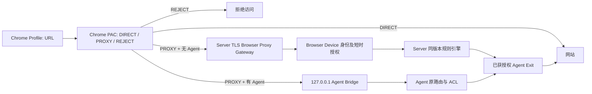

# RelayProxy Browser — 独立浏览器客户端与通用代理设计

> 方案版本：v1.0 · 2026-10-13  
> 基线：`feat/browser-session-sync`（PR #194，尚未并入 main）  
> 本文档所在分支：`design/browser-unified-proxy-client`，**仅设计/原型，不部署生产代理**。  
> 配套原型：`docs/prototypes/relayproxy-browser-unified-client.html`

## 1. 产品定位与原则

从“RelayProxy Browser Sync”升级为 **RelayProxy Browser**：Chrome Profile 级独立客户端，四个一级能力：①浏览器通用代理；②有序分流规则；③订阅规则；④已实现的端到端加密会话同步。扩展不依赖本机 Agent，但可选复用 Agent 路由。**不承诺浏览器代理等价于系统级 Agent 或透明 VPN。**

- **默认最少必要权限**：用户主动启用浏览器代理时提示 `proxy` 权限和可能的 Chrome 配置控制权；会话同步单独申请网站 Host、Cookie、Storage 权限，不因代理自动获得任何会话数据授权。
- **身份与 ACL 统一**：同一个 Profile 的 browser device ID、公私钥、提交的身份 ID 和设备名；代理是 **新增的 `browser.proxy.use` 能力**，不能继承 `browser.sync.send/receive` 或一般 Agent `proxy.exit`，管理员需要明确批准。远程出口必须同身份、在线、具有 `proxy.exit` grant 并满足 Agent/Relay ACL。
- **统一规则含义，不混淆能力**：Agent 能识别进程、IP 路由、部分 DNS 情况；Chrome PAC 主要可对 HTTP(S) 请求的主机名/URL进行代理选择。**浏览器不支持 Agent 的进程名规则、任意 UDP、系统 DNS 劫持、透明网络流量**。导入不支持的规则需展示跳过原因，绝不能静默把精确路径/IP 规则扩大为整个域名。
- **单一有效策略快照**：本地扩展与 Server 持有同一 `policyVersion` 与规则哈希；只接受完整编译且签名/授权的版本，不能出现 PAC 已应用但 Server 出口路由仍是旧版的半更新。先提交 Server 策略，再原子安装 Chrome PAC；提交失败继续旧有效快照。离线保留已校验版本并实行既定故障策略。
- **会话同步隔离**：Browser Sync 保留独立 E2EE、双端配对及可勾选的四类数据；代理分流规则不授予其他 Profile 同步权，代理可单独使用。

## 2. 信息架构与交互

桌面 Chrome 完整设置页（保留既有 RelayProxy Server Web 风格、响应式）：
1. **概览**：服务器/设备审批、代理主开关、模式、当前默认出口、可用出口数量、规则命中、延迟/错误；今日统计和最近连接。
2. **代理与出口**：分流模式（规则/全局代理/全局直连）、默认动作/默认出口、连接保持策略、所有**本身份已授权且在线**出口列表、出口探测、按代理路径应用与回滚、可选本机 Agent。单击“连接服务端”沿用身份 ID+设备名必填，待审批自动连接。
3. **分流规则**：按优先级拖拽排序；名称/启用/类型/目标匹配/动作/指定出口/备注；模拟“测试 URL，显示命中来源、所选出口、浏览器能否执行”、批量启停、冲突提示与导入。
4. **规则订阅**：地址、格式自动检测、启用、PROXY/DIRECT/REJECT、代理出口、通过代理更新（单独勾选）、刷新时间、有效/跳过条数、上次错误及缓存版本、手动更新、拖动订阅顺序、详情预览。
5. **连接监控**：时间、请求域名、规则来源、动作、实际出口、状态、时延和已知流量；过滤搜索，暂停监控/清空记录/导出脱敏日志。**真实出口以 Server/Agent 的权威回执为准；Chrome 侧无法单独从 PAC 推断每条 TCP 连接最终出口**。
6. **会话同步**：沿用既有设备 A/B 邀请、Cookie / LocalStorage / SessionStorage / IndexedDB 四种类型、覆盖及同步后打开复选框、网站授权和独立网络绑定管理。
7. **设置**：设备与身份、连接状态、Chrome 控制权、浏览器权限、DNS/QUIC/WebRTC 边界说明、订阅刷新、诊断、配置导入导出、隐私和重置代理。

**Popup**：主开关、模式、当前默认出口、当前标签页预计规则命中、查看日志/规则/完整设置的快捷入口。会话同步作为独立卡片而非默认首页。**首次授权、断连、被策略接管、退出还原代理**有明确状态；不把“正在连接”误判为已接管。

## 3. 用户可见规则模型

```json
{
  "mode": "rule",
  "defaultAction": "PROXY",
  "defaultExitId": "agent-hk-01",
  "rules": [
    {"id":"r-private","enabled":true,"name":"内网直连","kind":"DOMAIN_SUFFIX",
     "value":"corp.example","action":"DIRECT","exitId":""},
    {"id":"r-work","enabled":true,"name":"工作站点","kind":"DOMAIN_SUFFIX",
     "value":"work.example","action":"PROXY","exitId":"agent-us-02"},
    {"id":"r-block","enabled":true,"name":"拦截广告","kind":"DOMAIN",
     "value":"ads.example","action":"REJECT","exitId":""}
  ],
  "subscriptions": [
    {"id":"sub-1","enabled":true,"name":"GFWList","url":"https://example.org/gfwlist.txt",
     "action":"PROXY","exitId":"agent-hk-01","fetchViaProxy":true}
  ]
}
```

**唯一优先级**：
- `global_direct`：显式 DIRECT（应用不再控制 Chrome 代理，或安装显式直接模式；无规则计算）。
- `global_proxy`：所有可代理的浏览器 HTTP(S) 流量使用默认授权出口；仍执行内建回环/控制面保护与用户的显式 REJECT 规则（是否启用需明确）。
- `rule`：系统保留规则（Server bootstrap / 回环地址 / 禁止内网 CONNECT）→ **用户手动规则，自上而下第一条命中** → **订阅组按顺序，组内首命中** → 默认动作。Agent 已有手动优先于订阅的行为保持一致。
- 系统保留规则不允许被导入的订阅覆盖；订阅 `@@` 仅是**该订阅内部排除**，不等于强制 DIRECT；规则命中失败使用下一条，不自动猜测出口。
- 匹配 MVP：`DOMAIN` 精确、`DOMAIN_SUFFIX` 包含根域及子域、`HOST_WILDCARD` 受限单/多级通配、`IP_LITERAL`、协议 `HTTP/HTTPS`、TCP 端口（受代理能力约束）。`CIDR` 仅用于 URL 字面 IP，**不会为域名调用客户端 DNS 来试图匹配 CIDR**，避免本地解析泄漏。`PROCESS`、路径、复杂正则、请求头、DNS 应答属性在 Chrome PAC 路由中不支持；单独的 DNR 去广告不是出口分流。
- 动作：`PROXY`（显式指定合法出口或默认出口）、`DIRECT`（不经 RelayProxy）、`REJECT`（优先 DNR block，PAC 配合不直连的阻断哨兵）；规则缺失/出口未授权时**禁止无提示退回 DIRECT**。按用户选择的 fail-closed 保护处理。
- 禁止把源站控制台上已经存在的 Agent 进程匹配规则无损标记为 Chrome 规则，导入必须给出兼容报告。
- 规则编辑支持草稿、模拟匹配、一次性应用、版本回退（至少保留最近两份成功配置）。表单和订阅数据可持续刷新，但**绝不覆盖未保存编辑**。

## 4. 两条代理执行路径



### A. 本机 Agent 增强模式（有 Agent 可选）

PAC 使用已有 `127.0.0.1:21291` 浏览器 Bridge，由 Agent 对浏览器入口执行既有 Go 分流/出口/订阅引擎。保留 Agent 授权、在线及配置管理。Chrome 管理自己的规则时，需要明确**以浏览器规则为准**或**委托 Agent 规则**，禁止“前端命中一个出口，Agent 背后改选另一个”但 UI 仍声称原出口；可优先采用“委托 Agent”并在界面注明实时实际出口。Agent 不在线时不能暗中放行。

### B. 无 Agent 模式（默认，新增通用 Browser Proxy Gateway）

Chrome `chrome.proxy.settings` 安装**单份 PAC**；PAC 将需要代理的 HTTP(S) 目标送往一个 TLS 受保护的 Browser Proxy Gateway（可复用 Server 的 TLS 监听端口，但**不得复用 Browser Sync 配对专用的 HTTPS:443 单域 CONNECT 授权**）。Server：
1. 浏览器先用已批准私钥完成 WSS/HTTPS 设备认证并获取 5~15 分钟的**短期代理租约**，单独要求 `browser.proxy.use` grant；租约绑定 device ID、identity ID、policyVersion、HTTPS origin，限速/并发控制，并支持实时撤销。
2. 对每个普通 `CONNECT host:port` 或 `HTTP absolute-form` 请求进行身份/租约有效性校验、Host/port/IP/ACL 审核，在服务端用**同版已签名的规则快照**决定真实 `exitId`。不能只使用 PAC 计算结果来相信某个出口；PAC 只能决定是否送进网关。
3. 每次访问与已建立连接都核对同身份、指定 `proxy.exit`、Relay/Agent ACL 与在线状态；不允许访问内网、metadata、环回及 Server 管理面（除明确受控的本地规则）。HTTP forward 防头部注入、去除 Proxy-Authorization、限制流数和目标端口策略（例如 P0 TCP 80/443）。
4. 浏览器通过 `webRequest.onAuthRequired` 只针对**确定的本 Server Proxy 挑战**提供会话认证；不可把代理 Basic 凭据泄露到一般网站挑战；限制重试次数。长期私钥不直接作为代理 Basic 凭据。代理认证响应未获授权绝不 fallback DIRECT。
5. Server 可路由不同 Host 到不同 Exit，即使 Chrome PAC 仅返回同一 `HTTPS proxy.example:21000`；**PAC 本身不能携带不同的 exitId，也不能在一个公用 HTTPS 代理凭据里靠 host 自动确定合法身份**。需要 Server 权威规则引擎与命中回执。若 Server 规则与客户端编译版本不同，应拒绝/回滚或基于被接受的明确旧版本完成该请求，绝不静默使用另一出口。
6. 平台协议支持：TCP HTTP、HTTPS CONNECT、常见 ws/wss（在浏览器 HTTP 栈支持范围）；**无任意 UDP、无 QUIC 代理、无系统级 DNS 管理**。真实非 443 HTTPS/CONNECT 应通过 ACL 开放，MVP 只保证 HTTP:80 和 HTTPS:443。Server HTTP/2 CONNECT、HTTP/3 的能力必须实网验证，不能以普通 WSS 测试通过代替。

### 浏览器 / PAC 明确限制

- `chrome.proxy` 配置在 Chrome Profile 网络栈生效，不是单标签页独立代理；另一个扩展或企业策略可能持有控制权。启用前检查 `levelOfControl`，失去控制权立即展示“未接管”，不能显示假连接成功。
- PAC 决策的 HTTPS URL 路径并非可靠可用；主要做 Host/协议路由，不支持“某 HTTPS 路径用美国出口、同域另一路径香港出口”。
- Chrome 自身有回环地址绕过等规则及 Chrome 内置网络行为，代理不等于防泄漏 VPN。WebRTC、QUIC、内置安全 DNS/DoH、Service Worker/缓存、Chrome 系统服务请求需分别做可观测性与实际边界验收。不能宣称关闭所有 DNS 按钮即可全流量受控。
- `DNR` 可按规则阻断/升级/重定向和辅助广告屏蔽，**不是可指定任意代理出口的规则引擎**。MV3 中多数扩展不能使用阻塞式 `webRequestBlocking`；认证使用 `webRequestAuthProvider`。
- 退出“关闭代理”默认释放本扩展对 Chrome 代理的控制，恢复用户之前有效的系统/其他扩展配置；“无代理”状态与“明确 DIRECT”模式分开。出错保护默认不回落 DIRECT，用户可以在 UI 显式关闭保护（需提示潜在泄漏）。

## 5. 订阅兼容与更新

**复用 Agent `routing.subscriptions` 数据模型和解析/安全要求，而不是在扩展引入可执行的外部 PAC 代码。**

- 新增/编辑：名称、HTTPS URL、格式自动识别、启用、组动作 PROXY/DIRECT/REJECT、出口 ID、`fetchViaProxy`（默认关闭）、刷新时间和顺序；支持手动更新、原子版本发布、暂停、删除。
- 解析：Agent 目前支持逐行域名/IP/CIDR、Adblock 主机过滤器 `||host^`、Base64 GFWList 和 `@@` 同组例外；继续沿用**保守子集**，URL 路径、任意脚本、任意正则、第三方请求语法不自动扩大作用域。
- 下载安全与 Agent 对齐：仅 HTTPS、限制 5 跳、大小上限 8 MiB、最多 100000 条、SSR F 防护（禁止解析到内网/环回/metadata）、内容哈希及重复去重，默认 6 小时自动刷新，失败约 1 分钟退避重试。优先通过 Server 安全下载/编译并使用**同版 snapshot** 派发到已授权 browser device；若浏览器本地下载，必须严密处理跳转与 IP 复绑定，建议 P0 在 Server 完成受限获取。
- `fetchViaProxy` 只能使用**当前已获授权的出口**，单独的引导通道下载，避免递归经尚未生效的 PAC 触发代理环路；远程取回不自动 fallback DIRECT，保留上一份成功缓存和清晰错误。
- 大订阅**不能逐行塞入 Chrome PAC**。Server 将订阅规范化并提供有界 PAC 适用部分或分桶快照；Chrome PAC 仅以确定性 Host 检查决定 PROXY/DIRECT/REJECT；若规则超出浏览器端 PAC 容量/性能或超出受支持匹配子集，拒绝该配置或要求 Agent 模式，绝不可悄悄丢弃直接放行。
- 缓存保留成功版本、条数、跳过/冲突统计、ETag/Last-Modified（若支持）与错误；订阅更新不能覆盖手动排序及未保存表单。

## 6. 数据、控制 API 与权限

建议与 PR #194 的 Browser Sync 数据表**隔离**：
- `browser_proxy_device_grants`：browser device、identity、`browser.proxy.use` 审批、撤销时间。
- `browser_proxy_policies`：`identity_id, device_id, policy_version, hash, mode, default_exit, compiled_rules, updated_at`，写入时要求身份与已授权出口合法；每次变更有 `etag` 防并发覆盖。
- `browser_proxy_subscriptions`、`browser_proxy_subscription_revisions`：来源、受限下载与解析状态/缓存，更新不影响其他身份。
- `browser_proxy_leases`：仅持有 token 哈希+过期时间+设备/策略版本，不存长期密码。
- `browser_proxy_events`：受控元信息（日常连接 Host、规则 ID、出口 ID、结果、耗时），按租户隔离、限期存储与清除；**不记录 URL 路径、请求头、Cookie、负载或代理 Basic 密码**。

建议 API（路径待与 Server 现有 REST/WS 路由核对）：
```
GET    /api/v1/browser-proxy/status
GET    /api/v1/browser-proxy/exits
GET    /api/v1/browser-proxy/policy
PUT    /api/v1/browser-proxy/policy             # If-Match policyVersion/hash
POST   /api/v1/browser-proxy/policy/validate
POST   /api/v1/browser-proxy/lease              # 已签名浏览器设备证明
POST   /api/v1/browser-proxy/lease/revoke
GET    /api/v1/browser-proxy/subscriptions
POST   /api/v1/browser-proxy/subscriptions
POST   /api/v1/browser-proxy/subscriptions/{id}/refresh
GET    /api/v1/browser-proxy/events              # 按身份授权、分页、保留策略
```

审批从 Server Web 管理设备页面进行，待审批的浏览器只能低频查询自身审批状态，不可借匿名 Browser Sync 注册请求取得 Proxy 租约。状态事件使用既有统一的 `invalidate → refetch`，不能把 SSE 修订号当作授权证明。

## 7. 故障与安全矩阵

| 情况 | 客户端动作 | 最终状态 |
|---|---|---|
| Browser 权限未批准 | 不安装 PAC，保留原 Chrome 配置 | 未接管，提示权限 |
| 同身份 `browser.proxy.use` 待审批/撤销 | 不签发新租约；已有连接被主动终止或最迟租约到期关闭 | 代理不可用（按保护策略），不暗中直连 |
| Server / WSS 断连 | 已安装 PAC 仍指向明确 HTTPS 代理；定时补查，不以 WSS 在线代表转发成功 | 断线保护 |
| 默认/规则出口离线、无权限或身份变化 | Server 拒绝目标；不能偷偷切其他身份/出口 | 拒绝 + 显示原因，可显式配置有序备用合法出口 |
| 订阅更新失败 | 原子保留旧成功快照、标记错误 | 不发布空规则 |
| PAC 生成失败/超限、签名版本不匹配 | 不替换上版有效配置；阻止使用未提交策略 | 继续旧策略或显式阻断 |
| Chrome 策略/其他扩展占用代理控制权 | 检测 `levelOfControl` 变化 | UI 标记失控，不再显示受保护 |
| 用户明确关闭代理 | 撤销短时租约、清理本扩展 PAC、交还网络控制 | 不再受扩展保护，明确提示 |
| Browser Sync 规则撤销 | 仅终止被撤销的会话配对与其旧式专用绑定 | **不擅自改变**独立的全局代理规则 |

## 8. 开发阶段、测试与出厂门槛

### P0（必须完成才能称为通用代理）
1. Server 独立 Browser Proxy 权限、认证、租约与 ACL；跨身份/未批/撤销全部拒绝。
2. Agentless Gateway HTTPS 代理与 Agent 出口多路复用，HTTP/HTTPS/CONNECT/WebSocket 限制明确；Server 真实出口命中与 PAC 同版本。
3. Chrome Proxy Manager：接管权/策略兼容、手动规则 PROXY/DIRECT/REJECT、默认出口、 fail-closed、主开关、安全还原；多 Profile 冲突说明。
4. 有序订阅（至少 GFWList/域名）、代理下载、不安全 URL/跳转拦截、失败缓存回退、兼容统计。
5. 完整设置 UI + Popup、出口选择与真实状态监控、规则测试器和错误解释。
6. 完整回归：规则顺序、动态更新版本一致、Exit ACL、HTTP/HTTPS、代理断线、旧版 Server、Chrome 冷启/MV3 休眠、失去代理控制权、Linux/Windows/macOS 实体 Chrome 网络可访问性；检查 DNS/QUIC/WebRTC 边界。

### P1
- 端到端出口流量/时延统计和准确命中日志、多个合法备用出口与健康探测、分组策略、规则导入导出及冲突预览。
- 订阅缓存校验/增量更新/大量规则优化、多身份切换保护、全局断线提示与红色泄漏警告。
- Server 多实例事件共享与政策快照同步、独立 proxy API 兼容层、前后端安全与并发压测。

### P2
- Agent 完整配置委托/同步，复杂域名列表压缩与高级诊断；独立去广告 DNR 控制台；按标签页短时代理配置**只能在独立 Chrome profile 或产品证实支持的更窄能力下提供**，不作虚假承诺。
- Chrome 外其他浏览器适配需单独验证 API 差异。

**合并策略**：本文档与 HTML 原型先在设计分支审阅。PR #194 继续完成 Browser Sync 生产门槛；新通用 Browser Proxy 应从依赖 PR #194 的独立 feature PR 开发，在真实策略引擎与安全网关经过验收前**不改动现有 Browser Sync 默认路径**。
