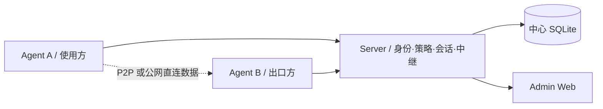
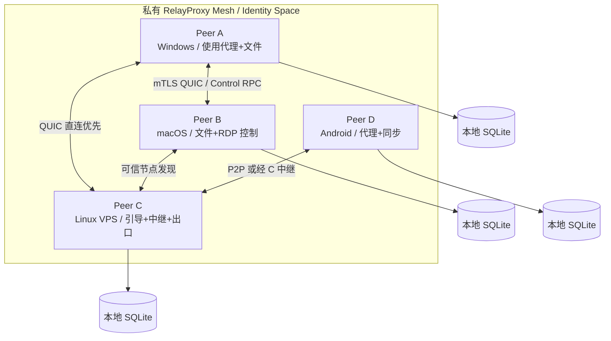
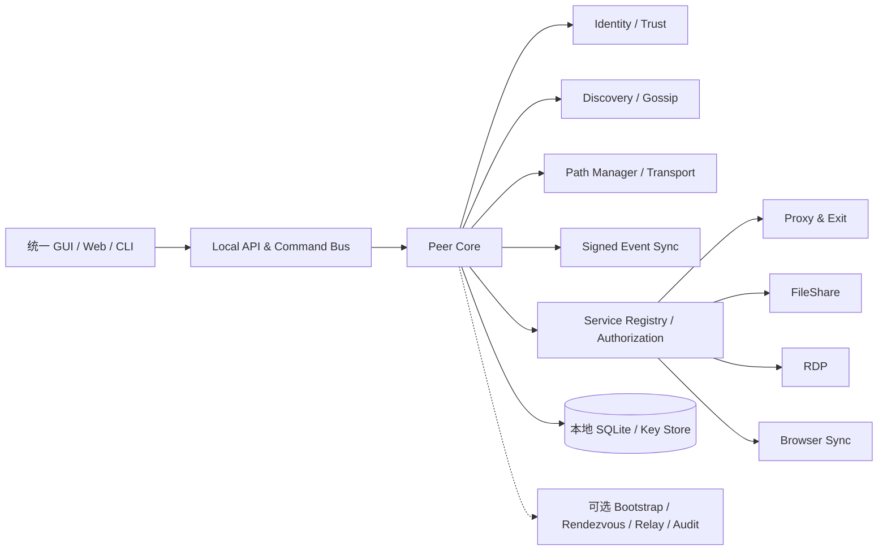
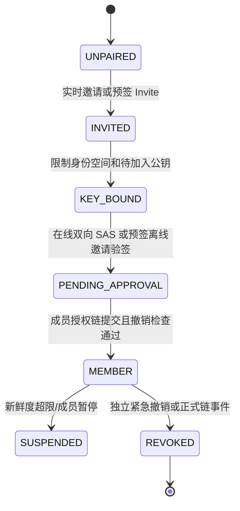
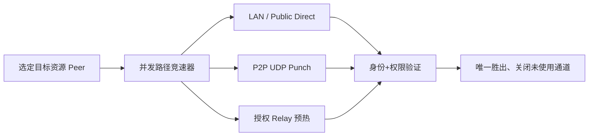
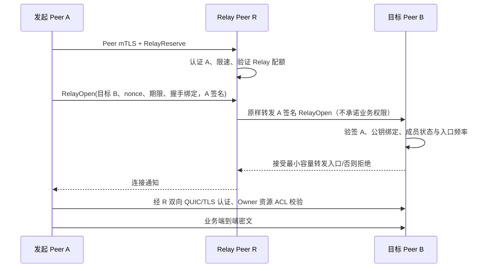
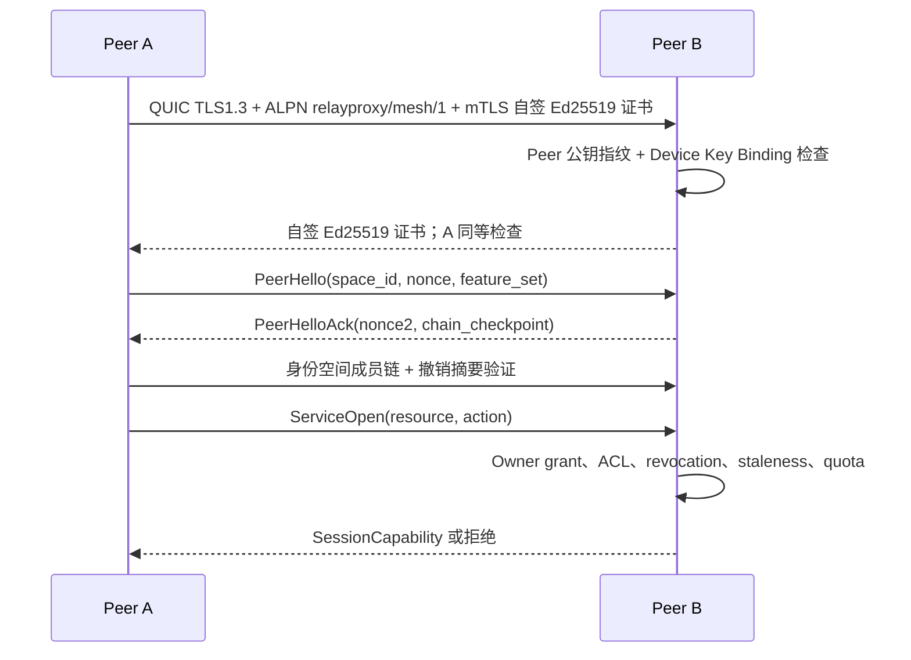
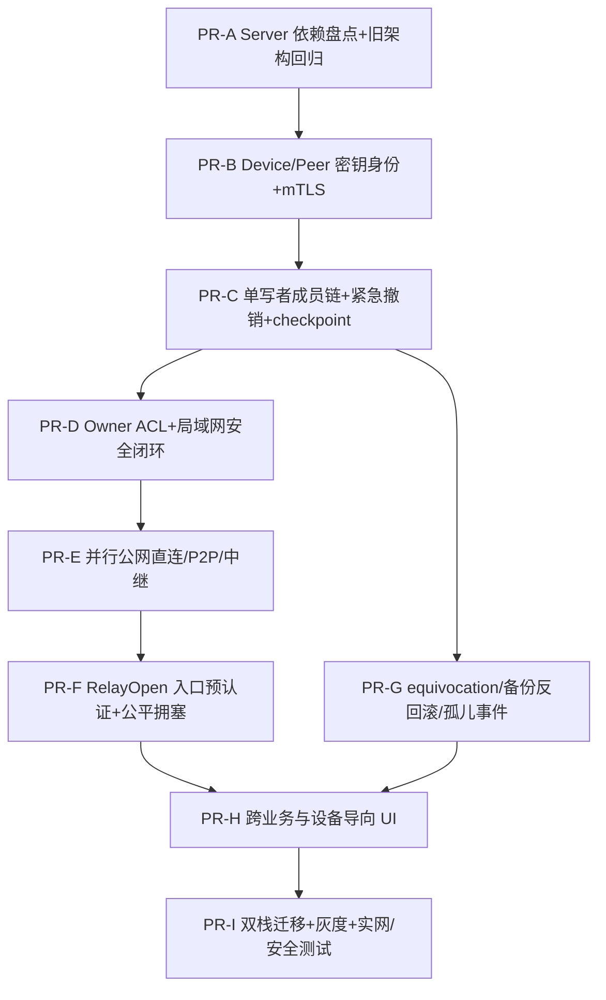

# RelayProxy 去中心化 Peer Mesh 架构重构设计

> 文档状态：**Design Proposal / 待评审**（非已实现声明）  
> 版本：v1.2（在 v1.1 基础上吸收 `design-review.md` 的第二轮 12 项评审）  
> 日期：2026-10-17  
> 建议仓库路径：`docs/relayproxy-decentralized-peer-mesh-design.md`  
> 适用范围：RelayProxy Server、Agent、Windows/macOS/Linux/Android 客户端、浏览器扩展、协议与运维  
> 本文中的模块路径、协议字段和性能指标均为**目标设计**，不能理解为现有代码已经支持。
> v1.1 已拆分的三份专题设计仍是配套参考；本 v1.2 为完整修订总稿。第一轮 R-01～R-20 追踪参见 `relayproxy-mesh-review-resolution.md`。

---

> **本次修订**：吸收 `design-review.md` 的 12 条新评审意见；不替代已解决的 Excel R-01～R-19。设计条款是待验证方案，不表示代码已完成。

## 阅读导航

- **总体方案**：第 0–4 章（架构决策、现状、目标、Peer Core、能力模型）
- **安全与网络**：第 5–8 章（身份、授权、发现、NAT 穿透和中继）
- **可开发协议**：第 9–12 章（控制消息、签名状态同步、数据库、各项业务迁移、API）
- **产品与落地**：第 13–16 章（设备导向 UI、代码组织、Server/Agent 迁移、PR 阶段）
- **验证与决策**：第 17–21 章（测试矩阵、运维、风险、验收、参考资料）

---

## 0. 执行摘要与架构决策

RelayProxy 从“一个中心 Server + 多个 Agent”重构为“**同一 Peer 内核 + 分布式信任与发现 + 端到端服务访问 + 可选引导/中继**”。每台设备均具有成为服务提供方与使用方的能力；实际启用功能受操作系统、资源预算、用户设置和授权控制。

关键结论：

1. **统一二进制核心，不强制每个设备运行所有服务。** 原 Server 能力解耦为 `bootstrap`、`rendezvous`、`relay`、`admin`、`audit` 等可选服务，运行 VPS 也只是一个 Peer。
2. **身份信任不等于管理节点在线。** 用身份根信任、设备密钥、签名成员凭证、设备本地 ACL 和短期会话能力票据替代 Server 在线审批；身份所有权保留，不采用“任何节点都可以批准任何节点”。
3. **控制平面去中心化，不保证任意网络环境下无基础设施可达。** LAN 可零引导；公网设备可使用预配引导/观察节点，严格 NAT 可经任意授权中继连接。
4. **保留现有业务协议和路径语义。** `DIRECT/PROXY/REJECT` 是分流动作；`public_direct_quic/p2p_quic/relay_quic/relay_tls` 是通信路径。业务处理、出口 DNS、文件共享、RDP 与浏览器同步不因路径变化改变授权语义。
5. **V1 采用单写者成员授权链 + 独立紧急撤销集合。** 正常成员签发/委托变更由一名有效的空间授权写入者串行提交；具备 `revoke_only` 委托的管理员可以独立签发单调撤销证据，立即进入不可逆撤销覆盖层。资源授权仅由 Owner 单写。DAG 多写者放至 V2。
6. **分阶段双栈迁移。** 初期保留旧 Server 作为兼容桥；优先完成两设备无 Server 局域网互通，再完成公网 Mesh，最后移除固定角色。

### 0.1 需要批准的 ADR（Architecture Decision Record）

| ID | 决策 | 本案建议 | 理由 |
|---|---|---|---|
| ADR-01 | 节点运行模型 | 统一 Peer Core + 可选服务 | 平台差异大，避免 Android 变成全天候 Server |
| ADR-02 | 根信任 | 每个身份空间有离线可恢复的根密钥 | 设备平权不代表授权来源无主 |
| ADR-03 | 加入网络 | 邀请凭证 + 人工确认/管理员委托 | 防止未知节点自动获得访问权 |
| ADR-04 | 公网发现 | 手工入口 + 可信引导节点 + 邻居 Gossip | 面向小型可信 Mesh，暂不引入全局 DHT |
| ADR-05 | 数据路径 | LAN/公网直连/P2P 优先，单跳授权中继回退 | 复用既有 QUIC 能力、减少多跳攻击面 |
| ADR-06 | 分布式存储 | SQLite 本地库 + 对象级签名事件同步 | 避免复制同一个 Server SQLite 数据库 |
| ADR-07 | 授权一致性 | 单写者成员链 + 独立撤销覆盖层；Owner 独占资源 ACL 写入 | 降低 V1 冲突面；任何撤销都不能被旧授权覆盖 |
| ADR-08 | 兼容迁移 | 双栈兼容、显式身份绑定、可回滚 | 避免既有设备升级后失联 |
| ADR-09 | TLS 身份绑定 | 双向 Ed25519 自签证书，验证公钥与 Peer ID 一致 | 固定一种可测试实现，拒绝模糊多方案 |
| ADR-10 | 密钥轮换 | 稳定 Device ID 与可轮换 Peer Key ID 分离 | 降低逐资源重授予成本，不允许仅凭旧私钥夺回设备 |
| ADR-11 | Relay 拥塞 | V1 中继路径禁用 Brutal，强制公平限速 | 多租户下杜绝单流无界抢占 |

### 0.2 本轮必须冻结的 P0 决策（新增）

| 代号 | 决议/门禁 | 状态 |
|---|---|---|
| ADR-12 | Wire Format：控制消息使用 length-delimited Protocol Buffers；签名对象使用严格定义的原始字节签名框架，严禁把“各平台 protobuf deterministic marshal 一致”当作前提 | 设计提案，须 Go/Kotlin/JS 交叉测试通过后冻结 |
| ADR-13 | Clock Trust：时间偏差不直接扩权；大偏差/跳变导致安全状态降级；物理时间只用于有效期，序列与可信链头用于顺序和防回滚 | 设计提案，须含多种时钟攻击的跨平台测试 |
| ADR-14 | Event Retention：V1 是线性哈希链与仅撤销集合，使用带签名快照/检查点的可证明安全压缩，不设计 DAG GC | 设计提案，须证明离线恢复不会复活旧授权 |
| ADR-15 | Multi-Space Isolation：发现、地址、Relay 配额、PeerRecord、缓存、诊断及订阅均按 Space 显式分区 | 设计提案，需跨空间侧信道测试 |

**注意**：本轮评审报告引用的 `5986 nodes / 31380 edges` 和 `tunnel=127`、`p2p=64` 为评审方代码图谱统计，不是本文件的独立复算结果；不得用于承诺工期。

## 1. 背景与现状核对

以仓库 `main` 的 `README.md`、`docs/proxy-p2p-direct-path-design.md`、`docs/proxy-public-direct-path-design.md` 为参考基线（2026-10-17 检索）。

### 1.1 当前已描述的基础能力

- Server：设备首次审批、身份归属、跨身份授权、集中 ACL、连接协调、出口发现、Relay、RDP 入口、连接审计、SQLite、Admin Web。
- Agent：SOCKS5/HTTP、进程/域名/IP/端口分流、TCP/UDP、Windows 透明代理、出口处理、本地 GUI/Web、实时监控。
- 传输：TLS/QUIC、P2P QUIC、已设计实现的公网直连 QUIC、Relay QUIC/TLS、路径健康度/回退。
- 扩展中的能力：共享文件夹、设备级读写授权、进度/速率、浏览器状态同步、消息规则、订阅和去广告等。以上功能需要按仓库最新代码逐项核对具体成熟度，**不得仅凭此前设计文档认定均已上线**。

### 1.2 当前架构的中心依赖



即使数据已点对点，某些认证票据、授权版本与路径协商仍依赖 Server。**因此删除 Server 进程不等于实现去中心化。**

### 1.2.1 P0 第一交付物：真实 Server 依赖热力图（新增，尚未完成）

代码评审提供了两个入口、Server 授权集中化和 tunnel/p2p 较高耦合度的线索。初步从 `main` 文件读取确认 `cmd/relay-server/main.go`、`cmd/relay-agent/main.go`、`server/service/auth_service.go`、`internal/tunnel/session.go` 存在；仅此不能推导全仓 fan-in、运行时热路径或改造工期。

P0 必须生成 `docs/mesh-server-dependency-inventory.md` 与机器可复现的 CSV/JSON 图谱，字段至少为：`repo_sha, symbol, file:line, callers, callees, edge_type, config_entry, protocol_message, db_state, runtime_frequency_or_unknown, security_owner, replacement, cutover_flag, test, complexity, owner`。执行范围覆盖身份/审批、出口 ACL、P2P/Direct ticket、RDP、文件共享、浏览器、消息、审计及全部旧 Server SQLite 写点。

- 静态 fan-in/out 仅代表**静态依赖规模**；执行频率须用 traces/benchmark 单独测量，未采样时写 `unknown`，不得从入边数推断吞吐。
- 按调用链划分热区：`A/高风险` 身份签发/集中 ACL/票据/协议边界；`B/中风险` 发现、状态/库模型；`C/低风险` 展示与薄适配。难度须标注依据和测试可用性。
- 优先为现有 `TunnelSession` 上层提供 `AuthenticatedConn` 薄适配层，不对 `internal/tunnel/` 做一次性重写；API 变化必须保留旧连接端到端回归。
- P0 未完成依赖图与旧功能基线之前，P1–P6 **只能作为工作包顺序，不得作为可信排期估算**。

### 1.3 必须保持的兼容约束

- 路由命中优先级、代理动作、出口选择、DNS 防泄漏策略及现有目标 ACL 语义不得意外变化。
- 既有持久化设备身份不得无提示轮换；设备私钥丢失时必须重新绑定，而非只复用旧设备 ID。
- 共享文件夹继续由文件所在设备授权；无共享授权的设备不能在文件浏览器中看到共享资源。
- 文件下载原名、断点续传、进度/速率，浏览器会话密文隔离，RDP 目标授权与封禁要求持续成立。
- Windows、macOS、Linux、Android 的本地代理能力保持；Android 后台限制须单独评估。

## 2. 目标、非目标与成功标准

### 2.1 功能目标（MUST）

1. 两台预先完成信任建立的设备在同一 LAN 内，关闭旧 Server 后仍可发现、认证、代理、传输文件、连接 RDP（能力/平台支持时）。
2. 不存在固定的管理/中继主机：任意拥有适当资源和权限的 Peer 可提供引导、协调、出口或中继服务。
3. 一台设备离线不影响其他已连通设备之间合法、未过期的会话；关键授权撤销应能在联通节点间传播并被执行。
4. 每台设备对本地资源具有最终决定权；跨身份能力以可验证、可撤销的授权凭证表达。
5. 支持公网复杂 NAT 情况下借助一个或多个用户允许的引导与中继 Peer，且业务端到端加密，中继不能读取业务明文。
6. 允许从现有 Server/Agent 平滑迁移、断电恢复、回滚；旧客户端在兼容窗口内可继续运行。
7. GUI 以设备为入口，隐藏 Server/Agent 角色，但保留必要的高级网络诊断能力。

### 2.2 质量目标（初始验收门槛，须通过实网基线校准）

| 指标 | 预期目标 | 说明 |
|---|---|---|
| LAN 连接建立 | p95 < 3 秒 | 已信任、网络正常、发现缓存命中；不含人工审批 |
| WAN 直连建立 | p95 < 10 秒 | 采用有界并行候选竞速；至少一个有效信令路径；不同 NAT 单独报告 |
| 中继回退建立 | p95 < 15 秒 | 中继候选与直连并行预热，入口预认证；有授权、可达且容量足够的中继 |
| 旧 Server 不可达 | 核心 Mesh 已建立连接仍可用 | 不因管理面断线强制断开；依权限有效期决定 |
| 已连通撤销推送 | p95 < 5 秒（实验门槛） | 所有相关资源方有健康控制通道、扇出拓扑可达；以接收到有效签名并拒绝新流为准，不适用于分区 |
| 分区撤销安全 | 按资源新鲜度上限 fail closed | 不能承诺离线的资源方立即得知撤销；超过门槛不得开新高危会话 |
| 中继额外明文暴露 | 0 | 中继只能看到必要元数据，不能解密业务负载 |
| 安全回归 | 0 高危未解决项 | 含认证绕过、开放代理、DNS 泄漏与撤销回滚 |
| 兼容/回滚 | 通过全平台矩阵 | 不丢身份、不静默扩大 ACL |

### 2.3 非目标（V1）

- 匿名公共 P2P 网络、任意不可信第三方中继交易市场、区块链共识。
- 通用多跳覆盖网络、出口节点之间的全互联网 BGP/路由表分发。
- 全球规模 DHT、无边界的全 Mesh 广播或所有设备数据库强一致同步。
- 在没有任何公共可达节点、没有 LAN、又无法打洞的双端 NAT 条件下保证连通。
- 让移动平台绕过其后台服务、VPN 权限或系统沙盒限制。

## 3. 目标总体架构



**注意：箭头表达可建立的逻辑关系，不要求维持全连接。** 网络构建策略是按需拨号、必要时稳定保持少量可信邻居连接。

### 3.1 每个 Peer 的逻辑组件



| 层 | 职责 | 不能承担的职责 |
|---|---|---|
| Identity | 本机密钥、身份成员凭证、根信任、撤销状态 | 不能因发现节点就自动授权 |
| Discovery | 发现受信 Peer 的可达线索及服务摘要 | 不能成为权限真相源 |
| Transport | 候选地址、打洞、直连与中继、连接健康度 | 不能修改路由选定的业务目标 |
| Control RPC | 状态同步、服务查询、授权操作、设备操作 | 不直接绕过本地资源 ACL |
| Policy | 成员权限、能力、资源级 ACL、审计 | 不能仅依赖远端声称的状态 |
| Service | 代理、文件、RDP、消息、浏览器会话 | 不依赖连接路径判断是否可信 |
| Storage | 本地密钥引用、事件、缓存、统计 | 不复制设备私钥与敏感本地配置 |

### 3.2 “平等”定义

- **协议平等**：设备使用同一 Peer 协议，任何平台可实现其允许的服务能力。
- **资源不平等**：VPS 可以运行长时中继；手机可能只作为按需客户端。
- **安全权限不平等**：身份根、管理员、资源所有者可授予能力；普通成员不能自动管理别人设备。
- **网络可达性不平等**：公网节点可为 NAT 节点提供协调；不因此自动拥有更高的控制权限。

## 4. 角色和服务能力模型

### 4.1 不再持久化 Server/Agent 角色

目标实体为 `Peer`；服务以 `ServiceAdvertisement` 表达。建议初始能力：

| 能力名称 | 作用 | 默认状态 | 主体授权 |
|---|---|---|---|
| `peer.discovery` | 受限节点发现与目录查询 | 可信连接内开启 | 必须为授权成员 |
| `peer.bootstrap` | 为新节点提供引导入口 | 手动开启 | 限流、无授权权威 |
| `peer.rendezvous` | 地址/候选交换、观察可达性 | 手动开启 | 同网络可信成员 |
| `peer.relay` | 转发端到端密文流量 | 默认关闭 | 双端授权、配额 |
| `proxy.client` | 发起代理 | 按平台配置 | 本机用户授权 |
| `proxy.exit` | 作为远程网络出口 | 默认关闭 | 出口资源 ACL |
| `rdp.host` | 暴露设备 RDP 能力 | 默认关闭 | 目标本地授权 |
| `rdp.connect` | 发起 RDP 访问 | 依设备授权 | 主客体双向检查 |
| `file.share.read` | 下载指定共享目录 | 默认无共享 | 目录级 ACL |
| `file.share.write` | 上传/删除/重命名 | 默认拒绝 | 单独写权限 |
| `browser.sync` | 同步选定浏览器域状态 | 默认关闭 | 配对设备/域授权 |
| `message.publish/subscribe` | 发布/接收消息 | 默认关闭 | 频道/身份授权 |
| `policy.manage` | 修改特定对象授权 | 默认根/委托 | 不能越权提权 |

默认关闭高风险服务；宣传 `ServiceAdvertisement` 不等于赋权。能力命名应设置稳定注册表和版本，不与历史 UI 勾选项硬编码绑定。

### 4.2 服务声明示例（概念结构）

```json
{
  "type": "service.advertise.v1",
  "peer_id": "p_...",
  "identity_space_id": "i_...",
  "services": [
    {"name": "proxy.exit", "version": 1, "scope": "members", "policy_revision": 17},
    {"name": "file.share.read", "version": 1, "scope": "authorized", "resource_count": 2}
  ],
  "endpoint_hint_digest": "sha256:...",
  "created_at": "2026-10-17T00:00:00Z",
  "expires_at": "2026-10-17T00:02:00Z",
  "signature": "base64url:..."
}
```

共享名称、内部路径、出口可访问的私网网段等应按授权分级返回，不应向陌生发现节点广播。

### 4.3 能力声明与可达性状态分离（本轮评审第 6 项）

V1 不再把服务能力与端点生存状态塞进相同的两分钟签名 TTL。`CapabilityAdvertisement` 在权限/服务状态/`policy_revision` 改变时发布，支持受限周期续签（默认参考 10 分钟，实际配置和测量决定）；`ReachabilityObservation` 是局部、短时、有网络作用域的路径健康缓存，不能作为授权证明。

| 对象 | 建议生命周期 | 接收逻辑 |
|---|---|---|
| CapabilityAdvertisement | 按变更推送；可选周期复核 5–10 分钟 | 验签、策略版本、空间可见性；旧版本禁止复活已撤销权限 |
| EndpointHint | 按端点/网络变动更新，带短 TTL | 仅供拨号探测，地址可达仍需端到端验证 |
| PathHealth | 本地按秒级活跃测试 + 指数退避 | 不能 Gossip 成全局权限真相 |

上文 §4.2 的 `expires_at` 两分钟是早期示例；正式冻结时应改成区分两种对象的 schema，不能照搬示例上线。

## 5. 身份体系、设备密钥与加入流程

### 5.1 术语与标识（v1.1）

| 对象 | 目标字段 | 权威含义 |
|---|---|---|
| Identity Space | `space_id` | 身份空间根公钥摘要；与登录名/旧 identity_id 无关 |
| Identity Root | `root_public_key` | 离线最终恢复锚，用于根轮换/恢复，不参与平日每次撤销 |
| Device | `device_id` | 创建时生成的稳定随机 128/256 位逻辑设备 ID；不是权限证明，不能单独鉴权 |
| Peer Key | `peer_id` | 当前有效 Ed25519 公钥域分离 SHA-256 指纹；密钥轮换后变化 |
| Key Binding | `device_key_binding` | 签名地将 `space_id + device_id + peer_id + key_epoch` 绑定，接受方校验完整信任链 |
| Member | `membership_credential` | 单写者授权链中已提交的有效成员凭证 |
| Revoke-Only Delegate | `revoke_only_credential` | 根/有权授权方预先签发；仅能撤销成员与委托，不能新增成员或扩大授权 |
| Space Writer | `membership_log_writer` | V1 每空间唯一当前成员授权链写入者，按前一提交 hash 串行追加 |
| Resource | `resource_id` | 一份资源；只能由指定 `owner_device_id` 实质管理 ACL |
| Grant | `grant_id` | Owner 签发的不可变授权事件 ID，按设备/资源/动作限定 |
| Trust Checkpoint | `checkpoint` | 根或有效空间写入者对最新链头、已知撤销集合摘要的签名锚 |

同一设备可加入多空间；`device_id` 表示逻辑设备，`peer_id` 表示**当前有效密钥**。验证权限时必须把稳定 `device_id` 映射为有可信 `key_epoch` 的最新 `peer_id`；仅知道 `device_id` 不构成身份认证。V1 每空间单写者只负责**扩大权限的串行管理**，不垄断拒绝/撤销通道。长期签名 Ed25519；连接 TLS1.3/QUIC；相关二进制签名输入需域分离。

### 5.2 信任根、紧急撤销和密钥轮换

- 新建身份空间生成离线根密钥并提供加密恢复包；推荐通过受系统硬件支持的密钥库保护设备密钥。
- 根将 `membership.write` 委托给一个当前空间写入者（可经有根签名的 `writer.rotate` 更换），再预先向**至少两个不同设备/管理者**签发有过期日的 `revoke_only` 委托。
- 任何仍有效的 `revoke_only` 管理者可独立签 `member.revoke`、`delegation.revoke`、`device_key.revoke`，包括撤销其他管理员。撤销证明构成单调集合，节点一经验证立刻拒绝受影响凭证，**无须等待根、空间写入者或全链同步**。其能力不能批准设备、签 Grant、轮换根或撤回已有撤销。
- 为控制被盗 `revoke_only` 管理员造成的 DoS，其凭证限定 `space_id`、操作集合、可选目标范围、过期日；根恢复/新 epoch 必须显式重建成员和信任，不能在原 epoch 对同一撤销做 LWW 反转。
- `membership.write` 不能越权修改其他设备资源的 ACL；策略 proposal 只是意图，资源 Owner 确认并签发自己的 Grant/Revocation 后才改变资源权限。
- 若旧设备密钥仍安全，密钥更新需**旧密钥、新密钥双方签名 + 有效管理员认可**；若旧密钥已泄露/丢失，须先撤销旧密钥，再通过独立的管理员确认或人工 SAS 重新绑定 `device_id`。不可仅凭旧私钥完成可能已泄露的恢复。
- 已签发给 `device_id` 的 Grant 可在新的可信 Key Binding 上继续使用，但 Owner 可设置 `require_regrant_on_rekey`（RDP/文件写入建议 true）；跨空间 Grant 由 Owner 重新确认，禁止默认跨越安全空间迁移。
- 根密钥及一切恢复材料丢失时不能仅凭公开 ID 取回空间；需要建立新空间逐台重新信任。

**V1 不提供无锚点的多写者 DAG 成员管理。**紧急撤销覆盖层是只减权的特例，不可用于提交普通新增授权。

### 5.3 新设备加入与预签邀请



**在线模式**：管理员和新设备交换身份公钥，双向 SAS 确认，空间写入者将签发事件追加当前链头，然后发放成员凭证。若当前写入者离线，用户可以等待或启动有根授权的写入者恢复流程；不能让多个离线管理员各自“乐观写入”。

**预签模式（R-18）**：新设备先在本机生成密钥，向管理员提供 `peer_id` / 公钥二维码；管理员可离线签一个明确绑定 `space_id + target_peer_id + device_id + actions=join + expires_at + nonce` 的 Invite。邀请并非有效成员凭证，设备后续通过任意可达可信节点提交给空间写入者串行入链，且验证单次使用、撤销、时间有效性及公钥持有证明。若只能获得通用预签邀请码（未绑定公钥），仍必须在线进行独立身份核验，不得直接批准成员。

邀请重放防护使用永久消耗记录、限制速率和明确的有效期；所有邀请凭证都必须限制所允许的初始权限。

#### 5.3.1 邀请创建者离线后的兑换（本轮评审第 8 项）

管理员 A 可离线生成**预签、绑定新 Peer 公钥和空间**的邀请；A 后续离线不阻塞递交：新设备可将 Invite 提交给任何经认证的在线可信 Peer M。M 仅执行签名验证、一次性兑换检查、速率限制和转发；**M 只有同时持有当期 `membership.write` 或合法 writer 切换委托时，才有权提交成员链**。普通成员、只有 `revoke_only` 的 M 不能自行批准入网。无 writer 可达时，申请进入 `PENDING_WRITER`，不能开启成员/服务权限。

Invite 至少绑定：`issuer_peer_id`、`space_id`、`target_peer_pubkey_hash`、`nonce`、`expires_at`、`allowed_initial_actions` 和 `invitation_epoch`。单次消费记录由当期写入者链提交后构成最终事实；M 的本地缓存不构成跨分区唯一性保证。同一 Invite 发生并发兑换时仅首个匹配的有效链事件能生效，其余拒绝并审计。

### 5.4 成员凭证（示意）

```json
{
  "schema": "mesh.membership.v1",
  "space_id": "i_...",
  "device_id": "d_...",
  "peer_id": "p_...",
  "key_epoch": 1,
  "device_public_key": "ed25519:...",
  "roles": ["member"],
  "can_delegate": false,
  "issued_by": "p_membership_writer...",
  "issuer_grant_id": "g_writer...",
  "not_before": "2026-10-17T00:00:00Z",
  "expires_at": "2027-10-17T00:00:00Z",
  "credential_id": "m_...",
  "issuer_signature": "base64url:..."
}
```

成员凭证只有在写入者的**线性成员日志中被提交**，且未命中独立紧急撤销集合时才有效；它属于长期**身份**证明，不代表拥有 `proxy.exit`、RDP 或文件权限。具体访问仍需每个资源单独授权和服务端实时检查。

### 5.5 跨身份空间授权

- 保留现有跨身份资源共享场景：目标资源所属 Peer 签发针对另一个空间中具体 `peer_id` 或受限组的 `ResourceGrant`。
- 同一身份空间的成员也不能凭“成员”身份越过资源默认拒绝策略；可提供可显式开启的“同空间默认可使用普通出口”模板，但必须逐台审计。
- 禁止把跨身份空间的高权委托进一步无约束转授。
- 跨空间发现只允许显示授权资源摘要，不能暴露所有成员及私网拓扑。

## 6. 权限与安全模型

### 6.1 本地最终授权、Owner 与 Proposal 权限

```text
Allow = PeerMutualTLSKeyBinding
     AND ValidSpaceMembershipOrCrossSpaceTrust
     AND DeviceCapability
     AND SignedOwnerResourceGrant
     AND OwnerMaterializedLocalACL
     AND TargetNetworkPolicy
     AND RevocationAndFreshnessChecks
     AND ServiceConstraints
```

**唯一 ACL 写者**：每个资源绑定一个 `owner_device_id` 和当前已验证的 `owner_peer_id`；只有 Owner 可签发扩权 `grant.issue`、修改资源 ACL 或删除资源。管理员仅可签署 `PolicyProposal`，由 Owner 在线确认后签发 `OwnerPolicyCommit`；合法的撤销委托可单向撤销成员/管理委托，但不能以“代理管理”名义扩大任一资源 Grant。`grant` 是不可变签名证据；本地 ACL 表是从 Owner 签名日志物化的受版本约束视图，物化视图与证据相冲突则拒绝。资源 Owner 被撤销时，其服务立刻停止接纳新会话，直到可信重归属流程完成。

Relay 的身份认证或签名票据不代替最终资源 Peer 审核。网络出口和文件系统 ACL 仍由承载资源的 Peer 本地执行。

### 6.2 授权对象（ResourceGrant）

```json
{
  "schema": "mesh.grant.v1",
  "grant_id": "g_...",
  "space_id": "i_...",
  "owner_device_id": "d_owner...",
  "owner_peer_id": "p_owner...",
  "subject": {"type": "device", "id": "d_reader...", "required_key_epoch": 2},
  "resource": {"type": "file_share", "id": "share_photos"},
  "actions": ["file.list", "file.read"],
  "constraints": {
    "expires_at": "2026-11-17T00:00:00Z",
    "max_sessions": 2,
    "max_bandwidth_bps": 20000000
  },
  "policy_revision": 18,
  "issued_by": "p_owner...",
  "prev_grant_event_id": "sha256:...",
  "signature": "base64url:..."
}
```

Owner 签发的 Grant 仅是证明；实际可执行 ACL 为 Owner 事件经过验签、撤销和单写者版本检查后构成的本地物化视图。写权限与读权限必须显式分离；`file.delete`、`file.rename` 建议独立授权。目录 ACL 作用域应绑定 `share_id` 及规范化后的子路径，防止路径穿越、符号链接逃逸和大小写/Unicode 路径歧义。

### 6.3 会话能力票据：替代中心 Server 签发

V1 采用目标资源方签发的短期会话许可，避免永久依赖一个在线的签发中心：

1. 访问方出示已认证的成员凭证及资源授权证明。
2. 资源所有者本地验证成员链、授予者委托、撤销事件、访问策略。
3. 目标 Peer 返回短期 `SessionCapability`，绑定 `subject_peer_id`、`target_peer_id`、资源、操作、会话 ID、连接握手摘要和策略修订。
4. 客户端在原连接或经中继建立的目标连接上提供能力票据；目标方验证防重放字段后开放业务流。
5. 目标权限变化或本地禁用资源后，立即拒绝新流并按策略结束已有流；票据过期不能被缓存复用。

连接本身采用双向身份验证，短期票据**不能**代替传输层认证。敏感 RPC 禁用 TLS/QUIC 0-RTT 可重放业务操作。旧版 Server 签名票据只在兼容模式下验收，不可默默转换为永久 Mesh 权限。

### 6.4 撤销传播、新鲜度与反回滚

**事件权威**：成员授予/委托扩大沿唯一 `membership.write` 线性 hash-chain 提交；`member.revoke`、`delegation.revoke`、`device_key.revoke` 允许任何持有效 `revoke_only` 权限的设备**独立签名**，形成只减权并集；Owner 资源 Grant 同样采用 Owner 单写线性事件链，Owner 可发 `grant.revoke`。合法的撤销 tombstone 在同 epoch 永不被旧 Grant 覆盖。

**传播路径（R-03）**：每个撤销通过已认证控制通道立即 push，邻居按 message_id 去重并有界向不同邻居转发（fanout 建议 3、hop TTL ≤ 6、重试上限与限流）；资源方在建立高风险新会话前向**至少两个独立、可信且可达的邻居/Bootstrap**拉取最新撤销摘要/签名 checkpoint，不能仅信单个候选 Peer 的“最新”断言。小于两个独立源时不能假装达到新鲜度保证：短期允许已有安全会话依据资源策略继续，高风险新会话按资源的新鲜度门槛 fail closed。固定公共引导不可成为唯一撤销源，避免 Eclipse 攻击；要求独立运营域/拓扑多样性、随机邻居轮换和证据冲突告警。

**质量目标的边界**：`p95 < 5s` 仅在签名撤销可通过健康控制拓扑触达目标资源方的试验集下测试，测的是资源方完成验证并拒绝新流。网络分区、资源方与撤销域失联无法保证 5 秒或即时撤销。RDP、文件写、跨空间出口等建议策略陈旧上限 300 秒（默认样例，评审后校准）；普通只读建议 1800 秒；每资源可覆盖且不能高于身份空间最大上限。

**时钟和回滚（R-07）**：在线进程以 monotonic clock 记录距离最近一次验证同步的经过时长；签名 checkpoint 由有效的空间成员写入者（或根）签发，含链头、已知撤销摘要、签名者及 epoch。跨重启/从备份恢复时不能把 wall-clock 当作防回滚权威：优先使用硬件可信单调计数器（若平台真实支持）；否则将最大观察 checkpoint hash/epoch 持久保存在系统保护存储并在重启后请求独立可信邻居验证，无法验证时高风险资源 fail closed。系统 Keychain 本身**不等价于硬件单调计数器**。异常时钟影响过期验证时进入安全状态，而非延长签名凭证寿命。

**撤销抗回滚**：checkpoint 和 tombstone 在事务中先验证、后持久化并更新物化 ACL。备份导入必须对比当前可信最高链头和撤销集合；孤立旧备份若不能获得可信新鲜证明，只允许可明确证明安全的低风险读取，默认拒绝新的高危操作。

#### 6.4.1 时钟偏差容忍与降级状态（本轮评审第 3 项）

时间参数均为**待实测调整的提案值**：经认证握手交换 `sent_at/recv_at` 并测 RTT，记录 offset 与误差上界，不把远端时间直接作为信任来源。具有多个独立可信观测者时可辅助判断本机异常；恶意邻居不能通过时间戳改变本机授权结果。

| 状态 | 参考条件 | 效果 |
|---|---|---|
| `CLOCK_OK` | 设备时间来源可信，估计偏差 ≤120 秒 | 正常验证绝对有效期，仍优先处理已知撤销 |
| `CLOCK_SUSPECT` | 偏差 >120 且 ≤300 秒，或独立观测者冲突 | 显示警告；**高风险新会话**需在线取得可信新鲜性证明，不能放宽 `expires_at` |
| `POLICY_STALE` | 偏差 >300 秒；检测到显著回拨/跳跃；冷启动后无法验证时间/可信链头 | 高风险新授权、成员加入、文件写、跨空间出口与 RDP 入口 fail closed；已建会话按资源策略和本机 monotonic 计时降级 |

安全顺序/撤销有效性取决于 `chain_seq + prev_hash + checkpoint + revocation overlay`；**逻辑时钟不能替代物理时间校验凭证 `expires_at`**。永远不可通过五分钟宽容窗“自动延长”已过期的高危会话能力。OS 时间源恢复并经至少一个有固定信任锚的验证源（高危场景按 §6.4 的独立性门槛）确认后，才退出 `POLICY_STALE`；必须留下原因码和审计。重启前后用于 TTL 的 monotonic 计时不可直接延续。

### 6.5 威胁模型

| 威胁 | 防护措施 | 剩余风险 |
|---|---|---|
| 未知 Peer 伪造身份 | 密钥身份、挑战绑定、双端确认、成员凭证 | 人为错误批准设备 |
| 被攻破的中继 | 端到端加密、目标侧 ACL、流量配额 | 中继仍可见流量时间与规模、做拒绝服务 |
| 盗取设备 | 密钥安全存储、撤销、短期能力票据、最小权限 | 撤销传播期间旧权限窗口 |
| 重放邀请/授权/流请求 | 单次邀请、nonce、过期、序列号/重放缓存 | 时钟严重偏差需恢复流程 |
| 旧状态回滚 | 签名事件、版本检查、撤销 tombstone、可信 checkpoint | 所有副本同时丢失最新状态时需恢复确认 |
| 错误开放代理 | 出口本地 ACL、私网/回环默认拒绝、来源约束、限速 | 配置误用须 GUI 显示警告 |
| SSRF/内网跳板 | 目标解析后再次校验 IP、DNS 重绑定防护 | 特殊协议须专项审计 |
| DNS/QUIC 泄漏 | 沿用本地分流、防泄漏与 DNS 选项；分平台实测 | 应用 DoH/IPv6/WebRTC 边界 |
| 拒绝服务 | 握手预鉴权限制、资源配额、黑名单、速率限制 | 公网节点持续受到流量攻击 |
| 浏览器同步数据泄漏 | 端到端密文、域名范围/设备配对、密钥隔离、敏感字段策略 | 浏览器 API 本身的限制 |
| 管理 Web 被远程访问 | 默认回环监听、身份会话、CSRF/Origin 校验、可选受控远程 RPC | 用户主动公开管理端口 |

#### 6.5.1 多空间拓扑侧信道（本轮评审第 4 项）

A/B 两个身份空间可以共享同一设备硬件，却不能共享未授权的目录视图、拓扑证明或 Gossip 订阅。禁止仅凭 `peer_id` 命中全局端点缓存后对 Space A 返回仅从 Space B 获得的内部地址和候选 `endpoint_hint_digest`；跨空间资源授权必须是 Owner 明确签署的白名单桥接，且只暴露被授权的目标服务标识。流量大小与连通时序仍可能暴露有限元数据，不应承诺完全隐匿。测例必须含“借 A 中继枚举 B 内网地址”“B 的局域网变化导致 A 的 API/诊断差异”等侧信道攻击。

## 7. Peer 发现、寻址与连通性

### 7.1 多层发现

| 层 | 机制 | 使用环境 | 信任原则 |
|---|---|---|---|
| LAN | mDNS / 可选 UDP 广播 | 同一广播域 | 仅发现线索，不能代表审批 |
| 手工 | 设备二维码/邀请 URI、静态地址 | 任意 | 必须完成密钥认证 |
| Bootstrap | 一组可选已知公网 Peer | 公网首连 | 无权代替目标授权 |
| Trusted Gossip | 已连接可信邻居交换受限设备目录 | 跨 NAT、局域网 | 只同步同一授权范围的数据 |
| 历史缓存 | 最后成功端点、网络特征 | 重新连接 | 地址过期和网络变化需重验证 |

V1 不依赖全网广播式 DHT。公网引导节点仅解决“我从哪里联系到至少一个可信节点”，不能变成强制单点。

### 7.2 节点记录

`PeerRecord` 为设备签名、短 TTL 的版本化记录，建议包含：`peer_id`、协议版本、声明的候选端点摘要、可选受信空间标记、支持的服务类别、有效期、记录序列号、设备签名。地址、真实 IP、局域网资源名称需做可见性限制。

- 接收时校验签名、公钥指纹、有效期、最大长度和单 Peer 更新频率。
- 记录更新只接受同一 Peer 的更高序列/合法轮换，拒绝伪造他人 IP 的无签名记录。
- 新地址必须经过实际端到端连通性/身份验证才标记为可用，不能只相信宣告。
- Gossip 应做去重、摘要同步、回退拉取和最大传播度约束，避免无限泛洪。

#### 7.2.1 `PeerRecord` 按空间严格隔离（本轮评审第 4 项）

发现缓存 key 使用 `(space_id, peer_id, network_scope, record_seq)`，订阅、Gossip、endpoint hints、mDNS 服务标签（如平台支持）、日志与遥测均携带并验证 `space_id`。对于相同物理设备属于多个空间，分别使用各空间授权范围的 `PeerRecord` 和受空间盐隔离的摘要，不允许公用全局可检索 `endpoint_hint_digest`。Relay 的 Space A 请求不得查询 B 的候选记录；中继的出入 ACL、探测速率与错误码按空间过滤。**跨空间显式 ResourceGrant 只授权资源访问，不隐含另一空间的网络目录访问**。

### 7.3 首次远程连通场景

1. **同 LAN**：设备自动发现邻居；用户完成二维码/指纹信任；直接 QUIC 建连。
2. **不同公网且一侧有公网 IPv4/IPv6**：通过邀请或 Bootstrap 得知可达目标；尝试公网直连，终端校验目标设备身份。
3. **双方 NAT**：双方通过可信可达协调 Peer 交换候选、使用实际打洞 socket 执行 UDP 探测、完成 QUIC 双向认证。
4. **严格 NAT/UDP 不可用**：连接到共同可达的授权 Relay Peer，经 TLS/QUIC 封装端到端业务流。
5. **没有任何共同可达入口**：显示 `UNREACHABLE / NO_RENDEZVOUS`，不可虚假承诺无条件 P2P 成功。

### 7.4 NAT 穿透与地址优先级

候选类型：LAN host、IPv6 global、UPnP/NAT-PMP/PCP 映射（平台与路由器允许时）、server-reflexive、经中继地址。候选选择参考 ICE 思路但不声称 V1 实现了完整 RFC 8445；若要声明 ICE 兼容，需要完成角色冲突、检查列表、连通性验证、重启等全部必要规范。

**候选集合与路径评分分开：** 先验证连通，按延迟、丢包、带宽、失败率、权限和成本排序。典型默认倾向：同 LAN → 已验证公网直连 → P2P UDP → 中继 QUIC → 中继 TLS；对 IPv4-only/IPv6-only 的组合只试双方可达的地址族，避免长时间无效 UDP6 尝试。

### 7.5 路径竞速与选择（R-11）



同一次业务拨号并行启动多个受预算约束的路径候选，而不是先等待直连超时再打洞、最后才尝试 Relay。借鉴 Happy Eyeballs/ICE candidate racing，但不声称实现全部 ICE 标准；中继只能在预认证和容量检查通过后标记 ready，且最终业务接入仍须目标 Peer 的独立身份与 ACL 验证。配置最多并行 3 个候选、每类独立失败冷却和退避；移动端电量/流量敏感时动态缩减。默认可按 150–300ms stagger，实测校准。

**路径选择不更改出口**：所有候选均绑定相同目标 `device_id` 和预期 `peer_id`；从 Relay 升级直连后不能改变流量目的出口。中途网络切换仅对新流自动升级；已有 TCP 连接除非现有可靠流恢复机制被验证，否则不能暗中重放数据。分别统计 `time_to_first_path`、`time_to_secure_session`、`time_to_authorized_service` 作为性能指标，防止只测“UDP 可达”。

## 8. 中继服务设计

### 8.1 Relay 是能力，不是中心；目标 Peer 入口先验签

每台设备可显式开关 `peer.relay`（默认关闭），按身份空间限制并发、速率与配额；只支持单跳，不提供公开匿名中继。



B 在验证 `RelayOpen` 的 A 签名、目标 ID、TTL、nonce 和已知撤销状态之前不得分配昂贵的流状态或接受内层握手。R 只证明传输来源与有配额，不能代表 B 授予任意 Proxy/File/RDP 权限。对未知设备快速拒绝、按身份限速、防重放；允许最小无状态解码/验签成本但禁止放大分配。

### 8.2 可靠的安全边界

- R 必须认证 A，验证目的 Peer 有可达端点或转发许可；B 在**接受 Relay 入口前**即校验 A 签署的 `RelayOpen`，随后内层连接还需双向 TLS 验证和资源 ACL。R 不可向 B 传达未经 B 验证的权限结论。
- R **无法解密内层应用会话**，但可以观测 A/B 的网络地址、连接时间和转发量，应显示元数据披露提醒。
- 只允许在授权设备网络中中继，不提供公开匿名代理端口，也禁止从未经授权用户到任意外网的出口转发。
- V1 **只支持单跳中继** `A → R → B`，避免环路、TTL、路径计费与多层加密协议膨胀。中继的中继、多跳路由列为 P2。
- 请求 R 时不要求 R 拥有目标业务权限；R 只需有转发权，B 控制真正资源权限。
- **拥塞公平（R-13）**：V1 Relay 路径强制禁用 Brutal；启用每会话 token-bucket 速率上限 + per-peer/space 公平队列和最低控制面保留带宽，避免一个上传流饿死其他用户。只有实网公平性通过、隔离限速稳定后才可对 Relay 专门开启其他拥塞算法。

#### 8.2.1 Relay 双层配额与耗尽语义（本轮评审第 10 项）

中继资源约束至少按 `(space_id, caller_peer_id, relay_id)` 分层记账；Space 的硬容量先判定，再应用 Peer 限额。V1 不实现外部付费结算或多个 Relay 的分布式强一致共享配额，各 Relay 独立执行本机限额，并明确显示“仅本 Relay 已用量”。建议配置：`max_sessions`、`max_bytes_per_day`（滚动 UTC 日或显式周期，按接收/发送字节分别计数）、`max_bandwidth_bps`（token bucket）、`burst_bytes`、`max_reservations`、`max_cpu_share`（如可测）。

- 带宽速率超限：先**整形/排队**，缓冲上限触发 `RELAY_RATE_LIMITED`；控制握手和撤销通道有独立保留预算。
- 并发、月/日字节硬额超限：拒绝**新** RelayReserve/Open，并回传 `RELAY_QUOTA_EXCEEDED`；现有会话按显式的管理员策略继续或有预告地关闭，绝不擅自切换另一网络出口。
- 限额变更/周期切换审计 `quota_revision`、`period_start`、`usage_ingress/egress`；迁移/重启需要持久化计数，不能因进程重启清零。
- 多 Relay 不共享精确账本；如需全网配额，列入 V2 并解决网络分区和双花问题，不能在 V1 宣称支持。

### 8.3 中继选举与回退

中继选择需要输入：`allowlist`、地理和出口约束（可选）、RTT、负载、可用速率、双端可达性、网络成本、故障历史。仅在候选提供者允许当前流量类型时参与打分。

建议评分形态（参数需基准测量）：

```text
score = w1 * normalized_rtt
      + w2 * packet_loss
      + w3 * load
      + w4 * estimated_cost
      + w5 * recent_failure_penalty
```

负载/测量缺失时保守降权；采用最短保持时长、切换滞后和退避，避免节点之间来回跳转。禁止所有 Peer 为每个新连接全网测一遍速度，需限速采样和缓存。

## 9. Peer 控制协议与通信契约

### 9.1 协议分层与版本

建议目标协议族：

```text
relayproxy/mesh/1
  ├── peer-handshake/1
  ├── discovery/1
  ├── membership/1
  ├── policy-sync/1
  ├── service-registry/1
  ├── session-admission/1
  ├── rendezvous/1
  ├── relay/1
  ├── admin-rpc/1
  └── business/{proxy,file,rdp,browser,message}/N
```

**兼容原则**：协议协商用明确 `major/minor/features`；不理解安全必需字段不得忽略并继续放行；未知非安全可选字段可跳过。老 Server 隧道和新 Mesh 隧道必须显式区分，禁止默认降级到不完整认证。

### 9.2 双向 QUIC TLS 身份绑定（明确单方案，R-08）

**V1 唯一支持的方案**：每台设备使用当前有效的长期 Ed25519 公钥签发自签 X.509 证书，双方 TLS1.3/QUIC 均请求并校验证书。Go 端在 `tls.Config.VerifyPeerCertificate`（同时审查 QUIC 中恢复握手回调行为）或等价 `VerifyConnection` 中解析叶证书、限定 Ed25519 公钥、计算 `peer_id = lowerBase32(SHA256(utf8("relayproxy/mesh/peerid/v1") || byte(0x00) || raw_ed25519_public_key))`，并与业务预期 Peer ID、最新 Device Key Binding 一致。禁止在 `InsecureSkipVerify` 开启后仅比较对端自报的 `peer_id` 字符串；如果 Go 自定义校验需要设置该选项，必须有覆盖**每次**实际握手的强制 pin 校验测试，禁用会跳过证书校验的恢复路径。

两端分别校验证书持有证明和对方长期密钥；证书有效期和撤销的权威来自**签名的 Device Key Binding + Membership + Revocation**，单靠公钥 Pin 不构成空间成员权限。V1 对 Mesh 控制流关闭 TLS session resumption/0-RTT，避免不同路径上的身份恢复语义不一致。证书格式、PEM 编码、散列/拼接规则、签名输入和错误码在协议冻结时发布 Go/Android 双端测试向量。



### 9.3 消息封装（示意）

```proto
message MeshEnvelope {
  uint32 protocol_major = 1;
  uint32 protocol_minor = 2;
  string message_type = 3;
  bytes sender_peer_id = 4;
  bytes identity_space_id = 5;
  bytes message_id = 6;
  uint64 actor_sequence = 7;
  int64 issued_at_ms = 8;
  int64 expires_at_ms = 9;
  bytes payload = 10;
  bytes signer_key_id = 11;
  bytes signature = 12;
}
```

规范化签名输入建议为域分离的**原始确定性 payload 字节**与头部字段，接收端验签原始字节而非重新序列化（避免跨语言对象重编码歧义）。具体编码可采用长度前缀 protobuf/CBOR，但必须固定字节级签名规则，发布向量测试，并设消息体/嵌套深度/数组长度限制。

**必须有的控制消息**：

| 类别 | 消息 | 幂等/安全要求 |
|---|---|---|
| Handshake | `PeerHello`, `PeerHelloAck` | nonce、身份绑定、版本协商 |
| Discovery | `PeerRecordPush`, `PeerRecordQuery` | 设备签名、短 TTL、可见性 |
| Membership | `JoinRequest`, `MemberIssued`, `MemberRevoked` | 邀请一次性、委托链验证 |
| Service | `ServiceAdvertise`, `ServiceQuery` | 只展示有权查询的数据 |
| Policy | `EventDigest`, `EventPull`, `EventBatch`, `Checkpoint`, `RevokePush`, `EquivocationProof` | 内容寻址、链头或撤销并集、签名、分叉告警 |
| Session | `SessionOpen`, `SessionGrant`, `SessionDeny`, `SessionClose` | 资源 ACL、反重放、配额 |
| P2P | `RendezvousOffer`, `CandidateUpdate`, `ConnectivityResult` | 不信任声称的公网端点 |
| Relay | `RelayReserve`, `RelayOpen`, `RelayClose` | RelayOpen 由 A 签名，B 先验签再开放入口；单跳 TTL |
| Admin | `PolicyProposal`, `OwnerPolicyCommit`, `AuditQuery` | Proposal 不改变授权；只有 Owner Commit 生效，可审计 |

#### 9.3.1 Wire Format / 签名输入冻结方案（本轮评审第 5 项）

**P0 候选 ADR-12**：控制消息采用 protobuf，消息边界 `uvarint(length) + bytes`；含签名的事件/凭证使用严格域分离的字节拼装规范，签名直接覆盖规范帧字节，而**不是**要求 Go/Kotlin/JS 将 protobuf 对象重新编码后得到相同字节。签名数据内不得使用未排序 map、重复单值字段、未知字段或模糊字符串正规化。禁止把“protobuf deterministic”理解成跨版本/跨语言保证。

建议 `signing_frame_v1` 的**逻辑字段**依次为 `domain_tag`、`schema_major`、`schema_minor`、`message_type`、`space_id`、`signer_key_id`、`message_id`、`actor_sequence`、`issued_at_ms`、`expires_at_ms`、`payload_sha256`；每字段的字节编码固定为 UTF-8 ASCII tag/明确长度前缀/固定端序整数，拼装细节以正式测试向量为准。原始 protobuf payload bytes 完整保留并先验签后解码，解析器必须拒绝重复关键字段、未知含义的安全字段及超大消息；事件 `event_id` 同时校验 canonical business identity，防止两种等价编码绕过去重。

P0 必须产出：`.proto` 文件、签名帧规范、最大消息体/嵌套/数组/字符串字节长度、升级与 unknown-field 策略、Go/Kotlin/JS 正负向向量（如 `nonce` 重放、尾部字段、变更字段顺序、字符 Unicode、超限长度），以及性能/体积比较。若此提案无法通过跨语言同构性，备选为 RFC 8949 确定性 CBOR 作为完整签名消息格式；**禁止协议与签名方案在 P1 开发时仍处于未选择状态**。

### 9.4 重放保护与错误语义

- `message_id` 为不可预测值；控制端在有界窗口内去重并设最大每 Peer 消息速率。
- `actor_sequence` 用于检测同一签发者异常回退；不能单独证明全局新鲜度。
- 所有高风险消息应校验时间范围、目标 Peer、身份空间、资源和当前策略 epoch。
- 断开/重试保持命令幂等；涉及 `file.delete` 等操作使用资源版本前置条件（如 ETag/expected_revision）。
- 拒绝码区分 `NOT_MEMBER`, `REVOKED`, `UNAUTHORIZED`, `POLICY_STALE`, `RESOURCE_OFFLINE`, `NO_ROUTE`, `RELAY_DENIED`, `RATE_LIMITED`, `PROTOCOL_UNSUPPORTED`；对未知 Peer 避免泄漏敏感资源是否存在。

### 9.5 QUIC 控制/数据连接及拥塞继承（本轮评审第 12 项）

继承现有 `quic-go` fork / TLS1.3 / 可靠逻辑流封装，而不是重做 TCP/UDP 传输。**默认同一已认证 Peer 路径的一条 QUIC connection**：控制面使用保留的一条双向 control stream（以及 P0 撤销专用 uni stream 或独立应急 stream），业务通过独立 stream/datagram；`SessionOpen` 的最终 Owner ACL 不因连接复用被跳过。遇到 QUIC stream-level HOL/flow control 时不能错误地把 QUIC 等同于“所有流不会互相阻塞”；控制面须保留 stream/connection 级窗口、调度预算与速率限制。

- 传输版本、ALPN、最大 streams/datagram 尺寸按旧端协商并保留兼容适配；每类 stream 带 `service_id`/`space_id`，避免跨空间复用单个授权上下文。
- 对不可预测的海量数据/Relay 争用，可选建立独立 QUIC control connection，但必须再做相同双向身份认证、重复连接折叠、重试与资源上限；这是一项经负载验证后开启的优化，而不是 V1 默认。
- **拥塞**：直连复用现有已验证的拥塞配置；Relay 路径按 §8.2 禁用 Brutal 并执行整形与公平队列；验证拥塞控制配置对 peer 之间不因 NAT/中继改变而意外放开。
- Benchmark 分别验证 1,000 并发服务流、单个大文件上传、P0 revoke 推送时延、UDP DATAGRAM 丢包和非 QUIC TLS fallback；新的 stream priority 机制必须通过实际 fork API 可用性确认，不能仅凭本设计假设已支持。

## 10. 分布式状态同步和持久化

### 10.1 数据按所有权分类

| 数据 | 真相源 | 同步策略 |
|---|---|---|
| 本机设备密钥/密钥保护设置 | 本机安全存储 | 绝不传播明文私钥 |
| 本机监听、驱动、系统代理、私有文件路径 | 本机 Peer | 不自动跨设备覆盖 |
| 成员关系/管理员委托 | 身份空间根及合法委托签发者 | 签名事件/快照按需同步 |
| 资源 ACL/共享目录权限 | 资源所属 Peer | 签名事件 + 资源本地最新态 |
| 服务声明/候选端点 | 发布该服务的 Peer | TTL 缓存/更新 |
| 路由规则、DNS/去广告订阅 | 规则所属设备/指定共享策略对象 | 可选版本化订阅和受限复制 |
| 文件内容 | 文件所属设备 | 按授权文件读写协议，不全量 Gossip |
| 浏览器 Cookie/Storage | 配对终端 | 端到端密文按需同步，不经过普通目录 Gossip |
| 实时连接/指标/审计 | 事件产生 Peer | 本地为主，授权订阅/汇总，可配置保留 |
| UI 主题、窗口/筛选偏好 | 本机 | 可选弱一致同步 |

### 10.2 V1 单写者事件链、紧急撤销并集和孤儿缓冲

**两种权限事件流，禁止混用：**

1. **扩权/常规管理（线性）**：每 `space_id` 有唯一有效 `membership_log_writer`；`member.issue`、`delegation.issue`、`writer.rotate` 等写入单一 `prev_event_hash + seq + chain_epoch` 哈希链。每资源 Owner 也单写 `grant.issue` / `grant.revoke` 线性链。客户端只采纳从已知可信 checkpoint 链头能验证的连续事件；不能凭更大时间戳选赢家。
2. **仅减权紧急撤销（集合）**：持根签发 `revoke_only` 委托的管理员可独立签发 `member.revoke`、`delegation.revoke`、`device_key.revoke`，即便空间写入者离线；按 `event_id` 合并的增量集合覆盖所有旧 Grant/成员状态。该集合只减权且不可由普通单写者事件删除；写入者恢复时把当前撤销摘要锚入下个 checkpoint。

事件字段：`event_id`（规范化 payload 的内容摘要）、`space_id`、`scope`、`chain_id`、`chain_seq`、`prev_hash`、`writer_epoch`、`actor_device_id`、`actor_peer_id`、`event_type`、`target_id`、`created_at`、`body`、`signature`；紧急撤销允许 `chain_id = revoke_overlay` 且不依赖 `prev_hash`，但必须验证委托及有效期。完整消息结构是**目标协议草案**。

**孤儿事件缓冲（R-10）**：缺 `prev_hash` 或上游委托证明时先写入有限 `mesh_pending_event`（每空间最多 1000 条 / 8 MiB，全局 32 MiB，最长 10 分钟，按来源速率限制），标记 `PENDING_DEPENDENCY` 并按摘要请求缺失依赖；不得提前物化权限/打开服务。超过额度或超时丢弃并审计。仅对外拒绝当前未证实的扩权；安全撤销在其必要委托可验证后立刻生效，缺委托时不盲信也不忽略告警。

**Equivocation（R-06）**：若同一有效写入者/Owner 对相同 `space_id + chain_id + writer_epoch + chain_seq + prev_hash` 签出两个不同事件哈希，生成包含两份完整签名事件的 `EquivocationProof`。核实后将该密钥标为 `COMPROMISED_SUSPEND`，停止接受其后续**扩权**和相关新高危会话，传播证明，交由离线根/可信恢复流程重建写入者链头。单纯网络丢包、事件晚到不是 equivocation，必须是确凿双签证据。旧已签有效资源操作受当前撤销和新鲜度策略约束。

接收流程：先结构/长度限制 → 验签及证书 Key Binding → 检查 scope、写者或 revoke_only 委托 → 检查链前置/孤儿缓冲 → 在同一 SQLite 事务写事件、checkpoint、tombstone 并更新物化视图 → 有界推送订阅者。备份恢复必须对照最新已信任锚，不能导入旧 snapshot 扩大 ACL。

#### 10.2.1 线性链索引与因果引用（本轮评审第 9 项）

v1.1 **不再使用通用多写者 DAG**，因此评审建议的 `mesh_event_parent` 多 parent 表不应强制引入 V1。成员/Owner 链使用 `UNIQUE(space_id,chain_id,writer_epoch,chain_seq)` 并保存 `prev_hash`，为按链头查询建立组合索引；revoke overlay 使用 `event_id` 和 `(space_id,target_id)` 检索，同时可选记录撤销事件依赖的委托 proof id。对 orphan 依赖的精确下载通过 `mesh_pending_dependency(event_id,missing_event_id)` 建模，而不是假造通用 parents；V2 若真实启用多 writer DAG 才引入 `mesh_event_parent`。

### 10.3 管理员离线并发边界（R-04/R-05/R-06）

V1 允许多个管理员发出**仅撤销**安全事件；普通成员扩权只能由当期单写者提交，资源扩权只能由资源 Owner 提交。其他管理员离线时可生成待批准的 `PolicyProposal`，但不能作为签名 Grant 提前生效。若唯一写入者长期失联，必须借助事先授权的 writer 切换/根恢复流程重建链；不能自封新管理员。

不同 Owner 的资源事件可独立并行，单个 Owner 资源链始终线性。对同一序列位置出现签名分叉视为可证明的 equivocation，不采用“最新时间戳覆盖”。**DAG、多写者离线授权和任意 CRDT ACL 明确不进入 V1。**

### 10.4 v1.1 SQLite 逻辑表（R-09，须先完成迁移映射校验）

```sql
CREATE TABLE mesh_device (
  device_id TEXT PRIMARY KEY,
  display_name TEXT NOT NULL,
  last_seen_ms INTEGER
);
CREATE TABLE mesh_peer_key (
  peer_id TEXT PRIMARY KEY,
  device_id TEXT NOT NULL,
  public_key BLOB NOT NULL,
  key_epoch INTEGER NOT NULL,
  key_binding_event_id TEXT NOT NULL,
  status TEXT NOT NULL,
  FOREIGN KEY (device_id) REFERENCES mesh_device(device_id)
);
CREATE TABLE mesh_identity_space (
  space_id TEXT PRIMARY KEY,
  root_public_key BLOB NOT NULL,
  trust_epoch INTEGER NOT NULL,
  settings_json TEXT NOT NULL
);
CREATE TABLE mesh_membership (
  space_id TEXT NOT NULL,
  device_id TEXT NOT NULL,
  active_peer_id TEXT NOT NULL,
  credential BLOB NOT NULL,
  trust_state TEXT NOT NULL,
  latest_membership_event_id TEXT NOT NULL,
  PRIMARY KEY (space_id, device_id)
);
CREATE TABLE mesh_security_event (
  event_id TEXT PRIMARY KEY,
  space_id TEXT NOT NULL,
  scope TEXT NOT NULL,
  chain_id TEXT NOT NULL,
  chain_seq INTEGER,
  prev_hash TEXT,
  writer_epoch INTEGER NOT NULL,
  event_type TEXT NOT NULL,
  actor_device_id TEXT NOT NULL,
  actor_peer_id TEXT NOT NULL,
  body BLOB NOT NULL,
  signature BLOB NOT NULL,
  applied_ms INTEGER NOT NULL,
  UNIQUE(space_id, chain_id, writer_epoch, chain_seq, prev_hash)
);
-- 验证事务还须按 (space_id, chain_id, writer_epoch, chain_seq) 检测非空/NULL prev_hash 的双签，并保留冲突双方原始字节。
CREATE TABLE mesh_equivocation_proof (
  proof_id TEXT PRIMARY KEY,
  space_id TEXT NOT NULL,
  actor_peer_id TEXT NOT NULL,
  first_signed_event BLOB NOT NULL,
  second_signed_event BLOB NOT NULL,
  verified_ms INTEGER NOT NULL
);
CREATE TABLE mesh_resource_grant (
  grant_id TEXT PRIMARY KEY,
  space_id TEXT NOT NULL,
  resource_id TEXT NOT NULL,
  subject_space_id TEXT NOT NULL,
  subject_device_id TEXT NOT NULL,
  owner_device_id TEXT NOT NULL,
  actions_json TEXT NOT NULL,
  policy_revision TEXT NOT NULL,
  signed_grant BLOB NOT NULL,
  signature BLOB NOT NULL,
  status TEXT NOT NULL,
  revoked_event_id TEXT,
  expires_at_ms INTEGER
);
CREATE TABLE mesh_service (
  service_id TEXT PRIMARY KEY,
  space_id TEXT NOT NULL,
  owner_device_id TEXT NOT NULL,
  owner_peer_id TEXT NOT NULL,
  capability TEXT NOT NULL,
  visibility TEXT NOT NULL,
  advert BLOB NOT NULL,
  expires_at_ms INTEGER NOT NULL
);
CREATE TABLE mesh_pending_event (
  event_id TEXT PRIMARY KEY,
  space_id TEXT NOT NULL,
  source_peer_id TEXT NOT NULL,
  reason TEXT NOT NULL,
  event_blob BLOB NOT NULL,
  received_ms INTEGER NOT NULL,
  deadline_ms INTEGER NOT NULL
);
CREATE TABLE mesh_revocation_tombstone (
  space_id TEXT NOT NULL,
  target_id TEXT NOT NULL,
  revocation_event_id TEXT NOT NULL,
  issued_by_peer_id TEXT NOT NULL,
  PRIMARY KEY (space_id, target_id, revocation_event_id)
);
CREATE TABLE mesh_trust_checkpoint (
  space_id TEXT NOT NULL,
  chain_id TEXT NOT NULL,
  chain_head TEXT NOT NULL,
  writer_epoch INTEGER NOT NULL,
  revocation_digest TEXT NOT NULL,
  signer_peer_id TEXT NOT NULL,
  signature BLOB NOT NULL,
  verified_at_ms INTEGER NOT NULL,
  PRIMARY KEY (space_id, chain_id, chain_head)
);
CREATE INDEX idx_mesh_chain_seq ON mesh_security_event(space_id, chain_id, writer_epoch, chain_seq);
CREATE INDEX idx_mesh_chain_prev ON mesh_security_event(space_id, chain_id, prev_hash);
CREATE INDEX idx_mesh_tombstone_target ON mesh_revocation_tombstone(space_id, target_id);
CREATE TABLE mesh_pending_dependency (
  event_id TEXT NOT NULL REFERENCES mesh_pending_event(event_id),
  missing_event_id TEXT NOT NULL,
  PRIMARY KEY(event_id, missing_event_id)
);
CREATE INDEX idx_mesh_pending_missing ON mesh_pending_dependency(missing_event_id);
-- 线性哈希链仍需事务中检测 seq 分叉与 evidence 保存；索引只加速查找。
CREATE TABLE mesh_path_health (
  space_id TEXT NOT NULL,
  peer_id TEXT NOT NULL,
  path_type TEXT NOT NULL,
  path_key TEXT NOT NULL,
  metrics_json TEXT,
  PRIMARY KEY (space_id, peer_id, path_type, path_key)
);
```

`trust_state` 不再存在全局 `mesh_peer` 单值，而是 `space_id + device_id` 下的成员信任状态。`mesh_security_event`、`mesh_resource_grant`、`mesh_service` 都有 `space_id`；Grant 保存原始签名及 `revoked_event_id`。`UNIQUE` 只是常规去重/基础链完整性约束；需要专用事务逻辑检测同 seq 冲突并保留两份 equivocation 证据，不能只因唯一键冲突便丢弃恶意分叉。实际迁移之前需补 FK/索引、存储加密方案、space 删除的级联语义和负载实测。

### 10.5 一致性和数据保留

- 缓存服务声明过期即不可用于新连接；已建立连接应继续按会话和权限状态检查。
- 安全事件优先 push 紧急撤销，再按能力拉取最新签名 checkpoint 和连续成员授权链，最后才同步服务目录摘要；不能用单点 Gossip 的“已最新”声明作为高危操作放行依据。
- 事件拉取分页并做总大小限制；可按资源作用域过滤，避免将不相关身份空间元数据传播给其他 Peer。
- 审计事件按本地保留策略归档，跨设备聚合仅复制管理员有权读取的内容；审计清除必须留有可选择的删除操作记录。
- 支持加密导出成员凭证与配置，导入旧快照需进行最低可信检查点验证。

### 10.6 事件生命周期、签名快照与安全压缩（本轮评审第 2 项）

**不可将数据库大小优化置于权限安全之前。** V1 按空间的单写者成员/Owner 线性链和只减权撤销 overlay 分别处理，不使用通用 DAG GC。建议每空间与每资源维护 `mesh_gc_watermark`、`mesh_chain_snapshot` 和可核验的 `snapshot_parent_head`，签名快照包含 `chain_id, writer_epoch, up_to_seq, last_event_hash, effective_members/grants, revocation_accumulator_root, checkpoint_signers, schema_version`。应用快照前验证由当期合格 Writer/Owner 签名、链头连续性、最低已观察信任锚与全部已知撤销集合，不能只信任来自陌生中继的快照。

1. **只压缩已签安全 checkpoint 覆盖的旧扩权事件**。必须满足无未决分叉/孤儿依赖，且需要的离线 Peer 可以通过签名 snapshot + delta 恢复。快照不得隐藏已经观察到的有效撤销。
2. **活跃/历史撤销不可简单删除**。即使满足 `tombstone 保留 ≥ 所允许的最长成员凭证/Grant 有效期 + 30 天安全缓冲`，仍需保持完整可证明的**撤销承诺根和查询/恢复证明**，保证旧签发/旧备份永不恢复权限。没有此可验证累积结构时，保守策略是永久保留压缩版撤销目标、事件 ID、签名摘要而不是 GC。
3. **快照时间不能依赖单台设备 wall clock**。删除条件以签名事件 head、凭证寿命、可信确认进度和可重新验证的撤销摘要为主；离线超过保留窗口的客户端必须执行 full snapshot recovery，不能从旧链头重放扩权。
4. **配额及阈值（初始提案）**：每 `(space_id,chain_id)` 未压缩事件超过 10,000 条或 32 MiB 告警；移动端本地 Mesh 事件存储超过 128 MiB 告警并暂停低优先级目录副本，绝不能丢失安全 tombstone；以性能基线调整。GC 在事务中标记、快照校验、备份、截断，保持 crash consistency。
5. **测试**：断电中断 GC、撤销与压缩并发、分区恢复、离线一年后重新加入、快照分叉、恶意快照遗漏墓碑、恶意 writer 重放过期 Grant。任一用例能恢复撤销权限则设计与实现不通过。

### 10.7 安全事件优先队列与流控（本轮评审第 7 项）

建议对每个已认证邻居使用独立的控制面发送窗口，并将 `RevokePush` 放在**控制面 P0** 可靠快速通道，不与大文件/普通 Metadata 共用一个无限 FIFO。优先级：P0 `root.rotate/member.revoke/grant.revoke/device_key.revoke`；P1 `writer.rotate/delegation.revoke/member.issued`；P2 `grant.issued/policy.update`；P3 `preference/service metadata`。注意 `root.rotate` 可能改变撤销权威，需原子附加新根 proof，不可仅凭消息名提升可信度。

推荐起始限制（需 load test 调参）：`EventPull` 100 条或 256 KiB/页，单 Peer 2 个拉取并发，每空间 4 个，普通事件通道 1 MiB 有界内存，P0 单独 256 KiB 保留队列；队列满时优先丢弃/重新拉取 P3 元数据，不得悄然丢掉 P0；P0 发送失败写入持久 outbox 并退避重试，保留受控同步状态和告警。P0 需要抗恶意撤销 flood：只对通过授权验签的安全事件保留最高优先级；未验签消息先经过廉价限速入口，避免攻击者占满通道。接收端先持久化验证成功的撤销再 ACK，严禁先 ACK 后丢失；同步指标包含 `revocation_queue_latency_ms`, `p0_send_retry`, `pending_event_bytes`。

## 11. 既有功能如何迁移到 Mesh

### 11.1 网络出口、SOCKS5/HTTP 与透明代理

- 本地 SOCKS5/HTTP 及系统透明代理继续由本机服务执行；路由规则仍选择 `DIRECT/PROXY/REJECT`。
- `PROXY` 选择明确的目标 `peer_id + exit_service_id`；后续路径决策不得改变出口。
- Exit 所属 Peer 负责认证客户端、执行目标域/IP/端口 ACL，严格防止绕过私网/环回拒绝规则；有上游代理时继续明确解析地点。
- 订阅规则可由本地按现有策略定时拉取，也可由一个被授权的共享配置发布者分发带版本规则包。共享包不自动覆盖设备自定义规则。
- 去广告规则：优先本地执行，允许从可信 Peer 获取签名规则包；不得将每个 DNS 查询变成对远程“策略中心”的依赖。
- 连接监控增加 `route_action`、`exit_peer`、`relay_peer`、`transport_path`、`rule_id`、`dns_source`、`policy_decision`，支持判断为什么命中特定出口或被 REJECT。

### 11.2 文件共享

- 一个共享对应稳定 `share_id`，其根目录与真实路径仅保存在拥有者本机。
- 共享目录列表只向 `file.list` 授权的设备返回；未授权设备既不能浏览也不应看见共享文件夹的元数据。
- 文件操作在目录内部进行，必须做平台路径规范化、符号链接边界限制、文件版本检查、原子写入、磁盘剩余量与权限验证。
- 维持系统文件夹选择弹窗（设备本机 GUI）、拖拽上传、右键菜单、保留文件名、传输速率、进度、暂停/恢复、断点续传、失败重试。
- 大文件传输继续按现有文件直连/P2P/Relay 数据通道实现，不通过 Gossip 分发文件块；支持分块哈希校验与目标变化检测。
- 分离 `file.list/read/write/create/rename/delete` 权限；拒绝写入不能依赖 UI 隐藏按钮。

### 11.3 RDP / 远程桌面

- 设备本地声明 `rdp.host`，发起端拥有 `rdp.connect`，目标端验目标资源授权。
- 默认 LAN/P2P 优先；无法直连时可走经受控中继的加密字节通道，保持既有启动系统远程桌面 App 的交互。
- 公网 RDP 入口由目标 Peer（或它明确授权的 ingress Peer）控制，按时间、来源 IP、身份、速率和最大会话限制。
- 连接审计、来源 IP 判断、IP 地域封禁和手动解封以**实际对外暴露入口**为执行点；转发后来源 IP 不得与中继地址混淆。仅记录可验证源地址，不信任客户端自报 `X-Forwarded-For`。
- 旧的 Windows 登录失败审计功能不应因为本次重构被重新引入。

### 11.4 浏览器扩展与会话同步

- 扩展本身不承担完整系统 Peer 监听服务；可作为受限设备端点（通过浏览器 WebSocket + 身份密钥）或连接本地 Peer 网关，具体以浏览器扩展 API 能力为准。
- 只允许被用户配对且授权的浏览器实例同步指定域的数据；Cookie、LocalStorage、SessionStorage、IndexedDB 按浏览器 API 的能力边界同步。
- 会话明文只能在经授权的源/目标浏览器端处理；普通 Bootstrap/Relay Peer 不持有解密密钥。
- 保留扩展通用代理/分流能力与同步能力的权限分离，不能因可以同步 Cookie 而自动获得 `proxy.exit` 或设备管理权。
- 登录状态并不保证跨设备可无条件复用；服务端设备绑定、IP 风控和 WebAuthn 会限制会话可迁移性，UI 需明确说明。

### 11.5 消息渠道、规则和通知

- 消息渠道属于明确的身份空间及资源所有者，支持 `message.publish` / `message.subscribe` 与精确频道授权。
- 管理员可以发布带签名的默认规则及更新；各终端本地进行验证码/普通消息匹配与弹窗，实现现有多平台通知体验。
- 消息可靠送达采用带 TTL 的本地队列、确认和去重；不要求所有 Peer 都在线，也不把未加密历史同步到所有节点。
- 订阅变更不应让旧设备因权限收紧再次进入“待审批”而意外恢复权限。

## 12. 本地配置与管理 API

### 12.1 Peer 配置提案

```yaml
mesh:
  enabled: true
  identity:
    key_store: system           # system / encrypted_file / external (按平台支持)
    active_space: i_example
  discovery:
    lan_enabled: true
    gossip_enabled: true
    bootstrap_peers:
      - "relayproxy://p_bootstrap@bootstrap.example.com:21000"
    max_neighbors: 8
  transport:
    mode: auto                   # auto / direct_only / relay_only
    quic_listen: ":21000"         # 桌面/服务机可启用
    tcp_fallback: true
    allow_upnp: false
  services:
    relay:
      enabled: false
      max_clients: 16
      max_bandwidth_mbps: 50
      allow_cross_space: false
      congestion_control: fair_bbr_or_cubic # Relay 路径 V1 禁用 Brutal
      per_session_rate_limit_mbps: 10
    rendezvous:
      enabled: false
    bootstrap:
      enabled: false
    exit:
      enabled: false
    file:
      enabled: false
  sync:
    enabled: true
    signed_events: true
    max_checkpoint_staleness_sec: 1800    # 空间范围上限
    resource_risk_defaults_sec:
      low: 1800
      medium: 600
      high: 300
    per_resource_override_sec: {}        # 可只收紧不得放宽空间上限
  admin:
    web_listen: "127.0.0.1:9090"
    remote_management: false

routing:
  mode: rule
  default_action: DIRECT
  default_exit_peer: ""
```

上面的 YAML 是**目标语义草案，不可直接用于当前版本**。迁移器负责从 `server`、`device`、`transport`、`proxy`、`exit`、`web` 等旧字段逐项映射；不识别字段应显示提示而不是静默忽略敏感配置。

### 12.2 Local API（签名事件语义，R-16）

| 接口 | 操作 | 权限 / 语义 |
|---|---|---|
| `GET /api/v2/mesh/peers` | 有权限设备和在线状态 | `peer.view` |
| `POST /api/v2/mesh/invites` | 创建实时/预签 Invite | `member.invite`；公钥 pin、期限、nonce |
| `POST /api/v2/mesh/join` | 入网申请 | Invite 有效、目标成员日志提交 |
| `POST /api/v2/mesh/members/{id}/revoke` | 签发撤销事件 | `revoke_only` 或 Owner 范围内权限 |
| `GET /api/v2/mesh/services` | 可访问服务 | `service.view` |
| `POST /api/v2/mesh/resources/{id}/grants` | **新建不可变 Grant** | 只有资源 Owner；需 `Idempotency-Key` 与 `expected_owner_seq` |
| `DELETE /api/v2/mesh/resources/{id}/grants/{grant_id}` | **签发 revoke tombstone** | 仅 Owner；返回撤销 event_id，不做物理删除 |
| `POST /api/v2/mesh/resources/{id}/policy-proposals` | 提交策略建议 | 有权管理员；**不即时生效** |
| `POST /api/v2/mesh/resources/{id}/policy-commits` | Owner 确认 Proposal | Owner 必须签署；生成新 ACL 事件 |
| `GET /api/v2/mesh/paths/{peer}` | 路径诊断 | `path.view` |
| `GET /api/v2/mesh/sync/status` | Chain/checkpoint/撤销传播状态 | `policy.view` |
| `POST /api/v2/mesh/relay/test` | 授权中继测试 | `relay.manage` |

`POST` 以签名事件 ID 表达幂等结果；`DELETE` 表示**发出撤销**而非删除历史。并发扩权必须带预期 Owner chain head，不匹配返回 `409 CONFLICT`，严禁 API 层静默 LWW。高危 RPC 不支持 0-RTT，Local API 默认回环；远程调用通过 `admin-rpc` 再在目标 Peer 校验 Owner 权限、CSRF/Origin。

### 12.3 统一错误和实时状态

建立统一 `StateBus`（本地事件聚合 + 权限隔离的远程订阅）：设备在线、服务开启/关闭、路径变化、文件传输、审计记录、规则同步均由同一事件机制推送到 Wails/React/Web/Android UI。每种事件声明 `sequence`、`source_peer_id`、`scope`、`timestamp`，客户端断线通过 cursor 恢复；不把任意业务消息广播到所有终端。

## 13. 跨平台产品设计与交互

### 13.1 信息架构：以设备为中心

建议统一导航：

```text
RelayProxy
├── 我的设备
│   ├── 全部 / 在线 / 离线 / 待加入
│   ├── 设备详情
│   │   ├── 概况（连通性、能力、资源、实时流量）
│   │   ├── 网络（出口、路由、路径、诊断）
│   │   ├── 文件（授权共享和浏览器）
│   │   ├── 远程桌面
│   │   ├── 浏览器同步（适用设备）
│   │   └── 访问权限（向谁共享、谁能访问）
│   └── 添加设备（LAN发现 / 扫码 / 邀请码 / 手动地址）
├── 我的共享
│   ├── 网络出口
│   ├── 文件夹
│   ├── 远程桌面
│   ├── 中继服务
│   └── 消息/浏览器数据
├── 网络
│   ├── 代理和分流
│   ├── 节点路径
│   ├── DNS 与安全
│   ├── 规则订阅 / 去广告
│   └── 连接监控
├── 活动
│   ├── 文件传输
│   ├── 连接与访问审计
│   ├── 消息
│   └── 系统日志
└── 设置
    ├── 身份空间与恢复
    ├── 高级发现 / 引导
    ├── 中继与网络监听
    ├── 授权同步与撤销
    └── 关于 / 诊断 / 兼容模式
```

- 不再向普通用户展示“连接 Server”“Server Web”“Agent Web”等核心入口，统一为“本机”“设备网络”“远程设备”。
- 添加设备必须明确区分发现、邀请、等待授权、已加入；未知设备不可自动看见受保护共享。
- 设备卡片只显示其有权查看的能力；离线卡片保留历史信息，但标记最后同步时间，不能当作实时可用。
- 修改远程资源的权限时显示“作用于目标设备”的确认，离线目标则展示“待目标确认/同步”而不是假装修改成功。
- 文件浏览器采用足够大的可调整主面板，支持文件拖放、上传/下载系统文件选择器、右键菜单、批量操作、传输队列和快捷键。
- 连接质量视图明确显示 `LAN / Public Direct / P2P / Relay`、当前中继 Peer、RTT、丢包、速率、失败原因、最后校验时间。
- 安全告警优先展示资源风险：公网监听、跨身份授权、允许访问私网/回环、高风险授权状态过期、撤销未同步，而不是低价值静态说明。

#### 13.1.1 多身份空间切换入口（本轮评审第 11 项）

顶部导航常驻 `当前空间 ▾` 选择器，显示空间名/信任状态；`我的设备/我的共享/网络/活动` 全部以当前 `space_id` 为查询和缓存主键。切换空间应清理原空间列表、文件浏览器预取结果、WebSocket 订阅、搜索历史和隐式出口选择，再在新空间重建受权订阅；URL 可携带受控空间上下文但不得让用户用篡改参数越权。跨空间授权服务需以显式 `Shared from <space>` 单独入口呈现，不将另一空间设备全部显露。状态恢复必须重新校验成员/策略 epoch，切换过程不允许显示上一空间的敏感缓存。

### 13.2 一致的设备操作模型

所有平台使用相同设备/服务 API 和权限词汇；桌面 React + Wails 与 Agent Web 共享设计系统。Android 使用原生 UI 但保持信息架构、状态语义与错误原因一致。

| 平台 | 默认节点模式 | 服务边界 | UI 重点 |
|---|---|---|---|
| Windows | 完整 Peer | WinDivert/系统服务按权限运行；可提供出口/中继 | 本地代理、设备、文件、RDP、实时监控 |
| macOS | 完整 Peer | 系统扩展/VPN 能力依权限和安装方式 | 系统代理、文件、共享、远控 |
| Linux | Headless/桌面 Peer | systemd、开机自启、可公网监听 | 本地 Web、CLI、出口/中继管理 |
| Android | 受系统约束的移动 Peer | VPN Service、后台电源策略、监听受限 | 接入、代理、设备列表、按需共享 |
| 浏览器扩展 | 受限 Mesh 端点或本地网关的应用 | 扩展 API 限制；不承担任意网络转发 | 分流、代理、浏览器数据配对 |

首次安装建议选择“加入现有设备网络”或“创建我的设备网络”；创建后可通过设备页开通出口、共享文件等能力，而非要求用户先架设 Server。

## 14. 代码组织与实现接口

### 14.1 推荐目标目录（待与真实源码树对照）

```text
internal/
  mesh/
    identity/          # Peer ID、成员凭证、密钥轮换、设备撤销
    trust/             # 证书/签名链、跨身份信任验证
    discovery/         # LAN、Bootstrap、Gossip、可见性过滤
    control/           # 握手、RPC、重试、错误模型
    registry/          # 服务与资源声明
    policy/            # ACL、委托、凭证、会话授权
    sync/              # 单写者安全链、revoke-only 覆盖层、快照与分叉证据
    transport/         # 统一连接抽象与会话池
    rendezvous/        # 候选交换与验证
    relay/             # 单跳转发服务、配额与转发日志
    metrics/           # Peer RTT、路径、同步和审计统计
    storage/           # 本地 SQLite migrations 和 repository
  p2p/                # 复用现有 RDP/Proxy P2P 通用原语
  tunnel/             # 复用现有 TCP/QUIC 与业务流抽象
peer/
  runtime/             # Peer Core 生命周期、功能开关
  services/            # exit / proxy / file / rdp / browser / message
  api/                 # Local API 和授权 Remote RPC
  gui/                 # 设备导向 React/Wails 对接
compat/
  legacy_server/       # 旧 Server 协议桥接（迁移期）
  legacy_agent/        # 旧 Agent 配置、设备映射
scripts/
  build.sh
  build.ps1
```

上图是**逻辑目标结构**，不是当前仓库文件清单。应首先在实际代码上完成依赖/引用分析，确定复用 `internal/rdp/*`、现有 TunnelSession、Agent Exit Handler、Agent GUI、Server Web 与数据库迁移的位置。

### 14.2 最小 Go 接口草案

```go
type PeerID string
type SpaceID string
type ResourceID string

type PeerCore interface {
    Start(ctx context.Context) error
    Stop(ctx context.Context) error
    Identity() PeerIdentity
    Services() ServiceRegistry
    DialPeer(ctx context.Context, target PeerID) (AuthenticatedConn, error)
}

type AuthenticatedConn interface {
    RemotePeer() PeerID
    Path() PathDescriptor
    OpenService(ctx context.Context, req ServiceOpenRequest) (ServiceStream, error)
    Close() error
}

type ServiceProvider interface {
    Descriptor() ServiceDescriptor
    Authorize(ctx context.Context, principal Principal, request ServiceOpenRequest) (Decision, error)
    Accept(ctx context.Context, session AuthenticatedConn, request ServiceOpenRequest) error
}

type PolicyEngine interface {
    Evaluate(ctx context.Context, principal Principal, resource ResourceID, action string) (Decision, error)
    ApplySignedEvent(ctx context.Context, event SignedEvent) error
}

type DiscoveryProvider interface {
    Discover(ctx context.Context, space SpaceID) (<-chan PeerRecord, error)
}

type PathProvider interface {
    Kind() string
    Dial(ctx context.Context, target PeerID, hints []EndpointHint) (AuthenticatedConn, error)
}
```

重要约束：`ServiceProvider.Authorize` 由目标 Peer 调用；`AuthenticatedConn` 的远端身份由已验证握手产生，不允许调用方随便填字符串。所有业务服务尽量复用统一流接口。

### 14.3 运行时和进程关系

一个安装可以包含：

```text
relayproxy peer daemon           # 核心后台服务
relayproxy gui                   # 桌面管理进程
relayproxy cli ...               # 命令行
relayproxy peer --headless       # VPS / Linux 服务器运行
```

是否最终合并为一个可执行文件由平台打包方式决定；**统一 Peer Core 并不要求所有 GUI 和后台驱动强行进同一进程**。Windows WinDivert/Network Service 生命周期、系统托盘退出、服务重启、任意改名可执行文件等现存打包边界需做专项回归。

## 15. 旧 Server / Agent 兼容与数据迁移

### 15.1 迁移原则

1. **先兼容，后替换**：旧 `relay-server` 继续服务现有 Agent；新版本 Peer 可启用兼容适配器与旧 Server 通信。
2. **不自动信任旧公开身份 ID**：旧 `identity_id` 只用于查找迁移关系，不能当作新身份空间根证明。
3. **身份映射需签名确认**：旧 Server 管理员确认生成空间根；原设备使用保留的设备私钥对“旧设备 ID ↔ 新 Peer 公钥”绑定挑战签名，新管理员再签发成员凭证。
4. **安全权限只收紧不扩大**：旧 Server 的 Server ACL 与 Exit ACL 要映射为目标本地资源 ACL；不能因为删除 Server ACL 而使 Exit 突然获得更宽的互联网/私网访问权限。
5. **数据原地备份和可审计迁移**：每次迁移有 backup、schema_version、migration_id、差异报告、回滚点。

### 15.2 建议迁移映射

| 旧对象 | 新对象 | 特别注意 |
|---|---|---|
| Server 身份 `identity_id` | `IdentitySpace` + 旧 ID 别名 | 需所有权证明，不直接当根公钥 |
| 安装密钥/设备 ID | `PeerIdentity` + 显式旧 ID 映射 | 私钥丢失必须重新邀请，不复活旧身份 |
| Server 审批设备 | `MembershipCredential` | 由合法管理员签名确认 |
| Server 设备能力勾选 | `ServiceGrant/DeviceCapability` | 不得自动扩大已收紧能力 |
| Server 跨身份授权 | `ResourceGrant` | 明确 owner、subject、scope、expiry |
| Server Relay ACL | 资源所属 Peer 的目标网络 ACL | 取原 Server+Exit ACL 交集后迁移 |
| Server Endpoint 注册/票据 | `PeerRecord` + 目标签发会话凭证 | 旧票据只在兼容通道短期生效 |
| Server Relay | 普通 Peer 上 `peer.relay` | 默认关闭直到管理员确认 |
| Server RDP ingress | 目标 Peer 或受托 ingress 能力 | 防止公网 RDP 意外开放 |
| Server 设备列表 | 受信设备目录 | 未获共享授权的资源不进入 UI |
| Server 审计/日志 | 本地审计 + 受控聚合 | 保留历史记录与导出 |

### 15.3 双栈阶段的授权不变量

迁移中同一资源可能同时经 Legacy Relay 和新 Mesh 路径访问：

```text
EffectiveAllow = LegacyAllow AND MeshAllow   (双策略强制阶段)
```

不能让“走 Mesh”绕过旧 Server 阻止的请求，也不能让“走 Legacy”绕过新的设备撤销。某个策略不可查询或状态冲突时，高风险流量拒绝；低风险已有流量按清晰定义的兼容规则处理。此交集约束在完成资源所有权迁移、旧通道关闭后才解除。

### 15.4 升级/回滚顺序

- **T0 基线**：旧 Server/Agent 固定版本，备份 SQLite 与配置；跑代理、RDP、文件、消息等现有基准。
- **T1 双协议**：先给 Server/VPS 增加 Peer Core 包装，保留旧 API；新端支持并行拨号，不改变业务默认路径。
- **T2 灰度 Mesh**：选择两台设备、相同身份、LAN 首先验证；再测公网 P2P 和中继，所有授权均使用显式迁移凭证。
- **T3 授权切换**：管理员确认授权差异，资源方开启本地最终 ACL；旧 Server 仍可用作引导/中继，但不能成为唯一授权真相源。
- **T4 正式切换**：新版本默认 Mesh，旧 Server 以兼容 Peer 模式服务未升级设备，展示旧客户端数量。
- **T5 移除遗留协议**：仅在兼容窗口结束、旧端升级率达标及回滚测试通过后，单独版本废弃旧强依赖。

**回滚限制**：新 Mesh 期间新增的权限、撤销和根密钥轮换不一定能被旧 Server 理解。若无法将安全事件无损投影回旧 ACL，禁止一键无条件回滚到旧认证；应进入 `SAFE_READONLY` 或完成显式安全迁移，再恢复旧版本。

### 15.5 灰度开关

```yaml
mesh:
  enabled: false
  compatibility:
    legacy_control_enabled: true
    mesh_discovery_enabled: false
    mesh_transport_enabled: false
    mesh_authorization_enforced: false
    shadow_policy_evaluation: true
```

每项逐步开启；`shadow_policy_evaluation` 只比较并记录差异，不得放宽真实权限。停用 Mesh 后旧路径的功能恢复应经过双向一致性验证。

## 16. 实施阶段、PR 拆分与依赖（修复 R-02）

**重要门禁**：P2 期间旧 Server 仍可作为兼容桥启动，但 P2 退出前必须有成员单写者链、签名 revoke-only、撤销 push、基础 checkpoint 与目标 Owner ACL；不允许在缺这些能力时宣称“关掉旧 Server 仍可安全运行”。旧 Server 真正不再是必需控制面后，才能进入公网 P3。

| 阶段 | 交付目标 | 关键工作 | 强制退出门槛 |
|---|---|---|---|
| P0 | 代码真实基线与 ADR | **首项：静态/动态 Server 依赖热力图**；冻结单写者/撤销信任语义、Wire Format/签名向量、时钟门槛；CI Baseline | 源码调用链和工期评估签收、Go/Kotlin/JS 签名负向向量、P0 安全评审、旧功能回归 |
| P1 | Peer Core + TLS 身份 | `device_id`/`peer_id`、Ed25519 mTLS、成员链、Owner ServiceRegistry、SQLite Schema | 双端身份向量、协议拒绝测试及 DB 迁移通过 |
| P2 | **安全的无 Server LAN Mesh** | mDNS、配对、**单写者成员链 + revoke-only + push + checkpoint + Owner Local ACL**、LAN 代理/文件/RDP | 关闭 Server 后可运行且撤销/回滚测试通过；高风险状态过期 fail closed |
| P3 | 公网 Mesh/动态中继 | 并行候选竞速、Bootstrap 多元观察、P2P、公网直连、RelayOpen 预验签、Relay 公平限速 | NAT/失联/eclipsing/中继 DoS、公网实验室矩阵通过 |
| P4 | 安全增强与恢复 | Equivocation proof、孤儿事件 buffer、跨重启反回滚、受控密钥轮换、多空间冲突 | S-01～S-24 与安全审查通过；不能晚于发布默认启用 |
| P5 | 业务、UI 与审计 | 设备导向界面、文件、消息、浏览器、远程管理、可选审计镜像 | Owner-only 管理、未授权资源隐藏、日志篡改提示跨平台回归 |
| P6 | 兼容迁移与上线 | 双栈 ACL 交集、身份映射、数据迁移、回滚、72h 负载 | 全部发布门禁通过、无未解决高危项 |

### 16.1 推荐 PR 顺序与不可逆门禁



PR-D 前的任何无 Server demo 都只是实验协议，不可对外宣称满足高危资源授权；`mesh.enabled=true` 默认值必须等 PR-I 的所有发布门禁通过后变更。尽量先抽象共用包，再迁移目录，避免纯重命名导致难以审查的巨大差异。

## 17. 测试、验收与故障注入

### 17.1 核心场景矩阵（必须自动化/留存实网报告）

| ID | 场景 | 网络 | 预期 | 级别 |
|---|---|---|---|---|
| T-01 | 两设备信任建立后关闭旧 Server | 同 LAN IPv4 | 可互认证与访问授权代理/文件/RDP | P0 |
| T-02 | LAN 发现关闭，使用静态 Peer 地址 | 同 LAN | 不依赖广播，可手动连接 | P0 |
| T-03 | 只有一端 IPv6、另一端 IPv4-only | 混合地址族 | 不盲拨不通的 IPv6；按真实可达路径回退 | P0 |
| T-04 | 两端有可访问公网端口 | 不同 WAN | 公网直连 QUIC、验目标身份 | P0 |
| T-05 | 普通 NAT UDP 打洞 | WAN/NAT | 经授权协调交换候选，P2P 成功可用 | P0 |
| T-06 | 对称 NAT、CGNAT、UDP 严格限制 | WAN/NAT | 不能打洞时单跳 Relay 可用；没有 Relay 明确失败 | P0 |
| T-07 | Relay Peer 中途退出 | WAN | 安全回退/重连，不换业务目标 Exit | P0 |
| T-08 | Bootstrap Peer 退出 | 任意 | 现有合法连接不依赖 Bootstrap 长驻；新发现按备用路径处理 | P0 |
| T-09 | 同身份设备文件授权读/写分离 | LAN/WAN | 只读不能写；未授权目录完全不可见 | P0 |
| T-10 | 下载大文件与断点续传 | LAN/WAN/Relay | 原名保留、哈希校验、速率/进度准确 | P0 |
| T-11 | RDP Host 入口与来源 IP 限制 | 公网 | 未授权设备和禁止 IP 无法建立会话 | P0 |
| T-12 | 透明代理 DNS / UDP / QUIC 边界 | Windows/Android | 不出现意外直连 DNS 泄漏；策略保持一致 | P0 |
| T-13 | Cookie/Storage 同步目标失联 | WAN | 密文保护，离线重试/到期规则准确 | P1 |
| T-14 | 订阅规则从远端可信 Peer 获取 | WAN | 正确签名校验/版本/代理获取，不扩大出口授权 | P1 |
| T-15 | 节点重装或长期密钥丢失 | 任意 | 不自动复用旧安全身份；必须重新邀请 | P0 |
| T-16 | 同一 Peer 同时加入两个身份空间 | 任意 | 身份、权限、共享与管理界面数据严格隔离 | P0 |
| T-17 | 浏览器扩展无法后台持续运行 | 浏览器 | 恢复后重连、不依赖扩展承载中继 | P1 |
| T-18 | Android 系统杀后台/VPN 重启 | Android | 状态透明、按系统权限恢复，不宣称始终在线 | P1 |
| T-19 | Windows 托盘退出/快速重启 | Windows | 驱动/服务释放、再次启动不锁文件 | P0 |
| T-20 | 升级、数据库恢复、回滚 | 全平台 | 数据不丢、权限不扩大、可追踪异常 | P0 |

### 17.2 安全负向测试矩阵

| ID | 攻击/故障注入 | 必须结果 |
|---|---|---|
| S-01 | 未知 Peer 伪造 `peer_id` | 握手拒绝 |
| S-02 | 重放旧邀请、旧成员签发消息 | 拒绝、记录审计 |
| S-03 | 被撤销设备用旧证书+缓存入口 | 资源方收到撤销后拒绝，超期拒绝 |
| S-04 | 旧授权事件晚于撤销事件到达 | 不恢复旧权限 |
| S-05 | 多管理员尝试并发扩大同一资源授权 | 非 Owner/非写入者事件拒绝，不进入物化 ACL |
| S-06 | Relay 篡改/注入业务数据 | 端到端校验失败 |
| S-07 | Relay 试图替代目标 Peer | 端到端身份绑定失败 |
| S-08 | 未获文件共享权却尝试 `file.list` | 不泄漏共享资源和目录元数据 |
| S-09 | `../`、符号链接、大小写别名路径逃逸 | 拒绝，防止越出共享根目录 |
| S-10 | DNS 重绑定到 loopback/RFC1918 地址 | 目标 Exit 二次 ACL 校验拒绝 |
| S-11 | 客户端伪造 RDP 原始 IP / HTTP 头 | 不接受不可信原始来源声明 |
| S-12 | 恶意 Peer 无限 Gossip/巨大事件 | 限流、断开、内存有上限 |
| S-13 | 客户端发送协议未知安全扩展 | 失败关闭，不静默跳过 |
| S-14 | 旧 Server ACL 拒绝、新 Mesh ACL 允许 | 双栈迁移时仍拒绝 |
| S-15 | 本地时间大幅偏移 | 进入安全恢复/时间校验流程，不忽略过期 |
| S-16 | 导入旧快照后再接受旧权限 | tombstone/checkpoint 防回滚或进入安全锁定 |
| S-17 | 普通成员调用高危远程管理 RPC | 目标 Peer 拒绝 |
| S-18 | 应用层 QUIC 0-RTT 发送删除/授权操作 | 不受理可重放敏感操作 |
| S-19 | 成员写入者对同 prev_hash/seq 双签不同事件 | 产生 EquivocationProof、暂停其扩权、审计告警 |
| S-20 | 收到依赖缺失的孤儿 grant；恶意海量 orphan | 有界 pending，超时丢弃，未证实授权绝不生效 |
| S-21 | 仅一个被攻击 Bootstrap 声称“无撤销” | 高风险资源不得凭单源陈述放行；eclipse 告警 |
| S-22 | Relay 转发未由 A 签名或重放的 RelayOpen | B 在分配会话资源前拒绝 |
| S-23 | 旧 Peer key 被盗后尝试冒充已 rekey 的 device_id | Key Binding epoch 检查拒绝；跨空间 grant 不自动迁移 |
| S-24 | 资源 Owner 接收管理员签署的 PolicyProposal | 不改变 ACL，必须 OwnerPolicyCommit 才生效 |

### 17.3 长时和性能验收

- 72 小时以上至少 4 Peer 混合稳定性；其中包括公网 VPS、Windows IPv4-only、macOS、Android；记录断线次数、CPU/RAM/FD、连接队列、延迟与 QUIC 退避行为。
- 使用 TCP 大文件、UDP/视频、RDP 输入延迟、并发代理请求开展直连与单跳 Relay 对照；明确记录网络基线及 TLS/QUIC 配置。
- 至少模拟 1%/3%/5% 丢包、50/100/200ms RTT、带宽受限、网络切换、IPv6 不可达、端口映射改变和 NAT rebinding。
- V1 Relay 路径**必须禁用 Brutal**并实施 per-session 限速与按设备/空间公平队列；测试并发多流 TCP+UDP+RDP 的 p95 延迟、最大占用和饥饿情况。直连路径可保留经过压测的拥塞算法，但不得将直连拥塞参数不加限制地传到 Relay。
- 对有限设备网络（如 5/20/50 Peer）测发现传播、每秒控制流量、事件冲突率、缓存占用，作为是否需要更复杂路由/分发机制的依据。

### 17.4 发布门禁（Go/No-Go）

所有 P0 场景、S-01 至 S-24、安全审计中的高危项、撤销传播/eclipsing 与 Relay 公平指标、旧客户端兼容、数据库升级/回滚、多平台安装包验证通过，才能使 `mesh.enabled=true` 成为默认。不得仅凭单元测试通过或单次 P2P 成功就默认移除旧 Server。

## 18. 可观测性、运维与隐私

### 18.1 必备遥测字段

| 分类 | 字段 | 用途 |
|---|---|---|
| Peer | `peer_id`, `space_id`, `trust_state`, `last_seen` | 判断设备是否真正在线/已授权 |
| Session | `session_id`, `service`, `resource_id`, `auth_revision` | 追溯是哪种资源权限接纳连接 |
| Path | `path_kind`, `relay_peer_id`, `endpoint_family`, `rtt_ms`, `loss` | 为什么用了 Relay 或无法打洞 |
| Policy | `decision`, `reason`, `checkpoint_age`, `event_id` | 诊断撤销/授权冲突 |
| Sync | `cursor`, `pending_events`, `chain_head`, `revocation_digest`, `checkpoint_signer`, `checkpoint_age`, `independent_observers` | 判断链头/撤销新鲜度、Eclipse 风险 |
| Transfer | `bytes`, `speed`, `progress`, `resume_count`, `checksum` | 文件下载监控 |
| Audit | `source_peer`, `source_ip_at_ingress`, `operation`, `result`, `prev_audit_hash`, `signed_batch_id`, `mirror_ack` | 本地篡改迹象与可选外送见证 |

**审计可信度边界（R-15）**：过去的 Server 可作为集中汇聚观察点；Mesh 的 Owner/Exit 若被完全攻破，可以删除尚未外送的本地日志。本机 hash-chain 只能防事后无痕编辑，不能证明日志一定完整。可选 `audit` Peer 接受签名分批 append-only 外送，按每来源 `prev_audit_hash + batch_seq` 记录和回执，支持多镜像以降低单点篡改风险；对被攻破节点的发生前未外送事件**仍无法提供强完整性保证**。不得将本地审计宣传为绝对防篡改。

隐私要求：默认不上传到第三方遥测平台；日志脱敏私钥、邀请令牌、Cookie、会话能力票据、完整 URL 参数；保留时间可配置，用户可导出本地诊断包。诊断包导出时二次确认并默认移除高敏感字段。

### 18.2 运维参数与容量

- Bootstrap/Relay VPS 必须支持服务健康检查、文件描述符上限、UDP/TCP 监听、防火墙与 TLS/QUIC 参数检查。
- Relay 为每设备、每身份空间设置峰值带宽、并发、流量配额、空闲超时；负载过高时显式拒绝新会话，不能挤占控制消息或本地管理服务。
- 移动端根据电量、网络类型及后台状态关闭不适合的主动探测，不要在蜂窝网络大量周期 Gossip。
- 本地数据库启用完整事务、定期备份、版本升级、事件保留与 WAL 维护；定期压缩不能删除仍必需的撤销证据。
- 磁盘满、证书过期、系统时钟异常、根密钥不可用时进入清晰的降级状态，不允许静默放行未知 Peer。

### 18.3 推荐可观测状态分级

```text
HEALTHY         可正常连接和执行授权
DEGRADED        部分路径失败，但存在可用安全回退
POLICY_STALE    授权状态过旧，高风险新连接受限
SYNC_CONFLICT   有待解决的安全性状态冲突
UNREACHABLE     没有有效的直连/中继路径
REVOKED         已被身份空间或资源所有者撤销
LEGACY_ONLY     仅能经旧 Server/Agent 协议连接
```

UI 应区分“设备离线”“没有权限”“节点可发现但不可建立安全连接”“中继额度不足”“策略状态过期”，不要把所有错误汇总成“正在连接”。

## 19. 主要风险、退路与待决策问题

### 19.1 风险与应对

| 风险 | 影响 | 预防/缓解 |
|---|---|---|
| 设备离线时撤销不可即时传播 | 旧成员短暂仍可访问离线资源方 | 短期许可、按风险定义状态新鲜度门槛、UI 警示 |
| 没有可达 Bootstrap 或 Relay | 跨公网的 NAT Peer 无法连接 | 可配置多个可信入口，LAN 直连与静态地址保底 |
| 管理员双签或离线并发扩权 | 权限分叉、误授权 | V1 单写者链、Owner 独占授权、EquivocationProof、默认拒绝 |
| 双栈授权语义不一致 | 越权访问或意外断流 | 新旧策略取交集、shadow diff、灰度和回滚门禁 |
| 旧设备密钥与新身份绑定错误 | 身份冒用/孤儿设备 | 签名挑战、管理员确认、旧 ID 映射审计 |
| Android 后台限制 | 设备不稳定在线、中继不可持续 | 移动端轻量模式、前台服务/系统允许范围操作 |
| 中继成本或被滥用 | 带宽费用、DOS、滥用代理 | 默认关闭、配额、可见源、拒绝公开中继 |
| 文件系统授权绕过 | 任意文件读取/写入 | 严格路径归一化、目录句柄/沙盒策略、负向测试 |
| 架构过度复杂 | 开发延期、维护成本陡增 | V1 不做全球 DHT/多跳/强一致全库复制 |
| 根密钥恢复失败 | 身份空间不可恢复 | 恢复包/多管理员委托、明确灾难恢复演练 |

### 19.2 需要正式评审的事项（不阻碍起草实现计划）

1. **身份根恢复方式**：V1 仅离线加密备份，还是实现预登记多恢复钥；建议先备份与管理员委托，阈值恢复放到 P2 安全评审。
2. **离线风险级别**：RDP、文件写入、跨空间出口的安全检查点最大陈旧度如何配置；建议优先安全、提供精确可见的服务降级。
3. **发现隐私**：LAN mDNS 默认是否开启，未知设备只能见到哪些匿名化信息；建议默认受限发现。
4. **跨身份委托**：是仅按 Peer 授权，还是支持整个受限群组；建议 V1 具体 Peer 优先，避免群组权限扩散。
5. **协议编码**：ADR-12 候选为 protobuf + 明确规范化签名帧；P0 必须与确定性 CBOR 做限时比较并冻结一种实现，经 Go/Kotlin/JS 交叉向量确认，P1 不再开放二选一。
6. **中继开放策略**：家用 PC 是否允许自动成为中继；建议默认关闭，由明确授权者开启并限制配额。
7. **历史审计归属**：旧 Server 日志作为只读历史，还是迁移为可按来源 Peer 检索的汇总；建议历史只读归档，新的事件归属各 Peer。
8. **旧客户端兼容期限**：应根据实际设备版本分布和双栈实现成本确定，不在设计阶段杜撰强制日期。

## 20. 交付清单与验收定义

### 20.1 设计阶段交付（本文件承担的内容）

- [x] 统一 Peer Core、服务能力及总体系统架构
- [x] 身份根、设备身份、入网、邀请、撤销与跨身份授权
- [x] Bootstrap、LAN 发现、Gossip、NAT 穿透、Public Direct 与单跳 Relay
- [x] 会话安全、最小授权、可验证撤销和分区边界
- [x] 控制协议、消息模型、版本兼容原则、RPC API 草案
- [x] 签名事件同步与本地 SQLite 逻辑表设计
- [x] 代理/文件/RDP/浏览器/消息业务迁移映射
- [x] 设备导向 GUI / Android 生命周期和文件浏览器交互
- [x] 新旧协议灰度、双栈授权不变量与回滚约束
- [x] 分阶段 PR 拆分、性能基线、安全与网络验收矩阵
- [x] 依据评审 R-01～R-19 修正信任/撤销/协议/路径/数据库/审计/API 并拆成专题文档
- [ ] R-20 与本轮高优 #1：完整实际源码调用链、文件路径、运行时采样及复杂度盘点；评审方代码图谱数据尚待独立复算
- [ ] 安全团队/维护者确认 ADR 与风险接受范围
- [ ] 代码逐模块盘点：现有结构、函数依赖、迁移复杂度估算
- [ ] 锁定网络/协议字段和跨语言签名测试向量

**本轮 `design-review.md` 新增待实证门禁**：

- [x] 设计补充：线性链快照/安全 GC、时钟偏差状态机、多空间端点隔离、服务 TTL 解耦、P0 撤销队列、离线邀请兑换、因果索引替代策略、Relay 配额、空间切换、QUIC 控制/数据隔离。
- [ ] P0 冻结 protobuf + 签名输入实现并完成 Go/Kotlin/JS 测试向量；该项当前是**候选 ADR，不代表已冻结**。
- [ ] P0 复算静态代码依赖图谱，补运行时频率基线、风险分级和工期估算。
- [ ] P1/P2 经实测校准时钟阈值、服务 TTL/队列容量及安全 GC 证明，补全攻击用例并经评审通过。

### 20.2 开发完成的 Definition of Done

- [ ] 用户可以在没有安装独立 Server 的情况下创建身份空间、邀请第二台设备并建立可信连接。
- [ ] 在同一 LAN 关闭所有旧 Server，已授权代理、文件访问、RDP 等在适用平台上可用。
- [ ] 在 WAN/NAT 环境中允许配置任意授权 Peer 作为引导、中继、出口；失败回退遵守目标设备与权限不变原则。
- [ ] 撤销、根轮换、并发 ACL 变更、分区恢复、旧状态回滚均有可复现的测试证据。
- [ ] 用户界面没有强制 Server/Agent 角色；设备详情作为功能管理入口，跨平台权限显示一致。
- [ ] 旧版设备迁移无静默提权、无身份混淆、无意外公开端口；备份与回滚门禁可验证。
- [ ] 所有 P0 网络矩阵、安全负向测试、完整安装包及实网稳定性验证通过后，才默认启用 Mesh。

---

## 21. 附录：接口安全约束与参考资料

### 21.1 不可违反的工程不变量

1. `device_id` 是稳定逻辑标识、不是权限证明；`peer_id` 必须由**当前有效** Ed25519 公钥的规范化域分离指纹推导，设备密钥轮换后必须验证 Key Binding 与 key_epoch，不由远端字符串声明决定。
2. 未授权设备不得查询共享文件夹、远程桌面、出口私网信息及浏览器会话内容。
3. 路由规则选择的出口只能由路由层改变，Transport 不得静默替换。
4. Relay 只提供密文字节转发；目标 Peer 始终进行业务授权检查。
5. `DIRECT` 永远表示本机直接访问最终目标，与“直连到远端 Exit”严格区分。
6. 收到合法 `revoke_only` 或 Owner 签名撤销后的旧 grant、旧 snapshot、旧 ticket 不得重新生效；普通管理员不能通过 PolicyProposal 修改 Owner ACL。
7. 无法验证的管理委托、未知关键协议字段、安全事件冲突，全部 fail closed。
8. Android 与浏览器扩展能否长期监听由平台约束决定，不作为其他设备必须在线的依赖。
9. 跨身份空间同步遵循最小披露；设备已发现不等于可见可访问。
10. 在完全网络分区时，对尚未得知撤销的 Peer 无法承诺即时生效；通过短期授权与显式降级控制风险。

### 21.2 参考与现有仓库文档

- RelayProxy `README.md`：https://github.com/timwai/RelayProxy/blob/main/README.md
- RelayProxy `docs/proxy-p2p-direct-path-design.md`：https://github.com/timwai/RelayProxy/blob/main/docs/proxy-p2p-direct-path-design.md
- RelayProxy `docs/proxy-public-direct-path-design.md`：https://github.com/timwai/RelayProxy/blob/main/docs/proxy-public-direct-path-design.md
- QUIC Transport, RFC 9000：https://www.rfc-editor.org/rfc/rfc9000
- QUIC TLS, RFC 9001：https://www.rfc-editor.org/rfc/rfc9001
- ICE NAT Traversal, RFC 8445：https://www.rfc-editor.org/rfc/rfc8445
- EdDSA/Ed25519, RFC 8032：https://www.rfc-editor.org/rfc/rfc8032
- HPKE, RFC 9180：https://www.rfc-editor.org/rfc/rfc9180

> **声明**：RFC 是协议设计参考，不代表当前 RelayProxy 已完整实现 ICE、HPKE 或全部扩展。具体算法、库、线协议和安全证明需在协议冻结与安全审查阶段定稿。

### 21.3 建议下一步立即开展的工程任务

**R-20 状态：待真实代码盘点，不能标记为已解决。** 首先创建一份面向 `main` 实际代码的 **Server 依赖清单**，逐条标注 `身份/审批`、`路径协调`、`短期凭证`、`集中 ACL`、`审计`、`数据库`、`Web 管理`、`代理/文件/RDP/浏览器业务` 的调用链；再开 P0/P1 两个独立 PR：一个只补全旧架构基线测试和可视化能力清单，另一个实现可单独启动、尚不对旧功能产生影响的 Peer Core 框架。优先验收“**双设备、无 Server、LAN、双向身份认证、访问本地共享资源**”这条最小闭环，基础签名成员链、撤销 push 与 Owner ACL 是 LAN 闭环的前提；成功后再进入公网，随后深化 equivocation / 密钥恢复等安全增强。
