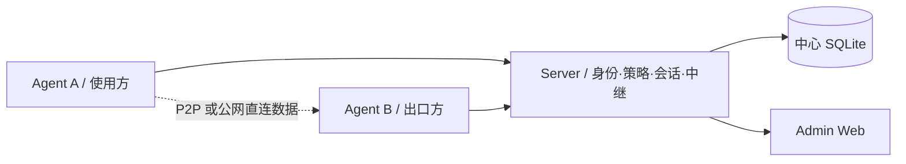
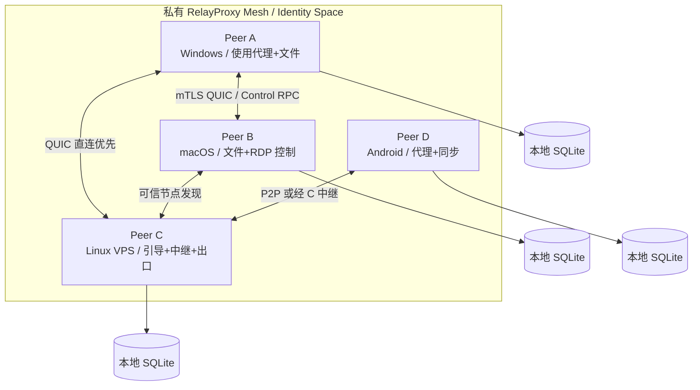
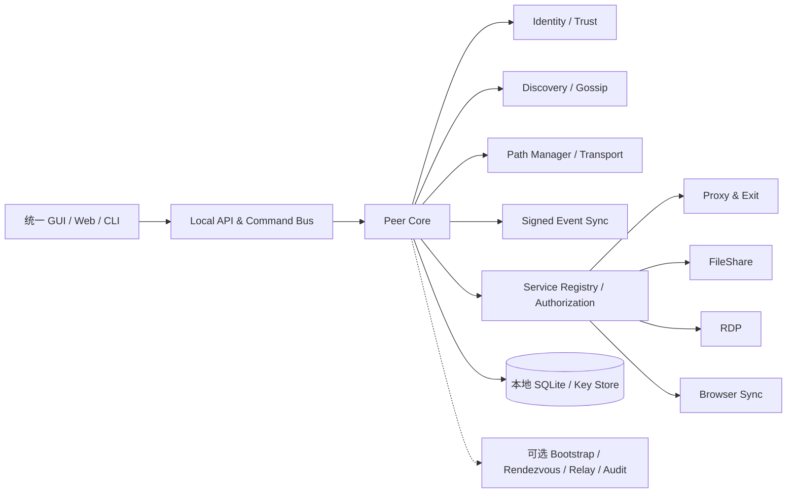
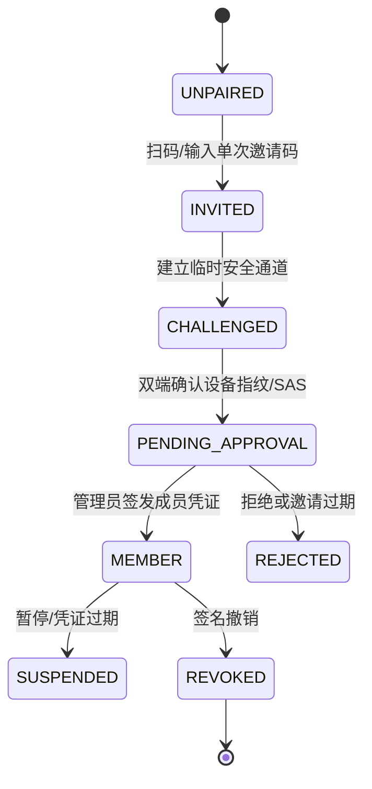
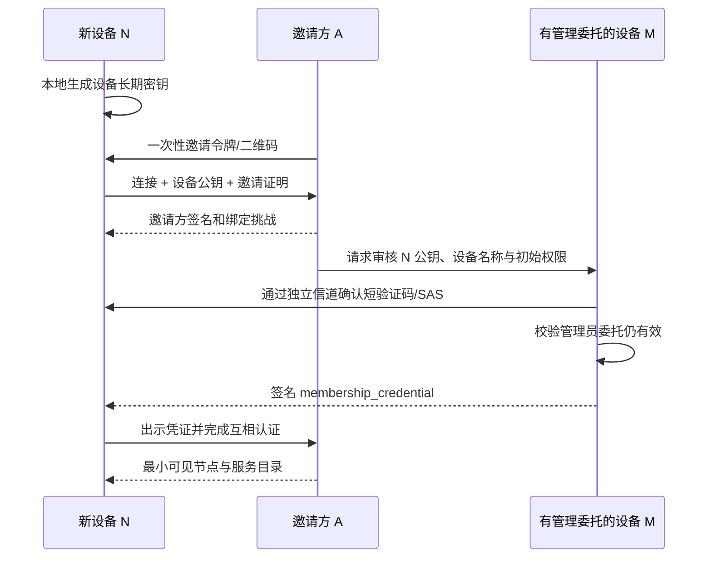
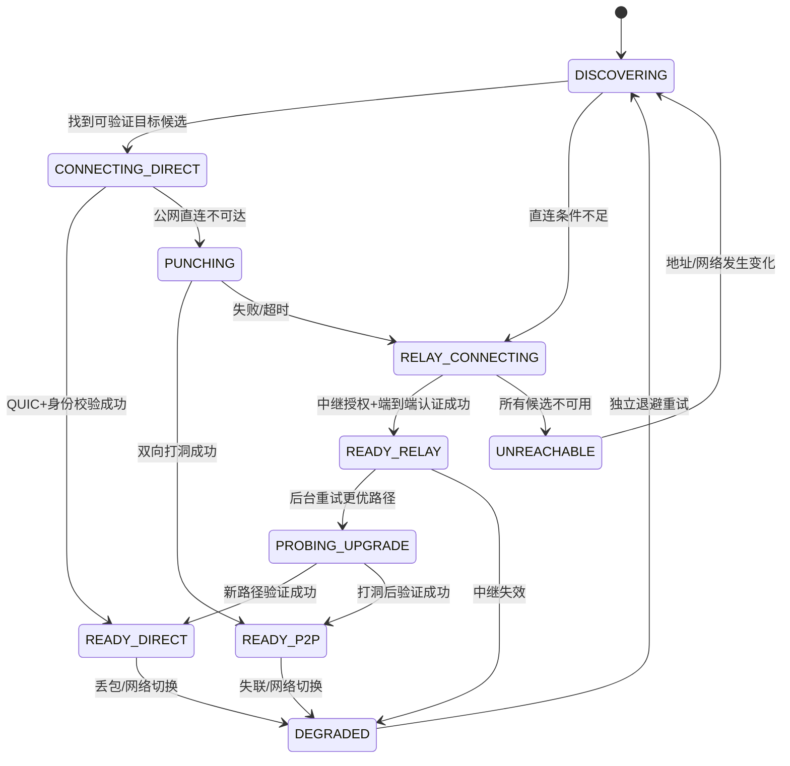
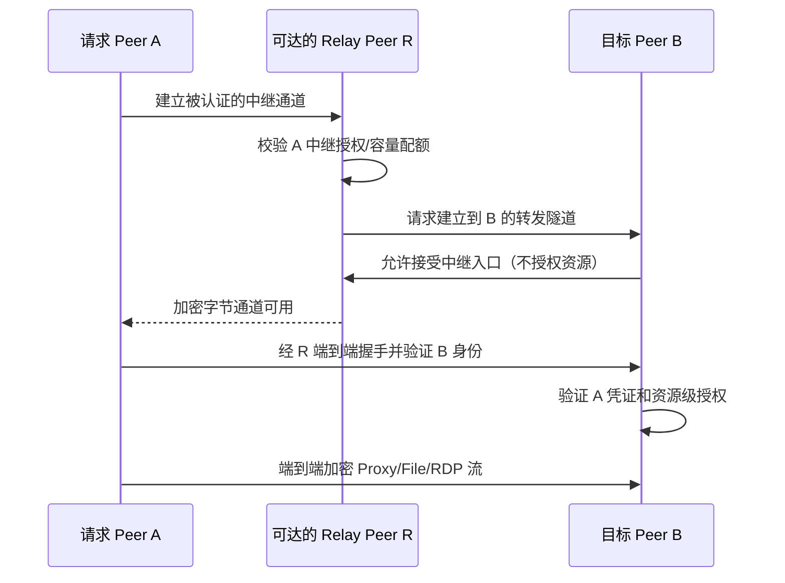
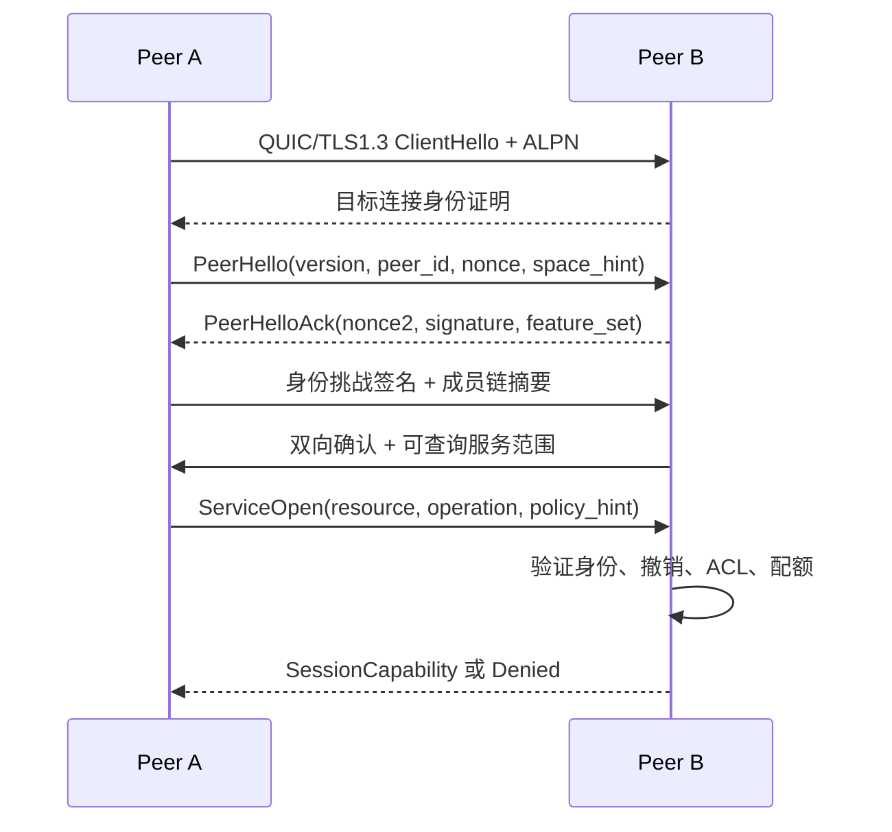
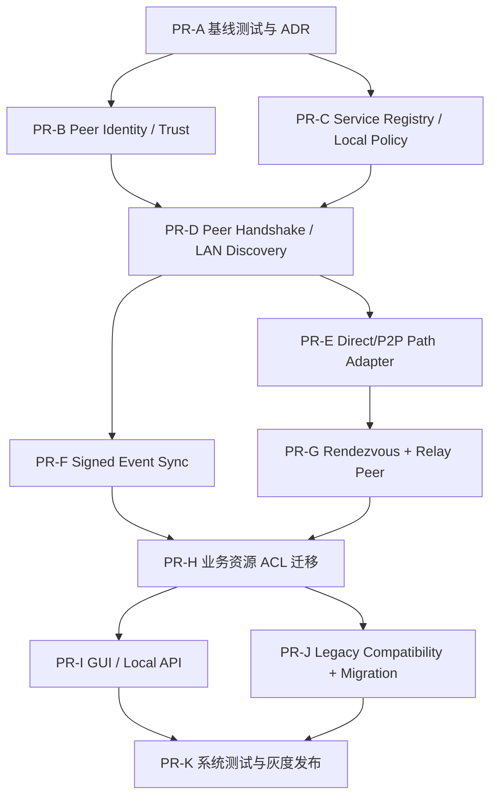

# RelayProxy 去中心化 Peer Mesh 架构重构设计

> 文档状态：**Design Proposal / 待评审**（非已实现声明）  
> 版本：v1.0  
> 日期：2026-10-17  
> 建议仓库路径：`docs/relayproxy-decentralized-peer-mesh-design.md`  
> 适用范围：RelayProxy Server、Agent、Windows/macOS/Linux/Android 客户端、浏览器扩展、协议与运维  
> 本文中的模块路径、协议字段和性能指标均为**目标设计**，不能理解为现有代码已经支持。

---

## 阅读导航

- **总体方案**：第 0–4 章（架构决策、现状、目标、Peer Core、能力模型）
- **安全与网络**：第 5–8 章（身份、授权、发现、NAT 穿透和中继）
- **可开发协议**：第 9–12 章（控制消息、签名状态同步、数据库、各项业务迁移、API）
- **产品与落地**：第 13–16 章（设备导向 UI、代码组织、Server/Agent 迁移、PR 阶段）
- **验证与决策**：第 17–21 章（测试矩阵、运维、风险、验收、参考资料）

---

## 0. 执行摘要与架构决策

RelayProxy 从“一个中心 Server + 多个 Agent”重构为“**同一 Peer 内核 + 分布式信任与发现 + 端到端服务访问 + 可选引导/中继**”。每台设备均具有成为服务提供方与使用方的能力；实际启用功能受操作系统、资源预算、用户设置和授权控制。

关键结论：

1. **统一二进制核心，不强制每个设备运行所有服务。** 原 Server 能力解耦为 `bootstrap`、`rendezvous`、`relay`、`admin`、`audit` 等可选服务，运行 VPS 也只是一个 Peer。
2. **身份信任不等于管理节点在线。** 用身份根信任、设备密钥、签名成员凭证、设备本地 ACL 和短期会话能力票据替代 Server 在线审批；身份所有权保留，不采用“任何节点都可以批准任何节点”。
3. **控制平面去中心化，不保证任意网络环境下无基础设施可达。** LAN 可零引导；公网设备可使用预配引导/观察节点，严格 NAT 可经任意授权中继连接。
4. **保留现有业务协议和路径语义。** `DIRECT/PROXY/REJECT` 是分流动作；`public_direct_quic/p2p_quic/relay_quic/relay_tls` 是通信路径。业务处理、出口 DNS、文件共享、RDP 与浏览器同步不因路径变化改变授权语义。
5. **安全状态不采用简单 LWW/无条件 CRDT。** 授权撤销采用签名事件、因果版本和“撤销优先”；授权冲突无法明确解析时默认拒绝。非安全性 UI 偏好可使用简化合并。
6. **分阶段双栈迁移。** 初期保留旧 Server 作为兼容桥；优先完成两设备无 Server 局域网互通，再完成公网 Mesh，最后移除固定角色。

### 0.1 需要批准的 ADR（Architecture Decision Record）

| ID | 决策 | 本案建议 | 理由 |
|---|---|---|---|
| ADR-01 | 节点运行模型 | 统一 Peer Core + 可选服务 | 平台差异大，避免 Android 变成全天候 Server |
| ADR-02 | 根信任 | 每个身份空间有离线可恢复的根密钥 | 设备平权不代表授权来源无主 |
| ADR-03 | 加入网络 | 邀请凭证 + 人工确认/管理员委托 | 防止未知节点自动获得访问权 |
| ADR-04 | 公网发现 | 手工入口 + 可信引导节点 + 邻居 Gossip | 面向小型可信 Mesh，暂不引入全局 DHT |
| ADR-05 | 数据路径 | LAN/公网直连/P2P 优先，单跳授权中继回退 | 复用既有 QUIC 能力、减少多跳攻击面 |
| ADR-06 | 分布式存储 | SQLite 本地库 + 对象级签名事件同步 | 避免复制同一个 Server SQLite 数据库 |
| ADR-07 | 授权一致性 | 权限变更按资源所属权管理；撤销优先 | 避免脱机分叉使旧权限复活 |
| ADR-08 | 兼容迁移 | 双栈兼容、显式身份绑定、可回滚 | 避免既有设备升级后失联 |

## 1. 背景与现状核对

以仓库 `main` 的 `README.md`、`docs/proxy-p2p-direct-path-design.md`、`docs/proxy-public-direct-path-design.md` 为参考基线（2026-10-17 检索）。

### 1.1 当前已描述的基础能力

- Server：设备首次审批、身份归属、跨身份授权、集中 ACL、连接协调、出口发现、Relay、RDP 入口、连接审计、SQLite、Admin Web。
- Agent：SOCKS5/HTTP、进程/域名/IP/端口分流、TCP/UDP、Windows 透明代理、出口处理、本地 GUI/Web、实时监控。
- 传输：TLS/QUIC、P2P QUIC、已设计实现的公网直连 QUIC、Relay QUIC/TLS、路径健康度/回退。
- 扩展中的能力：共享文件夹、设备级读写授权、进度/速率、浏览器状态同步、消息规则、订阅和去广告等。以上功能需要按仓库最新代码逐项核对具体成熟度，**不得仅凭此前设计文档认定均已上线**。

### 1.2 当前架构的中心依赖



即使数据已点对点，某些认证票据、授权版本与路径协商仍依赖 Server。**因此删除 Server 进程不等于实现去中心化。**

### 1.3 必须保持的兼容约束

- 路由命中优先级、代理动作、出口选择、DNS 防泄漏策略及现有目标 ACL 语义不得意外变化。
- 既有持久化设备身份不得无提示轮换；设备私钥丢失时必须重新绑定，而非只复用旧设备 ID。
- 共享文件夹继续由文件所在设备授权；无共享授权的设备不能在文件浏览器中看到共享资源。
- 文件下载原名、断点续传、进度/速率，浏览器会话密文隔离，RDP 目标授权与封禁要求持续成立。
- Windows、macOS、Linux、Android 的本地代理能力保持；Android 后台限制须单独评估。

## 2. 目标、非目标与成功标准

### 2.1 功能目标（MUST）

1. 两台预先完成信任建立的设备在同一 LAN 内，关闭旧 Server 后仍可发现、认证、代理、传输文件、连接 RDP（能力/平台支持时）。
2. 不存在固定的管理/中继主机：任意拥有适当资源和权限的 Peer 可提供引导、协调、出口或中继服务。
3. 一台设备离线不影响其他已连通设备之间合法、未过期的会话；关键授权撤销应能在联通节点间传播并被执行。
4. 每台设备对本地资源具有最终决定权；跨身份能力以可验证、可撤销的授权凭证表达。
5. 支持公网复杂 NAT 情况下借助一个或多个用户允许的引导与中继 Peer，且业务端到端加密，中继不能读取业务明文。
6. 允许从现有 Server/Agent 平滑迁移、断电恢复、回滚；旧客户端在兼容窗口内可继续运行。
7. GUI 以设备为入口，隐藏 Server/Agent 角色，但保留必要的高级网络诊断能力。

### 2.2 质量目标（初始验收门槛，须通过实网基线校准）

| 指标 | 预期目标 | 说明 |
|---|---|---|
| LAN 连接建立 | p95 < 3 秒 | 已信任、网络正常、发现缓存命中；不含人工审批 |
| WAN 直连建立 | p95 < 10 秒 | 至少一个有效信令路径；不同 NAT 单独报告 |
| 中继回退建立 | p95 < 15 秒 | 有授权、可达且容量足够的中继 |
| 旧 Server 不可达 | 核心 Mesh 已建立连接仍可用 | 不因管理面断线强制断开；依权限有效期决定 |
| 授权撤销生效 | 已联通相关 Peer p95 < 5 秒 | 在消息可靠可达条件下；分区存在安全窗口 |
| 中继额外明文暴露 | 0 | 中继只能看到必要元数据，不能解密业务负载 |
| 安全回归 | 0 高危未解决项 | 含认证绕过、开放代理、DNS 泄漏与撤销回滚 |
| 兼容/回滚 | 通过全平台矩阵 | 不丢身份、不静默扩大 ACL |

### 2.3 非目标（V1）

- 匿名公共 P2P 网络、任意不可信第三方中继交易市场、区块链共识。
- 通用多跳覆盖网络、出口节点之间的全互联网 BGP/路由表分发。
- 全球规模 DHT、无边界的全 Mesh 广播或所有设备数据库强一致同步。
- 在没有任何公共可达节点、没有 LAN、又无法打洞的双端 NAT 条件下保证连通。
- 让移动平台绕过其后台服务、VPN 权限或系统沙盒限制。

## 3. 目标总体架构



**注意：箭头表达可建立的逻辑关系，不要求维持全连接。** 网络构建策略是按需拨号、必要时稳定保持少量可信邻居连接。

### 3.1 每个 Peer 的逻辑组件



| 层 | 职责 | 不能承担的职责 |
|---|---|---|
| Identity | 本机密钥、身份成员凭证、根信任、撤销状态 | 不能因发现节点就自动授权 |
| Discovery | 发现受信 Peer 的可达线索及服务摘要 | 不能成为权限真相源 |
| Transport | 候选地址、打洞、直连与中继、连接健康度 | 不能修改路由选定的业务目标 |
| Control RPC | 状态同步、服务查询、授权操作、设备操作 | 不直接绕过本地资源 ACL |
| Policy | 成员权限、能力、资源级 ACL、审计 | 不能仅依赖远端声称的状态 |
| Service | 代理、文件、RDP、消息、浏览器会话 | 不依赖连接路径判断是否可信 |
| Storage | 本地密钥引用、事件、缓存、统计 | 不复制设备私钥与敏感本地配置 |

### 3.2 “平等”定义

- **协议平等**：设备使用同一 Peer 协议，任何平台可实现其允许的服务能力。
- **资源不平等**：VPS 可以运行长时中继；手机可能只作为按需客户端。
- **安全权限不平等**：身份根、管理员、资源所有者可授予能力；普通成员不能自动管理别人设备。
- **网络可达性不平等**：公网节点可为 NAT 节点提供协调；不因此自动拥有更高的控制权限。

## 4. 角色和服务能力模型

### 4.1 不再持久化 Server/Agent 角色

目标实体为 `Peer`；服务以 `ServiceAdvertisement` 表达。建议初始能力：

| 能力名称 | 作用 | 默认状态 | 主体授权 |
|---|---|---|---|
| `peer.discovery` | 受限节点发现与目录查询 | 可信连接内开启 | 必须为授权成员 |
| `peer.bootstrap` | 为新节点提供引导入口 | 手动开启 | 限流、无授权权威 |
| `peer.rendezvous` | 地址/候选交换、观察可达性 | 手动开启 | 同网络可信成员 |
| `peer.relay` | 转发端到端密文流量 | 默认关闭 | 双端授权、配额 |
| `proxy.client` | 发起代理 | 按平台配置 | 本机用户授权 |
| `proxy.exit` | 作为远程网络出口 | 默认关闭 | 出口资源 ACL |
| `rdp.host` | 暴露设备 RDP 能力 | 默认关闭 | 目标本地授权 |
| `rdp.connect` | 发起 RDP 访问 | 依设备授权 | 主客体双向检查 |
| `file.share.read` | 下载指定共享目录 | 默认无共享 | 目录级 ACL |
| `file.share.write` | 上传/删除/重命名 | 默认拒绝 | 单独写权限 |
| `browser.sync` | 同步选定浏览器域状态 | 默认关闭 | 配对设备/域授权 |
| `message.publish/subscribe` | 发布/接收消息 | 默认关闭 | 频道/身份授权 |
| `policy.manage` | 修改特定对象授权 | 默认根/委托 | 不能越权提权 |

默认关闭高风险服务；宣传 `ServiceAdvertisement` 不等于赋权。能力命名应设置稳定注册表和版本，不与历史 UI 勾选项硬编码绑定。

### 4.2 服务声明示例（概念结构）

```json
{
  "type": "service.advertise.v1",
  "peer_id": "p_...",
  "identity_space_id": "i_...",
  "services": [
    {"name": "proxy.exit", "version": 1, "scope": "members", "policy_revision": 17},
    {"name": "file.share.read", "version": 1, "scope": "authorized", "resource_count": 2}
  ],
  "endpoint_hint_digest": "sha256:...",
  "created_at": "2026-10-17T00:00:00Z",
  "expires_at": "2026-10-17T00:02:00Z",
  "signature": "base64url:..."
}
```

共享名称、内部路径、出口可访问的私网网段等应按授权分级返回，不应向陌生发现节点广播。

## 5. 身份体系、设备密钥与加入流程

### 5.1 术语与标识

| 对象 | 建议字段 | 来源与职责 |
|---|---|---|
| Identity Space | `identity_space_id` | 某一身份空间的根公钥摘要；命名空间，不是登录名 |
| Identity Root | `root_public_key` | 身份空间初始信任锚；根私钥建议离线或加密备份 |
| Peer | `peer_id` | 设备长期公钥的稳定指纹；不含 IP、主机名 |
| Device Key | `device_signing_key` | 设备自身 Ed25519 密钥，私钥不离机 |
| Member Certificate | `membership_credential` | 由根或被委托成员管理者签发的身份空间成员凭证 |
| Resource | `resource_id` | 单个文件共享、网络出口、RDP 服务或消息渠道的资源标识 |
| Grant | `grant_id` | 对主体、资源、操作及有效期的显式授权 |
| Trust Epoch | `identity_epoch` | 根密钥轮换/全局安全紧急事件后的代际编号 |
| Policy Revision | `policy_revision` | 资源所有者策略版本或含因果信息的修订标识 |

根密钥身份和设备密钥必须分离，避免“设备 A 丢失 = 整个 Mesh 永久丢失”。支持多身份空间；同一个 Peer 可加入多个身份空间，但成员关系、设备发现、配置、数据与权限默认按空间隔离。

**密钥推荐**：设备长期签名和身份根签名用 Ed25519；连接建立走经过身份绑定的 TLS 1.3/QUIC，必要的点对点密钥封装可采用 X25519 或经评估的 HPKE。具体证书链或应用层绑定选择必须经安全评审。禁止自行拼装无审计的密码协议。

### 5.2 信任根与恢复

- 新建身份空间时生成根密钥；默认提供一次性加密恢复包导出，强提示用户离线保存。
- 推荐提供“管理员设备签名权限”而不是把根私钥复制给所有管理员。委托凭证限制操作、身份空间、有效期和可继续委托的深度。
- 根私钥丢失且所有有效恢复手段丢失时，不能通过仅知道空间 ID 来恢复所有权；只能建立新空间并逐台可信重新配对。
- 根轮换优先使用旧根签发 `root.rotate`，或预先登记的恢复密钥集合满足阈值批准。该阈值方案属于后期增强，不应在未审计前宣称可用。
- 设备密钥泄漏需将旧 `peer_id` 撤销并用新密钥作为新 Peer 入网；旧 ID 只能保留显示层别名或迁移记录。

### 5.3 新设备加入状态机





邀请限制：单次使用、绑定身份空间、限制最迟时间、可选绑定预期 `peer_id`、最大尝试次数、速率限制、撤销列表；邀请码本身不是长期成员凭证。**不得仅凭知道旧的公开 `identity_id` 自动入网。**

### 5.4 成员凭证（示意）

```json
{
  "schema": "mesh.membership.v1",
  "space_id": "i_...",
  "peer_id": "p_...",
  "device_public_key": "ed25519:...",
  "roles": ["member"],
  "can_delegate": false,
  "issued_by": "p_admin...",
  "issuer_grant_id": "g_admin...",
  "not_before": "2026-10-17T00:00:00Z",
  "expires_at": "2027-10-17T00:00:00Z",
  "credential_id": "m_...",
  "issuer_signature": "base64url:..."
}
```

成员凭证属于长期**身份**证明，不代表拥有 `proxy.exit`、RDP 或文件权限。具体访问仍需每个资源单独授权和服务端实时检查。

### 5.5 跨身份空间授权

- 保留现有跨身份资源共享场景：目标资源所属 Peer 签发针对另一个空间中具体 `peer_id` 或受限组的 `ResourceGrant`。
- 同一身份空间的成员也不能凭“成员”身份越过资源默认拒绝策略；可提供可显式开启的“同空间默认可使用普通出口”模板，但必须逐台审计。
- 禁止把跨身份空间的高权委托进一步无约束转授。
- 跨空间发现只允许显示授权资源摘要，不能暴露所有成员及私网拓扑。

## 6. 权限与安全模型

### 6.1 本地最终授权判断

最终允许访问应满足：

```text
Allow =
  ValidMutualPeerAuthentication
  AND ValidSpaceMembershipOrCrossSpaceTrust
  AND SubjectCapability
  AND ResourceOwnerGrant
  AND ResourceLocalACL
  AND TargetNetworkPolicy
  AND FreshnessAndRevocationChecks
  AND ServiceSpecificConstraints
```

- `Client` 有权发起代理 ≠ 目标 `Exit` 同意为其访问互联网。
- `Relay` 愿意转发 ≠ `Exit` 同意接受此请求。
- `Admin` 能管理共享规则 ≠ 管理员可以通过转发节点读取原始共享文件。
- 资源所属设备执行上述判断，**不信任中继的“已授权”断言**。

### 6.2 授权对象（ResourceGrant）

```json
{
  "schema": "mesh.grant.v1",
  "grant_id": "g_...",
  "space_id": "i_...",
  "owner_peer_id": "p_owner...",
  "subject": {"type": "peer", "id": "p_reader..."},
  "resource": {"type": "file_share", "id": "share_photos"},
  "actions": ["file.list", "file.read"],
  "constraints": {
    "expires_at": "2026-11-17T00:00:00Z",
    "max_sessions": 2,
    "max_bandwidth_bps": 20000000
  },
  "policy_revision": 18,
  "issued_by": "p_owner...",
  "signature": "base64url:..."
}
```

写权限与读权限必须显式分离；`file.delete`、`file.rename` 建议独立授权。目录 ACL 作用域应绑定 `share_id` 及规范化后的子路径，防止路径穿越、符号链接逃逸和大小写/Unicode 路径歧义。

### 6.3 会话能力票据：替代中心 Server 签发

V1 采用目标资源方签发的短期会话许可，避免永久依赖一个在线的签发中心：

1. 访问方出示已认证的成员凭证及资源授权证明。
2. 资源所有者本地验证成员链、授予者委托、撤销事件、访问策略。
3. 目标 Peer 返回短期 `SessionCapability`，绑定 `subject_peer_id`、`target_peer_id`、资源、操作、会话 ID、连接握手摘要和策略修订。
4. 客户端在原连接或经中继建立的目标连接上提供能力票据；目标方验证防重放字段后开放业务流。
5. 目标权限变化或本地禁用资源后，立即拒绝新流并按策略结束已有流；票据过期不能被缓存复用。

连接本身采用双向身份验证，短期票据**不能**代替传输层认证。敏感 RPC 禁用 TLS/QUIC 0-RTT 可重放业务操作。旧版 Server 签名票据只在兼容模式下验收，不可默默转换为永久 Mesh 权限。

### 6.4 撤销、离线与一致性边界

- `member.revoke`、`grant.revoke`、`root.rotate`、`delegation.revoke` 是签名安全事件；保留不可被旧授权覆盖的 tombstone，记录撤销范围、签发者、因果父事件与安全 epoch。
- **拒绝优先**：接收到合法的撤销事件后，同一个 `grant_id` 或设备密钥的旧授权无法通过更大时间戳重新激活。
- 新授权必须使用新 `grant_id`，明确关联当前权限版本及撤销检查点；若所依赖权限被撤销，授予链一并失效。
- 对身份成员关系与委托链发生分叉时，访问目标应用最保守的可验证权限交集；分叉待管理员解决。
- 离线设备无法瞬间知道其他设备发出的撤销。高风险服务（RDP 公网入口、写文件、跨身份代理访问、策略管理）必须支持较短有效期和最大安全状态陈旧时间；检查不到足够新鲜的授权检查点时拒绝新高风险会话。
- 在完全分区下，撤销的严格即时生效与持续离线可用**不可能同时保证**。此边界需体现在 GUI 警告及自动化测试中。

建议配置基线（非不可更改协议常数）：会话能力有效期 5 分钟；授权状态主动交换约 15–30 秒一次（仅已有可信控制通道）；高风险资源的状态最大陈旧度 10 分钟；成员凭证可设较长有效期，但不能替代撤销检查。具体数值须经风险和网络测量决定。

### 6.5 威胁模型

| 威胁 | 防护措施 | 剩余风险 |
|---|---|---|
| 未知 Peer 伪造身份 | 密钥身份、挑战绑定、双端确认、成员凭证 | 人为错误批准设备 |
| 被攻破的中继 | 端到端加密、目标侧 ACL、流量配额 | 中继仍可见流量时间与规模、做拒绝服务 |
| 盗取设备 | 密钥安全存储、撤销、短期能力票据、最小权限 | 撤销传播期间旧权限窗口 |
| 重放邀请/授权/流请求 | 单次邀请、nonce、过期、序列号/重放缓存 | 时钟严重偏差需恢复流程 |
| 旧状态回滚 | 签名事件、版本检查、撤销 tombstone、可信 checkpoint | 所有副本同时丢失最新状态时需恢复确认 |
| 错误开放代理 | 出口本地 ACL、私网/回环默认拒绝、来源约束、限速 | 配置误用须 GUI 显示警告 |
| SSRF/内网跳板 | 目标解析后再次校验 IP、DNS 重绑定防护 | 特殊协议须专项审计 |
| DNS/QUIC 泄漏 | 沿用本地分流、防泄漏与 DNS 选项；分平台实测 | 应用 DoH/IPv6/WebRTC 边界 |
| 拒绝服务 | 握手预鉴权限制、资源配额、黑名单、速率限制 | 公网节点持续受到流量攻击 |
| 浏览器同步数据泄漏 | 端到端密文、域名范围/设备配对、密钥隔离、敏感字段策略 | 浏览器 API 本身的限制 |
| 管理 Web 被远程访问 | 默认回环监听、身份会话、CSRF/Origin 校验、可选受控远程 RPC | 用户主动公开管理端口 |

## 7. Peer 发现、寻址与连通性

### 7.1 多层发现

| 层 | 机制 | 使用环境 | 信任原则 |
|---|---|---|---|
| LAN | mDNS / 可选 UDP 广播 | 同一广播域 | 仅发现线索，不能代表审批 |
| 手工 | 设备二维码/邀请 URI、静态地址 | 任意 | 必须完成密钥认证 |
| Bootstrap | 一组可选已知公网 Peer | 公网首连 | 无权代替目标授权 |
| Trusted Gossip | 已连接可信邻居交换受限设备目录 | 跨 NAT、局域网 | 只同步同一授权范围的数据 |
| 历史缓存 | 最后成功端点、网络特征 | 重新连接 | 地址过期和网络变化需重验证 |

V1 不依赖全网广播式 DHT。公网引导节点仅解决“我从哪里联系到至少一个可信节点”，不能变成强制单点。

### 7.2 节点记录

`PeerRecord` 为设备签名、短 TTL 的版本化记录，建议包含：`peer_id`、协议版本、声明的候选端点摘要、可选受信空间标记、支持的服务类别、有效期、记录序列号、设备签名。地址、真实 IP、局域网资源名称需做可见性限制。

- 接收时校验签名、公钥指纹、有效期、最大长度和单 Peer 更新频率。
- 记录更新只接受同一 Peer 的更高序列/合法轮换，拒绝伪造他人 IP 的无签名记录。
- 新地址必须经过实际端到端连通性/身份验证才标记为可用，不能只相信宣告。
- Gossip 应做去重、摘要同步、回退拉取和最大传播度约束，避免无限泛洪。

### 7.3 首次远程连通场景

1. **同 LAN**：设备自动发现邻居；用户完成二维码/指纹信任；直接 QUIC 建连。
2. **不同公网且一侧有公网 IPv4/IPv6**：通过邀请或 Bootstrap 得知可达目标；尝试公网直连，终端校验目标设备身份。
3. **双方 NAT**：双方通过可信可达协调 Peer 交换候选、使用实际打洞 socket 执行 UDP 探测、完成 QUIC 双向认证。
4. **严格 NAT/UDP 不可用**：连接到共同可达的授权 Relay Peer，经 TLS/QUIC 封装端到端业务流。
5. **没有任何共同可达入口**：显示 `UNREACHABLE / NO_RENDEZVOUS`，不可虚假承诺无条件 P2P 成功。

### 7.4 NAT 穿透与地址优先级

候选类型：LAN host、IPv6 global、UPnP/NAT-PMP/PCP 映射（平台与路由器允许时）、server-reflexive、经中继地址。候选选择参考 ICE 思路但不声称 V1 实现了完整 RFC 8445；若要声明 ICE 兼容，需要完成角色冲突、检查列表、连通性验证、重启等全部必要规范。

**候选集合与路径评分分开：** 先验证连通，按延迟、丢包、带宽、失败率、权限和成本排序。典型默认倾向：同 LAN → 已验证公网直连 → P2P UDP → 中继 QUIC → 中继 TLS；对 IPv4-only/IPv6-only 的组合只试双方可达的地址族，避免长时间无效 UDP6 尝试。

### 7.5 路径状态机



- 已选 Exit 不得被 Path Manager 悄悄换成另一个出口，避免流量地理位置和 ACL 变化。
- 只对新建流量无缝切换路径；既有 TCP 流只有底层支持可靠恢复且确认无数据重放时才迁移，否则断开并清晰记录。
- 公网直连与 P2P 分别维护失败冷却；网络改变时失效缓存，限制指数重试负载。
- 主机 IPv4/IPv6 和监听族都应进入候选有效性验证。

## 8. 中继服务设计

### 8.1 Relay 是能力，不是中心

每台设备可以开关 `peer.relay`，但默认关闭。中继由管理员配置允许的身份/设备、最大带宽、并发流、每日配额、公网监听地址、转发日志保留时间及是否转发跨身份业务。



### 8.2 可靠的安全边界

- R 必须认证 A，验证目的 Peer 有可达端点或转发许可；B 必须最终认证 A。R 不可向 B 传达未经 B 验证的权限结论。
- R **无法解密内层应用会话**，但可以观测 A/B 的网络地址、连接时间和转发量，应显示元数据披露提醒。
- 只允许在授权设备网络中中继，不提供公开匿名代理端口，也禁止从未经授权用户到任意外网的出口转发。
- V1 **只支持单跳中继** `A → R → B`，避免环路、TTL、路径计费与多层加密协议膨胀。中继的中继、多跳路由列为 P2。
- 请求 R 时不要求 R 拥有目标业务权限；R 只需有转发权，B 控制真正资源权限。

### 8.3 中继选举与回退

中继选择需要输入：`allowlist`、地理和出口约束（可选）、RTT、负载、可用速率、双端可达性、网络成本、故障历史。仅在候选提供者允许当前流量类型时参与打分。

建议评分形态（参数需基准测量）：

```text
score = w1 * normalized_rtt
      + w2 * packet_loss
      + w3 * load
      + w4 * estimated_cost
      + w5 * recent_failure_penalty
```

负载/测量缺失时保守降权；采用最短保持时长、切换滞后和退避，避免节点之间来回跳转。禁止所有 Peer 为每个新连接全网测一遍速度，需限速采样和缓存。

## 9. Peer 控制协议与通信契约

### 9.1 协议分层与版本

建议目标协议族：

```text
relayproxy/mesh/1
  ├── peer-handshake/1
  ├── discovery/1
  ├── membership/1
  ├── policy-sync/1
  ├── service-registry/1
  ├── session-admission/1
  ├── rendezvous/1
  ├── relay/1
  ├── admin-rpc/1
  └── business/{proxy,file,rdp,browser,message}/N
```

**兼容原则**：协议协商用明确 `major/minor/features`；不理解安全必需字段不得忽略并继续放行；未知非安全可选字段可跳过。老 Server 隧道和新 Mesh 隧道必须显式区分，禁止默认降级到不完整认证。

### 9.2 握手流程



传输层实现必须将长期 Peer 公钥绑定到 TLS 对端身份（例如受检验的短期证书与签名绑定证明），不能仅验证自签 TLS 证书的格式。客户端及服务端都应验证对端 `peer_id` 和其对应公钥，避免共享中继造成对端混淆。

### 9.3 消息封装（示意）

```proto
message MeshEnvelope {
  uint32 protocol_major = 1;
  uint32 protocol_minor = 2;
  string message_type = 3;
  bytes sender_peer_id = 4;
  bytes identity_space_id = 5;
  bytes message_id = 6;
  uint64 actor_sequence = 7;
  int64 issued_at_ms = 8;
  int64 expires_at_ms = 9;
  bytes payload = 10;
  bytes signer_key_id = 11;
  bytes signature = 12;
}
```

规范化签名输入建议为域分离的**原始确定性 payload 字节**与头部字段，接收端验签原始字节而非重新序列化（避免跨语言对象重编码歧义）。具体编码可采用长度前缀 protobuf/CBOR，但必须固定字节级签名规则，发布向量测试，并设消息体/嵌套深度/数组长度限制。

**必须有的控制消息**：

| 类别 | 消息 | 幂等/安全要求 |
|---|---|---|
| Handshake | `PeerHello`, `PeerHelloAck` | nonce、身份绑定、版本协商 |
| Discovery | `PeerRecordPush`, `PeerRecordQuery` | 设备签名、短 TTL、可见性 |
| Membership | `JoinRequest`, `MemberIssued`, `MemberRevoked` | 邀请一次性、委托链验证 |
| Service | `ServiceAdvertise`, `ServiceQuery` | 只展示有权查询的数据 |
| Policy | `EventDigest`, `EventPull`, `EventBatch`, `Checkpoint` | 内容寻址、签名、因果检查 |
| Session | `SessionOpen`, `SessionGrant`, `SessionDeny`, `SessionClose` | 资源 ACL、反重放、配额 |
| P2P | `RendezvousOffer`, `CandidateUpdate`, `ConnectivityResult` | 不信任声称的公网端点 |
| Relay | `RelayReserve`, `RelayOpen`, `RelayClose` | 两端身份绑定、单跳 TTL |
| Admin | `PolicyProposal`, `PolicyCommit`, `AuditQuery` | 细粒度管理授权、可审计 |

### 9.4 重放保护与错误语义

- `message_id` 为不可预测值；控制端在有界窗口内去重并设最大每 Peer 消息速率。
- `actor_sequence` 用于检测同一签发者异常回退；不能单独证明全局新鲜度。
- 所有高风险消息应校验时间范围、目标 Peer、身份空间、资源和当前策略 epoch。
- 断开/重试保持命令幂等；涉及 `file.delete` 等操作使用资源版本前置条件（如 ETag/expected_revision）。
- 拒绝码区分 `NOT_MEMBER`, `REVOKED`, `UNAUTHORIZED`, `POLICY_STALE`, `RESOURCE_OFFLINE`, `NO_ROUTE`, `RELAY_DENIED`, `RATE_LIMITED`, `PROTOCOL_UNSUPPORTED`；对未知 Peer 避免泄漏敏感资源是否存在。

## 10. 分布式状态同步和持久化

### 10.1 数据按所有权分类

| 数据 | 真相源 | 同步策略 |
|---|---|---|
| 本机设备密钥/密钥保护设置 | 本机安全存储 | 绝不传播明文私钥 |
| 本机监听、驱动、系统代理、私有文件路径 | 本机 Peer | 不自动跨设备覆盖 |
| 成员关系/管理员委托 | 身份空间根及合法委托签发者 | 签名事件/快照按需同步 |
| 资源 ACL/共享目录权限 | 资源所属 Peer | 签名事件 + 资源本地最新态 |
| 服务声明/候选端点 | 发布该服务的 Peer | TTL 缓存/更新 |
| 路由规则、DNS/去广告订阅 | 规则所属设备/指定共享策略对象 | 可选版本化订阅和受限复制 |
| 文件内容 | 文件所属设备 | 按授权文件读写协议，不全量 Gossip |
| 浏览器 Cookie/Storage | 配对终端 | 端到端密文按需同步，不经过普通目录 Gossip |
| 实时连接/指标/审计 | 事件产生 Peer | 本地为主，授权订阅/汇总，可配置保留 |
| UI 主题、窗口/筛选偏好 | 本机 | 可选弱一致同步 |

### 10.2 事件模型

```json
{
  "event_id": "sha256:...",
  "scope": "resource:share_photos",
  "event_type": "grant.revoke",
  "subject_id": "p_...",
  "resource_id": "share_photos",
  "actor_peer_id": "p_owner...",
  "actor_seq": 42,
  "parents": ["sha256:previous_state..."],
  "authority_epoch": 8,
  "created_at": "2026-10-17T00:00:00Z",
  "body": {"grant_id": "g_old...", "reason": "device_lost"},
  "signature": "base64url:..."
}
```

- 每个事件都带权限作用域、签发者、签名、前置因果事件/检查点。
- 跨节点通过 `EventDigest` 对比摘要、分页 `EventPull` 拉取缺失事件；不能无限推送全空间历史。
- 收到事件时先验签和验权限，再落盘，最后更新本地物化视图；两者必须在同一数据库事务内完成。
- 授权冲突策略：已知有效撤销优于旧授权；无权签发的授权事件永不生效；并发的高风险授权若委托链不一致，置为 `CONFLICT_DENY` 等待处理。
- 非安全 UI 偏好可采用 LWW；**不对安全 ACL 使用“时间戳最大即赢”。**
- 本地恢复快照必须携带签名 checkpoint、最高可验证 epoch 与撤销 tombstone；禁止从旧备份静默复活已撤销权限。

### 10.3 多管理员离线变更

身份空间中允许多个拥有受限委托的管理员设备，但并不承诺所有离线管理员能无冲突地新增高危授权：

1. 每个委托有特定对象/操作及失效时间；每个管理者只对其授权范围签事件。
2. 独立对象可并行编辑；同一对象并发修改通过因果父事件检测分叉。
3. 撤销类事件可以优先安全传播；扩大权限类事件在分叉时不被乐观生效。
4. 非敏感配置可以自动合并；资源 ACL 冲突必须经有资格的管理者重新签发明确结果。

这样可以去掉运行时中心服务器，同时保留可审计的权限来源；代价是发生网络分区时，部分管理操作可能暂时无法生效。

### 10.4 建议 SQLite 模型（逻辑表，字段需结合现有迁移框架确定）

```sql
CREATE TABLE mesh_peer (
  peer_id TEXT PRIMARY KEY,
  display_name TEXT NOT NULL,
  public_key BLOB NOT NULL,
  trust_state TEXT NOT NULL,
  last_seen_ms INTEGER,
  last_record_seq INTEGER NOT NULL DEFAULT 0
);

CREATE TABLE mesh_identity_space (
  space_id TEXT PRIMARY KEY,
  root_public_key BLOB NOT NULL,
  trust_epoch INTEGER NOT NULL,
  settings_json TEXT NOT NULL
);

CREATE TABLE mesh_membership (
  space_id TEXT NOT NULL,
  peer_id TEXT NOT NULL,
  credential BLOB NOT NULL,
  state TEXT NOT NULL,
  PRIMARY KEY (space_id, peer_id)
);

CREATE TABLE mesh_security_event (
  event_id TEXT PRIMARY KEY,
  scope TEXT NOT NULL,
  event_type TEXT NOT NULL,
  actor_peer_id TEXT NOT NULL,
  actor_seq INTEGER NOT NULL,
  epoch INTEGER NOT NULL,
  body BLOB NOT NULL,
  signature BLOB NOT NULL,
  applied_ms INTEGER NOT NULL
);

CREATE TABLE mesh_resource_grant (
  grant_id TEXT PRIMARY KEY,
  resource_id TEXT NOT NULL,
  subject_id TEXT NOT NULL,
  owner_peer_id TEXT NOT NULL,
  actions_json TEXT NOT NULL,
  policy_revision TEXT NOT NULL,
  status TEXT NOT NULL,
  expires_at_ms INTEGER
);

CREATE TABLE mesh_service (
  service_id TEXT PRIMARY KEY,
  peer_id TEXT NOT NULL,
  capability TEXT NOT NULL,
  visibility TEXT NOT NULL,
  advert BLOB NOT NULL,
  expires_at_ms INTEGER NOT NULL
);

CREATE TABLE mesh_path_health (
  peer_id TEXT NOT NULL,
  path_type TEXT NOT NULL,
  path_key TEXT NOT NULL,
  last_success_ms INTEGER,
  last_failure_ms INTEGER,
  metrics_json TEXT,
  PRIMARY KEY (peer_id, path_type, path_key)
);
```

其他必要对象：`mesh_peer_endpoint`、`mesh_invite`、`mesh_trust_checkpoint`、`mesh_event_parent`、`mesh_relay_quota`、`mesh_audit_event`、`mesh_sync_cursor`、`mesh_legacy_identity_map`；这些表的索引、保留策略、保密等级和事务边界须在实现阶段确定。大型文件内容、浏览器会话密文不得塞入发现事件队列。

### 10.5 一致性和数据保留

- 缓存服务声明过期即不可用于新连接；已建立连接应继续按会话和权限状态检查。
- 安全事件优先同步撤销和根轮换，再同步一般成员变化和目录摘要。
- 事件拉取分页并做总大小限制；可按资源作用域过滤，避免将不相关身份空间元数据传播给其他 Peer。
- 审计事件按本地保留策略归档，跨设备聚合仅复制管理员有权读取的内容；审计清除必须留有可选择的删除操作记录。
- 支持加密导出成员凭证与配置，导入旧快照需进行最低可信检查点验证。

## 11. 既有功能如何迁移到 Mesh

### 11.1 网络出口、SOCKS5/HTTP 与透明代理

- 本地 SOCKS5/HTTP 及系统透明代理继续由本机服务执行；路由规则仍选择 `DIRECT/PROXY/REJECT`。
- `PROXY` 选择明确的目标 `peer_id + exit_service_id`；后续路径决策不得改变出口。
- Exit 所属 Peer 负责认证客户端、执行目标域/IP/端口 ACL，严格防止绕过私网/环回拒绝规则；有上游代理时继续明确解析地点。
- 订阅规则可由本地按现有策略定时拉取，也可由一个被授权的共享配置发布者分发带版本规则包。共享包不自动覆盖设备自定义规则。
- 去广告规则：优先本地执行，允许从可信 Peer 获取签名规则包；不得将每个 DNS 查询变成对远程“策略中心”的依赖。
- 连接监控增加 `route_action`、`exit_peer`、`relay_peer`、`transport_path`、`rule_id`、`dns_source`、`policy_decision`，支持判断为什么命中特定出口或被 REJECT。

### 11.2 文件共享

- 一个共享对应稳定 `share_id`，其根目录与真实路径仅保存在拥有者本机。
- 共享目录列表只向 `file.list` 授权的设备返回；未授权设备既不能浏览也不应看见共享文件夹的元数据。
- 文件操作在目录内部进行，必须做平台路径规范化、符号链接边界限制、文件版本检查、原子写入、磁盘剩余量与权限验证。
- 维持系统文件夹选择弹窗（设备本机 GUI）、拖拽上传、右键菜单、保留文件名、传输速率、进度、暂停/恢复、断点续传、失败重试。
- 大文件传输继续按现有文件直连/P2P/Relay 数据通道实现，不通过 Gossip 分发文件块；支持分块哈希校验与目标变化检测。
- 分离 `file.list/read/write/create/rename/delete` 权限；拒绝写入不能依赖 UI 隐藏按钮。

### 11.3 RDP / 远程桌面

- 设备本地声明 `rdp.host`，发起端拥有 `rdp.connect`，目标端验目标资源授权。
- 默认 LAN/P2P 优先；无法直连时可走经受控中继的加密字节通道，保持既有启动系统远程桌面 App 的交互。
- 公网 RDP 入口由目标 Peer（或它明确授权的 ingress Peer）控制，按时间、来源 IP、身份、速率和最大会话限制。
- 连接审计、来源 IP 判断、IP 地域封禁和手动解封以**实际对外暴露入口**为执行点；转发后来源 IP 不得与中继地址混淆。仅记录可验证源地址，不信任客户端自报 `X-Forwarded-For`。
- 旧的 Windows 登录失败审计功能不应因为本次重构被重新引入。

### 11.4 浏览器扩展与会话同步

- 扩展本身不承担完整系统 Peer 监听服务；可作为受限设备端点（通过浏览器 WebSocket + 身份密钥）或连接本地 Peer 网关，具体以浏览器扩展 API 能力为准。
- 只允许被用户配对且授权的浏览器实例同步指定域的数据；Cookie、LocalStorage、SessionStorage、IndexedDB 按浏览器 API 的能力边界同步。
- 会话明文只能在经授权的源/目标浏览器端处理；普通 Bootstrap/Relay Peer 不持有解密密钥。
- 保留扩展通用代理/分流能力与同步能力的权限分离，不能因可以同步 Cookie 而自动获得 `proxy.exit` 或设备管理权。
- 登录状态并不保证跨设备可无条件复用；服务端设备绑定、IP 风控和 WebAuthn 会限制会话可迁移性，UI 需明确说明。

### 11.5 消息渠道、规则和通知

- 消息渠道属于明确的身份空间及资源所有者，支持 `message.publish` / `message.subscribe` 与精确频道授权。
- 管理员可以发布带签名的默认规则及更新；各终端本地进行验证码/普通消息匹配与弹窗，实现现有多平台通知体验。
- 消息可靠送达采用带 TTL 的本地队列、确认和去重；不要求所有 Peer 都在线，也不把未加密历史同步到所有节点。
- 订阅变更不应让旧设备因权限收紧再次进入“待审批”而意外恢复权限。

## 12. 本地配置与管理 API

### 12.1 Peer 配置提案

```yaml
mesh:
  enabled: true
  identity:
    key_store: system           # system / encrypted_file / external (按平台支持)
    active_space: i_example
  discovery:
    lan_enabled: true
    gossip_enabled: true
    bootstrap_peers:
      - "relayproxy://p_bootstrap@bootstrap.example.com:21000"
    max_neighbors: 8
  transport:
    mode: auto                   # auto / direct_only / relay_only
    quic_listen: ":21000"         # 桌面/服务机可启用
    tcp_fallback: true
    allow_upnp: false
  services:
    relay:
      enabled: false
      max_clients: 16
      max_bandwidth_mbps: 50
      allow_cross_space: false
    rendezvous:
      enabled: false
    bootstrap:
      enabled: false
    exit:
      enabled: false
    file:
      enabled: false
  sync:
    enabled: true
    signed_events: true
    policy_max_staleness_sec: 600
  admin:
    web_listen: "127.0.0.1:9090"
    remote_management: false

routing:
  mode: rule
  default_action: DIRECT
  default_exit_peer: ""
```

上面的 YAML 是**目标语义草案，不可直接用于当前版本**。迁移器负责从 `server`、`device`、`transport`、`proxy`、`exit`、`web` 等旧字段逐项映射；不识别字段应显示提示而不是静默忽略敏感配置。

### 12.2 Local API（建议 REST 资源，仅表意）

| 接口 | 操作 | 权限 |
|---|---|---|
| `GET /api/v2/mesh/peers` | 受限设备列表及在线状态 | `peer.view` |
| `POST /api/v2/mesh/invites` | 创建加入邀请 | `member.invite` |
| `POST /api/v2/mesh/join` | 申请加入空间 | 待确认邀请 |
| `POST /api/v2/mesh/members/{id}/revoke` | 撤销成员 | `member.revoke` |
| `GET /api/v2/mesh/services` | 可访问服务列表 | `service.view` |
| `PUT /api/v2/mesh/resources/{id}/grants` | 修改资源 ACL | `resource.manage` |
| `GET /api/v2/mesh/paths/{peer}` | 路径与诊断 | `path.view` |
| `POST /api/v2/mesh/peers/{id}/connect` | 建立业务会话 | 对应业务权限 |
| `GET /api/v2/mesh/sync/status` | 事件同步检查点 | `policy.view` |
| `POST /api/v2/mesh/relay/test` | 测试中继可达 | `relay.manage` |

Local API 默认为 loopback；远程管理不等于直接公开 Web 端口。远程管理应通过 Mesh 内独立 `admin-rpc`，在目标 Peer 侧执行精确授权。Web 要防 CSRF、跨源请求、令牌泄漏和点击劫持。

### 12.3 统一错误和实时状态

建立统一 `StateBus`（本地事件聚合 + 权限隔离的远程订阅）：设备在线、服务开启/关闭、路径变化、文件传输、审计记录、规则同步均由同一事件机制推送到 Wails/React/Web/Android UI。每种事件声明 `sequence`、`source_peer_id`、`scope`、`timestamp`，客户端断线通过 cursor 恢复；不把任意业务消息广播到所有终端。

## 13. 跨平台产品设计与交互

### 13.1 信息架构：以设备为中心

建议统一导航：

```text
RelayProxy
├── 我的设备
│   ├── 全部 / 在线 / 离线 / 待加入
│   ├── 设备详情
│   │   ├── 概况（连通性、能力、资源、实时流量）
│   │   ├── 网络（出口、路由、路径、诊断）
│   │   ├── 文件（授权共享和浏览器）
│   │   ├── 远程桌面
│   │   ├── 浏览器同步（适用设备）
│   │   └── 访问权限（向谁共享、谁能访问）
│   └── 添加设备（LAN发现 / 扫码 / 邀请码 / 手动地址）
├── 我的共享
│   ├── 网络出口
│   ├── 文件夹
│   ├── 远程桌面
│   ├── 中继服务
│   └── 消息/浏览器数据
├── 网络
│   ├── 代理和分流
│   ├── 节点路径
│   ├── DNS 与安全
│   ├── 规则订阅 / 去广告
│   └── 连接监控
├── 活动
│   ├── 文件传输
│   ├── 连接与访问审计
│   ├── 消息
│   └── 系统日志
└── 设置
    ├── 身份空间与恢复
    ├── 高级发现 / 引导
    ├── 中继与网络监听
    ├── 授权同步与撤销
    └── 关于 / 诊断 / 兼容模式
```

- 不再向普通用户展示“连接 Server”“Server Web”“Agent Web”等核心入口，统一为“本机”“设备网络”“远程设备”。
- 添加设备必须明确区分发现、邀请、等待授权、已加入；未知设备不可自动看见受保护共享。
- 设备卡片只显示其有权查看的能力；离线卡片保留历史信息，但标记最后同步时间，不能当作实时可用。
- 修改远程资源的权限时显示“作用于目标设备”的确认，离线目标则展示“待目标确认/同步”而不是假装修改成功。
- 文件浏览器采用足够大的可调整主面板，支持文件拖放、上传/下载系统文件选择器、右键菜单、批量操作、传输队列和快捷键。
- 连接质量视图明确显示 `LAN / Public Direct / P2P / Relay`、当前中继 Peer、RTT、丢包、速率、失败原因、最后校验时间。
- 安全告警优先展示资源风险：公网监听、跨身份授权、允许访问私网/回环、高风险授权状态过期、撤销未同步，而不是低价值静态说明。

### 13.2 一致的设备操作模型

所有平台使用相同设备/服务 API 和权限词汇；桌面 React + Wails 与 Agent Web 共享设计系统。Android 使用原生 UI 但保持信息架构、状态语义与错误原因一致。

| 平台 | 默认节点模式 | 服务边界 | UI 重点 |
|---|---|---|---|
| Windows | 完整 Peer | WinDivert/系统服务按权限运行；可提供出口/中继 | 本地代理、设备、文件、RDP、实时监控 |
| macOS | 完整 Peer | 系统扩展/VPN 能力依权限和安装方式 | 系统代理、文件、共享、远控 |
| Linux | Headless/桌面 Peer | systemd、开机自启、可公网监听 | 本地 Web、CLI、出口/中继管理 |
| Android | 受系统约束的移动 Peer | VPN Service、后台电源策略、监听受限 | 接入、代理、设备列表、按需共享 |
| 浏览器扩展 | 受限 Mesh 端点或本地网关的应用 | 扩展 API 限制；不承担任意网络转发 | 分流、代理、浏览器数据配对 |

首次安装建议选择“加入现有设备网络”或“创建我的设备网络”；创建后可通过设备页开通出口、共享文件等能力，而非要求用户先架设 Server。

## 14. 代码组织与实现接口

### 14.1 推荐目标目录（待与真实源码树对照）

```text
internal/
  mesh/
    identity/          # Peer ID、成员凭证、密钥轮换、设备撤销
    trust/             # 证书/签名链、跨身份信任验证
    discovery/         # LAN、Bootstrap、Gossip、可见性过滤
    control/           # 握手、RPC、重试、错误模型
    registry/          # 服务与资源声明
    policy/            # ACL、委托、凭证、会话授权
    sync/              # 签名事件 DAG、快照、冲突检测
    transport/         # 统一连接抽象与会话池
    rendezvous/        # 候选交换与验证
    relay/             # 单跳转发服务、配额与转发日志
    metrics/           # Peer RTT、路径、同步和审计统计
    storage/           # 本地 SQLite migrations 和 repository
  p2p/                # 复用现有 RDP/Proxy P2P 通用原语
  tunnel/             # 复用现有 TCP/QUIC 与业务流抽象
peer/
  runtime/             # Peer Core 生命周期、功能开关
  services/            # exit / proxy / file / rdp / browser / message
  api/                 # Local API 和授权 Remote RPC
  gui/                 # 设备导向 React/Wails 对接
compat/
  legacy_server/       # 旧 Server 协议桥接（迁移期）
  legacy_agent/        # 旧 Agent 配置、设备映射
scripts/
  build.sh
  build.ps1
```

上图是**逻辑目标结构**，不是当前仓库文件清单。应首先在实际代码上完成依赖/引用分析，确定复用 `internal/rdp/*`、现有 TunnelSession、Agent Exit Handler、Agent GUI、Server Web 与数据库迁移的位置。

### 14.2 最小 Go 接口草案

```go
type PeerID string
type SpaceID string
type ResourceID string

type PeerCore interface {
    Start(ctx context.Context) error
    Stop(ctx context.Context) error
    Identity() PeerIdentity
    Services() ServiceRegistry
    DialPeer(ctx context.Context, target PeerID) (AuthenticatedConn, error)
}

type AuthenticatedConn interface {
    RemotePeer() PeerID
    Path() PathDescriptor
    OpenService(ctx context.Context, req ServiceOpenRequest) (ServiceStream, error)
    Close() error
}

type ServiceProvider interface {
    Descriptor() ServiceDescriptor
    Authorize(ctx context.Context, principal Principal, request ServiceOpenRequest) (Decision, error)
    Accept(ctx context.Context, session AuthenticatedConn, request ServiceOpenRequest) error
}

type PolicyEngine interface {
    Evaluate(ctx context.Context, principal Principal, resource ResourceID, action string) (Decision, error)
    ApplySignedEvent(ctx context.Context, event SignedEvent) error
}

type DiscoveryProvider interface {
    Discover(ctx context.Context, space SpaceID) (<-chan PeerRecord, error)
}

type PathProvider interface {
    Kind() string
    Dial(ctx context.Context, target PeerID, hints []EndpointHint) (AuthenticatedConn, error)
}
```

重要约束：`ServiceProvider.Authorize` 由目标 Peer 调用；`AuthenticatedConn` 的远端身份由已验证握手产生，不允许调用方随便填字符串。所有业务服务尽量复用统一流接口。

### 14.3 运行时和进程关系

一个安装可以包含：

```text
relayproxy peer daemon           # 核心后台服务
relayproxy gui                   # 桌面管理进程
relayproxy cli ...               # 命令行
relayproxy peer --headless       # VPS / Linux 服务器运行
```

是否最终合并为一个可执行文件由平台打包方式决定；**统一 Peer Core 并不要求所有 GUI 和后台驱动强行进同一进程**。Windows WinDivert/Network Service 生命周期、系统托盘退出、服务重启、任意改名可执行文件等现存打包边界需做专项回归。

## 15. 旧 Server / Agent 兼容与数据迁移

### 15.1 迁移原则

1. **先兼容，后替换**：旧 `relay-server` 继续服务现有 Agent；新版本 Peer 可启用兼容适配器与旧 Server 通信。
2. **不自动信任旧公开身份 ID**：旧 `identity_id` 只用于查找迁移关系，不能当作新身份空间根证明。
3. **身份映射需签名确认**：旧 Server 管理员确认生成空间根；原设备使用保留的设备私钥对“旧设备 ID ↔ 新 Peer 公钥”绑定挑战签名，新管理员再签发成员凭证。
4. **安全权限只收紧不扩大**：旧 Server 的 Server ACL 与 Exit ACL 要映射为目标本地资源 ACL；不能因为删除 Server ACL 而使 Exit 突然获得更宽的互联网/私网访问权限。
5. **数据原地备份和可审计迁移**：每次迁移有 backup、schema_version、migration_id、差异报告、回滚点。

### 15.2 建议迁移映射

| 旧对象 | 新对象 | 特别注意 |
|---|---|---|
| Server 身份 `identity_id` | `IdentitySpace` + 旧 ID 别名 | 需所有权证明，不直接当根公钥 |
| 安装密钥/设备 ID | `PeerIdentity` + 显式旧 ID 映射 | 私钥丢失必须重新邀请，不复活旧身份 |
| Server 审批设备 | `MembershipCredential` | 由合法管理员签名确认 |
| Server 设备能力勾选 | `ServiceGrant/DeviceCapability` | 不得自动扩大已收紧能力 |
| Server 跨身份授权 | `ResourceGrant` | 明确 owner、subject、scope、expiry |
| Server Relay ACL | 资源所属 Peer 的目标网络 ACL | 取原 Server+Exit ACL 交集后迁移 |
| Server Endpoint 注册/票据 | `PeerRecord` + 目标签发会话凭证 | 旧票据只在兼容通道短期生效 |
| Server Relay | 普通 Peer 上 `peer.relay` | 默认关闭直到管理员确认 |
| Server RDP ingress | 目标 Peer 或受托 ingress 能力 | 防止公网 RDP 意外开放 |
| Server 设备列表 | 受信设备目录 | 未获共享授权的资源不进入 UI |
| Server 审计/日志 | 本地审计 + 受控聚合 | 保留历史记录与导出 |

### 15.3 双栈阶段的授权不变量

迁移中同一资源可能同时经 Legacy Relay 和新 Mesh 路径访问：

```text
EffectiveAllow = LegacyAllow AND MeshAllow   (双策略强制阶段)
```

不能让“走 Mesh”绕过旧 Server 阻止的请求，也不能让“走 Legacy”绕过新的设备撤销。某个策略不可查询或状态冲突时，高风险流量拒绝；低风险已有流量按清晰定义的兼容规则处理。此交集约束在完成资源所有权迁移、旧通道关闭后才解除。

### 15.4 升级/回滚顺序

- **T0 基线**：旧 Server/Agent 固定版本，备份 SQLite 与配置；跑代理、RDP、文件、消息等现有基准。
- **T1 双协议**：先给 Server/VPS 增加 Peer Core 包装，保留旧 API；新端支持并行拨号，不改变业务默认路径。
- **T2 灰度 Mesh**：选择两台设备、相同身份、LAN 首先验证；再测公网 P2P 和中继，所有授权均使用显式迁移凭证。
- **T3 授权切换**：管理员确认授权差异，资源方开启本地最终 ACL；旧 Server 仍可用作引导/中继，但不能成为唯一授权真相源。
- **T4 正式切换**：新版本默认 Mesh，旧 Server 以兼容 Peer 模式服务未升级设备，展示旧客户端数量。
- **T5 移除遗留协议**：仅在兼容窗口结束、旧端升级率达标及回滚测试通过后，单独版本废弃旧强依赖。

**回滚限制**：新 Mesh 期间新增的权限、撤销和根密钥轮换不一定能被旧 Server 理解。若无法将安全事件无损投影回旧 ACL，禁止一键无条件回滚到旧认证；应进入 `SAFE_READONLY` 或完成显式安全迁移，再恢复旧版本。

### 15.5 灰度开关

```yaml
mesh:
  enabled: false
  compatibility:
    legacy_control_enabled: true
    mesh_discovery_enabled: false
    mesh_transport_enabled: false
    mesh_authorization_enforced: false
    shadow_policy_evaluation: true
```

每项逐步开启；`shadow_policy_evaluation` 只比较并记录差异，不得放宽真实权限。停用 Mesh 后旧路径的功能恢复应经过双向一致性验证。

## 16. 实施阶段、PR 拆分与依赖

| 阶段 | 交付目标 | 核心工作 | 退出条件 |
|---|---|---|---|
| P0 | 基线与协议冻结 | 盘点代码依赖/数据库；列出兼容清单；安全 ADR | 现有核心能力自动化基准通过 |
| P1 | Peer 内核落地 | Peer ID、成员凭证、Local DB、服务接口、可选服务开关 | 同一程序以不同能力配置启动 |
| P2 | 无 Server 的 LAN Mesh | 配对、mDNS、双向认证、Local ACL、两端会话 | 关闭旧 Server 后 LAN 代理/文件/RDP 工作 |
| P3 | 公网发现与连接 | Bootstrap、候选交换、P2P、Public Direct、Relay Peer | 多 NAT 环境实测、回退不破坏授权 |
| P4 | 分布式安全事件 | Member/Grant/Revocation、冲突、安全检查点 | 分区/重放/撤销回归通过 |
| P5 | 业务和 UI 整合 | 设备导向 UI、文件、消息、浏览器、远程管理 | 跨平台一致且未授权资源不可见 |
| P6 | 兼容迁移与上线 | 旧身份映射、审计迁移、双栈灰度、回滚 | 全平台矩阵、长期压测、发布门禁通过 |

可并行的工程工作流建议：

- **协议/安全**：身份、签名封装、成员授权、版本化事件与负向测试；先设计威胁模型，审查后再实现高风险管理 RPC。
- **网络**：通用 P2P/路径管理提炼、Bootstrap、单跳 Relay、候选验证、网络诊断。
- **业务适配**：统一 ServiceProvider、代理出口、文件/RDP/浏览器/消息授权边界。
- **前端/平台**：设备导向 UX、状态总线、桌面打包和 Android 生命周期。
- **兼容与 QA**：旧协议桥接、升级/回滚脚本、跨平台双设备测试、性能回归。

### 16.1 推荐的 PR 依赖图



不建议先大规模重命名 `server/`、`agent/` 目录，因为这会制造高冲突、难以 review 的纯搬运差异。应先引入抽象层和测试，在功能互通后再逐步收敛命名。

## 17. 测试、验收与故障注入

### 17.1 核心场景矩阵（必须自动化/留存实网报告）

| ID | 场景 | 网络 | 预期 | 级别 |
|---|---|---|---|---|
| T-01 | 两设备信任建立后关闭旧 Server | 同 LAN IPv4 | 可互认证与访问授权代理/文件/RDP | P0 |
| T-02 | LAN 发现关闭，使用静态 Peer 地址 | 同 LAN | 不依赖广播，可手动连接 | P0 |
| T-03 | 只有一端 IPv6、另一端 IPv4-only | 混合地址族 | 不盲拨不通的 IPv6；按真实可达路径回退 | P0 |
| T-04 | 两端有可访问公网端口 | 不同 WAN | 公网直连 QUIC、验目标身份 | P0 |
| T-05 | 普通 NAT UDP 打洞 | WAN/NAT | 经授权协调交换候选，P2P 成功可用 | P0 |
| T-06 | 对称 NAT、CGNAT、UDP 严格限制 | WAN/NAT | 不能打洞时单跳 Relay 可用；没有 Relay 明确失败 | P0 |
| T-07 | Relay Peer 中途退出 | WAN | 安全回退/重连，不换业务目标 Exit | P0 |
| T-08 | Bootstrap Peer 退出 | 任意 | 现有合法连接不依赖 Bootstrap 长驻；新发现按备用路径处理 | P0 |
| T-09 | 同身份设备文件授权读/写分离 | LAN/WAN | 只读不能写；未授权目录完全不可见 | P0 |
| T-10 | 下载大文件与断点续传 | LAN/WAN/Relay | 原名保留、哈希校验、速率/进度准确 | P0 |
| T-11 | RDP Host 入口与来源 IP 限制 | 公网 | 未授权设备和禁止 IP 无法建立会话 | P0 |
| T-12 | 透明代理 DNS / UDP / QUIC 边界 | Windows/Android | 不出现意外直连 DNS 泄漏；策略保持一致 | P0 |
| T-13 | Cookie/Storage 同步目标失联 | WAN | 密文保护，离线重试/到期规则准确 | P1 |
| T-14 | 订阅规则从远端可信 Peer 获取 | WAN | 正确签名校验/版本/代理获取，不扩大出口授权 | P1 |
| T-15 | 节点重装或长期密钥丢失 | 任意 | 不自动复用旧安全身份；必须重新邀请 | P0 |
| T-16 | 同一 Peer 同时加入两个身份空间 | 任意 | 身份、权限、共享与管理界面数据严格隔离 | P0 |
| T-17 | 浏览器扩展无法后台持续运行 | 浏览器 | 恢复后重连、不依赖扩展承载中继 | P1 |
| T-18 | Android 系统杀后台/VPN 重启 | Android | 状态透明、按系统权限恢复，不宣称始终在线 | P1 |
| T-19 | Windows 托盘退出/快速重启 | Windows | 驱动/服务释放、再次启动不锁文件 | P0 |
| T-20 | 升级、数据库恢复、回滚 | 全平台 | 数据不丢、权限不扩大、可追踪异常 | P0 |

### 17.2 安全负向测试矩阵

| ID | 攻击/故障注入 | 必须结果 |
|---|---|---|
| S-01 | 未知 Peer 伪造 `peer_id` | 握手拒绝 |
| S-02 | 重放旧邀请、旧成员签发消息 | 拒绝、记录审计 |
| S-03 | 被撤销设备用旧证书+缓存入口 | 资源方收到撤销后拒绝，超期拒绝 |
| S-04 | 旧授权事件晚于撤销事件到达 | 不恢复旧权限 |
| S-05 | 并发管理员给同一敏感资源冲突授权 | 保守拒绝并提示冲突 |
| S-06 | Relay 篡改/注入业务数据 | 端到端校验失败 |
| S-07 | Relay 试图替代目标 Peer | 端到端身份绑定失败 |
| S-08 | 未获文件共享权却尝试 `file.list` | 不泄漏共享资源和目录元数据 |
| S-09 | `../`、符号链接、大小写别名路径逃逸 | 拒绝，防止越出共享根目录 |
| S-10 | DNS 重绑定到 loopback/RFC1918 地址 | 目标 Exit 二次 ACL 校验拒绝 |
| S-11 | 客户端伪造 RDP 原始 IP / HTTP 头 | 不接受不可信原始来源声明 |
| S-12 | 恶意 Peer 无限 Gossip/巨大事件 | 限流、断开、内存有上限 |
| S-13 | 客户端发送协议未知安全扩展 | 失败关闭，不静默跳过 |
| S-14 | 旧 Server ACL 拒绝、新 Mesh ACL 允许 | 双栈迁移时仍拒绝 |
| S-15 | 本地时间大幅偏移 | 进入安全恢复/时间校验流程，不忽略过期 |
| S-16 | 导入旧快照后再接受旧权限 | tombstone/checkpoint 防回滚或进入安全锁定 |
| S-17 | 普通成员调用高危远程管理 RPC | 目标 Peer 拒绝 |
| S-18 | 应用层 QUIC 0-RTT 发送删除/授权操作 | 不受理可重放敏感操作 |

### 17.3 长时和性能验收

- 72 小时以上至少 4 Peer 混合稳定性；其中包括公网 VPS、Windows IPv4-only、macOS、Android；记录断线次数、CPU/RAM/FD、连接队列、延迟与 QUIC 退避行为。
- 使用 TCP 大文件、UDP/视频、RDP 输入延迟、并发代理请求开展直连与单跳 Relay 对照；明确记录网络基线及 TLS/QUIC 配置。
- 至少模拟 1%/3%/5% 丢包、50/100/200ms RTT、带宽受限、网络切换、IPv6 不可达、端口映射改变和 NAT rebinding。
- 验证 `Brutal`/现有 QUIC 拥塞控制策略是被正确继承且在负载下公平，不因路径切换无意触发大面积吞吐/时延恶化。
- 对有限设备网络（如 5/20/50 Peer）测发现传播、每秒控制流量、事件冲突率、缓存占用，作为是否需要更复杂路由/分发机制的依据。

### 17.4 发布门禁（Go/No-Go）

所有 P0 场景、S-01 至 S-18、安全审计中的高危项、旧客户端兼容、数据库升级/回滚、多平台安装包验证通过，才能使 `mesh.enabled=true` 成为默认。不得仅凭单元测试通过或单次 P2P 成功就默认移除旧 Server。

## 18. 可观测性、运维与隐私

### 18.1 必备遥测字段

| 分类 | 字段 | 用途 |
|---|---|---|
| Peer | `peer_id`, `space_id`, `trust_state`, `last_seen` | 判断设备是否真正在线/已授权 |
| Session | `session_id`, `service`, `resource_id`, `auth_revision` | 追溯是哪种资源权限接纳连接 |
| Path | `path_kind`, `relay_peer_id`, `endpoint_family`, `rtt_ms`, `loss` | 为什么用了 Relay 或无法打洞 |
| Policy | `decision`, `reason`, `checkpoint_age`, `event_id` | 诊断撤销/授权冲突 |
| Sync | `cursor`, `pending_events`, `conflict_count`, `latest_revocation` | 判断事件是否过时 |
| Transfer | `bytes`, `speed`, `progress`, `resume_count`, `checksum` | 文件下载监控 |
| Audit | `source_peer`, `source_ip_at_ingress`, `operation`, `result` | 安全审计与可追踪性 |

隐私要求：默认不上传到第三方遥测平台；日志脱敏私钥、邀请令牌、Cookie、会话能力票据、完整 URL 参数；保留时间可配置，用户可导出本地诊断包。诊断包导出时二次确认并默认移除高敏感字段。

### 18.2 运维参数与容量

- Bootstrap/Relay VPS 必须支持服务健康检查、文件描述符上限、UDP/TCP 监听、防火墙与 TLS/QUIC 参数检查。
- Relay 为每设备、每身份空间设置峰值带宽、并发、流量配额、空闲超时；负载过高时显式拒绝新会话，不能挤占控制消息或本地管理服务。
- 移动端根据电量、网络类型及后台状态关闭不适合的主动探测，不要在蜂窝网络大量周期 Gossip。
- 本地数据库启用完整事务、定期备份、版本升级、事件保留与 WAL 维护；定期压缩不能删除仍必需的撤销证据。
- 磁盘满、证书过期、系统时钟异常、根密钥不可用时进入清晰的降级状态，不允许静默放行未知 Peer。

### 18.3 推荐可观测状态分级

```text
HEALTHY         可正常连接和执行授权
DEGRADED        部分路径失败，但存在可用安全回退
POLICY_STALE    授权状态过旧，高风险新连接受限
SYNC_CONFLICT   有待解决的安全性状态冲突
UNREACHABLE     没有有效的直连/中继路径
REVOKED         已被身份空间或资源所有者撤销
LEGACY_ONLY     仅能经旧 Server/Agent 协议连接
```

UI 应区分“设备离线”“没有权限”“节点可发现但不可建立安全连接”“中继额度不足”“策略状态过期”，不要把所有错误汇总成“正在连接”。

## 19. 主要风险、退路与待决策问题

### 19.1 风险与应对

| 风险 | 影响 | 预防/缓解 |
|---|---|---|
| 设备离线时撤销不可即时传播 | 旧成员短暂仍可访问离线资源方 | 短期许可、按风险定义状态新鲜度门槛、UI 警示 |
| 没有可达 Bootstrap 或 Relay | 跨公网的 NAT Peer 无法连接 | 可配置多个可信入口，LAN 直连与静态地址保底 |
| 多管理员同时变更 ACL | 权限分叉、误授权 | 签名因果事件、撤销优先、冲突拒绝、人工合并 |
| 双栈授权语义不一致 | 越权访问或意外断流 | 新旧策略取交集、shadow diff、灰度和回滚门禁 |
| 旧设备密钥与新身份绑定错误 | 身份冒用/孤儿设备 | 签名挑战、管理员确认、旧 ID 映射审计 |
| Android 后台限制 | 设备不稳定在线、中继不可持续 | 移动端轻量模式、前台服务/系统允许范围操作 |
| 中继成本或被滥用 | 带宽费用、DOS、滥用代理 | 默认关闭、配额、可见源、拒绝公开中继 |
| 文件系统授权绕过 | 任意文件读取/写入 | 严格路径归一化、目录句柄/沙盒策略、负向测试 |
| 架构过度复杂 | 开发延期、维护成本陡增 | V1 不做全球 DHT/多跳/强一致全库复制 |
| 根密钥恢复失败 | 身份空间不可恢复 | 恢复包/多管理员委托、明确灾难恢复演练 |

### 19.2 需要正式评审的事项（不阻碍起草实现计划）

1. **身份根恢复方式**：V1 仅离线加密备份，还是实现预登记多恢复钥；建议先备份与管理员委托，阈值恢复放到 P2 安全评审。
2. **离线风险级别**：RDP、文件写入、跨空间出口的安全检查点最大陈旧度如何配置；建议优先安全、提供精确可见的服务降级。
3. **发现隐私**：LAN mDNS 默认是否开启，未知设备只能见到哪些匿名化信息；建议默认受限发现。
4. **跨身份委托**：是仅按 Peer 授权，还是支持整个受限群组；建议 V1 具体 Peer 优先，避免群组权限扩散。
5. **协议编码**：选择长度前缀 protobuf + 字节级签名还是规范化 CBOR；应由 Go/Android 跨语言向量和现有依赖情况决定。
6. **中继开放策略**：家用 PC 是否允许自动成为中继；建议默认关闭，由明确授权者开启并限制配额。
7. **历史审计归属**：旧 Server 日志作为只读历史，还是迁移为可按来源 Peer 检索的汇总；建议历史只读归档，新的事件归属各 Peer。
8. **旧客户端兼容期限**：应根据实际设备版本分布和双栈实现成本确定，不在设计阶段杜撰强制日期。

## 20. 交付清单与验收定义

### 20.1 设计阶段交付（本文件承担的内容）

- [x] 统一 Peer Core、服务能力及总体系统架构
- [x] 身份根、设备身份、入网、邀请、撤销与跨身份授权
- [x] Bootstrap、LAN 发现、Gossip、NAT 穿透、Public Direct 与单跳 Relay
- [x] 会话安全、最小授权、可验证撤销和分区边界
- [x] 控制协议、消息模型、版本兼容原则、RPC API 草案
- [x] 签名事件同步与本地 SQLite 逻辑表设计
- [x] 代理/文件/RDP/浏览器/消息业务迁移映射
- [x] 设备导向 GUI / Android 生命周期和文件浏览器交互
- [x] 新旧协议灰度、双栈授权不变量与回滚约束
- [x] 分阶段 PR 拆分、性能基线、安全与网络验收矩阵
- [ ] 安全团队/维护者确认 ADR 与风险接受范围
- [ ] 代码逐模块盘点：现有结构、函数依赖、迁移复杂度估算
- [ ] 锁定网络/协议字段和跨语言签名测试向量

### 20.2 开发完成的 Definition of Done

- [ ] 用户可以在没有安装独立 Server 的情况下创建身份空间、邀请第二台设备并建立可信连接。
- [ ] 在同一 LAN 关闭所有旧 Server，已授权代理、文件访问、RDP 等在适用平台上可用。
- [ ] 在 WAN/NAT 环境中允许配置任意授权 Peer 作为引导、中继、出口；失败回退遵守目标设备与权限不变原则。
- [ ] 撤销、根轮换、并发 ACL 变更、分区恢复、旧状态回滚均有可复现的测试证据。
- [ ] 用户界面没有强制 Server/Agent 角色；设备详情作为功能管理入口，跨平台权限显示一致。
- [ ] 旧版设备迁移无静默提权、无身份混淆、无意外公开端口；备份与回滚门禁可验证。
- [ ] 所有 P0 网络矩阵、安全负向测试、完整安装包及实网稳定性验证通过后，才默认启用 Mesh。

---

## 21. 附录：接口安全约束与参考资料

### 21.1 不可违反的工程不变量

1. `peer_id` 必须来源于经过校验的长期设备密钥，不由远端字符串声明决定。
2. 未授权设备不得查询共享文件夹、远程桌面、出口私网信息及浏览器会话内容。
3. 路由规则选择的出口只能由路由层改变，Transport 不得静默替换。
4. Relay 只提供密文字节转发；目标 Peer 始终进行业务授权检查。
5. `DIRECT` 永远表示本机直接访问最终目标，与“直连到远端 Exit”严格区分。
6. 收到签名撤销后的旧 grant、旧 snapshot、旧 ticket 不得重新生效。
7. 无法验证的管理委托、未知关键协议字段、安全事件冲突，全部 fail closed。
8. Android 与浏览器扩展能否长期监听由平台约束决定，不作为其他设备必须在线的依赖。
9. 跨身份空间同步遵循最小披露；设备已发现不等于可见可访问。
10. 在完全网络分区时，对尚未得知撤销的 Peer 无法承诺即时生效；通过短期授权与显式降级控制风险。

### 21.2 参考与现有仓库文档

- RelayProxy `README.md`：https://github.com/timwai/RelayProxy/blob/main/README.md
- RelayProxy `docs/proxy-p2p-direct-path-design.md`：https://github.com/timwai/RelayProxy/blob/main/docs/proxy-p2p-direct-path-design.md
- RelayProxy `docs/proxy-public-direct-path-design.md`：https://github.com/timwai/RelayProxy/blob/main/docs/proxy-public-direct-path-design.md
- QUIC Transport, RFC 9000：https://www.rfc-editor.org/rfc/rfc9000
- QUIC TLS, RFC 9001：https://www.rfc-editor.org/rfc/rfc9001
- ICE NAT Traversal, RFC 8445：https://www.rfc-editor.org/rfc/rfc8445
- EdDSA/Ed25519, RFC 8032：https://www.rfc-editor.org/rfc/rfc8032
- HPKE, RFC 9180：https://www.rfc-editor.org/rfc/rfc9180

> **声明**：RFC 是协议设计参考，不代表当前 RelayProxy 已完整实现 ICE、HPKE 或全部扩展。具体算法、库、线协议和安全证明需在协议冻结与安全审查阶段定稿。

### 21.3 建议下一步立即开展的工程任务

首先创建一份面向 `main` 实际代码的 **Server 依赖清单**，逐条标注 `身份/审批`、`路径协调`、`短期凭证`、`集中 ACL`、`审计`、`数据库`、`Web 管理`、`代理/文件/RDP/浏览器业务` 的调用链；再开 P0/P1 两个独立 PR：一个只补全旧架构基线测试和可视化能力清单，另一个实现可单独启动、尚不对旧功能产生影响的 Peer Core 框架。优先验收“**双设备、无 Server、LAN、双向身份认证、访问本地共享资源**”这条最小闭环，成功后再进入公网和授权事件同步阶段。
