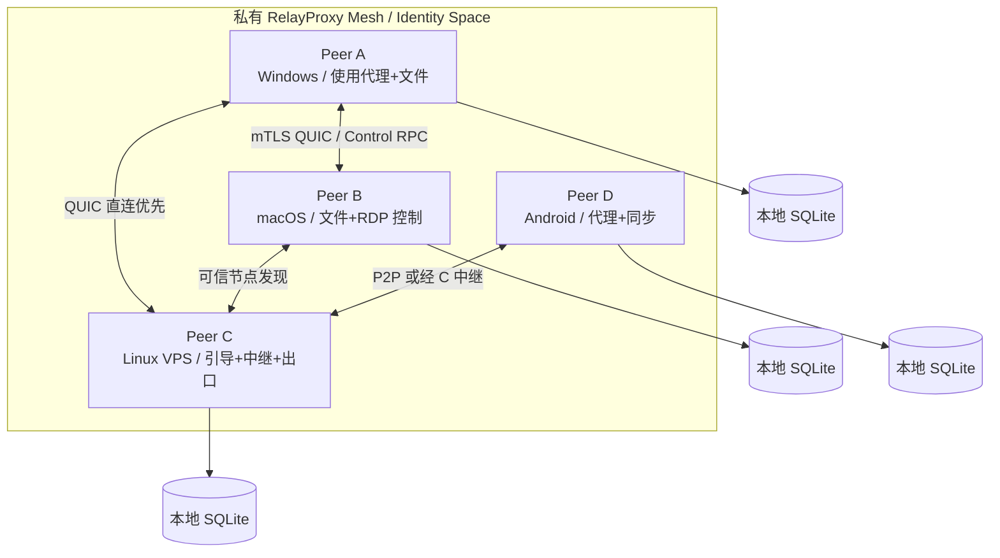
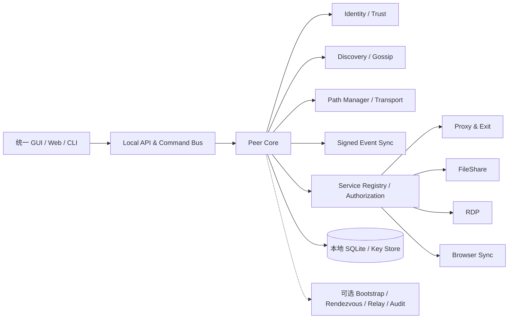
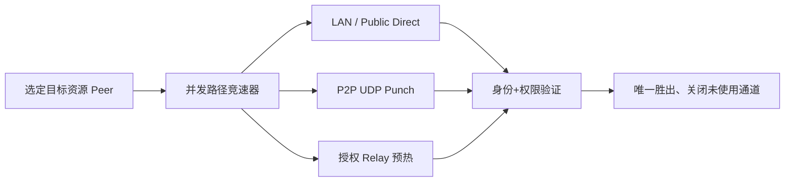
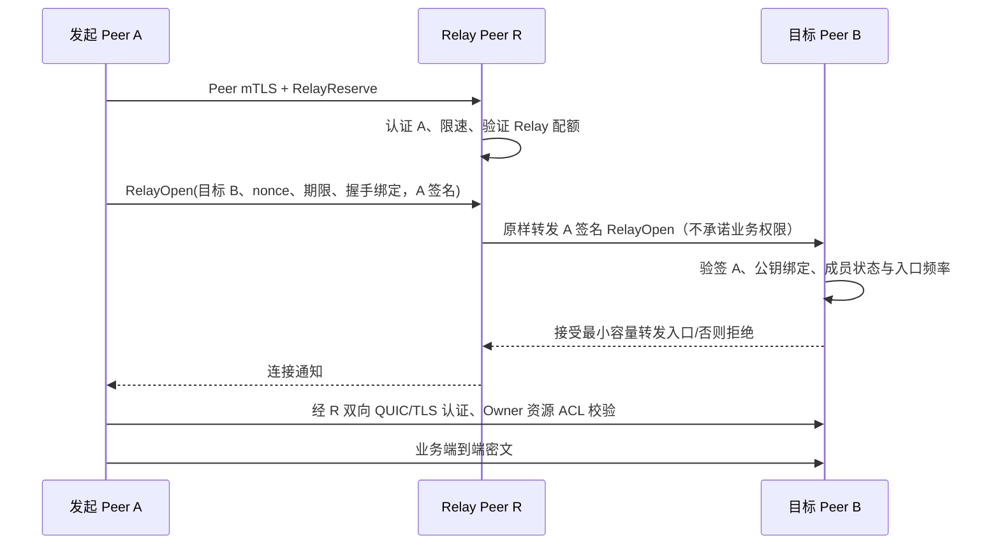

# RelayProxy Mesh — 网络、路径与动态中继设计

> 版本：v1.1（评审响应版） · 日期：2026-10-17
> 文档状态：Design Proposal / 待安全评审、代码盘点和协议冻结
> 文档族按安全/网络/产品迁移三条独立评审线组织；各文档原 § 编号保持可追溯。

- [信任、安全与协议](relayproxy-mesh-security-trust-design.md)
- [Peer 网络、路径与 Relay](relayproxy-mesh-network-transport-design.md)
- [产品、迁移、测试与开发计划](relayproxy-mesh-product-migration-design.md)
- [评审问题回应与后续门禁](relayproxy-mesh-review-resolution.md)

**提示：所有对象模型、表结构和路径都是目标设计，不代表当前 `main` 已实现；R-20 代码依赖盘点尚未完成。**

---

## 3. 目标总体架构



**注意：箭头表达可建立的逻辑关系，不要求维持全连接。** 网络构建策略是按需拨号、必要时稳定保持少量可信邻居连接。

### 3.1 每个 Peer 的逻辑组件



| 层 | 职责 | 不能承担的职责 |
|---|---|---|
| Identity | 本机密钥、身份成员凭证、根信任、撤销状态 | 不能因发现节点就自动授权 |
| Discovery | 发现受信 Peer 的可达线索及服务摘要 | 不能成为权限真相源 |
| Transport | 候选地址、打洞、直连与中继、连接健康度 | 不能修改路由选定的业务目标 |
| Control RPC | 状态同步、服务查询、授权操作、设备操作 | 不直接绕过本地资源 ACL |
| Policy | 成员权限、能力、资源级 ACL、审计 | 不能仅依赖远端声称的状态 |
| Service | 代理、文件、RDP、消息、浏览器会话 | 不依赖连接路径判断是否可信 |
| Storage | 本地密钥引用、事件、缓存、统计 | 不复制设备私钥与敏感本地配置 |

### 3.2 “平等”定义

- **协议平等**：设备使用同一 Peer 协议，任何平台可实现其允许的服务能力。
- **资源不平等**：VPS 可以运行长时中继；手机可能只作为按需客户端。
- **安全权限不平等**：身份根、管理员、资源所有者可授予能力；普通成员不能自动管理别人设备。
- **网络可达性不平等**：公网节点可为 NAT 节点提供协调；不因此自动拥有更高的控制权限。

## 4. 角色和服务能力模型

### 4.1 不再持久化 Server/Agent 角色

目标实体为 `Peer`；服务以 `ServiceAdvertisement` 表达。建议初始能力：

| 能力名称 | 作用 | 默认状态 | 主体授权 |
|---|---|---|---|
| `peer.discovery` | 受限节点发现与目录查询 | 可信连接内开启 | 必须为授权成员 |
| `peer.bootstrap` | 为新节点提供引导入口 | 手动开启 | 限流、无授权权威 |
| `peer.rendezvous` | 地址/候选交换、观察可达性 | 手动开启 | 同网络可信成员 |
| `peer.relay` | 转发端到端密文流量 | 默认关闭 | 双端授权、配额 |
| `proxy.client` | 发起代理 | 按平台配置 | 本机用户授权 |
| `proxy.exit` | 作为远程网络出口 | 默认关闭 | 出口资源 ACL |
| `rdp.host` | 暴露设备 RDP 能力 | 默认关闭 | 目标本地授权 |
| `rdp.connect` | 发起 RDP 访问 | 依设备授权 | 主客体双向检查 |
| `file.share.read` | 下载指定共享目录 | 默认无共享 | 目录级 ACL |
| `file.share.write` | 上传/删除/重命名 | 默认拒绝 | 单独写权限 |
| `browser.sync` | 同步选定浏览器域状态 | 默认关闭 | 配对设备/域授权 |
| `message.publish/subscribe` | 发布/接收消息 | 默认关闭 | 频道/身份授权 |
| `policy.manage` | 修改特定对象授权 | 默认根/委托 | 不能越权提权 |

默认关闭高风险服务；宣传 `ServiceAdvertisement` 不等于赋权。能力命名应设置稳定注册表和版本，不与历史 UI 勾选项硬编码绑定。

### 4.2 服务声明示例（概念结构）

```json
{
  "type": "service.advertise.v1",
  "peer_id": "p_...",
  "identity_space_id": "i_...",
  "services": [
    {"name": "proxy.exit", "version": 1, "scope": "members", "policy_revision": 17},
    {"name": "file.share.read", "version": 1, "scope": "authorized", "resource_count": 2}
  ],
  "endpoint_hint_digest": "sha256:...",
  "created_at": "2026-10-17T00:00:00Z",
  "expires_at": "2026-10-17T00:02:00Z",
  "signature": "base64url:..."
}
```

共享名称、内部路径、出口可访问的私网网段等应按授权分级返回，不应向陌生发现节点广播。
## 7. Peer 发现、寻址与连通性

### 7.1 多层发现

| 层 | 机制 | 使用环境 | 信任原则 |
|---|---|---|---|
| LAN | mDNS / 可选 UDP 广播 | 同一广播域 | 仅发现线索，不能代表审批 |
| 手工 | 设备二维码/邀请 URI、静态地址 | 任意 | 必须完成密钥认证 |
| Bootstrap | 一组可选已知公网 Peer | 公网首连 | 无权代替目标授权 |
| Trusted Gossip | 已连接可信邻居交换受限设备目录 | 跨 NAT、局域网 | 只同步同一授权范围的数据 |
| 历史缓存 | 最后成功端点、网络特征 | 重新连接 | 地址过期和网络变化需重验证 |

V1 不依赖全网广播式 DHT。公网引导节点仅解决“我从哪里联系到至少一个可信节点”，不能变成强制单点。

### 7.2 节点记录

`PeerRecord` 为设备签名、短 TTL 的版本化记录，建议包含：`peer_id`、协议版本、声明的候选端点摘要、可选受信空间标记、支持的服务类别、有效期、记录序列号、设备签名。地址、真实 IP、局域网资源名称需做可见性限制。

- 接收时校验签名、公钥指纹、有效期、最大长度和单 Peer 更新频率。
- 记录更新只接受同一 Peer 的更高序列/合法轮换，拒绝伪造他人 IP 的无签名记录。
- 新地址必须经过实际端到端连通性/身份验证才标记为可用，不能只相信宣告。
- Gossip 应做去重、摘要同步、回退拉取和最大传播度约束，避免无限泛洪。

### 7.3 首次远程连通场景

1. **同 LAN**：设备自动发现邻居；用户完成二维码/指纹信任；直接 QUIC 建连。
2. **不同公网且一侧有公网 IPv4/IPv6**：通过邀请或 Bootstrap 得知可达目标；尝试公网直连，终端校验目标设备身份。
3. **双方 NAT**：双方通过可信可达协调 Peer 交换候选、使用实际打洞 socket 执行 UDP 探测、完成 QUIC 双向认证。
4. **严格 NAT/UDP 不可用**：连接到共同可达的授权 Relay Peer，经 TLS/QUIC 封装端到端业务流。
5. **没有任何共同可达入口**：显示 `UNREACHABLE / NO_RENDEZVOUS`，不可虚假承诺无条件 P2P 成功。

### 7.4 NAT 穿透与地址优先级

候选类型：LAN host、IPv6 global、UPnP/NAT-PMP/PCP 映射（平台与路由器允许时）、server-reflexive、经中继地址。候选选择参考 ICE 思路但不声称 V1 实现了完整 RFC 8445；若要声明 ICE 兼容，需要完成角色冲突、检查列表、连通性验证、重启等全部必要规范。

**候选集合与路径评分分开：** 先验证连通，按延迟、丢包、带宽、失败率、权限和成本排序。典型默认倾向：同 LAN → 已验证公网直连 → P2P UDP → 中继 QUIC → 中继 TLS；对 IPv4-only/IPv6-only 的组合只试双方可达的地址族，避免长时间无效 UDP6 尝试。

### 7.5 路径竞速与选择（R-11）



同一次业务拨号并行启动多个受预算约束的路径候选，而不是先等待直连超时再打洞、最后才尝试 Relay。借鉴 Happy Eyeballs/ICE candidate racing，但不声称实现全部 ICE 标准；中继只能在预认证和容量检查通过后标记 ready，且最终业务接入仍须目标 Peer 的独立身份与 ACL 验证。配置最多并行 3 个候选、每类独立失败冷却和退避；移动端电量/流量敏感时动态缩减。默认可按 150–300ms stagger，实测校准。

**路径选择不更改出口**：所有候选均绑定相同目标 `device_id` 和预期 `peer_id`；从 Relay 升级直连后不能改变流量目的出口。中途网络切换仅对新流自动升级；已有 TCP 连接除非现有可靠流恢复机制被验证，否则不能暗中重放数据。分别统计 `time_to_first_path`、`time_to_secure_session`、`time_to_authorized_service` 作为性能指标，防止只测“UDP 可达”。

## 8. 中继服务设计

### 8.1 Relay 是能力，不是中心；目标 Peer 入口先验签

每台设备可显式开关 `peer.relay`（默认关闭），按身份空间限制并发、速率与配额；只支持单跳，不提供公开匿名中继。



B 在验证 `RelayOpen` 的 A 签名、目标 ID、TTL、nonce 和已知撤销状态之前不得分配昂贵的流状态或接受内层握手。R 只证明传输来源与有配额，不能代表 B 授予任意 Proxy/File/RDP 权限。对未知设备快速拒绝、按身份限速、防重放；允许最小无状态解码/验签成本但禁止放大分配。

### 8.2 可靠的安全边界

- R 必须认证 A，验证目的 Peer 有可达端点或转发许可；B 在**接受 Relay 入口前**即校验 A 签署的 `RelayOpen`，随后内层连接还需双向 TLS 验证和资源 ACL。R 不可向 B 传达未经 B 验证的权限结论。
- R **无法解密内层应用会话**，但可以观测 A/B 的网络地址、连接时间和转发量，应显示元数据披露提醒。
- 只允许在授权设备网络中中继，不提供公开匿名代理端口，也禁止从未经授权用户到任意外网的出口转发。
- V1 **只支持单跳中继** `A → R → B`，避免环路、TTL、路径计费与多层加密协议膨胀。中继的中继、多跳路由列为 P2。
- 请求 R 时不要求 R 拥有目标业务权限；R 只需有转发权，B 控制真正资源权限。
- **拥塞公平（R-13）**：V1 Relay 路径强制禁用 Brutal；启用每会话 token-bucket 速率上限 + per-peer/space 公平队列和最低控制面保留带宽，避免一个上传流饿死其他用户。只有实网公平性通过、隔离限速稳定后才可对 Relay 专门开启其他拥塞算法。

### 8.3 中继选举与回退

中继选择需要输入：`allowlist`、地理和出口约束（可选）、RTT、负载、可用速率、双端可达性、网络成本、故障历史。仅在候选提供者允许当前流量类型时参与打分。

建议评分形态（参数需基准测量）：

```text
score = w1 * normalized_rtt
      + w2 * packet_loss
      + w3 * load
      + w4 * estimated_cost
      + w5 * recent_failure_penalty
```

负载/测量缺失时保守降权；采用最短保持时长、切换滞后和退避，避免节点之间来回跳转。禁止所有 Peer 为每个新连接全网测一遍速度，需限速采样和缓存。

## 附：网络验收入口

完整的网络矩阵与指标见 [产品与迁移 §17.1 / §17.3](relayproxy-mesh-product-migration-design.md)；V1 强制并行竞速、签名 `RelayOpen` 预验签、单跳中继和中继禁用 Brutal。
