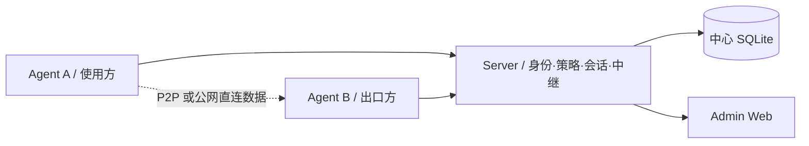
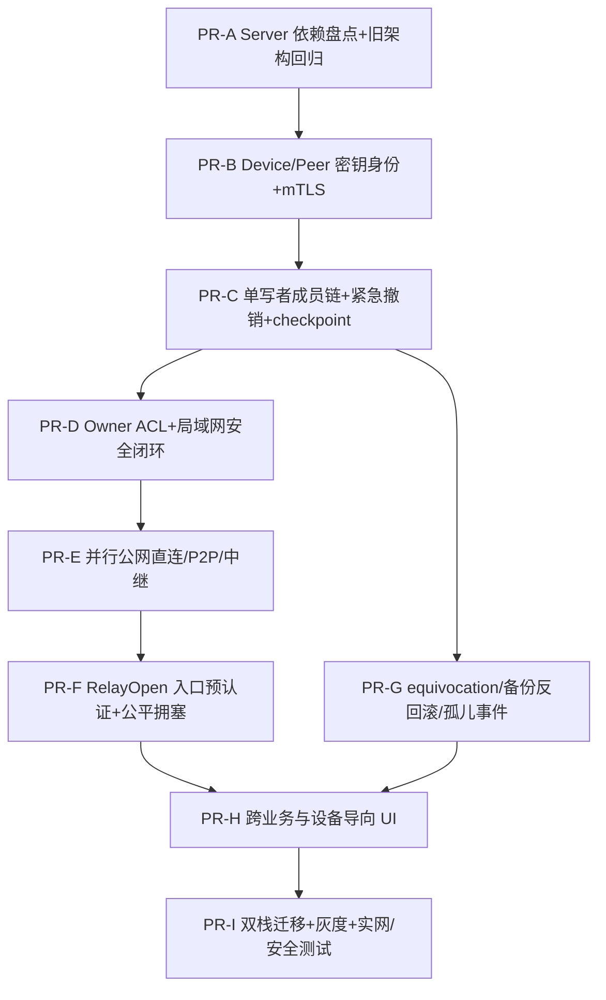

# RelayProxy Mesh — 产品、实现、迁移与验收设计

> 版本：v1.1（评审响应版） · 日期：2026-10-17
> 文档状态：Design Proposal / 待安全评审、代码盘点和协议冻结
> 文档族按安全/网络/产品迁移三条独立评审线组织；各文档原 § 编号保持可追溯。

- [信任、安全与协议](relayproxy-mesh-security-trust-design.md)
- [Peer 网络、路径与 Relay](relayproxy-mesh-network-transport-design.md)
- [产品、迁移、测试与开发计划](relayproxy-mesh-product-migration-design.md)
- [评审问题回应与后续门禁](relayproxy-mesh-review-resolution.md)

**提示：所有对象模型、表结构和路径都是目标设计，不代表当前 `main` 已实现；R-20 代码依赖盘点尚未完成。**

---

## 1. 背景与现状核对

以仓库 `main` 的 `README.md`、`docs/proxy-p2p-direct-path-design.md`、`docs/proxy-public-direct-path-design.md` 为参考基线（2026-10-17 检索）。

### 1.1 当前已描述的基础能力

- Server：设备首次审批、身份归属、跨身份授权、集中 ACL、连接协调、出口发现、Relay、RDP 入口、连接审计、SQLite、Admin Web。
- Agent：SOCKS5/HTTP、进程/域名/IP/端口分流、TCP/UDP、Windows 透明代理、出口处理、本地 GUI/Web、实时监控。
- 传输：TLS/QUIC、P2P QUIC、已设计实现的公网直连 QUIC、Relay QUIC/TLS、路径健康度/回退。
- 扩展中的能力：共享文件夹、设备级读写授权、进度/速率、浏览器状态同步、消息规则、订阅和去广告等。以上功能需要按仓库最新代码逐项核对具体成熟度，**不得仅凭此前设计文档认定均已上线**。

### 1.2 当前架构的中心依赖



即使数据已点对点，某些认证票据、授权版本与路径协商仍依赖 Server。**因此删除 Server 进程不等于实现去中心化。**

### 1.3 必须保持的兼容约束

- 路由命中优先级、代理动作、出口选择、DNS 防泄漏策略及现有目标 ACL 语义不得意外变化。
- 既有持久化设备身份不得无提示轮换；设备私钥丢失时必须重新绑定，而非只复用旧设备 ID。
- 共享文件夹继续由文件所在设备授权；无共享授权的设备不能在文件浏览器中看到共享资源。
- 文件下载原名、断点续传、进度/速率，浏览器会话密文隔离，RDP 目标授权与封禁要求持续成立。
- Windows、macOS、Linux、Android 的本地代理能力保持；Android 后台限制须单独评估。

## 2. 目标、非目标与成功标准

### 2.1 功能目标（MUST）

1. 两台预先完成信任建立的设备在同一 LAN 内，关闭旧 Server 后仍可发现、认证、代理、传输文件、连接 RDP（能力/平台支持时）。
2. 不存在固定的管理/中继主机：任意拥有适当资源和权限的 Peer 可提供引导、协调、出口或中继服务。
3. 一台设备离线不影响其他已连通设备之间合法、未过期的会话；关键授权撤销应能在联通节点间传播并被执行。
4. 每台设备对本地资源具有最终决定权；跨身份能力以可验证、可撤销的授权凭证表达。
5. 支持公网复杂 NAT 情况下借助一个或多个用户允许的引导与中继 Peer，且业务端到端加密，中继不能读取业务明文。
6. 允许从现有 Server/Agent 平滑迁移、断电恢复、回滚；旧客户端在兼容窗口内可继续运行。
7. GUI 以设备为入口，隐藏 Server/Agent 角色，但保留必要的高级网络诊断能力。

### 2.2 质量目标（初始验收门槛，须通过实网基线校准）

| 指标 | 预期目标 | 说明 |
|---|---|---|
| LAN 连接建立 | p95 < 3 秒 | 已信任、网络正常、发现缓存命中；不含人工审批 |
| WAN 直连建立 | p95 < 10 秒 | 采用有界并行候选竞速；至少一个有效信令路径；不同 NAT 单独报告 |
| 中继回退建立 | p95 < 15 秒 | 中继候选与直连并行预热，入口预认证；有授权、可达且容量足够的中继 |
| 旧 Server 不可达 | 核心 Mesh 已建立连接仍可用 | 不因管理面断线强制断开；依权限有效期决定 |
| 已连通撤销推送 | p95 < 5 秒（实验门槛） | 所有相关资源方有健康控制通道、扇出拓扑可达；以接收到有效签名并拒绝新流为准，不适用于分区 |
| 分区撤销安全 | 按资源新鲜度上限 fail closed | 不能承诺离线的资源方立即得知撤销；超过门槛不得开新高危会话 |
| 中继额外明文暴露 | 0 | 中继只能看到必要元数据，不能解密业务负载 |
| 安全回归 | 0 高危未解决项 | 含认证绕过、开放代理、DNS 泄漏与撤销回滚 |
| 兼容/回滚 | 通过全平台矩阵 | 不丢身份、不静默扩大 ACL |

### 2.3 非目标（V1）

- 匿名公共 P2P 网络、任意不可信第三方中继交易市场、区块链共识。
- 通用多跳覆盖网络、出口节点之间的全互联网 BGP/路由表分发。
- 全球规模 DHT、无边界的全 Mesh 广播或所有设备数据库强一致同步。
- 在没有任何公共可达节点、没有 LAN、又无法打洞的双端 NAT 条件下保证连通。
- 让移动平台绕过其后台服务、VPN 权限或系统沙盒限制。
## 11. 既有功能如何迁移到 Mesh

### 11.1 网络出口、SOCKS5/HTTP 与透明代理

- 本地 SOCKS5/HTTP 及系统透明代理继续由本机服务执行；路由规则仍选择 `DIRECT/PROXY/REJECT`。
- `PROXY` 选择明确的目标 `peer_id + exit_service_id`；后续路径决策不得改变出口。
- Exit 所属 Peer 负责认证客户端、执行目标域/IP/端口 ACL，严格防止绕过私网/环回拒绝规则；有上游代理时继续明确解析地点。
- 订阅规则可由本地按现有策略定时拉取，也可由一个被授权的共享配置发布者分发带版本规则包。共享包不自动覆盖设备自定义规则。
- 去广告规则：优先本地执行，允许从可信 Peer 获取签名规则包；不得将每个 DNS 查询变成对远程“策略中心”的依赖。
- 连接监控增加 `route_action`、`exit_peer`、`relay_peer`、`transport_path`、`rule_id`、`dns_source`、`policy_decision`，支持判断为什么命中特定出口或被 REJECT。

### 11.2 文件共享

- 一个共享对应稳定 `share_id`，其根目录与真实路径仅保存在拥有者本机。
- 共享目录列表只向 `file.list` 授权的设备返回；未授权设备既不能浏览也不应看见共享文件夹的元数据。
- 文件操作在目录内部进行，必须做平台路径规范化、符号链接边界限制、文件版本检查、原子写入、磁盘剩余量与权限验证。
- 维持系统文件夹选择弹窗（设备本机 GUI）、拖拽上传、右键菜单、保留文件名、传输速率、进度、暂停/恢复、断点续传、失败重试。
- 大文件传输继续按现有文件直连/P2P/Relay 数据通道实现，不通过 Gossip 分发文件块；支持分块哈希校验与目标变化检测。
- 分离 `file.list/read/write/create/rename/delete` 权限；拒绝写入不能依赖 UI 隐藏按钮。

### 11.3 RDP / 远程桌面

- 设备本地声明 `rdp.host`，发起端拥有 `rdp.connect`，目标端验目标资源授权。
- 默认 LAN/P2P 优先；无法直连时可走经受控中继的加密字节通道，保持既有启动系统远程桌面 App 的交互。
- 公网 RDP 入口由目标 Peer（或它明确授权的 ingress Peer）控制，按时间、来源 IP、身份、速率和最大会话限制。
- 连接审计、来源 IP 判断、IP 地域封禁和手动解封以**实际对外暴露入口**为执行点；转发后来源 IP 不得与中继地址混淆。仅记录可验证源地址，不信任客户端自报 `X-Forwarded-For`。
- 旧的 Windows 登录失败审计功能不应因为本次重构被重新引入。

### 11.4 浏览器扩展与会话同步

- 扩展本身不承担完整系统 Peer 监听服务；可作为受限设备端点（通过浏览器 WebSocket + 身份密钥）或连接本地 Peer 网关，具体以浏览器扩展 API 能力为准。
- 只允许被用户配对且授权的浏览器实例同步指定域的数据；Cookie、LocalStorage、SessionStorage、IndexedDB 按浏览器 API 的能力边界同步。
- 会话明文只能在经授权的源/目标浏览器端处理；普通 Bootstrap/Relay Peer 不持有解密密钥。
- 保留扩展通用代理/分流能力与同步能力的权限分离，不能因可以同步 Cookie 而自动获得 `proxy.exit` 或设备管理权。
- 登录状态并不保证跨设备可无条件复用；服务端设备绑定、IP 风控和 WebAuthn 会限制会话可迁移性，UI 需明确说明。

### 11.5 消息渠道、规则和通知

- 消息渠道属于明确的身份空间及资源所有者，支持 `message.publish` / `message.subscribe` 与精确频道授权。
- 管理员可以发布带签名的默认规则及更新；各终端本地进行验证码/普通消息匹配与弹窗，实现现有多平台通知体验。
- 消息可靠送达采用带 TTL 的本地队列、确认和去重；不要求所有 Peer 都在线，也不把未加密历史同步到所有节点。
- 订阅变更不应让旧设备因权限收紧再次进入“待审批”而意外恢复权限。

## 12. 本地配置与管理 API

### 12.1 Peer 配置提案

```yaml
mesh:
  enabled: true
  identity:
    key_store: system           # system / encrypted_file / external (按平台支持)
    active_space: i_example
  discovery:
    lan_enabled: true
    gossip_enabled: true
    bootstrap_peers:
      - "relayproxy://p_bootstrap@bootstrap.example.com:21000"
    max_neighbors: 8
  transport:
    mode: auto                   # auto / direct_only / relay_only
    quic_listen: ":21000"         # 桌面/服务机可启用
    tcp_fallback: true
    allow_upnp: false
  services:
    relay:
      enabled: false
      max_clients: 16
      max_bandwidth_mbps: 50
      allow_cross_space: false
      congestion_control: fair_bbr_or_cubic # Relay 路径 V1 禁用 Brutal
      per_session_rate_limit_mbps: 10
    rendezvous:
      enabled: false
    bootstrap:
      enabled: false
    exit:
      enabled: false
    file:
      enabled: false
  sync:
    enabled: true
    signed_events: true
    max_checkpoint_staleness_sec: 1800    # 空间范围上限
    resource_risk_defaults_sec:
      low: 1800
      medium: 600
      high: 300
    per_resource_override_sec: {}        # 可只收紧不得放宽空间上限
  admin:
    web_listen: "127.0.0.1:9090"
    remote_management: false

routing:
  mode: rule
  default_action: DIRECT
  default_exit_peer: ""
```

上面的 YAML 是**目标语义草案，不可直接用于当前版本**。迁移器负责从 `server`、`device`、`transport`、`proxy`、`exit`、`web` 等旧字段逐项映射；不识别字段应显示提示而不是静默忽略敏感配置。

### 12.2 Local API（签名事件语义，R-16）

| 接口 | 操作 | 权限 / 语义 |
|---|---|---|
| `GET /api/v2/mesh/peers` | 有权限设备和在线状态 | `peer.view` |
| `POST /api/v2/mesh/invites` | 创建实时/预签 Invite | `member.invite`；公钥 pin、期限、nonce |
| `POST /api/v2/mesh/join` | 入网申请 | Invite 有效、目标成员日志提交 |
| `POST /api/v2/mesh/members/{id}/revoke` | 签发撤销事件 | `revoke_only` 或 Owner 范围内权限 |
| `GET /api/v2/mesh/services` | 可访问服务 | `service.view` |
| `POST /api/v2/mesh/resources/{id}/grants` | **新建不可变 Grant** | 只有资源 Owner；需 `Idempotency-Key` 与 `expected_owner_seq` |
| `DELETE /api/v2/mesh/resources/{id}/grants/{grant_id}` | **签发 revoke tombstone** | 仅 Owner；返回撤销 event_id，不做物理删除 |
| `POST /api/v2/mesh/resources/{id}/policy-proposals` | 提交策略建议 | 有权管理员；**不即时生效** |
| `POST /api/v2/mesh/resources/{id}/policy-commits` | Owner 确认 Proposal | Owner 必须签署；生成新 ACL 事件 |
| `GET /api/v2/mesh/paths/{peer}` | 路径诊断 | `path.view` |
| `GET /api/v2/mesh/sync/status` | Chain/checkpoint/撤销传播状态 | `policy.view` |
| `POST /api/v2/mesh/relay/test` | 授权中继测试 | `relay.manage` |

`POST` 以签名事件 ID 表达幂等结果；`DELETE` 表示**发出撤销**而非删除历史。并发扩权必须带预期 Owner chain head，不匹配返回 `409 CONFLICT`，严禁 API 层静默 LWW。高危 RPC 不支持 0-RTT，Local API 默认回环；远程调用通过 `admin-rpc` 再在目标 Peer 校验 Owner 权限、CSRF/Origin。

### 12.3 统一错误和实时状态

建立统一 `StateBus`（本地事件聚合 + 权限隔离的远程订阅）：设备在线、服务开启/关闭、路径变化、文件传输、审计记录、规则同步均由同一事件机制推送到 Wails/React/Web/Android UI。每种事件声明 `sequence`、`source_peer_id`、`scope`、`timestamp`，客户端断线通过 cursor 恢复；不把任意业务消息广播到所有终端。
## 13. 跨平台产品设计与交互

### 13.1 信息架构：以设备为中心

建议统一导航：

```text
RelayProxy
├── 我的设备
│   ├── 全部 / 在线 / 离线 / 待加入
│   ├── 设备详情
│   │   ├── 概况（连通性、能力、资源、实时流量）
│   │   ├── 网络（出口、路由、路径、诊断）
│   │   ├── 文件（授权共享和浏览器）
│   │   ├── 远程桌面
│   │   ├── 浏览器同步（适用设备）
│   │   └── 访问权限（向谁共享、谁能访问）
│   └── 添加设备（LAN发现 / 扫码 / 邀请码 / 手动地址）
├── 我的共享
│   ├── 网络出口
│   ├── 文件夹
│   ├── 远程桌面
│   ├── 中继服务
│   └── 消息/浏览器数据
├── 网络
│   ├── 代理和分流
│   ├── 节点路径
│   ├── DNS 与安全
│   ├── 规则订阅 / 去广告
│   └── 连接监控
├── 活动
│   ├── 文件传输
│   ├── 连接与访问审计
│   ├── 消息
│   └── 系统日志
└── 设置
    ├── 身份空间与恢复
    ├── 高级发现 / 引导
    ├── 中继与网络监听
    ├── 授权同步与撤销
    └── 关于 / 诊断 / 兼容模式
```

- 不再向普通用户展示“连接 Server”“Server Web”“Agent Web”等核心入口，统一为“本机”“设备网络”“远程设备”。
- 添加设备必须明确区分发现、邀请、等待授权、已加入；未知设备不可自动看见受保护共享。
- 设备卡片只显示其有权查看的能力；离线卡片保留历史信息，但标记最后同步时间，不能当作实时可用。
- 修改远程资源的权限时显示“作用于目标设备”的确认，离线目标则展示“待目标确认/同步”而不是假装修改成功。
- 文件浏览器采用足够大的可调整主面板，支持文件拖放、上传/下载系统文件选择器、右键菜单、批量操作、传输队列和快捷键。
- 连接质量视图明确显示 `LAN / Public Direct / P2P / Relay`、当前中继 Peer、RTT、丢包、速率、失败原因、最后校验时间。
- 安全告警优先展示资源风险：公网监听、跨身份授权、允许访问私网/回环、高风险授权状态过期、撤销未同步，而不是低价值静态说明。

### 13.2 一致的设备操作模型

所有平台使用相同设备/服务 API 和权限词汇；桌面 React + Wails 与 Agent Web 共享设计系统。Android 使用原生 UI 但保持信息架构、状态语义与错误原因一致。

| 平台 | 默认节点模式 | 服务边界 | UI 重点 |
|---|---|---|---|
| Windows | 完整 Peer | WinDivert/系统服务按权限运行；可提供出口/中继 | 本地代理、设备、文件、RDP、实时监控 |
| macOS | 完整 Peer | 系统扩展/VPN 能力依权限和安装方式 | 系统代理、文件、共享、远控 |
| Linux | Headless/桌面 Peer | systemd、开机自启、可公网监听 | 本地 Web、CLI、出口/中继管理 |
| Android | 受系统约束的移动 Peer | VPN Service、后台电源策略、监听受限 | 接入、代理、设备列表、按需共享 |
| 浏览器扩展 | 受限 Mesh 端点或本地网关的应用 | 扩展 API 限制；不承担任意网络转发 | 分流、代理、浏览器数据配对 |

首次安装建议选择“加入现有设备网络”或“创建我的设备网络”；创建后可通过设备页开通出口、共享文件等能力，而非要求用户先架设 Server。

## 14. 代码组织与实现接口

### 14.1 推荐目标目录（待与真实源码树对照）

```text
internal/
  mesh/
    identity/          # Peer ID、成员凭证、密钥轮换、设备撤销
    trust/             # 证书/签名链、跨身份信任验证
    discovery/         # LAN、Bootstrap、Gossip、可见性过滤
    control/           # 握手、RPC、重试、错误模型
    registry/          # 服务与资源声明
    policy/            # ACL、委托、凭证、会话授权
    sync/              # 单写者安全链、revoke-only 覆盖层、快照与分叉证据
    transport/         # 统一连接抽象与会话池
    rendezvous/        # 候选交换与验证
    relay/             # 单跳转发服务、配额与转发日志
    metrics/           # Peer RTT、路径、同步和审计统计
    storage/           # 本地 SQLite migrations 和 repository
  p2p/                # 复用现有 RDP/Proxy P2P 通用原语
  tunnel/             # 复用现有 TCP/QUIC 与业务流抽象
peer/
  runtime/             # Peer Core 生命周期、功能开关
  services/            # exit / proxy / file / rdp / browser / message
  api/                 # Local API 和授权 Remote RPC
  gui/                 # 设备导向 React/Wails 对接
compat/
  legacy_server/       # 旧 Server 协议桥接（迁移期）
  legacy_agent/        # 旧 Agent 配置、设备映射
scripts/
  build.sh
  build.ps1
```

上图是**逻辑目标结构**，不是当前仓库文件清单。应首先在实际代码上完成依赖/引用分析，确定复用 `internal/rdp/*`、现有 TunnelSession、Agent Exit Handler、Agent GUI、Server Web 与数据库迁移的位置。

### 14.2 最小 Go 接口草案

```go
type PeerID string
type SpaceID string
type ResourceID string

type PeerCore interface {
    Start(ctx context.Context) error
    Stop(ctx context.Context) error
    Identity() PeerIdentity
    Services() ServiceRegistry
    DialPeer(ctx context.Context, target PeerID) (AuthenticatedConn, error)
}

type AuthenticatedConn interface {
    RemotePeer() PeerID
    Path() PathDescriptor
    OpenService(ctx context.Context, req ServiceOpenRequest) (ServiceStream, error)
    Close() error
}

type ServiceProvider interface {
    Descriptor() ServiceDescriptor
    Authorize(ctx context.Context, principal Principal, request ServiceOpenRequest) (Decision, error)
    Accept(ctx context.Context, session AuthenticatedConn, request ServiceOpenRequest) error
}

type PolicyEngine interface {
    Evaluate(ctx context.Context, principal Principal, resource ResourceID, action string) (Decision, error)
    ApplySignedEvent(ctx context.Context, event SignedEvent) error
}

type DiscoveryProvider interface {
    Discover(ctx context.Context, space SpaceID) (<-chan PeerRecord, error)
}

type PathProvider interface {
    Kind() string
    Dial(ctx context.Context, target PeerID, hints []EndpointHint) (AuthenticatedConn, error)
}
```

重要约束：`ServiceProvider.Authorize` 由目标 Peer 调用；`AuthenticatedConn` 的远端身份由已验证握手产生，不允许调用方随便填字符串。所有业务服务尽量复用统一流接口。

### 14.3 运行时和进程关系

一个安装可以包含：

```text
relayproxy peer daemon           # 核心后台服务
relayproxy gui                   # 桌面管理进程
relayproxy cli ...               # 命令行
relayproxy peer --headless       # VPS / Linux 服务器运行
```

是否最终合并为一个可执行文件由平台打包方式决定；**统一 Peer Core 并不要求所有 GUI 和后台驱动强行进同一进程**。Windows WinDivert/Network Service 生命周期、系统托盘退出、服务重启、任意改名可执行文件等现存打包边界需做专项回归。

## 15. 旧 Server / Agent 兼容与数据迁移

### 15.1 迁移原则

1. **先兼容，后替换**：旧 `relay-server` 继续服务现有 Agent；新版本 Peer 可启用兼容适配器与旧 Server 通信。
2. **不自动信任旧公开身份 ID**：旧 `identity_id` 只用于查找迁移关系，不能当作新身份空间根证明。
3. **身份映射需签名确认**：旧 Server 管理员确认生成空间根；原设备使用保留的设备私钥对“旧设备 ID ↔ 新 Peer 公钥”绑定挑战签名，新管理员再签发成员凭证。
4. **安全权限只收紧不扩大**：旧 Server 的 Server ACL 与 Exit ACL 要映射为目标本地资源 ACL；不能因为删除 Server ACL 而使 Exit 突然获得更宽的互联网/私网访问权限。
5. **数据原地备份和可审计迁移**：每次迁移有 backup、schema_version、migration_id、差异报告、回滚点。

### 15.2 建议迁移映射

| 旧对象 | 新对象 | 特别注意 |
|---|---|---|
| Server 身份 `identity_id` | `IdentitySpace` + 旧 ID 别名 | 需所有权证明，不直接当根公钥 |
| 安装密钥/设备 ID | `PeerIdentity` + 显式旧 ID 映射 | 私钥丢失必须重新邀请，不复活旧身份 |
| Server 审批设备 | `MembershipCredential` | 由合法管理员签名确认 |
| Server 设备能力勾选 | `ServiceGrant/DeviceCapability` | 不得自动扩大已收紧能力 |
| Server 跨身份授权 | `ResourceGrant` | 明确 owner、subject、scope、expiry |
| Server Relay ACL | 资源所属 Peer 的目标网络 ACL | 取原 Server+Exit ACL 交集后迁移 |
| Server Endpoint 注册/票据 | `PeerRecord` + 目标签发会话凭证 | 旧票据只在兼容通道短期生效 |
| Server Relay | 普通 Peer 上 `peer.relay` | 默认关闭直到管理员确认 |
| Server RDP ingress | 目标 Peer 或受托 ingress 能力 | 防止公网 RDP 意外开放 |
| Server 设备列表 | 受信设备目录 | 未获共享授权的资源不进入 UI |
| Server 审计/日志 | 本地审计 + 受控聚合 | 保留历史记录与导出 |

### 15.3 双栈阶段的授权不变量

迁移中同一资源可能同时经 Legacy Relay 和新 Mesh 路径访问：

```text
EffectiveAllow = LegacyAllow AND MeshAllow   (双策略强制阶段)
```

不能让“走 Mesh”绕过旧 Server 阻止的请求，也不能让“走 Legacy”绕过新的设备撤销。某个策略不可查询或状态冲突时，高风险流量拒绝；低风险已有流量按清晰定义的兼容规则处理。此交集约束在完成资源所有权迁移、旧通道关闭后才解除。

### 15.4 升级/回滚顺序

- **T0 基线**：旧 Server/Agent 固定版本，备份 SQLite 与配置；跑代理、RDP、文件、消息等现有基准。
- **T1 双协议**：先给 Server/VPS 增加 Peer Core 包装，保留旧 API；新端支持并行拨号，不改变业务默认路径。
- **T2 灰度 Mesh**：选择两台设备、相同身份、LAN 首先验证；再测公网 P2P 和中继，所有授权均使用显式迁移凭证。
- **T3 授权切换**：管理员确认授权差异，资源方开启本地最终 ACL；旧 Server 仍可用作引导/中继，但不能成为唯一授权真相源。
- **T4 正式切换**：新版本默认 Mesh，旧 Server 以兼容 Peer 模式服务未升级设备，展示旧客户端数量。
- **T5 移除遗留协议**：仅在兼容窗口结束、旧端升级率达标及回滚测试通过后，单独版本废弃旧强依赖。

**回滚限制**：新 Mesh 期间新增的权限、撤销和根密钥轮换不一定能被旧 Server 理解。若无法将安全事件无损投影回旧 ACL，禁止一键无条件回滚到旧认证；应进入 `SAFE_READONLY` 或完成显式安全迁移，再恢复旧版本。

### 15.5 灰度开关

```yaml
mesh:
  enabled: false
  compatibility:
    legacy_control_enabled: true
    mesh_discovery_enabled: false
    mesh_transport_enabled: false
    mesh_authorization_enforced: false
    shadow_policy_evaluation: true
```

每项逐步开启；`shadow_policy_evaluation` 只比较并记录差异，不得放宽真实权限。停用 Mesh 后旧路径的功能恢复应经过双向一致性验证。

## 16. 实施阶段、PR 拆分与依赖（修复 R-02）

**重要门禁**：P2 期间旧 Server 仍可作为兼容桥启动，但 P2 退出前必须有成员单写者链、签名 revoke-only、撤销 push、基础 checkpoint 与目标 Owner ACL；不允许在缺这些能力时宣称“关掉旧 Server 仍可安全运行”。旧 Server 真正不再是必需控制面后，才能进入公网 P3。

| 阶段 | 交付目标 | 关键工作 | 强制退出门槛 |
|---|---|---|---|
| P0 | 代码真实基线与 ADR | Server 依赖清单；冻结单写者/撤销信任语义；CI Baseline | 代码依赖逐调用链签收、P0 ADR 安全评审、旧功能回归 |
| P1 | Peer Core + TLS 身份 | `device_id`/`peer_id`、Ed25519 mTLS、成员链、Owner ServiceRegistry、SQLite Schema | 双端身份向量、协议拒绝测试及 DB 迁移通过 |
| P2 | **安全的无 Server LAN Mesh** | mDNS、配对、**单写者成员链 + revoke-only + push + checkpoint + Owner Local ACL**、LAN 代理/文件/RDP | 关闭 Server 后可运行且撤销/回滚测试通过；高风险状态过期 fail closed |
| P3 | 公网 Mesh/动态中继 | 并行候选竞速、Bootstrap 多元观察、P2P、公网直连、RelayOpen 预验签、Relay 公平限速 | NAT/失联/eclipsing/中继 DoS、公网实验室矩阵通过 |
| P4 | 安全增强与恢复 | Equivocation proof、孤儿事件 buffer、跨重启反回滚、受控密钥轮换、多空间冲突 | S-01～S-24 与安全审查通过；不能晚于发布默认启用 |
| P5 | 业务、UI 与审计 | 设备导向界面、文件、消息、浏览器、远程管理、可选审计镜像 | Owner-only 管理、未授权资源隐藏、日志篡改提示跨平台回归 |
| P6 | 兼容迁移与上线 | 双栈 ACL 交集、身份映射、数据迁移、回滚、72h 负载 | 全部发布门禁通过、无未解决高危项 |

### 16.1 推荐 PR 顺序与不可逆门禁



PR-D 前的任何无 Server demo 都只是实验协议，不可对外宣称满足高危资源授权；`mesh.enabled=true` 默认值必须等 PR-I 的所有发布门禁通过后变更。尽量先抽象共用包，再迁移目录，避免纯重命名导致难以审查的巨大差异。

## 17. 测试、验收与故障注入

### 17.1 核心场景矩阵（必须自动化/留存实网报告）

| ID | 场景 | 网络 | 预期 | 级别 |
|---|---|---|---|---|
| T-01 | 两设备信任建立后关闭旧 Server | 同 LAN IPv4 | 可互认证与访问授权代理/文件/RDP | P0 |
| T-02 | LAN 发现关闭，使用静态 Peer 地址 | 同 LAN | 不依赖广播，可手动连接 | P0 |
| T-03 | 只有一端 IPv6、另一端 IPv4-only | 混合地址族 | 不盲拨不通的 IPv6；按真实可达路径回退 | P0 |
| T-04 | 两端有可访问公网端口 | 不同 WAN | 公网直连 QUIC、验目标身份 | P0 |
| T-05 | 普通 NAT UDP 打洞 | WAN/NAT | 经授权协调交换候选，P2P 成功可用 | P0 |
| T-06 | 对称 NAT、CGNAT、UDP 严格限制 | WAN/NAT | 不能打洞时单跳 Relay 可用；没有 Relay 明确失败 | P0 |
| T-07 | Relay Peer 中途退出 | WAN | 安全回退/重连，不换业务目标 Exit | P0 |
| T-08 | Bootstrap Peer 退出 | 任意 | 现有合法连接不依赖 Bootstrap 长驻；新发现按备用路径处理 | P0 |
| T-09 | 同身份设备文件授权读/写分离 | LAN/WAN | 只读不能写；未授权目录完全不可见 | P0 |
| T-10 | 下载大文件与断点续传 | LAN/WAN/Relay | 原名保留、哈希校验、速率/进度准确 | P0 |
| T-11 | RDP Host 入口与来源 IP 限制 | 公网 | 未授权设备和禁止 IP 无法建立会话 | P0 |
| T-12 | 透明代理 DNS / UDP / QUIC 边界 | Windows/Android | 不出现意外直连 DNS 泄漏；策略保持一致 | P0 |
| T-13 | Cookie/Storage 同步目标失联 | WAN | 密文保护，离线重试/到期规则准确 | P1 |
| T-14 | 订阅规则从远端可信 Peer 获取 | WAN | 正确签名校验/版本/代理获取，不扩大出口授权 | P1 |
| T-15 | 节点重装或长期密钥丢失 | 任意 | 不自动复用旧安全身份；必须重新邀请 | P0 |
| T-16 | 同一 Peer 同时加入两个身份空间 | 任意 | 身份、权限、共享与管理界面数据严格隔离 | P0 |
| T-17 | 浏览器扩展无法后台持续运行 | 浏览器 | 恢复后重连、不依赖扩展承载中继 | P1 |
| T-18 | Android 系统杀后台/VPN 重启 | Android | 状态透明、按系统权限恢复，不宣称始终在线 | P1 |
| T-19 | Windows 托盘退出/快速重启 | Windows | 驱动/服务释放、再次启动不锁文件 | P0 |
| T-20 | 升级、数据库恢复、回滚 | 全平台 | 数据不丢、权限不扩大、可追踪异常 | P0 |

### 17.2 安全负向测试矩阵

| ID | 攻击/故障注入 | 必须结果 |
|---|---|---|
| S-01 | 未知 Peer 伪造 `peer_id` | 握手拒绝 |
| S-02 | 重放旧邀请、旧成员签发消息 | 拒绝、记录审计 |
| S-03 | 被撤销设备用旧证书+缓存入口 | 资源方收到撤销后拒绝，超期拒绝 |
| S-04 | 旧授权事件晚于撤销事件到达 | 不恢复旧权限 |
| S-05 | 多管理员尝试并发扩大同一资源授权 | 非 Owner/非写入者事件拒绝，不进入物化 ACL |
| S-06 | Relay 篡改/注入业务数据 | 端到端校验失败 |
| S-07 | Relay 试图替代目标 Peer | 端到端身份绑定失败 |
| S-08 | 未获文件共享权却尝试 `file.list` | 不泄漏共享资源和目录元数据 |
| S-09 | `../`、符号链接、大小写别名路径逃逸 | 拒绝，防止越出共享根目录 |
| S-10 | DNS 重绑定到 loopback/RFC1918 地址 | 目标 Exit 二次 ACL 校验拒绝 |
| S-11 | 客户端伪造 RDP 原始 IP / HTTP 头 | 不接受不可信原始来源声明 |
| S-12 | 恶意 Peer 无限 Gossip/巨大事件 | 限流、断开、内存有上限 |
| S-13 | 客户端发送协议未知安全扩展 | 失败关闭，不静默跳过 |
| S-14 | 旧 Server ACL 拒绝、新 Mesh ACL 允许 | 双栈迁移时仍拒绝 |
| S-15 | 本地时间大幅偏移 | 进入安全恢复/时间校验流程，不忽略过期 |
| S-16 | 导入旧快照后再接受旧权限 | tombstone/checkpoint 防回滚或进入安全锁定 |
| S-17 | 普通成员调用高危远程管理 RPC | 目标 Peer 拒绝 |
| S-18 | 应用层 QUIC 0-RTT 发送删除/授权操作 | 不受理可重放敏感操作 |
| S-19 | 成员写入者对同 prev_hash/seq 双签不同事件 | 产生 EquivocationProof、暂停其扩权、审计告警 |
| S-20 | 收到依赖缺失的孤儿 grant；恶意海量 orphan | 有界 pending，超时丢弃，未证实授权绝不生效 |
| S-21 | 仅一个被攻击 Bootstrap 声称“无撤销” | 高风险资源不得凭单源陈述放行；eclipse 告警 |
| S-22 | Relay 转发未由 A 签名或重放的 RelayOpen | B 在分配会话资源前拒绝 |
| S-23 | 旧 Peer key 被盗后尝试冒充已 rekey 的 device_id | Key Binding epoch 检查拒绝；跨空间 grant 不自动迁移 |
| S-24 | 资源 Owner 接收管理员签署的 PolicyProposal | 不改变 ACL，必须 OwnerPolicyCommit 才生效 |

### 17.3 长时和性能验收

- 72 小时以上至少 4 Peer 混合稳定性；其中包括公网 VPS、Windows IPv4-only、macOS、Android；记录断线次数、CPU/RAM/FD、连接队列、延迟与 QUIC 退避行为。
- 使用 TCP 大文件、UDP/视频、RDP 输入延迟、并发代理请求开展直连与单跳 Relay 对照；明确记录网络基线及 TLS/QUIC 配置。
- 至少模拟 1%/3%/5% 丢包、50/100/200ms RTT、带宽受限、网络切换、IPv6 不可达、端口映射改变和 NAT rebinding。
- V1 Relay 路径**必须禁用 Brutal**并实施 per-session 限速与按设备/空间公平队列；测试并发多流 TCP+UDP+RDP 的 p95 延迟、最大占用和饥饿情况。直连路径可保留经过压测的拥塞算法，但不得将直连拥塞参数不加限制地传到 Relay。
- 对有限设备网络（如 5/20/50 Peer）测发现传播、每秒控制流量、事件冲突率、缓存占用，作为是否需要更复杂路由/分发机制的依据。

### 17.4 发布门禁（Go/No-Go）

所有 P0 场景、S-01 至 S-24、安全审计中的高危项、撤销传播/eclipsing 与 Relay 公平指标、旧客户端兼容、数据库升级/回滚、多平台安装包验证通过，才能使 `mesh.enabled=true` 成为默认。不得仅凭单元测试通过或单次 P2P 成功就默认移除旧 Server。

## 18. 可观测性、运维与隐私

### 18.1 必备遥测字段

| 分类 | 字段 | 用途 |
|---|---|---|
| Peer | `peer_id`, `space_id`, `trust_state`, `last_seen` | 判断设备是否真正在线/已授权 |
| Session | `session_id`, `service`, `resource_id`, `auth_revision` | 追溯是哪种资源权限接纳连接 |
| Path | `path_kind`, `relay_peer_id`, `endpoint_family`, `rtt_ms`, `loss` | 为什么用了 Relay 或无法打洞 |
| Policy | `decision`, `reason`, `checkpoint_age`, `event_id` | 诊断撤销/授权冲突 |
| Sync | `cursor`, `pending_events`, `chain_head`, `revocation_digest`, `checkpoint_signer`, `checkpoint_age`, `independent_observers` | 判断链头/撤销新鲜度、Eclipse 风险 |
| Transfer | `bytes`, `speed`, `progress`, `resume_count`, `checksum` | 文件下载监控 |
| Audit | `source_peer`, `source_ip_at_ingress`, `operation`, `result`, `prev_audit_hash`, `signed_batch_id`, `mirror_ack` | 本地篡改迹象与可选外送见证 |

**审计可信度边界（R-15）**：过去的 Server 可作为集中汇聚观察点；Mesh 的 Owner/Exit 若被完全攻破，可以删除尚未外送的本地日志。本机 hash-chain 只能防事后无痕编辑，不能证明日志一定完整。可选 `audit` Peer 接受签名分批 append-only 外送，按每来源 `prev_audit_hash + batch_seq` 记录和回执，支持多镜像以降低单点篡改风险；对被攻破节点的发生前未外送事件**仍无法提供强完整性保证**。不得将本地审计宣传为绝对防篡改。

隐私要求：默认不上传到第三方遥测平台；日志脱敏私钥、邀请令牌、Cookie、会话能力票据、完整 URL 参数；保留时间可配置，用户可导出本地诊断包。诊断包导出时二次确认并默认移除高敏感字段。

### 18.2 运维参数与容量

- Bootstrap/Relay VPS 必须支持服务健康检查、文件描述符上限、UDP/TCP 监听、防火墙与 TLS/QUIC 参数检查。
- Relay 为每设备、每身份空间设置峰值带宽、并发、流量配额、空闲超时；负载过高时显式拒绝新会话，不能挤占控制消息或本地管理服务。
- 移动端根据电量、网络类型及后台状态关闭不适合的主动探测，不要在蜂窝网络大量周期 Gossip。
- 本地数据库启用完整事务、定期备份、版本升级、事件保留与 WAL 维护；定期压缩不能删除仍必需的撤销证据。
- 磁盘满、证书过期、系统时钟异常、根密钥不可用时进入清晰的降级状态，不允许静默放行未知 Peer。

### 18.3 推荐可观测状态分级

```text
HEALTHY         可正常连接和执行授权
DEGRADED        部分路径失败，但存在可用安全回退
POLICY_STALE    授权状态过旧，高风险新连接受限
SYNC_CONFLICT   有待解决的安全性状态冲突
UNREACHABLE     没有有效的直连/中继路径
REVOKED         已被身份空间或资源所有者撤销
LEGACY_ONLY     仅能经旧 Server/Agent 协议连接
```

UI 应区分“设备离线”“没有权限”“节点可发现但不可建立安全连接”“中继额度不足”“策略状态过期”，不要把所有错误汇总成“正在连接”。

## 19. 主要风险、退路与待决策问题

### 19.1 风险与应对

| 风险 | 影响 | 预防/缓解 |
|---|---|---|
| 设备离线时撤销不可即时传播 | 旧成员短暂仍可访问离线资源方 | 短期许可、按风险定义状态新鲜度门槛、UI 警示 |
| 没有可达 Bootstrap 或 Relay | 跨公网的 NAT Peer 无法连接 | 可配置多个可信入口，LAN 直连与静态地址保底 |
| 管理员双签或离线并发扩权 | 权限分叉、误授权 | V1 单写者链、Owner 独占授权、EquivocationProof、默认拒绝 |
| 双栈授权语义不一致 | 越权访问或意外断流 | 新旧策略取交集、shadow diff、灰度和回滚门禁 |
| 旧设备密钥与新身份绑定错误 | 身份冒用/孤儿设备 | 签名挑战、管理员确认、旧 ID 映射审计 |
| Android 后台限制 | 设备不稳定在线、中继不可持续 | 移动端轻量模式、前台服务/系统允许范围操作 |
| 中继成本或被滥用 | 带宽费用、DOS、滥用代理 | 默认关闭、配额、可见源、拒绝公开中继 |
| 文件系统授权绕过 | 任意文件读取/写入 | 严格路径归一化、目录句柄/沙盒策略、负向测试 |
| 架构过度复杂 | 开发延期、维护成本陡增 | V1 不做全球 DHT/多跳/强一致全库复制 |
| 根密钥恢复失败 | 身份空间不可恢复 | 恢复包/多管理员委托、明确灾难恢复演练 |

### 19.2 需要正式评审的事项（不阻碍起草实现计划）

1. **身份根恢复方式**：V1 仅离线加密备份，还是实现预登记多恢复钥；建议先备份与管理员委托，阈值恢复放到 P2 安全评审。
2. **离线风险级别**：RDP、文件写入、跨空间出口的安全检查点最大陈旧度如何配置；建议优先安全、提供精确可见的服务降级。
3. **发现隐私**：LAN mDNS 默认是否开启，未知设备只能见到哪些匿名化信息；建议默认受限发现。
4. **跨身份委托**：是仅按 Peer 授权，还是支持整个受限群组；建议 V1 具体 Peer 优先，避免群组权限扩散。
5. **协议编码**：选择长度前缀 protobuf + 字节级签名还是规范化 CBOR；应由 Go/Android 跨语言向量和现有依赖情况决定。
6. **中继开放策略**：家用 PC 是否允许自动成为中继；建议默认关闭，由明确授权者开启并限制配额。
7. **历史审计归属**：旧 Server 日志作为只读历史，还是迁移为可按来源 Peer 检索的汇总；建议历史只读归档，新的事件归属各 Peer。
8. **旧客户端兼容期限**：应根据实际设备版本分布和双栈实现成本确定，不在设计阶段杜撰强制日期。

## 20. 交付清单与验收定义

### 20.1 设计阶段交付（本文件承担的内容）

- [x] 统一 Peer Core、服务能力及总体系统架构
- [x] 身份根、设备身份、入网、邀请、撤销与跨身份授权
- [x] Bootstrap、LAN 发现、Gossip、NAT 穿透、Public Direct 与单跳 Relay
- [x] 会话安全、最小授权、可验证撤销和分区边界
- [x] 控制协议、消息模型、版本兼容原则、RPC API 草案
- [x] 签名事件同步与本地 SQLite 逻辑表设计
- [x] 代理/文件/RDP/浏览器/消息业务迁移映射
- [x] 设备导向 GUI / Android 生命周期和文件浏览器交互
- [x] 新旧协议灰度、双栈授权不变量与回滚约束
- [x] 分阶段 PR 拆分、性能基线、安全与网络验收矩阵
- [x] 依据评审 R-01～R-19 修正信任/撤销/协议/路径/数据库/审计/API 并拆成专题文档
- [ ] R-20：完整实际源码调用链、文件路径和复杂度盘点，不能仅凭 README/旧设计推断
- [ ] 安全团队/维护者确认 ADR 与风险接受范围
- [ ] 代码逐模块盘点：现有结构、函数依赖、迁移复杂度估算
- [ ] 锁定网络/协议字段和跨语言签名测试向量

### 20.2 开发完成的 Definition of Done

- [ ] 用户可以在没有安装独立 Server 的情况下创建身份空间、邀请第二台设备并建立可信连接。
- [ ] 在同一 LAN 关闭所有旧 Server，已授权代理、文件访问、RDP 等在适用平台上可用。
- [ ] 在 WAN/NAT 环境中允许配置任意授权 Peer 作为引导、中继、出口；失败回退遵守目标设备与权限不变原则。
- [ ] 撤销、根轮换、并发 ACL 变更、分区恢复、旧状态回滚均有可复现的测试证据。
- [ ] 用户界面没有强制 Server/Agent 角色；设备详情作为功能管理入口，跨平台权限显示一致。
- [ ] 旧版设备迁移无静默提权、无身份混淆、无意外公开端口；备份与回滚门禁可验证。
- [ ] 所有 P0 网络矩阵、安全负向测试、完整安装包及实网稳定性验证通过后，才默认启用 Mesh。

---
## 21. 附录：接口安全约束与参考资料

### 21.1 不可违反的工程不变量

1. `device_id` 是稳定逻辑标识、不是权限证明；`peer_id` 必须由**当前有效** Ed25519 公钥的规范化域分离指纹推导，设备密钥轮换后必须验证 Key Binding 与 key_epoch，不由远端字符串声明决定。
2. 未授权设备不得查询共享文件夹、远程桌面、出口私网信息及浏览器会话内容。
3. 路由规则选择的出口只能由路由层改变，Transport 不得静默替换。
4. Relay 只提供密文字节转发；目标 Peer 始终进行业务授权检查。
5. `DIRECT` 永远表示本机直接访问最终目标，与“直连到远端 Exit”严格区分。
6. 收到合法 `revoke_only` 或 Owner 签名撤销后的旧 grant、旧 snapshot、旧 ticket 不得重新生效；普通管理员不能通过 PolicyProposal 修改 Owner ACL。
7. 无法验证的管理委托、未知关键协议字段、安全事件冲突，全部 fail closed。
8. Android 与浏览器扩展能否长期监听由平台约束决定，不作为其他设备必须在线的依赖。
9. 跨身份空间同步遵循最小披露；设备已发现不等于可见可访问。
10. 在完全网络分区时，对尚未得知撤销的 Peer 无法承诺即时生效；通过短期授权与显式降级控制风险。

### 21.2 参考与现有仓库文档

- RelayProxy `README.md`：https://github.com/timwai/RelayProxy/blob/main/README.md
- RelayProxy `docs/proxy-p2p-direct-path-design.md`：https://github.com/timwai/RelayProxy/blob/main/docs/proxy-p2p-direct-path-design.md
- RelayProxy `docs/proxy-public-direct-path-design.md`：https://github.com/timwai/RelayProxy/blob/main/docs/proxy-public-direct-path-design.md
- QUIC Transport, RFC 9000：https://www.rfc-editor.org/rfc/rfc9000
- QUIC TLS, RFC 9001：https://www.rfc-editor.org/rfc/rfc9001
- ICE NAT Traversal, RFC 8445：https://www.rfc-editor.org/rfc/rfc8445
- EdDSA/Ed25519, RFC 8032：https://www.rfc-editor.org/rfc/rfc8032
- HPKE, RFC 9180：https://www.rfc-editor.org/rfc/rfc9180

> **声明**：RFC 是协议设计参考，不代表当前 RelayProxy 已完整实现 ICE、HPKE 或全部扩展。具体算法、库、线协议和安全证明需在协议冻结与安全审查阶段定稿。

### 21.3 建议下一步立即开展的工程任务

**R-20 状态：待真实代码盘点，不能标记为已解决。** 首先创建一份面向 `main` 实际代码的 **Server 依赖清单**，逐条标注 `身份/审批`、`路径协调`、`短期凭证`、`集中 ACL`、`审计`、`数据库`、`Web 管理`、`代理/文件/RDP/浏览器业务` 的调用链；再开 P0/P1 两个独立 PR：一个只补全旧架构基线测试和可视化能力清单，另一个实现可单独启动、尚不对旧功能产生影响的 Peer Core 框架。优先验收“**双设备、无 Server、LAN、双向身份认证、访问本地共享资源**”这条最小闭环，基础签名成员链、撤销 push 与 Owner ACL 是 LAN 闭环的前提；成功后再进入公网，随后深化 equivocation / 密钥恢复等安全增强。
