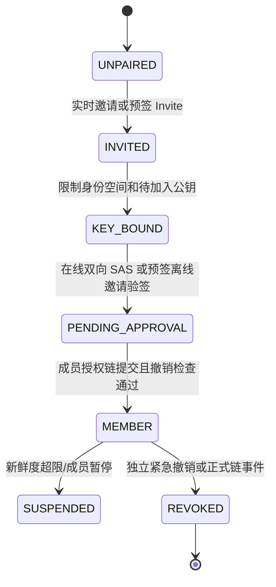
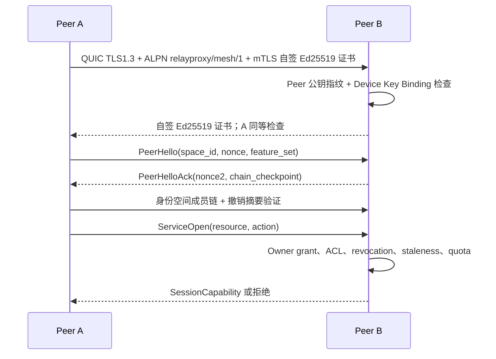

# RelayProxy Mesh — 信任、安全与协议设计

> 版本：v1.1（评审响应版） · 日期：2026-10-17
> 文档状态：Design Proposal / 待安全评审、代码盘点和协议冻结
> 文档族按安全/网络/产品迁移三条独立评审线组织；各文档原 § 编号保持可追溯。

- [信任、安全与协议](relayproxy-mesh-security-trust-design.md)
- [Peer 网络、路径与 Relay](relayproxy-mesh-network-transport-design.md)
- [产品、迁移、测试与开发计划](relayproxy-mesh-product-migration-design.md)
- [评审问题回应与后续门禁](relayproxy-mesh-review-resolution.md)

**提示：所有对象模型、表结构和路径都是目标设计，不代表当前 `main` 已实现；R-20 代码依赖盘点尚未完成。**

---

## 5. 身份体系、设备密钥与加入流程

### 5.1 术语与标识（v1.1）

| 对象 | 目标字段 | 权威含义 |
|---|---|---|
| Identity Space | `space_id` | 身份空间根公钥摘要；与登录名/旧 identity_id 无关 |
| Identity Root | `root_public_key` | 离线最终恢复锚，用于根轮换/恢复，不参与平日每次撤销 |
| Device | `device_id` | 创建时生成的稳定随机 128/256 位逻辑设备 ID；不是权限证明，不能单独鉴权 |
| Peer Key | `peer_id` | 当前有效 Ed25519 公钥域分离 SHA-256 指纹；密钥轮换后变化 |
| Key Binding | `device_key_binding` | 签名地将 `space_id + device_id + peer_id + key_epoch` 绑定，接受方校验完整信任链 |
| Member | `membership_credential` | 单写者授权链中已提交的有效成员凭证 |
| Revoke-Only Delegate | `revoke_only_credential` | 根/有权授权方预先签发；仅能撤销成员与委托，不能新增成员或扩大授权 |
| Space Writer | `membership_log_writer` | V1 每空间唯一当前成员授权链写入者，按前一提交 hash 串行追加 |
| Resource | `resource_id` | 一份资源；只能由指定 `owner_device_id` 实质管理 ACL |
| Grant | `grant_id` | Owner 签发的不可变授权事件 ID，按设备/资源/动作限定 |
| Trust Checkpoint | `checkpoint` | 根或有效空间写入者对最新链头、已知撤销集合摘要的签名锚 |

同一设备可加入多空间；`device_id` 表示逻辑设备，`peer_id` 表示**当前有效密钥**。验证权限时必须把稳定 `device_id` 映射为有可信 `key_epoch` 的最新 `peer_id`；仅知道 `device_id` 不构成身份认证。V1 每空间单写者只负责**扩大权限的串行管理**，不垄断拒绝/撤销通道。长期签名 Ed25519；连接 TLS1.3/QUIC；相关二进制签名输入需域分离。

### 5.2 信任根、紧急撤销和密钥轮换

- 新建身份空间生成离线根密钥并提供加密恢复包；推荐通过受系统硬件支持的密钥库保护设备密钥。
- 根将 `membership.write` 委托给一个当前空间写入者（可经有根签名的 `writer.rotate` 更换），再预先向**至少两个不同设备/管理者**签发有过期日的 `revoke_only` 委托。
- 任何仍有效的 `revoke_only` 管理者可独立签 `member.revoke`、`delegation.revoke`、`device_key.revoke`，包括撤销其他管理员。撤销证明构成单调集合，节点一经验证立刻拒绝受影响凭证，**无须等待根、空间写入者或全链同步**。其能力不能批准设备、签 Grant、轮换根或撤回已有撤销。
- 为控制被盗 `revoke_only` 管理员造成的 DoS，其凭证限定 `space_id`、操作集合、可选目标范围、过期日；根恢复/新 epoch 必须显式重建成员和信任，不能在原 epoch 对同一撤销做 LWW 反转。
- `membership.write` 不能越权修改其他设备资源的 ACL；策略 proposal 只是意图，资源 Owner 确认并签发自己的 Grant/Revocation 后才改变资源权限。
- 若旧设备密钥仍安全，密钥更新需**旧密钥、新密钥双方签名 + 有效管理员认可**；若旧密钥已泄露/丢失，须先撤销旧密钥，再通过独立的管理员确认或人工 SAS 重新绑定 `device_id`。不可仅凭旧私钥完成可能已泄露的恢复。
- 已签发给 `device_id` 的 Grant 可在新的可信 Key Binding 上继续使用，但 Owner 可设置 `require_regrant_on_rekey`（RDP/文件写入建议 true）；跨空间 Grant 由 Owner 重新确认，禁止默认跨越安全空间迁移。
- 根密钥及一切恢复材料丢失时不能仅凭公开 ID 取回空间；需要建立新空间逐台重新信任。

**V1 不提供无锚点的多写者 DAG 成员管理。**紧急撤销覆盖层是只减权的特例，不可用于提交普通新增授权。

### 5.3 新设备加入与预签邀请



**在线模式**：管理员和新设备交换身份公钥，双向 SAS 确认，空间写入者将签发事件追加当前链头，然后发放成员凭证。若当前写入者离线，用户可以等待或启动有根授权的写入者恢复流程；不能让多个离线管理员各自“乐观写入”。

**预签模式（R-18）**：新设备先在本机生成密钥，向管理员提供 `peer_id` / 公钥二维码；管理员可离线签一个明确绑定 `space_id + target_peer_id + device_id + actions=join + expires_at + nonce` 的 Invite。邀请并非有效成员凭证，设备后续通过任意可达可信节点提交给空间写入者串行入链，且验证单次使用、撤销、时间有效性及公钥持有证明。若只能获得通用预签邀请码（未绑定公钥），仍必须在线进行独立身份核验，不得直接批准成员。

邀请重放防护使用永久消耗记录、限制速率和明确的有效期；所有邀请凭证都必须限制所允许的初始权限。

### 5.4 成员凭证（示意）

```json
{
  "schema": "mesh.membership.v1",
  "space_id": "i_...",
  "device_id": "d_...",
  "peer_id": "p_...",
  "key_epoch": 1,
  "device_public_key": "ed25519:...",
  "roles": ["member"],
  "can_delegate": false,
  "issued_by": "p_membership_writer...",
  "issuer_grant_id": "g_writer...",
  "not_before": "2026-10-17T00:00:00Z",
  "expires_at": "2027-10-17T00:00:00Z",
  "credential_id": "m_...",
  "issuer_signature": "base64url:..."
}
```

成员凭证只有在写入者的**线性成员日志中被提交**，且未命中独立紧急撤销集合时才有效；它属于长期**身份**证明，不代表拥有 `proxy.exit`、RDP 或文件权限。具体访问仍需每个资源单独授权和服务端实时检查。

### 5.5 跨身份空间授权

- 保留现有跨身份资源共享场景：目标资源所属 Peer 签发针对另一个空间中具体 `peer_id` 或受限组的 `ResourceGrant`。
- 同一身份空间的成员也不能凭“成员”身份越过资源默认拒绝策略；可提供可显式开启的“同空间默认可使用普通出口”模板，但必须逐台审计。
- 禁止把跨身份空间的高权委托进一步无约束转授。
- 跨空间发现只允许显示授权资源摘要，不能暴露所有成员及私网拓扑。

## 6. 权限与安全模型

### 6.1 本地最终授权、Owner 与 Proposal 权限

```text
Allow = PeerMutualTLSKeyBinding
     AND ValidSpaceMembershipOrCrossSpaceTrust
     AND DeviceCapability
     AND SignedOwnerResourceGrant
     AND OwnerMaterializedLocalACL
     AND TargetNetworkPolicy
     AND RevocationAndFreshnessChecks
     AND ServiceConstraints
```

**唯一 ACL 写者**：每个资源绑定一个 `owner_device_id` 和当前已验证的 `owner_peer_id`；只有 Owner 可签发扩权 `grant.issue`、修改资源 ACL 或删除资源。管理员仅可签署 `PolicyProposal`，由 Owner 在线确认后签发 `OwnerPolicyCommit`；合法的撤销委托可单向撤销成员/管理委托，但不能以“代理管理”名义扩大任一资源 Grant。`grant` 是不可变签名证据；本地 ACL 表是从 Owner 签名日志物化的受版本约束视图，物化视图与证据相冲突则拒绝。资源 Owner 被撤销时，其服务立刻停止接纳新会话，直到可信重归属流程完成。

Relay 的身份认证或签名票据不代替最终资源 Peer 审核。网络出口和文件系统 ACL 仍由承载资源的 Peer 本地执行。

### 6.2 授权对象（ResourceGrant）

```json
{
  "schema": "mesh.grant.v1",
  "grant_id": "g_...",
  "space_id": "i_...",
  "owner_device_id": "d_owner...",
  "owner_peer_id": "p_owner...",
  "subject": {"type": "device", "id": "d_reader...", "required_key_epoch": 2},
  "resource": {"type": "file_share", "id": "share_photos"},
  "actions": ["file.list", "file.read"],
  "constraints": {
    "expires_at": "2026-11-17T00:00:00Z",
    "max_sessions": 2,
    "max_bandwidth_bps": 20000000
  },
  "policy_revision": 18,
  "issued_by": "p_owner...",
  "prev_grant_event_id": "sha256:...",
  "signature": "base64url:..."
}
```

Owner 签发的 Grant 仅是证明；实际可执行 ACL 为 Owner 事件经过验签、撤销和单写者版本检查后构成的本地物化视图。写权限与读权限必须显式分离；`file.delete`、`file.rename` 建议独立授权。目录 ACL 作用域应绑定 `share_id` 及规范化后的子路径，防止路径穿越、符号链接逃逸和大小写/Unicode 路径歧义。

### 6.3 会话能力票据：替代中心 Server 签发

V1 采用目标资源方签发的短期会话许可，避免永久依赖一个在线的签发中心：

1. 访问方出示已认证的成员凭证及资源授权证明。
2. 资源所有者本地验证成员链、授予者委托、撤销事件、访问策略。
3. 目标 Peer 返回短期 `SessionCapability`，绑定 `subject_peer_id`、`target_peer_id`、资源、操作、会话 ID、连接握手摘要和策略修订。
4. 客户端在原连接或经中继建立的目标连接上提供能力票据；目标方验证防重放字段后开放业务流。
5. 目标权限变化或本地禁用资源后，立即拒绝新流并按策略结束已有流；票据过期不能被缓存复用。

连接本身采用双向身份验证，短期票据**不能**代替传输层认证。敏感 RPC 禁用 TLS/QUIC 0-RTT 可重放业务操作。旧版 Server 签名票据只在兼容模式下验收，不可默默转换为永久 Mesh 权限。

### 6.4 撤销传播、新鲜度与反回滚

**事件权威**：成员授予/委托扩大沿唯一 `membership.write` 线性 hash-chain 提交；`member.revoke`、`delegation.revoke`、`device_key.revoke` 允许任何持有效 `revoke_only` 权限的设备**独立签名**，形成只减权并集；Owner 资源 Grant 同样采用 Owner 单写线性事件链，Owner 可发 `grant.revoke`。合法的撤销 tombstone 在同 epoch 永不被旧 Grant 覆盖。

**传播路径（R-03）**：每个撤销通过已认证控制通道立即 push，邻居按 message_id 去重并有界向不同邻居转发（fanout 建议 3、hop TTL ≤ 6、重试上限与限流）；资源方在建立高风险新会话前向**至少两个独立、可信且可达的邻居/Bootstrap**拉取最新撤销摘要/签名 checkpoint，不能仅信单个候选 Peer 的“最新”断言。小于两个独立源时不能假装达到新鲜度保证：短期允许已有安全会话依据资源策略继续，高风险新会话按资源的新鲜度门槛 fail closed。固定公共引导不可成为唯一撤销源，避免 Eclipse 攻击；要求独立运营域/拓扑多样性、随机邻居轮换和证据冲突告警。

**质量目标的边界**：`p95 < 5s` 仅在签名撤销可通过健康控制拓扑触达目标资源方的试验集下测试，测的是资源方完成验证并拒绝新流。网络分区、资源方与撤销域失联无法保证 5 秒或即时撤销。RDP、文件写、跨空间出口等建议策略陈旧上限 300 秒（默认样例，评审后校准）；普通只读建议 1800 秒；每资源可覆盖且不能高于身份空间最大上限。

**时钟和回滚（R-07）**：在线进程以 monotonic clock 记录距离最近一次验证同步的经过时长；签名 checkpoint 由有效的空间成员写入者（或根）签发，含链头、已知撤销摘要、签名者及 epoch。跨重启/从备份恢复时不能把 wall-clock 当作防回滚权威：优先使用硬件可信单调计数器（若平台真实支持）；否则将最大观察 checkpoint hash/epoch 持久保存在系统保护存储并在重启后请求独立可信邻居验证，无法验证时高风险资源 fail closed。系统 Keychain 本身**不等价于硬件单调计数器**。异常时钟影响过期验证时进入安全状态，而非延长签名凭证寿命。

**撤销抗回滚**：checkpoint 和 tombstone 在事务中先验证、后持久化并更新物化 ACL。备份导入必须对比当前可信最高链头和撤销集合；孤立旧备份若不能获得可信新鲜证明，只允许可明确证明安全的低风险读取，默认拒绝新的高危操作。

### 6.5 威胁模型

| 威胁 | 防护措施 | 剩余风险 |
|---|---|---|
| 未知 Peer 伪造身份 | 密钥身份、挑战绑定、双端确认、成员凭证 | 人为错误批准设备 |
| 被攻破的中继 | 端到端加密、目标侧 ACL、流量配额 | 中继仍可见流量时间与规模、做拒绝服务 |
| 盗取设备 | 密钥安全存储、撤销、短期能力票据、最小权限 | 撤销传播期间旧权限窗口 |
| 重放邀请/授权/流请求 | 单次邀请、nonce、过期、序列号/重放缓存 | 时钟严重偏差需恢复流程 |
| 旧状态回滚 | 签名事件、版本检查、撤销 tombstone、可信 checkpoint | 所有副本同时丢失最新状态时需恢复确认 |
| 错误开放代理 | 出口本地 ACL、私网/回环默认拒绝、来源约束、限速 | 配置误用须 GUI 显示警告 |
| SSRF/内网跳板 | 目标解析后再次校验 IP、DNS 重绑定防护 | 特殊协议须专项审计 |
| DNS/QUIC 泄漏 | 沿用本地分流、防泄漏与 DNS 选项；分平台实测 | 应用 DoH/IPv6/WebRTC 边界 |
| 拒绝服务 | 握手预鉴权限制、资源配额、黑名单、速率限制 | 公网节点持续受到流量攻击 |
| 浏览器同步数据泄漏 | 端到端密文、域名范围/设备配对、密钥隔离、敏感字段策略 | 浏览器 API 本身的限制 |
| 管理 Web 被远程访问 | 默认回环监听、身份会话、CSRF/Origin 校验、可选受控远程 RPC | 用户主动公开管理端口 |
## 9. Peer 控制协议与通信契约

### 9.1 协议分层与版本

建议目标协议族：

```text
relayproxy/mesh/1
  ├── peer-handshake/1
  ├── discovery/1
  ├── membership/1
  ├── policy-sync/1
  ├── service-registry/1
  ├── session-admission/1
  ├── rendezvous/1
  ├── relay/1
  ├── admin-rpc/1
  └── business/{proxy,file,rdp,browser,message}/N
```

**兼容原则**：协议协商用明确 `major/minor/features`；不理解安全必需字段不得忽略并继续放行；未知非安全可选字段可跳过。老 Server 隧道和新 Mesh 隧道必须显式区分，禁止默认降级到不完整认证。

### 9.2 双向 QUIC TLS 身份绑定（明确单方案，R-08）

**V1 唯一支持的方案**：每台设备使用当前有效的长期 Ed25519 公钥签发自签 X.509 证书，双方 TLS1.3/QUIC 均请求并校验证书。Go 端在 `tls.Config.VerifyPeerCertificate`（同时审查 QUIC 中恢复握手回调行为）或等价 `VerifyConnection` 中解析叶证书、限定 Ed25519 公钥、计算 `peer_id = lowerBase32(SHA256(utf8("relayproxy/mesh/peerid/v1") || byte(0x00) || raw_ed25519_public_key))`，并与业务预期 Peer ID、最新 Device Key Binding 一致。禁止在 `InsecureSkipVerify` 开启后仅比较对端自报的 `peer_id` 字符串；如果 Go 自定义校验需要设置该选项，必须有覆盖**每次**实际握手的强制 pin 校验测试，禁用会跳过证书校验的恢复路径。

两端分别校验证书持有证明和对方长期密钥；证书有效期和撤销的权威来自**签名的 Device Key Binding + Membership + Revocation**，单靠公钥 Pin 不构成空间成员权限。V1 对 Mesh 控制流关闭 TLS session resumption/0-RTT，避免不同路径上的身份恢复语义不一致。证书格式、PEM 编码、散列/拼接规则、签名输入和错误码在协议冻结时发布 Go/Android 双端测试向量。



### 9.3 消息封装（示意）

```proto
message MeshEnvelope {
  uint32 protocol_major = 1;
  uint32 protocol_minor = 2;
  string message_type = 3;
  bytes sender_peer_id = 4;
  bytes identity_space_id = 5;
  bytes message_id = 6;
  uint64 actor_sequence = 7;
  int64 issued_at_ms = 8;
  int64 expires_at_ms = 9;
  bytes payload = 10;
  bytes signer_key_id = 11;
  bytes signature = 12;
}
```

规范化签名输入建议为域分离的**原始确定性 payload 字节**与头部字段，接收端验签原始字节而非重新序列化（避免跨语言对象重编码歧义）。具体编码可采用长度前缀 protobuf/CBOR，但必须固定字节级签名规则，发布向量测试，并设消息体/嵌套深度/数组长度限制。

**必须有的控制消息**：

| 类别 | 消息 | 幂等/安全要求 |
|---|---|---|
| Handshake | `PeerHello`, `PeerHelloAck` | nonce、身份绑定、版本协商 |
| Discovery | `PeerRecordPush`, `PeerRecordQuery` | 设备签名、短 TTL、可见性 |
| Membership | `JoinRequest`, `MemberIssued`, `MemberRevoked` | 邀请一次性、委托链验证 |
| Service | `ServiceAdvertise`, `ServiceQuery` | 只展示有权查询的数据 |
| Policy | `EventDigest`, `EventPull`, `EventBatch`, `Checkpoint`, `RevokePush`, `EquivocationProof` | 内容寻址、链头或撤销并集、签名、分叉告警 |
| Session | `SessionOpen`, `SessionGrant`, `SessionDeny`, `SessionClose` | 资源 ACL、反重放、配额 |
| P2P | `RendezvousOffer`, `CandidateUpdate`, `ConnectivityResult` | 不信任声称的公网端点 |
| Relay | `RelayReserve`, `RelayOpen`, `RelayClose` | RelayOpen 由 A 签名，B 先验签再开放入口；单跳 TTL |
| Admin | `PolicyProposal`, `OwnerPolicyCommit`, `AuditQuery` | Proposal 不改变授权；只有 Owner Commit 生效，可审计 |

### 9.4 重放保护与错误语义

- `message_id` 为不可预测值；控制端在有界窗口内去重并设最大每 Peer 消息速率。
- `actor_sequence` 用于检测同一签发者异常回退；不能单独证明全局新鲜度。
- 所有高风险消息应校验时间范围、目标 Peer、身份空间、资源和当前策略 epoch。
- 断开/重试保持命令幂等；涉及 `file.delete` 等操作使用资源版本前置条件（如 ETag/expected_revision）。
- 拒绝码区分 `NOT_MEMBER`, `REVOKED`, `UNAUTHORIZED`, `POLICY_STALE`, `RESOURCE_OFFLINE`, `NO_ROUTE`, `RELAY_DENIED`, `RATE_LIMITED`, `PROTOCOL_UNSUPPORTED`；对未知 Peer 避免泄漏敏感资源是否存在。

## 10. 分布式状态同步和持久化

### 10.1 数据按所有权分类

| 数据 | 真相源 | 同步策略 |
|---|---|---|
| 本机设备密钥/密钥保护设置 | 本机安全存储 | 绝不传播明文私钥 |
| 本机监听、驱动、系统代理、私有文件路径 | 本机 Peer | 不自动跨设备覆盖 |
| 成员关系/管理员委托 | 身份空间根及合法委托签发者 | 签名事件/快照按需同步 |
| 资源 ACL/共享目录权限 | 资源所属 Peer | 签名事件 + 资源本地最新态 |
| 服务声明/候选端点 | 发布该服务的 Peer | TTL 缓存/更新 |
| 路由规则、DNS/去广告订阅 | 规则所属设备/指定共享策略对象 | 可选版本化订阅和受限复制 |
| 文件内容 | 文件所属设备 | 按授权文件读写协议，不全量 Gossip |
| 浏览器 Cookie/Storage | 配对终端 | 端到端密文按需同步，不经过普通目录 Gossip |
| 实时连接/指标/审计 | 事件产生 Peer | 本地为主，授权订阅/汇总，可配置保留 |
| UI 主题、窗口/筛选偏好 | 本机 | 可选弱一致同步 |

### 10.2 V1 单写者事件链、紧急撤销并集和孤儿缓冲

**两种权限事件流，禁止混用：**

1. **扩权/常规管理（线性）**：每 `space_id` 有唯一有效 `membership_log_writer`；`member.issue`、`delegation.issue`、`writer.rotate` 等写入单一 `prev_event_hash + seq + chain_epoch` 哈希链。每资源 Owner 也单写 `grant.issue` / `grant.revoke` 线性链。客户端只采纳从已知可信 checkpoint 链头能验证的连续事件；不能凭更大时间戳选赢家。
2. **仅减权紧急撤销（集合）**：持根签发 `revoke_only` 委托的管理员可独立签发 `member.revoke`、`delegation.revoke`、`device_key.revoke`，即便空间写入者离线；按 `event_id` 合并的增量集合覆盖所有旧 Grant/成员状态。该集合只减权且不可由普通单写者事件删除；写入者恢复时把当前撤销摘要锚入下个 checkpoint。

事件字段：`event_id`（规范化 payload 的内容摘要）、`space_id`、`scope`、`chain_id`、`chain_seq`、`prev_hash`、`writer_epoch`、`actor_device_id`、`actor_peer_id`、`event_type`、`target_id`、`created_at`、`body`、`signature`；紧急撤销允许 `chain_id = revoke_overlay` 且不依赖 `prev_hash`，但必须验证委托及有效期。完整消息结构是**目标协议草案**。

**孤儿事件缓冲（R-10）**：缺 `prev_hash` 或上游委托证明时先写入有限 `mesh_pending_event`（每空间最多 1000 条 / 8 MiB，全局 32 MiB，最长 10 分钟，按来源速率限制），标记 `PENDING_DEPENDENCY` 并按摘要请求缺失依赖；不得提前物化权限/打开服务。超过额度或超时丢弃并审计。仅对外拒绝当前未证实的扩权；安全撤销在其必要委托可验证后立刻生效，缺委托时不盲信也不忽略告警。

**Equivocation（R-06）**：若同一有效写入者/Owner 对相同 `space_id + chain_id + writer_epoch + chain_seq + prev_hash` 签出两个不同事件哈希，生成包含两份完整签名事件的 `EquivocationProof`。核实后将该密钥标为 `COMPROMISED_SUSPEND`，停止接受其后续**扩权**和相关新高危会话，传播证明，交由离线根/可信恢复流程重建写入者链头。单纯网络丢包、事件晚到不是 equivocation，必须是确凿双签证据。旧已签有效资源操作受当前撤销和新鲜度策略约束。

接收流程：先结构/长度限制 → 验签及证书 Key Binding → 检查 scope、写者或 revoke_only 委托 → 检查链前置/孤儿缓冲 → 在同一 SQLite 事务写事件、checkpoint、tombstone 并更新物化视图 → 有界推送订阅者。备份恢复必须对照最新已信任锚，不能导入旧 snapshot 扩大 ACL。

### 10.3 管理员离线并发边界（R-04/R-05/R-06）

V1 允许多个管理员发出**仅撤销**安全事件；普通成员扩权只能由当期单写者提交，资源扩权只能由资源 Owner 提交。其他管理员离线时可生成待批准的 `PolicyProposal`，但不能作为签名 Grant 提前生效。若唯一写入者长期失联，必须借助事先授权的 writer 切换/根恢复流程重建链；不能自封新管理员。

不同 Owner 的资源事件可独立并行，单个 Owner 资源链始终线性。对同一序列位置出现签名分叉视为可证明的 equivocation，不采用“最新时间戳覆盖”。**DAG、多写者离线授权和任意 CRDT ACL 明确不进入 V1。**

### 10.4 v1.1 SQLite 逻辑表（R-09，须先完成迁移映射校验）

```sql
CREATE TABLE mesh_device (
  device_id TEXT PRIMARY KEY,
  display_name TEXT NOT NULL,
  last_seen_ms INTEGER
);
CREATE TABLE mesh_peer_key (
  peer_id TEXT PRIMARY KEY,
  device_id TEXT NOT NULL,
  public_key BLOB NOT NULL,
  key_epoch INTEGER NOT NULL,
  key_binding_event_id TEXT NOT NULL,
  status TEXT NOT NULL,
  FOREIGN KEY (device_id) REFERENCES mesh_device(device_id)
);
CREATE TABLE mesh_identity_space (
  space_id TEXT PRIMARY KEY,
  root_public_key BLOB NOT NULL,
  trust_epoch INTEGER NOT NULL,
  settings_json TEXT NOT NULL
);
CREATE TABLE mesh_membership (
  space_id TEXT NOT NULL,
  device_id TEXT NOT NULL,
  active_peer_id TEXT NOT NULL,
  credential BLOB NOT NULL,
  trust_state TEXT NOT NULL,
  latest_membership_event_id TEXT NOT NULL,
  PRIMARY KEY (space_id, device_id)
);
CREATE TABLE mesh_security_event (
  event_id TEXT PRIMARY KEY,
  space_id TEXT NOT NULL,
  scope TEXT NOT NULL,
  chain_id TEXT NOT NULL,
  chain_seq INTEGER,
  prev_hash TEXT,
  writer_epoch INTEGER NOT NULL,
  event_type TEXT NOT NULL,
  actor_device_id TEXT NOT NULL,
  actor_peer_id TEXT NOT NULL,
  body BLOB NOT NULL,
  signature BLOB NOT NULL,
  applied_ms INTEGER NOT NULL,
  UNIQUE(space_id, chain_id, writer_epoch, chain_seq, prev_hash)
);
-- 验证事务还须按 (space_id, chain_id, writer_epoch, chain_seq) 检测非空/NULL prev_hash 的双签，并保留冲突双方原始字节。
CREATE TABLE mesh_equivocation_proof (
  proof_id TEXT PRIMARY KEY,
  space_id TEXT NOT NULL,
  actor_peer_id TEXT NOT NULL,
  first_signed_event BLOB NOT NULL,
  second_signed_event BLOB NOT NULL,
  verified_ms INTEGER NOT NULL
);
CREATE TABLE mesh_resource_grant (
  grant_id TEXT PRIMARY KEY,
  space_id TEXT NOT NULL,
  resource_id TEXT NOT NULL,
  subject_space_id TEXT NOT NULL,
  subject_device_id TEXT NOT NULL,
  owner_device_id TEXT NOT NULL,
  actions_json TEXT NOT NULL,
  policy_revision TEXT NOT NULL,
  signed_grant BLOB NOT NULL,
  signature BLOB NOT NULL,
  status TEXT NOT NULL,
  revoked_event_id TEXT,
  expires_at_ms INTEGER
);
CREATE TABLE mesh_service (
  service_id TEXT PRIMARY KEY,
  space_id TEXT NOT NULL,
  owner_device_id TEXT NOT NULL,
  owner_peer_id TEXT NOT NULL,
  capability TEXT NOT NULL,
  visibility TEXT NOT NULL,
  advert BLOB NOT NULL,
  expires_at_ms INTEGER NOT NULL
);
CREATE TABLE mesh_pending_event (
  event_id TEXT PRIMARY KEY,
  space_id TEXT NOT NULL,
  source_peer_id TEXT NOT NULL,
  reason TEXT NOT NULL,
  event_blob BLOB NOT NULL,
  received_ms INTEGER NOT NULL,
  deadline_ms INTEGER NOT NULL
);
CREATE TABLE mesh_revocation_tombstone (
  space_id TEXT NOT NULL,
  target_id TEXT NOT NULL,
  revocation_event_id TEXT NOT NULL,
  issued_by_peer_id TEXT NOT NULL,
  PRIMARY KEY (space_id, target_id, revocation_event_id)
);
CREATE TABLE mesh_trust_checkpoint (
  space_id TEXT NOT NULL,
  chain_id TEXT NOT NULL,
  chain_head TEXT NOT NULL,
  writer_epoch INTEGER NOT NULL,
  revocation_digest TEXT NOT NULL,
  signer_peer_id TEXT NOT NULL,
  signature BLOB NOT NULL,
  verified_at_ms INTEGER NOT NULL,
  PRIMARY KEY (space_id, chain_id, chain_head)
);
CREATE TABLE mesh_path_health (
  space_id TEXT NOT NULL,
  peer_id TEXT NOT NULL,
  path_type TEXT NOT NULL,
  path_key TEXT NOT NULL,
  metrics_json TEXT,
  PRIMARY KEY (space_id, peer_id, path_type, path_key)
);
```

`trust_state` 不再存在全局 `mesh_peer` 单值，而是 `space_id + device_id` 下的成员信任状态。`mesh_security_event`、`mesh_resource_grant`、`mesh_service` 都有 `space_id`；Grant 保存原始签名及 `revoked_event_id`。`UNIQUE` 只是常规去重/基础链完整性约束；需要专用事务逻辑检测同 seq 冲突并保留两份 equivocation 证据，不能只因唯一键冲突便丢弃恶意分叉。实际迁移之前需补 FK/索引、存储加密方案、space 删除的级联语义和负载实测。

### 10.5 一致性和数据保留

- 缓存服务声明过期即不可用于新连接；已建立连接应继续按会话和权限状态检查。
- 安全事件优先 push 紧急撤销，再按能力拉取最新签名 checkpoint 和连续成员授权链，最后才同步服务目录摘要；不能用单点 Gossip 的“已最新”声明作为高危操作放行依据。
- 事件拉取分页并做总大小限制；可按资源作用域过滤，避免将不相关身份空间元数据传播给其他 Peer。
- 审计事件按本地保留策略归档，跨设备聚合仅复制管理员有权读取的内容；审计清除必须留有可选择的删除操作记录。
- 支持加密导出成员凭证与配置，导入旧快照需进行最低可信检查点验证。

## 附：安全验收入口

完整负向测试清单见 [产品与迁移 §17.2](relayproxy-mesh-product-migration-design.md)；必须包含 `S-01` 至 `S-24`。正式冻结前发布 mTLS key pin、签名事件、撤销覆盖层的二进制测试向量，并由 Go 与 Android 实际实现交叉验证。
